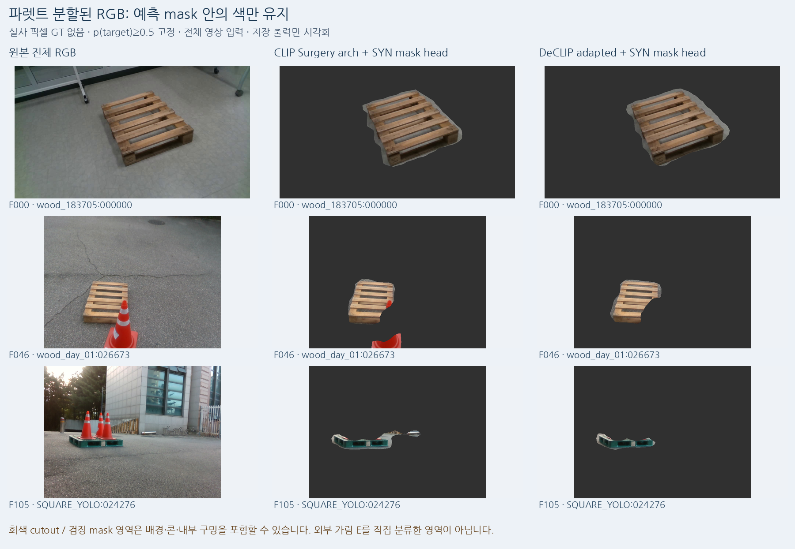
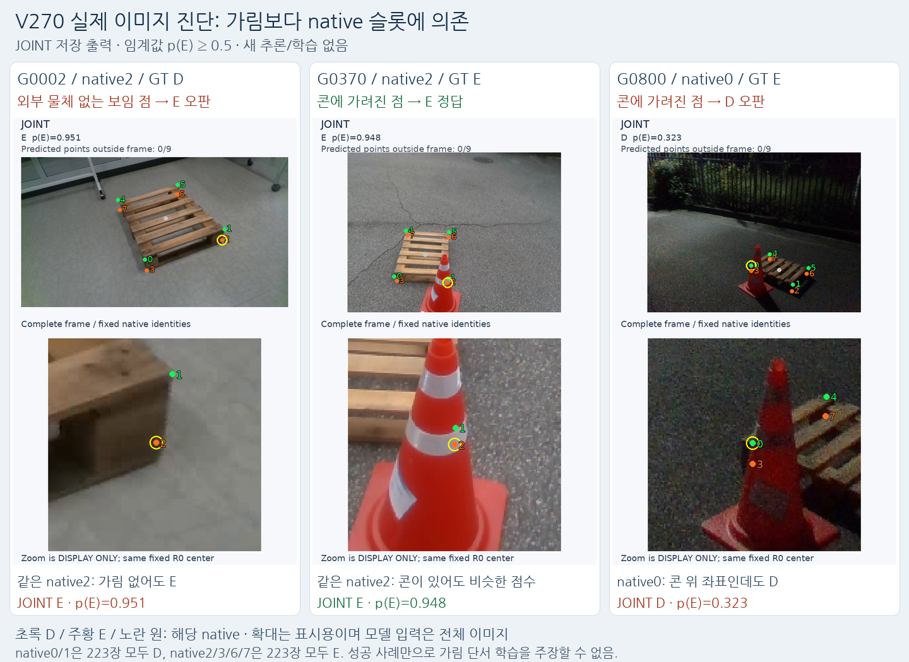
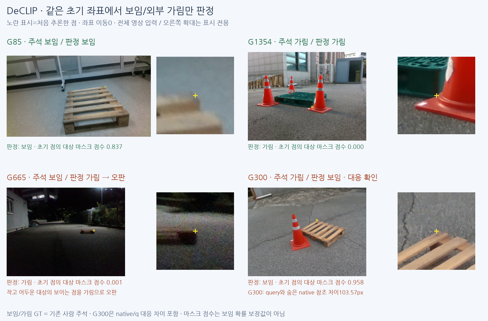
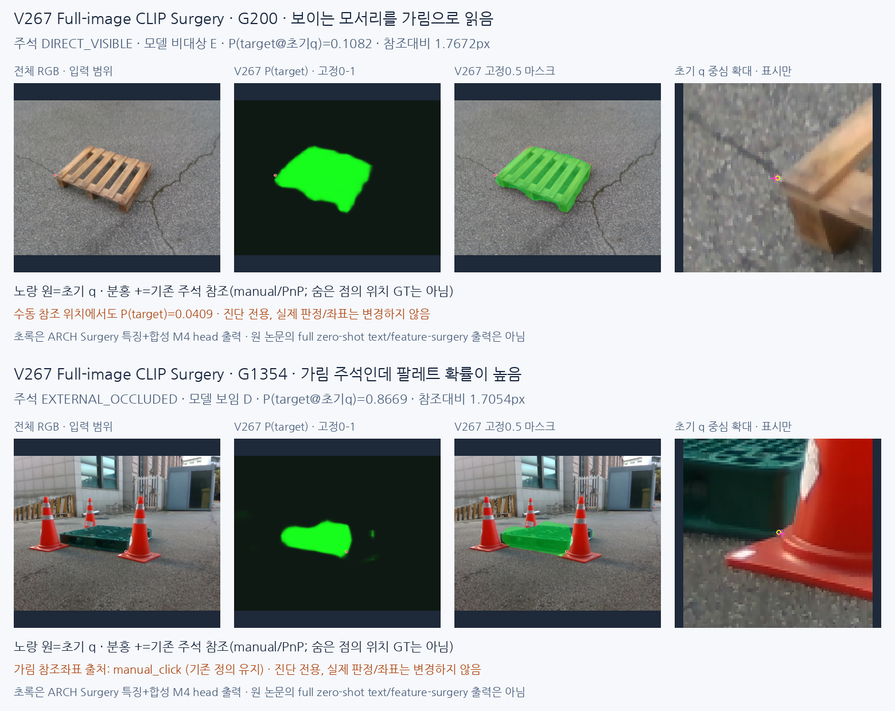

## V271 — 팔레트 segmentation과 KP별 가림 판정 전체 시각 비교

같은 실사에서 일반 CLIP / Surgery / DeCLIP의 **흑백 팔레트 마스크·팔레트만 남긴 RGB·확률 지도**와 각 KP의 정답·오판을 나란히 볼 수 있습니다. 대표10장×5분할 모델, 실사223장×8점×10방법 전체 표, 목재/정사각형·KP번호별540행 지표와 실제 합성 M4 GT 대조를 묶었습니다. 새 학습·모델 추론·PnP·문턱 변경0입니다.

KP 공동 모델의 번호 사전값 의존, 분할의 거친 경계·외부 물체 오포함, 기존 query와 native 가림 정답의 위치/의미 차이가 서로 다른 문제임을 보여줍니다. 실사 마스크는 예측이며 pixel GT/IoU가 아닙니다. 모든 CLIP 빨간 칸을 픽셀 분할 오류라고 해석하지 않습니다.

[장면·분할 종류·KP를 바꿔 보는 전체 비교](V271_KP_CLIP_SEGMENTATION_VISUAL_COMPARISON/README_KO.md) · [분할 마스크 원본](V271_KP_CLIP_SEGMENTATION_VISUAL_COMPARISON/artifacts/V271_KP_CLIP_SEGMENTATION_VISUAL_COMPARISON/segmentation_atlas/INDEX_KO.html) · [223장 전체 점 검색](V271_KP_CLIP_SEGMENTATION_VISUAL_COMPARISON/artifacts/V271_KP_CLIP_SEGMENTATION_VISUAL_COMPARISON/kp_comparison/POINT_MODEL_COMPARISON.html) · [공개 저장 자료 재현 검증](V271_KP_CLIP_SEGMENTATION_VISUAL_COMPARISON/PUBLICATION_SAVED_REPLAY_VERIFICATION.json)

## V270 — 초기 KP 위치·가림 공동 학습 빠른 확인

**공동 출력은 구현했지만 이번300회 pilot은 가림 판정을 개선하지 못했습니다.** 가림만→공동 학습에서 보임 오판511→471, 외부 가림 누락51→59입니다. 새 모델은 채택하지 않습니다. strict D=0 교사 선택으로 아래쪽 native2/3/6/7의 보임 학습 표본이 모두0개가 됐고 실사223장 전체에서 이 네 슬롯을 가림으로 출력했습니다. 합성 슬롯 사전값만으로도 DEV 균형 recall72.40%, 공동73.09%로 비슷해 영상 단서 학습을 주장할 수 없습니다.

전체 RGB640, frozen backbone/neck 위 기존 KP shared stem와 새 E head를 위치만/가림만/공동 각300회 학습했습니다. 새 학습은 합성768장뿐이고 실사223장은 동결 후 반복 개발 평가만 했습니다. 전체 네트워크 공동 학습의 불가능성을 보인 실험은 아닙니다. 먼저 슬롯별 보임/가림 양쪽 감독과 의미 정의를 바로잡아야 합니다. 새 PnP·실사 fit·threshold/체크포인트 선택0입니다.

[전체 결과·학습·재현](V270_INITIAL_KP_JOINT_VISIBILITY_QUICKCHECK/README_KO.md) · [실제19사례](V270_INITIAL_KP_JOINT_VISIBILITY_QUICKCHECK/artifacts/V270_INITIAL_KP_JOINT_VISIBILITY_QUICKCHECK/visual_v3/INDEX_KO.html) · [슬롯 교사 감사](V270_INITIAL_KP_JOINT_VISIBILITY_QUICKCHECK/artifacts/V270_INITIAL_KP_JOINT_VISIBILITY_QUICKCHECK/slot_prior_diagnosis_v1/READOUT_KO.html) · [공개본 CPU 재현 확인](V270_INITIAL_KP_JOINT_VISIBILITY_QUICKCHECK/PUBLICATION_REPLAY_AND_SCIENTIFIC_QA.json)

## V269 — 전체 이미지 DeCLIP의 보임/외부 가림 판정

**초기 좌표는 그대로 두고 보임/가림만 판정했습니다.** 기존 Surgery→DeCLIP은 보임595→655/1147, 외부 가림84→89/90으로 전체 집계가 개선됐습니다. 목재 보임307→393, 정사각형 보임288→262로 **정사각형은 악화했습니다.** 보이는492점을 여전히 가림으로 오판하여 단독 판정기는 완성되지 않았습니다. 가림 recall98.89%는 전체 정확도가 아닙니다(가림 precision15.32%, 전체 정확도60.15%).

원본 EVA 일반 / 같은 가중치의 CSA / 공개 DeCLIP CSA를 동일 합성768학습·235검증·head26721개·각1000회로 비교했습니다. 같은 EVA+CSA→DeCLIP은 보임594→655, 가림89→89여서, 가림 정답 증가를 DeCLIP만의 효과로 부르지 않습니다. 공개 COCO 적응 이력을 밝히고 이번 팔레트용 새 학습은 합성만 사용했습니다. 실사223장은 동결 후 평가만 했으며 반복 개발 평가입니다. 새 PnP·좌표 보정0입니다.

[전체 표·학습·재현](V269_FULL_IMAGE_DECLIP_MATCHED_BACKBONE/README_KO.md) · [실제123사례](V269_FULL_IMAGE_DECLIP_MATCHED_BACKBONE/artifacts/V269_FULL_IMAGE_DECLIP_MATCHED_BACKBONE/evaluation_v1/INDEX_KO.html) · [보임/가림 판정 4유형](V269_FULL_IMAGE_DECLIP_MATCHED_BACKBONE/artifacts/V269_FULL_IMAGE_DECLIP_MATCHED_BACKBONE/FOUR_VISIBILITY_CASES_KO.png) · [합성 원본 M4 대조](V269_FULL_IMAGE_DECLIP_MATCHED_BACKBONE/artifacts/V269_FULL_IMAGE_DECLIP_MATCHED_BACKBONE/syn_mask_diagnostic_v1/INDEX_KO.html)

## V268 — 전체 이미지 경계 보정·V267 실패 시각화·DeCLIP 확인

**Full-image CLIP Surgery는 팔레트 영역을 찾는 앞단으로 활용할 수 있습니다.** 현재 한 지점의 마스크 값만으로 native 보임/외부 가림을 확정하는 방식에 한계가 있습니다. V267만 따로 보이는 모서리 누락·작은 야간 대상·가림 경계 오판·query/native 위치 차이를 실제 영상으로 정리했습니다.

합성만으로 고해상도 보정 A / 경계 손실 추가 B를 각1000회 학습하고 실사223장은 평가만 했습니다. 이전 대비 보임 정답595→619/512, 외부 가림84→78/84로 **두 목표의 동시 개선을 얻지 못해 새 판별기를 채택하지 않았습니다.** 합성 원해상도 IoU65.29→66.01/67.30%의 개선과 실사 native 보임을 구분합니다. 모든 설정은 실사 평가 전에 동결했고 추가 fit·문턱·PnP 변경0입니다.

[전체 표·학습·재현](V268_FULL_IMAGE_BOUNDARY_REFINEMENT/README_KO.md) · [V267만 보는 실패5개](V268_FULL_IMAGE_BOUNDARY_REFINEMENT/artifacts/V268_FULL_IMAGE_BOUNDARY_REFINEMENT/v267_baseline_failures_v1/INDEX_KO.html) · [실사111사례](V268_FULL_IMAGE_BOUNDARY_REFINEMENT/artifacts/V268_FULL_IMAGE_BOUNDARY_REFINEMENT/evaluation_v1/INDEX_KO.html) · [DeCLIP/DCLIP 공식 자료 검토](V268_FULL_IMAGE_BOUNDARY_REFINEMENT/artifacts/V268_FULL_IMAGE_BOUNDARY_REFINEMENT/PRIMARY_SOURCE_DCLIP_REVIEW_KO.md)

## V267 — 원래 합성 마스크의 전체 이미지 CLIP 분할 비교 완료

**콘을 제외하는 분할은 진전했지만 보이는 모서리를 놓쳐 새 판별기로 채택하지 않았습니다.** 전체 RGB를 처음부터512×512로 입력하고 사용자 원래 RGB/M4 학습768·검증235장만 사용했습니다. KP crop 없이 지도부터 저장한 뒤 초기 q를 읽으며, 실사223장은 평가에만 사용했습니다.

개선형의 외부 가림 recall은 V264의25.56→93.33%(누락67점 중61점 회복·새 누락0), 보임 recall은89.63→51.87%입니다. 보임 precision99.00%는595/601선택점이고 전체 정확도가 아닙니다. 비대상 마스크를 E에 대응한 proxy라 배경과 실제 외부 물체를 직접 구분한 것은 아닙니다. 일반 CLIP과 공식 CLIP Surgery의 **영상 구조 변경**을 같은 head·1000업데이트로 비교했으며 text feature surgery/zero-shot pipeline은 실행하지 않았습니다.

[결과·목재/정사각형 혼동행렬·재현](V267_FULL_IMAGE_CLIP_VISIBLE_MASK/README_KO.md) · [실사104사례](V267_FULL_IMAGE_CLIP_VISIBLE_MASK/artifacts/V267_FULL_IMAGE_CLIP_VISIBLE_MASK/evaluation_v2/INDEX_KO.html) · [합성 원본 RGB/M4 대조](V267_FULL_IMAGE_CLIP_VISIBLE_MASK/artifacts/V267_FULL_IMAGE_CLIP_VISIBLE_MASK/syn_mask_diagnostic_v1/INDEX_KO.html) · [보임 누락 경계 진단](V267_FULL_IMAGE_CLIP_VISIBLE_MASK/artifacts/V267_FULL_IMAGE_CLIP_VISIBLE_MASK/mask_boundary_diagnostic_v1/INDEX_KO.html)

## V266 범위 정정 — 전체 이미지 CLIP 분할은 미검증

V266은 KP crop의 DINO 특징을 이용한 실험입니다. 사용자가 뜻한 전체 이미지 기반 분할과 달랐으며, 그 제안이 실패했다는 근거가 아닙니다. 3종 owner GT도 별도 진단용 합성 자료의 것으로, 사용자의 원래 visible-pallet mask와 구분해야 합니다. 원래 팔레트 마스크만으로 전체 이미지의 대상/비대상 이진 분할을 학습할 수 있습니다. 기존 수치 보존, 새 학습0입니다.

[정정 상세·GT 출처·원래 마스크 활용](V266_FULL_IMAGE_SCOPE_CORRECTION/README_KO.md)

## V266 — 영역 분할·대조 학습 비교 완료

**이번 구성은 외부 가림 개선에 실패했습니다.** 현재 방식 / 분할 추가 / 분할+대조 학습의 보임 recall은 89.63 / 92.59 / 92.50%, 외부 가림 recall은 25.56 / 22.22 / 22.22%입니다. 두 새 방식 모두 기존 가림 누락 67점 회복 0점, 새 누락 3점입니다. 새 모델은 채택하지 않았습니다.

합성만으로 두 추가 모듈을 각각 1,000회 학습하고 고정한 뒤, 실사 223장은 평가에만 사용했습니다. 콘의 흰 띠·받침을 팔레트로 분할하는 전이 문제와, 합성에서 분할이 맞아도 최종 가림 판단을 놓치는 문제를 구분했습니다. 학습 조건·체크포인트·전체 표·실제 97사례·합성 정답 대조·CPU 재현 자료를 포함합니다. 실사 223장은 반복 개발 평가 자료입니다.

[전체 결과·재현](V266_SEGMENTATION_CONTRASTIVE/README_KO.md) · [외부 가림 90점 전체](V266_SEGMENTATION_CONTRASTIVE/artifacts/V266_SEGMENTATION_CONTRASTIVE/evaluation_v1/INDEX_KO.html) · [합성 정답 대조](V266_SEGMENTATION_CONTRASTIVE/artifacts/V266_SEGMENTATION_CONTRASTIVE/syn_visual_v1/INDEX_KO.html)

## V265 — 가림 누락67점 진단·보임 조건 위치 보정

누락67점은 참조 crop 밖5, crop 안 참조≤3px10,3–6px15,6px 초과37점입니다. 숨은 E 좌표는 직접 보이는 위치 정답이 아니므로 거리 구간과 실제 crop 해석을 분리했습니다. 콘의 띠·경계·받침 및 주변 구조 반응이 반복됩니다.

**보임이 별도로 확인된 점의 보정 후보 용도가 더 맞습니다.** 정사각형 수동D에서 원시 제안의≤3px가223→352/531점, 중앙값3.68→2.23px입니다. 목재153→136/323점은 개선되지 않았습니다. 사후 humanD 가상 비교이며 새 승인 게이트/배포 성능은 아닙니다. 새 학습·모델 추론·PnP·threshold/라벨 변경0입니다.

[전체 진단·재현](V265_EXTERNAL_MISS_LOCATION_DIAGNOSIS/README_KO.md) · [누락67점 전체 crop](V265_EXTERNAL_MISS_LOCATION_DIAGNOSIS/artifacts/V265_EXTERNAL_MISS_LOCATION_DIAGNOSIS/all67_gallery_v1/INDEX_KO.html) · [대표12개 실제 crop](V265_EXTERNAL_MISS_LOCATION_DIAGNOSIS/artifacts/V265_EXTERNAL_MISS_LOCATION_DIAGNOSIS/diagnosis_v1/INDEX_KO.html)

## V264 — Heatmap 위치 주변 특징의 합성 학습 비교 완료

위치 모델을 고정하고 전체 평균/heatmap 주변 분류기를 동일 조건으로 각1,000회 학습했습니다. 실사223장은 이번 학습·설정 선택에 사용하지 않았습니다. **보임 recall56.2→89.6%로 개선됐지만 외부 가림 recall78.9→25.6%, F121.4→19.8%로 악화해 채택하지 않았습니다.**

[전체 결과·실제 가중 영역·재현](V264_HEATMAP_LOCAL_VISIBILITY/README_KO.md) · [학습 전 조건](V264_HEATMAP_LOCAL_VISIBILITY/artifacts/V264_HEATMAP_LOCAL_VISIBILITY/PROTOCOL_BEFORE_FIT.json) · [고정16셀 실제 crop](V264_HEATMAP_LOCAL_VISIBILITY/artifacts/V264_HEATMAP_LOCAL_VISIBILITY/evaluation_v1/INDEX_KO.html)

## V263 — Heatmap을 가림 판단에 쓰는 방법과 저장 출력 진단

현재 VIS head는 crop 전체 특징의 평균을 읽으며 heatmap이 찾은 위치 주변을 직접 읽지 않습니다. **heatmap으로 위치를 찾고 그 주변 특징과 맥락으로 D/E를 판단하는 방식**은 다음 개선 가설이며 아직 구현·검증하지 않았습니다. 현재 softmax heatmap은 가려져도 봉우리가 생겨 보임 확률로 쓸 수 없습니다.

기존 PRIMARY 주석 D 1,147/E 90점의 저장 출력만 재집계했습니다. 높은 봉우리로 보임을 구분한 AUC는 0.609, 낮은 분포 entropy는 전체 0.735·목재 0.721·정사각형 0.776입니다. AUC는 정확도가 아니며, 반복 개발 평가의 진단입니다. 새 학습·추론·PnP·임계값 탐색은 없습니다.

사용자 시각 검토: G996은 주석 E/모델 D의 불일치로, native 대응과 주석을 재검토해야 합니다. G981·G200은 1.46→3.65px·1.77→4.57px로 3px 기준을 넘었으며 큰 시각적 실패라고 단정하지 않습니다. 기존 주석·지표는 유지합니다.

[분포와 설명 HTML](V263_SPATIAL_LOCALIZATION/artifacts/V263_ROOT_SPATIAL_LOCALIZATION/heatmap_visibility_diagnostic_v1/INDEX_KO.html) · [전체 수치·입력 SHA](V263_SPATIAL_LOCALIZATION/artifacts/V263_ROOT_SPATIAL_LOCALIZATION/heatmap_visibility_diagnostic_v1/RESULTS.json) · [1,237점 특징 CSV](V263_SPATIAL_LOCALIZATION/artifacts/V263_ROOT_SPATIAL_LOCALIZATION/heatmap_visibility_diagnostic_v1/PRIMARY1237_FEATURES.csv) · [재현 코드](V263_SPATIAL_LOCALIZATION/artifacts/V263_ROOT_SPATIAL_LOCALIZATION/diagnose_saved_heatmap_visibility.py)

## V263 — 되는 사례와 실패 사례 실사 시각화

저장된 공동 모델 출력으로 위치 복구·보정 손상·가림 정답·오답을 나란히 비교했습니다. 새 학습·추론·문턱 변경은 없습니다. 파랑 원은 초기 추론, 분홍 +는 수동 주석, 녹색 ×는 적용 위치입니다. 그림의 오차는 원본 영상 px입니다.

[확대·성공/실패 필터 HTML](V263_SPATIAL_LOCALIZATION/artifacts/V263_ROOT_SPATIAL_LOCALIZATION/visual_success_failure_v1/INDEX_KO.html) · [사례별 수치와 출처](V263_SPATIAL_LOCALIZATION/artifacts/V263_ROOT_SPATIAL_LOCALIZATION/visual_success_failure_v1/CASE_SUMMARY.json)

목재에서는 초기 오차0.73px인 보이는 점을 외부 가림으로 부릅니다. 위치를 복구하는 사례와 정확한 점을 옮겨 손상시키는 사례가 함께 있으며, heatmap peak만으로 지정 native 점의 직접 보임을 확인하지 못합니다. Heatmap 색은 보정된 확률이 아닙니다.

## V263 — 공간 위치 보정과 가림 비교 완료

합성만으로4설정·각1,000업데이트를 실행하고 설정을 동결한 뒤 기존223장을 개발 평가했습니다. **가림 판별은 개선되지 않았고 새 모델은 채택하지 않았습니다. 위치 보정은 정사각형에서 개선됐지만 목재 손상이 남습니다.**

| 동일 평가 | 원래 | 위치 전용 | 공동 모델 |
|---|---:|---:|---:|
| 목재 수동 보임점3px 이내 /323 |153|140|140|
| 정사각형 수동 보임점3px 이내 /531 |223|321|317|
| 목재 고정 후단 참조상대 성공 /105 |57|51|58|
| 정사각형 고정 후단 참조상대 성공 /118 |30|72|50|

공동 모델의 외부가림은35/90점(E precision11.67%, recall38.89%)으로 V261 CONTROL의68/90점(27.09%/75.56%)보다 낮았습니다. 가림 전용은0/90점입니다. 공동 위치 보정은 전체 수동 보임854점에서 복구140·손상59이며, 원오차≤3px 보임376점에서도102점을 E로 오판했습니다. 고정 후단은 기존 solver·C2/C4 참조 계약을 재생한 별도 진단이며 독립6D 정답 평가가 아닙니다.

[전체 표와 실제 crop](V263_SPATIAL_LOCALIZATION/artifacts/V263_ROOT_SPATIAL_LOCALIZATION/ROOT_READOUT_KO.html) · [가림·위치 상세 보고](V263_SPATIAL_LOCALIZATION/artifacts/V263_CURRENT_EVALUATION_A/PORTABLE_CURRENT_REPORT_KO.md) · [고정 후단 전체 통계](V263_SPATIAL_LOCALIZATION/artifacts/V263_CURRENT_UTILITY_B/current223_utility_v1/REPORT_KO.md) · [재현 안내](V263_SPATIAL_LOCALIZATION/artifacts/V263_SPATIAL_HEAD_C/RUN_GUIDE_KO.md) · [전체 파일과 대형특징 제외 manifest](V263_SPATIAL_LOCALIZATION/RESULTS_PACKAGE_MANIFEST.json)

223장 외에9월6일20영상의 실사1,505장 ZIP이 있습니다. 현재223장·기존학습851장과 encoded SHA 중복0이나 점별 D/E 정답이 없어 이번 실험에는 편입하지 않았습니다. [추가 실사 조사](V263_SPATIAL_LOCALIZATION/ADDITIONAL_REAL_DATA_INVENTORY.json). 현재223장은 반복 개발 자료이며 이번 제한된4설정 비교를 마쳤습니다.

## V263 — 공간 위치 보정 비교 실행 중 · 추가 실사 자료 확인

사용자가 V262의 최소 후속 계획 실행을 새로 요청했습니다. 합성에서 최대4설정·seed17·각1000업데이트로 제한하고 현재223장은 개발 평가에만 사용합니다. 이 게시 단계에는 새 학습 성능 결과가 없습니다.

| 추가 자료 | 확인 내용 | 독립 가림 검증 준비도 |
|---|---|---|
| 기존 주석 중 현재223장 밖215장 | 목재20·기존 플라스틱194·정사각형1 | 과거 개발 자료 |
| green851와194/290/51장 ZIP | 세 ZIP의 모든 이미지가851장에 중복,851장은 과거 증강 학습 사용 | 미사용 검증 아님 |
| 9월6일 원본 추출1505장·20영상 | encoded SHA 기준 current223/green851 중복0 | 점별 D/E 정답 없음·과거 노출 미확인 |

[정확한 경로·중복·한계](V263_SPATIAL_LOCALIZATION/ADDITIONAL_REAL_DATA_INVENTORY.json) · [확인 표 HTML](V263_SPATIAL_LOCALIZATION/ADDITIONAL_REAL_DATA_READOUT_KO.html) · [고정 실험 조건](V263_SPATIAL_LOCALIZATION/PROSPECTIVE_EXECUTION_POLICY_V2.json) · [읽기 전용 확인 코드](V263_SPATIAL_LOCALIZATION/audit_other_real_data.py)

## V262 — 문헌·공식 GitHub 검토 (새 실험 없음)

OVD와 지정 코너 가시성의 차이, 위치 분포·관측 적합성, 대칭·후보 생성/선택, 합성→실사 전이를 관련 논문·공식 코드와 대조했습니다. [조사와 최소 후속 설계](V262_LITERATURE_REVIEW_ONLY/README_KO.md) — V261 결과·학습 상태는 그대로이며 새 학습/PnP 실행은 없습니다.

## V261 — 마지막 공개 실사 추가 비교 완료

공개 실사 추가 전후 현재 동일 query 1,237점에서 보임 정답 964→959 /1,147, 외부 가림 정답 68→68 /90입니다. 전체 개선을 확인하지 못했으며 추가 학습·문턱 탐색을 종료합니다.

[상세 결과·재현](V261_FINAL_PUBLIC_REAL_COMPARISON/README_KO.md) · [시각화](V261_FINAL_PUBLIC_REAL_COMPARISON/ROOT_READOUT_KO.html) · [고정 실제 crop 12개](V261_FINAL_PUBLIC_REAL_COMPARISON/artifacts/V261_ROOT_FINAL_PUBLIC_REAL_COMPARISON/final_current_crop_gallery_v1/GALLERY.html)

> [V259: 공개 depth point teacher pilot](V259_PUBLIC_DEPTH_POINT_TEACHER_PILOT/README_KO.md) — 공개 2프레임의 D/E/U 교사 라벨을 점검했습니다. 모델 정확도 결과가 아니며 학습 0회입니다. 최신 모델 비교는 V256입니다.

> [V257：공개 pallet 보정값·mesh 형식 확인](V257_PUBLIC_GEOMETRY_FORMAT/README_KO.md) — 공식 K·OBJ 원본과 독립 검산을 보존했습니다. 새 학습·정확도 평가 0이며, native 대응·투영·point 가림 라벨은 아직 미확정입니다. 모델 비교는 아래 V256 링크에 있습니다.

> [V256：가림 대조 데이터 추가 효과와 공개 실사 미해결 기록](V256_MATCHED_NATIVE_DATA_PAIR/README_KO.md) — 동일 모델·초기값·1,000회 학습으로 새 합성 데이터 추가 효과를 비교했습니다. 합성 가림 recall은 증가했지만 precision·FIT 대조 패턴은 악화했고 공개 YCB 가림은 두 모델 모두 0/57입니다. 모델 채택은 하지 않았습니다.

> [V255：전체 학습용 원본의 점별 3D 가림 대조 검산](V255_ALL_NATIVE_SOURCE_FIT_INTERVENTIONS/README_KO.md) — 86개 합성 원본·688개 점별 시도·1,892개 실제 장면과 독립 검산 및 원 crop 시각화를 모두 공개합니다. 모델 성능 개선은 아직 입증되지 않았습니다.

> [V254：같은 원 query의 저장 COVER·SHAM 반응 진단](V254_SAVED_SOURCE_COUNTERFACTUAL_RESPONSE/README_KO.md) — 새 학습 없이 저장된 세 모델의 같은 초기 좌표 BEFORE·COVER·SHAM 반응과 누락을 검산합니다. 현재 평가 데이터와 PnP는 사용하지 않았습니다.

> [V253：같은 원 query의 저장 오판과 참조 점수 진단](V253_SAVED_FAILURE_SOURCE_FIT_CROP_AUDIT/README_KO.md) — 새 학습 없이 저장 점수의 오판 전이와 참조 분포를 검산하고, 고정 규칙으로 선택한 Source FIT crop을 공개합니다. 현재 평가 데이터와 PnP는 사용하지 않았습니다.

> [V252：direct 참조 head와 대조군의 고정 문턱 SOURCE 비교](V252_DIRECT_REFERENCE_HEAD_SOURCE_FIT/README_KO.md) — 합성·공개 실사 FIT으로 direct head 두 개를 각각 1,000회 학습하고, 두 checkpoint를 봉인한 뒤 SOURCE DEV를 평가했습니다. 실제 팔레트 전이는 별도 검증 대상입니다.

> [V251：참조 head와 대조군의 고정 문턱 SOURCE 비교](V251_FROZEN_CORE_REFERENCE_RESIDUAL_SOURCE_FIT/README_KO.md) — 합성·공개 실사 FIT으로 참조 head와 대조군을 각각 1,000회 학습하고, 두 checkpoint를 봉인한 뒤 SOURCE DEV를 평가했습니다. 실제 팔레트 전이는 별도 검증 대상입니다.

> [V250：입력 참조 선택·oracle 대비·모든 특징/오차 범위](V250_INPUT_ONLY_REFERENCE_SELECTOR/README_KO.md) — 정답 라벨을 읽기 전에 1,521행의 참조 선택과 세 특징 점수를 봉인했습니다. SOURCE 진단이며 새 배포 모델·팔레트 정확도가 아닙니다.

<!-- V249 actual SOURCE oracle-reference diagnostic -->
## 2026-10-25 · V249 대상 RGB 참조 진단

[전체 결과·원 점수·독립 검산·공개 CPU 재현](V249_SOURCE_RGB_REFERENCE_ORACLE_DIAGNOSTIC/README_KO.md)

정답 물체 RGB 참조의 중심 특징 점수 차이는 SOURCE AUROC0.9837(오차≤3px 0.9919)이지만 teacher-ID oracle입니다. 기존 V248 head의 같은 SOURCE 순위는 약0.53이며, 배포 참조 선택·팔레트 전이는 미해결입니다. 새 분류기 학습·현재 평가·PnP는 없습니다.

---

<!-- V248 actual SOURCE results -->
## 2026-10-25 · V248 공개 픽셀 보조학습 실제 결과

[결과·코드·혼동행렬·실제 crop·재현 검산](V248_PUBLIC_PIXEL_AUX_ACTUAL_RESULTS/README_KO.md)

AUX 내부 DEV는 보임319/320·가림128/128이지만 기존 YCB 가림은 양군 모두0/57입니다. SOURCE 채택 기준 실패로 모델 채택·새 current/v61 평가·PnP는 없습니다.

---

## V247 · SAM2.1 공개 SOURCE same-query proposal 진단

[보고서·전체352행·chosen logits·실패 기록·검산](V247_FROZEN_SAM_PUBLIC_TRAIN_DIAGNOSTIC/README_KO.md). 공식 동결 모델의 class-agnostic mask와 조건부 교사/의도한 nativepart 권한을 분리합니다. 새 학습0·현재 평가 사용0·모델 미채택이며 기존 기록은 아래에 유지합니다.

## V246 · Pallox TRAIN 원 query 동일주소 조건부 감사

[보고서·352행·22인증·실패 원본·재현 코드](V246_PUBLIC_PALLOX_SAME_QUERY_AUDIT/README_KO.md). 같은 픽셀/5×5 조건부 V/E/U 근거와 native D/E/SELF 권한을 분리합니다. 새 학습0·모델 미채택·현재 평가 사용0이며 기존 기록은 아래에 유지합니다.

## V245 · 실제 SOURCE CF 특징 및 고정 학습 대조

[보고서·표·동결 체크포인트·특징·검산](V245_SCENE_CF_SOURCE_TRIAL/README_KO.md). 원 q/L/q8·분리·교사 권한을 유지한 SOURCE-only 대조입니다. 파이프라인 PASS와 성능 기준 FAIL을 구분하고, 모델 미채택·current/held 새 접근0을 보존합니다. 기존 결과는 아래에 유지합니다.

## V242–V244 · 실제 데이터 검산 / 새 학습 전 동결 행동 진단

[상태·진단 표·고정4사례·실패 원본·코드·재검산](V244_SCENE_DATA_AND_FROZEN_BEHAVIOR/README_KO.md). V2425,406부모 전부 시도,5,367proof PASS/39미생성 보존. V244는 V240 TREAT 자체 분기와 V235 옛 CF 쌍의 동결 forward 결과입니다. 새 optimizer0, current/held 새 payload0, PnP0, 모델 미채택. V241 준비 자료와 이전 결과는 아래에 유지합니다.

## V241 · 같은 원 장면의 COVER/SHAM 입력 준비 / 미실행 단계 명시

[계약·부모5,406행·donor64·코드·가상 테스트·실패 원본](V241_SCENE_CONSISTENT_CF_PREPARATION/README_KO.md). 원래 FIT 보임 D 전체와 이전 실패39개를 보존했습니다. 메타데이터에서 부모·donor의 원 DEV group/image 중복0을 확인했습니다. 순수 계산/가상 테스트까지이며 실제 데이터 생성·독립 픽셀 검산·새 학습·성능 비교는 아직 없습니다. 원 q/L/native/U/분할 유지, 현재223/held 새 사용0, PnP0입니다. 최근 완료한 모델 실험은 아래 V239–V240입니다.

## V239–V240 · canonical 특징·local/context 새 학습·검산 완료 / 미채택

[코드·6개 frozen 특징·두 모델·로그·행별 결과·표·crop·CPU replay](V240_CANONICAL_CONTEXT_ACTUAL_RESULTS/README_KO.md). 알려진 D/E 7,617개에서 입력 byte 정합을 확인하고 두 모델을 각각 동일 원 seed17/draw로 1,000회 학습했습니다. 합성 DEV context D/E recall98.76/91.07%, YCB DEV97.65/1.75%(E1/57), source gate FAIL(+0.345657pp). 공개 q-r≤3px E30도 모두 미검출입니다. 현재223/held 새 사용0·새 후보 admission=false·PnP0이며 원 q/L/native/U/FIT·DEV는 유지했습니다. 이전 준비·실패 기록을 아래에 보존합니다.

## V237–V239 · 원 입력 복원 완료 / 특징 검증 실패 진단 / 공통 특징 비교 준비

[실행 코드·진단 CSV·실제 crop·상태표·검산 안내](V239_SOURCE_CONTEXT_INPUTS_AND_PREPARATION/README_KO.md). V237: SOURCE 15,040행, 알려진 D/E 7,617개, 그룹 1,767개를 유지하고 원 RGB/valid 일치를 확인했습니다. V238: 실제 시도는 특징 일치 검사에서 중단, 새 optimizer 0회·새 DEV 출력 0개입니다. 기존 CONTROL 복사본은 이전 모델 기록입니다. V239: 공통 특징과 CONTROL/TREAT 각각 1,000회 학습 코드를 준비했으며 실제 실행 전입니다. 허용 오차 완화·현재223 새 사용·PnP는 없습니다. 이전 기록을 아래에 유지합니다.

## V234–V236 · SOURCE 실패 진단·같은 점 COVER/SHAM 학습 완료 / 미채택

[코드·모델·로그·원행 출력·표·시각화·검산](V236_SOURCE_DIAGNOSIS_AND_PAIRED_TRAINING/README_KO.md). V234는 라벨/좌표/물체×표면점 분포와 기존 코드를 감사했습니다. V235는 공개 FIT donor64개로 성공5,367쌍을 만들고 같은 고정 encoder/head를1000회 학습했습니다. SYN DEV D/E recall98.68/92.86%, YCB DEV96.76/0%, 가족 평균 균형 recall gain+0.113491pp로 사전3pp 기준 미달입니다. V236은 공개 원 장면3개와 다른 q8의 대상 픽셀을 대조했습니다. 현재223 새 사용0, 새 후보 admission=false, PnP/좌표 회귀 없음입니다.

## V232–V233 · SOURCE local crop encoder 적응 대조 완료 / 미채택

[전체 과정·코드·체크포인트·결과·검산](V233_SOURCE_CROP_ENCODER_ADAPTATION/README_KO.md). 같은 query/L와 고정 head에서 CONTROL1000 vs 마지막qkv LoRA1000을 비교했습니다. SYN DEV D/E recall98.84/91.07%, YCB DEV97.94/0%, 양팔 순개선0pp입니다. 원 실패 및 동일 forward 수리, 두 final freeze 이후 DEV 출력 기록과 실제 crop을 포함합니다. 현재 평가 새 사용0, 후보 admission=false입니다.

[V231: 기존 head·라벨·Pallox·특징 cache 경로 점검 원본 추가. 새 학습·성능 개선 결과 없음. V229 실사 비교와 V230 표·실제 crop·검산 코드로 연결.](V231_EXISTING_HEAD_DATA_CACHE_AUDIT/PORTABLE_REPORT_KO.md)

[V230: 공개 YCB8,000점의 q/r 관측·원라벨 재현. 기준점과 crop 중심의 차이·실제6crop·기존 BCE 학습 경로·검산 자료 공개. 새 모델 성능 개선 결과 아님.](V230_YCB_QUERY_OBSERVATION/PORTABLE_REPORT_KO.md)

[V229: 90%대 SOURCE 후보를 실사에 고정 평가. 보임 recall83.26%·외부 가림30.00%로 채택하지 않음. 원1784출력·목재/정사각형 CM/P/R/U·성공/실패8crop·재검산 코드 공개.](V229_FIXED_CONTEXT_REAL/PORTABLE_REPORT_KO.md)

[V227: 공개 SOURCE에서 고정 읽기 대 학습 attention; attention 추가 효과 미확인. 원 특징·두 head·736출력·실제 crop·학습 없는 검산기 공개, 새 실사 개선 아님.](V227_CONTEXT_READ_SOURCE_PROBE/PORTABLE_REPORT_KO.md)

[V226: 공개 원 query368개 reference 정합; 가림37/44 crop안, 좌표·역할·문맥 혼재 확인. 새학습/실사개선 결과 아님.](V226_REFERENCE_ALIGNMENT/PORTABLE_REPORT_KO.md)

[V225: 원 query crop15장·장면분리 점검; 독립 분리 후보 FIT의 가림 weak8개, 새학습/성능개선 결과 아님](V225_DATA_AND_CROP_REVIEW/PORTABLE_REPORT_KO.md)

[V224: 새 학습 없이 원 초기 query 약라벨 연결·현재 loss 경로 점검; 성능 개선 결과 아님](V224_DATA_TARGET_READINESS/PORTABLE_REPORT_KO.md)

# V223 — 점·부위 출력 분리: SOURCE 공동 개선 미확인

같은 구조/초기값/데이터/1100update에서 strong 감독 출력 경로만 대조했다. CF DEV 정답17/27→17/27, 세 상태 완전정답2/9→1/9, natural DEV9/12동일이다. 입력6297행의 exact opposite-label group0을 확인했고 shared control은 이전C67SOURCElogit전부재현했다. GT-derived finite-part weak이며 실제nativegold/생산query전이/실사개선은 미입증이다. 현재223새추론·PnP·모델채택0, 최신실사V220유지. 공개보류metadata360행 eager-parse 예외는기록했고설계/학습사용0이며phase전체metadata접근0주장은하지않는다.

- [V223 보고서](archive/task-2/pallet-keypoint-visibility/query_visibility_source_target_address_consistency_20261025_v223/PORTABLE_REPORT_KO.md)
- [CM·두클래스 P/R 표](archive/task-2/pallet-keypoint-visibility/query_visibility_source_target_address_consistency_20261025_v223/saved_source_comparison_v1/SOURCE_FAMILIES_SEPARATE_CM_PRECISION_RECALL.csv)
- [DEV9묶음 실제 crop](archive/task-2/pallet-keypoint-visibility/query_visibility_source_target_address_consistency_20261025_v223/saved_source_comparison_v1/PORTABLE_GALLERY_KO.md)
- [코드·실행·QA·범위예외 원문](archive/task-2/pallet-keypoint-visibility/query_visibility_source_target_address_consistency_20261025_v223/provenance/ARCHIVE_MANIFEST.json)

---

# V222 — 예상 부위 COVER/SHAM 감독: SOURCE 일반화 개선 미확인

같은 C65에서 C66/C67을 각1,100 update 학습했다. 추가 감독은 FIT39묶음 모두 맞혔지만 CF DEV 전체 정답19/27→17/27, natural weak DEV11/12→9/12였다. DEV9묶음 세 상태 완전정답1→2만으로 성공이라 하지 않는다. GT-derived 공개 학습 query의 finite-part weak 감독이며 native점 gold나 생산 초기query 정합성을 증명하지 않았다. 현재223 새추론·PnP·모델채택0, 최신 실사 평가V220 유지.

- [V222 보고서](archive/task-2/pallet-keypoint-visibility/query_visibility_expected_part_counterfactual_source_bridge_20261025_v222/PORTABLE_REPORT_KO.md)
- [분모별 CM·precision·recall 표](archive/task-2/pallet-keypoint-visibility/query_visibility_expected_part_counterfactual_source_bridge_20261025_v222/saved_source_comparison_v2/SOURCE_FAMILIES_SEPARATE_CM_PRECISION_RECALL.csv)
- [검증9묶음 실제 crop 전부](archive/task-2/pallet-keypoint-visibility/query_visibility_expected_part_counterfactual_source_bridge_20261025_v222/saved_source_comparison_v2/PORTABLE_GALLERY_KO.md)
- [원문 코드·실패·QA 보존 목록](archive/task-2/pallet-keypoint-visibility/query_visibility_expected_part_counterfactual_source_bridge_20261025_v222/provenance/ARCHIVE_MANIFEST.json)
- [완결 결과](archive/task-2/pallet-keypoint-visibility/query_visibility_expected_part_counterfactual_source_bridge_20261025_v222/ROOT_PHASE_RESULT.json)

---

[V221 검토 대조·중복 시도와 남은 과제](EXPERIMENT_INDEX_THROUGH_V221_KO.md)

최신 모델은 보이는 점 보존이 늘었지만 외부 가림 검출은 함께 좋아지지 않았습니다. 첨부 V193 조언과 현재 계약·데이터·실험 이력을 대조한 결과이며 이번 새 학습·실사 추론은 없습니다.

---

# 전체 실험 기록

단계별 방법·결과·실패·검증·그림을 원문과 함께 보존한 목록입니다. 단계 PASS는 전체 목표 해결을 뜻하지 않습니다.

최신 완료 실험은 V186의 고정4 source 프레임/5 GT instance 등록 진단과 독립400 ray 검산입니다. 모델 성공 결과가 아닙니다. 최신 실사 분류 비교는 V184이며 D recall 증가와 E recall 감소를 함께 보고했고 모델 채택이 없습니다. V185는 source 감독 준비도 검토입니다. 전체 WOOD/SQUARE·native8 목표는 미해결입니다.

legacy 모델의 실사-CAL 이력, 새 모델의 평가-only 실사 사용, 역사적으로 반복 노출된 VAL/current/public held의 not-blind 한계를 각 원문대로 유지합니다. source point-owner와 regional end-support는 native 외부가림 정답과 동일하지 않습니다.

이 게시본에는 허용된 버전 원문과 별도 Markdown 파생본이 공존합니다. 원문 로컬 절대 경로는 provenance이고 이 페이지 링크는 프로젝트 상대 경로입니다. 대용량/외부 의존성은 최종 publication manifest에 별도 기록합니다.

V112는 명시 지시에 따라 디렉터리 이름 단계에서 제외했습니다. 그 내용을 읽거나 완료/실패로 평가하지 않았습니다.

| 버전 | 개요 | 원본 디렉터리 |
|---|---|---|
| V63 | [방법·결과·한계](archive/task-2/pallet-keypoint-visibility/query_visibility_public_real_20261022_v63/PORTABLE_REPORT_KO.md) | [원본](archive/task-2/pallet-keypoint-visibility/query_visibility_public_real_20261022_v63/) |
| V64 | [방법·결과·한계](archive/task-2/pallet-keypoint-visibility/query_visibility_multitarget_20261022_v64/PORTABLE_REPORT_KO.md) | [원본](archive/task-2/pallet-keypoint-visibility/query_visibility_multitarget_20261022_v64/) |
| V65 | [방법·결과·한계](archive/task-2/pallet-keypoint-visibility/query_visibility_amodal_global_20261022_v65/PORTABLE_REPORT_KO.md) | [원본](archive/task-2/pallet-keypoint-visibility/query_visibility_amodal_global_20261022_v65/) |
| V66 | [방법·결과·한계](archive/task-2/pallet-keypoint-visibility/query_visibility_controlled_real_20261022_v66/PORTABLE_REPORT_KO.md) | [원본](archive/task-2/pallet-keypoint-visibility/query_visibility_controlled_real_20261022_v66/) |
| V67 | [방법·결과·한계](archive/task-2/pallet-keypoint-visibility/query_visibility_visible_preservation_20261023_v67/PORTABLE_REPORT_KO.md) | [원본](archive/task-2/pallet-keypoint-visibility/query_visibility_visible_preservation_20261023_v67/) |
| V68 | [방법·결과·한계](archive/task-2/pallet-keypoint-visibility/query_visibility_sam21_frozen_20261023_v68/PORTABLE_REPORT_KO.md) | [원본](archive/task-2/pallet-keypoint-visibility/query_visibility_sam21_frozen_20261023_v68/) |
| V69 | [방법·결과·한계](archive/task-2/pallet-keypoint-visibility/query_visibility_reference_semantic_20261023_v69/PORTABLE_REPORT_KO.md) | [원본](archive/task-2/pallet-keypoint-visibility/query_visibility_reference_semantic_20261023_v69/) |
| V70 | [방법·결과·한계](archive/task-2/pallet-keypoint-visibility/query_visibility_target_ownership_20261023_v70/PORTABLE_REPORT_KO.md) | [원본](archive/task-2/pallet-keypoint-visibility/query_visibility_target_ownership_20261023_v70/) |
| V71 | [방법·결과·한계](archive/task-2/pallet-keypoint-visibility/query_visibility_reference_jitter_20261023_v71/PORTABLE_REPORT_KO.md) | [원본](archive/task-2/pallet-keypoint-visibility/query_visibility_reference_jitter_20261023_v71/) |
| V72 | [방법·결과·한계](archive/task-2/pallet-keypoint-visibility/query_visibility_cue_occlusion_20261023_v72/PORTABLE_REPORT_KO.md) | [원본](archive/task-2/pallet-keypoint-visibility/query_visibility_cue_occlusion_20261023_v72/) |
| V73 | [방법·결과·한계](archive/task-2/pallet-keypoint-visibility/query_visibility_public_pallet_loco_20261023_v73/PORTABLE_REPORT_KO.md) | [원본](archive/task-2/pallet-keypoint-visibility/query_visibility_public_pallet_loco_20261023_v73/) |
| V74 | [방법·결과·한계](archive/task-2/pallet-keypoint-visibility/query_visibility_loco_native_context_20261023_v74/PORTABLE_REPORT_KO.md) | [원본](archive/task-2/pallet-keypoint-visibility/query_visibility_loco_native_context_20261023_v74/) |
| V75 | [방법·결과·한계](archive/task-2/pallet-keypoint-visibility/query_visibility_native_context_pretrain_20261023_v75/PORTABLE_REPORT_KO.md) | [원본](archive/task-2/pallet-keypoint-visibility/query_visibility_native_context_pretrain_20261023_v75/) |
| V76 | [방법·결과·한계](archive/task-2/pallet-keypoint-visibility/query_visibility_reference_local_support_20261023_v76/PORTABLE_REPORT_KO.md) | [원본](archive/task-2/pallet-keypoint-visibility/query_visibility_reference_local_support_20261023_v76/) |
| V77 | [방법·결과·한계](archive/task-2/pallet-keypoint-visibility/query_visibility_controlled_pairs_20261023_v77/PORTABLE_REPORT_KO.md) | [원본](archive/task-2/pallet-keypoint-visibility/query_visibility_controlled_pairs_20261023_v77/) |
| V78 | [방법·결과·한계](archive/task-2/pallet-keypoint-visibility/query_visibility_dino_query_support_20261023_v78/PORTABLE_REPORT_KO.md) | [원본](archive/task-2/pallet-keypoint-visibility/query_visibility_dino_query_support_20261023_v78/) |
| V79 | [방법·결과·한계](archive/task-2/pallet-keypoint-visibility/query_visibility_natural_occlusion_audit_20261023_v79/PORTABLE_REPORT_KO.md) | [원본](archive/task-2/pallet-keypoint-visibility/query_visibility_natural_occlusion_audit_20261023_v79/) |
| V80 | [방법·결과·한계](archive/task-2/pallet-keypoint-visibility/query_visibility_dense_support_20261023_v80/PORTABLE_REPORT_KO.md) | [원본](archive/task-2/pallet-keypoint-visibility/query_visibility_dense_support_20261023_v80/) |
| V81 | [방법·결과·한계](archive/task-2/pallet-keypoint-visibility/query_visibility_grounded_target_20261023_v81/PORTABLE_REPORT_KO.md) | [원본](archive/task-2/pallet-keypoint-visibility/query_visibility_grounded_target_20261023_v81/) |
| V82 | [방법·결과·한계](archive/task-2/pallet-keypoint-visibility/query_visibility_requested_category_20261023_v82/PORTABLE_REPORT_KO.md) | [원본](archive/task-2/pallet-keypoint-visibility/query_visibility_requested_category_20261023_v82/) |
| V83 | [방법·결과·한계](archive/task-2/pallet-keypoint-visibility/query_visibility_public_cue_audit_20261023_v83/PORTABLE_REPORT_KO.md) | [원본](archive/task-2/pallet-keypoint-visibility/query_visibility_public_cue_audit_20261023_v83/) |
| V84 | [방법·결과·한계](archive/task-2/pallet-keypoint-visibility/query_visibility_paired_cue_20261023_v84/PORTABLE_REPORT_KO.md) | [원본](archive/task-2/pallet-keypoint-visibility/query_visibility_paired_cue_20261023_v84/) |
| V85 | [방법·결과·한계](archive/task-2/pallet-keypoint-visibility/query_visibility_source_cue_corpus_20261023_v85/PORTABLE_REPORT_KO.md) | [원본](archive/task-2/pallet-keypoint-visibility/query_visibility_source_cue_corpus_20261023_v85/) |
| V86 | [방법·결과·한계](archive/task-2/pallet-keypoint-visibility/query_visibility_native_cue_evidence_20261023_v86/PORTABLE_REPORT_KO.md) | [원본](archive/task-2/pallet-keypoint-visibility/query_visibility_native_cue_evidence_20261023_v86/) |
| V87 | [방법·결과·한계](archive/task-2/pallet-keypoint-visibility/query_visibility_public_external_ray_20261023_v87/PORTABLE_REPORT_KO.md) | [원본](archive/task-2/pallet-keypoint-visibility/query_visibility_public_external_ray_20261023_v87/) |
| V88 | [방법·결과·한계](archive/task-2/pallet-keypoint-visibility/query_visibility_external_ray_head_20261023_v88/PORTABLE_REPORT_KO.md) | [원본](archive/task-2/pallet-keypoint-visibility/query_visibility_external_ray_head_20261023_v88/) |
| V89 | [방법·결과·한계](archive/task-2/pallet-keypoint-visibility/query_visibility_public_cue_grid_20261023_v89/PORTABLE_REPORT_KO.md) | [원본](archive/task-2/pallet-keypoint-visibility/query_visibility_public_cue_grid_20261023_v89/) |
| V90 | [방법·결과·한계](archive/task-2/pallet-keypoint-visibility/query_visibility_public_cue_inputs_20261023_v90/PORTABLE_REPORT_KO.md) | [원본](archive/task-2/pallet-keypoint-visibility/query_visibility_public_cue_inputs_20261023_v90/) |
| V91 | [방법·결과·한계](archive/task-2/pallet-keypoint-visibility/query_visibility_physical_cue_aux_20261023_v91/PORTABLE_REPORT_KO.md) | [원본](archive/task-2/pallet-keypoint-visibility/query_visibility_physical_cue_aux_20261023_v91/) |
| V92 | [방법·결과·한계](archive/task-2/pallet-keypoint-visibility/query_visibility_flat_pallet_cue_bridge_20261023_v92/PORTABLE_REPORT_KO.md) | [원본](archive/task-2/pallet-keypoint-visibility/query_visibility_flat_pallet_cue_bridge_20261023_v92/) |
| V93 | [방법·결과·한계](archive/task-2/pallet-keypoint-visibility/query_visibility_synthetic_part_teacher_20261023_v93/PORTABLE_REPORT_KO.md) | [원본](archive/task-2/pallet-keypoint-visibility/query_visibility_synthetic_part_teacher_20261023_v93/) |
| V94 | [방법·결과·한계](archive/task-2/pallet-keypoint-visibility/query_visibility_matched_query_scalar_20261023_v94/PORTABLE_REPORT_KO.md) | [원본](archive/task-2/pallet-keypoint-visibility/query_visibility_matched_query_scalar_20261023_v94/) |
| V95 | [방법·결과·한계](archive/task-2/pallet-keypoint-visibility/query_visibility_same_q_counterfactual_20261023_v95/PORTABLE_REPORT_KO.md) | [원본](archive/task-2/pallet-keypoint-visibility/query_visibility_same_q_counterfactual_20261023_v95/) |
| V96 | [방법·결과·한계](archive/task-2/pallet-keypoint-visibility/query_visibility_query_anchored_cue_20261023_v96/PORTABLE_REPORT_KO.md) | [원본](archive/task-2/pallet-keypoint-visibility/query_visibility_query_anchored_cue_20261023_v96/) |
| V97 | [방법·결과·한계](archive/task-2/pallet-keypoint-visibility/query_visibility_expected_cue_triplets_20261023_v97/PORTABLE_REPORT_KO.md) | [원본](archive/task-2/pallet-keypoint-visibility/query_visibility_expected_cue_triplets_20261023_v97/) |
| V98 | [방법·결과·한계](archive/task-2/pallet-keypoint-visibility/query_visibility_C1_warmstart_20261023_v98/PORTABLE_REPORT_KO.md) | [원본](archive/task-2/pallet-keypoint-visibility/query_visibility_C1_warmstart_20261023_v98/) |
| V99 | [방법·결과·한계](archive/task-2/pallet-keypoint-visibility/query_visibility_diverse_expected_cue_source_20261023_v99/PORTABLE_REPORT_KO.md) | [원본](archive/task-2/pallet-keypoint-visibility/query_visibility_diverse_expected_cue_source_20261023_v99/) |
| V100 | [방법·결과·한계](archive/task-2/pallet-keypoint-visibility/query_visibility_public_box_cue_20261023_v100/PORTABLE_REPORT_KO.md) | [원본](archive/task-2/pallet-keypoint-visibility/query_visibility_public_box_cue_20261023_v100/) |
| V101 | [방법·결과·한계](archive/task-2/pallet-keypoint-visibility/query_visibility_local_residual_head_20261023_v101/PORTABLE_REPORT_KO.md) | [원본](archive/task-2/pallet-keypoint-visibility/query_visibility_local_residual_head_20261023_v101/) |
| V102 | [방법·결과·한계](archive/task-2/pallet-keypoint-visibility/query_visibility_external_only_bounded_prior_20261023_v102/PORTABLE_REPORT_KO.md) | [원본](archive/task-2/pallet-keypoint-visibility/query_visibility_external_only_bounded_prior_20261023_v102/) |
| V103 | [방법·결과·한계](archive/task-2/pallet-keypoint-visibility/query_visibility_public_flat_pallet_pilot_20261023_v103/PORTABLE_REPORT_KO.md) | [원본](archive/task-2/pallet-keypoint-visibility/query_visibility_public_flat_pallet_pilot_20261023_v103/) |
| V104 | [방법·결과·한계](archive/task-2/pallet-keypoint-visibility/query_visibility_public_flat_pallet_queries_20261023_v104/PORTABLE_REPORT_KO.md) | [원본](archive/task-2/pallet-keypoint-visibility/query_visibility_public_flat_pallet_queries_20261023_v104/) |
| V105 | [방법·결과·한계](archive/task-2/pallet-keypoint-visibility/query_visibility_frozen_rgb_head_20261023_v105/PORTABLE_REPORT_KO.md) | [원본](archive/task-2/pallet-keypoint-visibility/query_visibility_frozen_rgb_head_20261023_v105/) |
| V106 | [방법·결과·한계](archive/task-2/pallet-keypoint-visibility/query_visibility_ycb_surface_cues_20261023_v106/PORTABLE_REPORT_KO.md) | [원본](archive/task-2/pallet-keypoint-visibility/query_visibility_ycb_surface_cues_20261023_v106/) |
| V107 | [방법·결과·한계](archive/task-2/pallet-keypoint-visibility/query_visibility_target_context_rgb_20261023_v107/PORTABLE_REPORT_KO.md) | [원본](archive/task-2/pallet-keypoint-visibility/query_visibility_target_context_rgb_20261023_v107/) |
| V108 | [방법·결과·한계](archive/task-2/pallet-keypoint-visibility/query_visibility_target_relative_rgb_head_20261023_v108/PORTABLE_REPORT_KO.md) | [원본](archive/task-2/pallet-keypoint-visibility/query_visibility_target_relative_rgb_head_20261023_v108/) |
| V109 | [방법·결과·한계](archive/task-2/pallet-keypoint-visibility/query_visibility_ycb_real_surface_source_20261023_v109/PORTABLE_REPORT_KO.md) | [원본](archive/task-2/pallet-keypoint-visibility/query_visibility_ycb_real_surface_source_20261023_v109/) |
| V110 | [방법·결과·한계](archive/task-2/pallet-keypoint-visibility/query_visibility_natural_surface_rgb_head_20261023_v110/PORTABLE_REPORT_KO.md) | [원본](archive/task-2/pallet-keypoint-visibility/query_visibility_natural_surface_rgb_head_20261023_v110/) |
| V111 | [방법·결과·한계](archive/task-2/pallet-keypoint-visibility/query_visibility_spatial_target_query_features_20261023_v111/PORTABLE_REPORT_KO.md) | [원본](archive/task-2/pallet-keypoint-visibility/query_visibility_spatial_target_query_features_20261023_v111/) |
| V111 | [방법·결과·한계](archive/task-2/pallet-keypoint-visibility/query_visibility_ycb_holdout_20261023_v111/PORTABLE_REPORT_KO.md) | [원본](archive/task-2/pallet-keypoint-visibility/query_visibility_ycb_holdout_20261023_v111/) |
| V113 | [방법·결과·한계](archive/task-2/pallet-keypoint-visibility/query_visibility_ycb_wood_foam_source_20261023_v113/PORTABLE_REPORT_KO.md) | [원본](archive/task-2/pallet-keypoint-visibility/query_visibility_ycb_wood_foam_source_20261023_v113/) |
| V114 | [방법·결과·한계](archive/task-2/pallet-keypoint-visibility/query_visibility_material_augmented_query_head_20261023_v114/PORTABLE_REPORT_KO.md) | [원본](archive/task-2/pallet-keypoint-visibility/query_visibility_material_augmented_query_head_20261023_v114/) |
| V115 | [방법·결과·한계](archive/task-2/pallet-keypoint-visibility/query_visibility_loco_annotation_target_masks_20261023_v115/PORTABLE_REPORT_KO.md) | [원본](archive/task-2/pallet-keypoint-visibility/query_visibility_loco_annotation_target_masks_20261023_v115/) |
| V116 | [방법·결과·한계](archive/task-2/pallet-keypoint-visibility/query_visibility_same_material_foreground_source_20261023_v116/PORTABLE_REPORT_KO.md) | [원본](archive/task-2/pallet-keypoint-visibility/query_visibility_same_material_foreground_source_20261023_v116/) |
| V117 | [방법·결과·한계](archive/task-2/pallet-keypoint-visibility/query_visibility_success_failure_visual_review_20261023_v117/PORTABLE_REPORT_KO.md) | [원본](archive/task-2/pallet-keypoint-visibility/query_visibility_success_failure_visual_review_20261023_v117/) |
| V118 | [방법·결과·한계](archive/task-2/pallet-keypoint-visibility/query_visibility_same_material_query_head_20261023_v118/PORTABLE_REPORT_KO.md) | [원본](archive/task-2/pallet-keypoint-visibility/query_visibility_same_material_query_head_20261023_v118/) |
| V119 | [방법·결과·한계](archive/task-2/pallet-keypoint-visibility/query_visibility_consistent_query_context_20261023_v119/PORTABLE_REPORT_KO.md) | [원본](archive/task-2/pallet-keypoint-visibility/query_visibility_consistent_query_context_20261023_v119/) |
| V120 | [방법·결과·한계](archive/task-2/pallet-keypoint-visibility/query_visibility_natural_pallet_cue_intake_20261023_v120/PORTABLE_REPORT_KO.md) | [원본](archive/task-2/pallet-keypoint-visibility/query_visibility_natural_pallet_cue_intake_20261023_v120/) |
| V121 | [방법·결과·한계](archive/task-2/pallet-keypoint-visibility/query_visibility_natural_cue_query_baseline_20261023_v121/PORTABLE_REPORT_KO.md) | [원본](archive/task-2/pallet-keypoint-visibility/query_visibility_natural_cue_query_baseline_20261023_v121/) |
| V122 | [방법·결과·한계](archive/task-2/pallet-keypoint-visibility/query_visibility_flat_pallet_cue_source_20261023_v122/PORTABLE_REPORT_KO.md) | [원본](archive/task-2/pallet-keypoint-visibility/query_visibility_flat_pallet_cue_source_20261023_v122/) |
| V123 | [방법·결과·한계](archive/task-2/pallet-keypoint-visibility/query_visibility_flat_pallet_augmented_head_20261023_v123/PORTABLE_REPORT_KO.md) | [원본](archive/task-2/pallet-keypoint-visibility/query_visibility_flat_pallet_augmented_head_20261023_v123/) |
| V124 | [방법·결과·한계](archive/task-2/pallet-keypoint-visibility/query_visibility_training_duration_control_20261023_v124/PORTABLE_REPORT_KO.md) | [원본](archive/task-2/pallet-keypoint-visibility/query_visibility_training_duration_control_20261023_v124/) |
| V125 | [방법·결과·한계](archive/task-2/pallet-keypoint-visibility/query_visibility_boundary_query_source_20261023_v125/PORTABLE_REPORT_KO.md) | [원본](archive/task-2/pallet-keypoint-visibility/query_visibility_boundary_query_source_20261023_v125/) |
| V126 | [방법·결과·한계](archive/task-2/pallet-keypoint-visibility/query_visibility_wide_only_loss_diagnostic_20261023_v126/PORTABLE_REPORT_KO.md) | [원본](archive/task-2/pallet-keypoint-visibility/query_visibility_wide_only_loss_diagnostic_20261023_v126/) |
| V127 | [방법·결과·한계](archive/task-2/pallet-keypoint-visibility/query_visibility_spatial_stencil_control_20261023_v127/PORTABLE_REPORT_KO.md) | [원본](archive/task-2/pallet-keypoint-visibility/query_visibility_spatial_stencil_control_20261023_v127/) |
| V128 | [방법·결과·한계](archive/task-2/pallet-keypoint-visibility/query_visibility_registered_native_render_20261023_v128/PORTABLE_REPORT_KO.md) | [원본](archive/task-2/pallet-keypoint-visibility/query_visibility_registered_native_render_20261023_v128/) |
| V129 | [방법·결과·한계](archive/task-2/pallet-keypoint-visibility/query_visibility_registered_native_diversity_20261023_v129/PORTABLE_REPORT_KO.md) | [원본](archive/task-2/pallet-keypoint-visibility/query_visibility_registered_native_diversity_20261023_v129/) |
| V130 | [방법·결과·한계](archive/task-2/pallet-keypoint-visibility/query_visibility_source_coverage_duration_20261024_v130/PORTABLE_REPORT_KO.md) | [원본](archive/task-2/pallet-keypoint-visibility/query_visibility_source_coverage_duration_20261024_v130/) |
| V131 | [방법·결과·한계](archive/task-2/pallet-keypoint-visibility/query_visibility_public_small_query_jitter_20261024_v131/PORTABLE_REPORT_KO.md) | [원본](archive/task-2/pallet-keypoint-visibility/query_visibility_public_small_query_jitter_20261024_v131/) |
| V132 | [방법·결과·한계](archive/task-2/pallet-keypoint-visibility/query_visibility_actual_initializer_source_20261024_v132/PORTABLE_REPORT_KO.md) | [원본](archive/task-2/pallet-keypoint-visibility/query_visibility_actual_initializer_source_20261024_v132/) |
| V133 | [방법·결과·한계](archive/task-2/pallet-keypoint-visibility/query_visibility_native_geometry_control_20261024_v133/PORTABLE_REPORT_KO.md) | [원본](archive/task-2/pallet-keypoint-visibility/query_visibility_native_geometry_control_20261024_v133/) |
| V134 | [방법·결과·한계](archive/task-2/pallet-keypoint-visibility/query_visibility_native_witness_diagnosis_20261024_v134/PORTABLE_REPORT_KO.md) | [원본](archive/task-2/pallet-keypoint-visibility/query_visibility_native_witness_diagnosis_20261024_v134/) |
| V135 | [방법·결과·한계](archive/task-2/pallet-keypoint-visibility/query_visibility_native_pair_supervision_control_20261024_v135/PORTABLE_REPORT_KO.md) | [원본](archive/task-2/pallet-keypoint-visibility/query_visibility_native_pair_supervision_control_20261024_v135/) |
| V136 | [방법·결과·한계](archive/task-2/pallet-keypoint-visibility/query_visibility_continuous_native_source_20261024_v136/PORTABLE_REPORT_KO.md) | [원본](archive/task-2/pallet-keypoint-visibility/query_visibility_continuous_native_source_20261024_v136/) |
| V137 | [방법·결과·한계](archive/task-2/pallet-keypoint-visibility/query_visibility_continuous_source_coverage_control_20261024_v137/PORTABLE_REPORT_KO.md) | [원본](archive/task-2/pallet-keypoint-visibility/query_visibility_continuous_source_coverage_control_20261024_v137/) |
| V138 | [방법·결과·한계](archive/task-2/pallet-keypoint-visibility/query_visibility_saved_query_reliability_20261024_v138/PORTABLE_REPORT_KO.md) | [원본](archive/task-2/pallet-keypoint-visibility/query_visibility_saved_query_reliability_20261024_v138/) |
| V139 | [방법·결과·한계](archive/task-2/pallet-keypoint-visibility/query_visibility_broad_source_geometry_control_20261024_v139/PORTABLE_REPORT_KO.md) | [원본](archive/task-2/pallet-keypoint-visibility/query_visibility_broad_source_geometry_control_20261024_v139/) |
| V140 | [방법·결과·한계](archive/task-2/pallet-keypoint-visibility/query_visibility_public_native_reference_feasibility_20261024_v140/PORTABLE_REPORT_KO.md) | [원본](archive/task-2/pallet-keypoint-visibility/query_visibility_public_native_reference_feasibility_20261024_v140/) |
| V141 | [방법·결과·한계](archive/task-2/pallet-keypoint-visibility/query_visibility_public_native_initializer_association_20261024_v141/PORTABLE_REPORT_KO.md) | [원본](archive/task-2/pallet-keypoint-visibility/query_visibility_public_native_initializer_association_20261024_v141/) |
| V142 | [방법·결과·한계](archive/task-2/pallet-keypoint-visibility/query_visibility_native_target_gradient_control_20261024_v142/PORTABLE_REPORT_KO.md) | [원본](archive/task-2/pallet-keypoint-visibility/query_visibility_native_target_gradient_control_20261024_v142/) |
| V143 | [방법·결과·한계](archive/task-2/pallet-keypoint-visibility/query_visibility_frozen_native_current_benchmark_20261024_v143/PORTABLE_REPORT_KO.md) | [원본](archive/task-2/pallet-keypoint-visibility/query_visibility_frozen_native_current_benchmark_20261024_v143/) |
| V144 | [방법·결과·한계](archive/task-2/pallet-keypoint-visibility/query_visibility_public_selected_native_labels_20261024_v144/PORTABLE_REPORT_KO.md) | [원본](archive/task-2/pallet-keypoint-visibility/query_visibility_public_selected_native_labels_20261024_v144/) |
| V145 | [방법·결과·한계](archive/task-2/pallet-keypoint-visibility/query_visibility_native_fine_rgb_control_20261024_v145/PORTABLE_REPORT_KO.md) | [원본](archive/task-2/pallet-keypoint-visibility/query_visibility_native_fine_rgb_control_20261024_v145/) |
| V146 | [방법·결과·한계](archive/task-2/pallet-keypoint-visibility/query_visibility_public_native_source_expansion_20261024_v146/PORTABLE_REPORT_KO.md) | [원본](archive/task-2/pallet-keypoint-visibility/query_visibility_public_native_source_expansion_20261024_v146/) |
| V147 | [방법·결과·한계](archive/task-2/pallet-keypoint-visibility/query_visibility_public_native_features_20261024_v147/PORTABLE_REPORT_KO.md) | [원본](archive/task-2/pallet-keypoint-visibility/query_visibility_public_native_features_20261024_v147/) |
| V148 | [방법·결과·한계](archive/task-2/pallet-keypoint-visibility/query_visibility_public_native_supervision_control_20261024_v148/PORTABLE_REPORT_KO.md) | [원본](archive/task-2/pallet-keypoint-visibility/query_visibility_public_native_supervision_control_20261024_v148/) |
| V149 | [방법·결과·한계](archive/task-2/pallet-keypoint-visibility/query_visibility_public_native_frozen_current_benchmark_20261024_v149/PORTABLE_REPORT_KO.md) | [원본](archive/task-2/pallet-keypoint-visibility/query_visibility_public_native_frozen_current_benchmark_20261024_v149/) |
| V150 | [방법·결과·한계](archive/task-2/pallet-keypoint-visibility/query_visibility_public_native_saved_mechanism_20261024_v150/PORTABLE_REPORT_KO.md) | [원본](archive/task-2/pallet-keypoint-visibility/query_visibility_public_native_saved_mechanism_20261024_v150/) |
| V151 | [방법·결과·한계](archive/task-2/pallet-keypoint-visibility/query_visibility_mr6d_public_native_intake_20261024_v151/PORTABLE_REPORT_KO.md) | [원본](archive/task-2/pallet-keypoint-visibility/query_visibility_mr6d_public_native_intake_20261024_v151/) |
| V152 | [방법·결과·한계](archive/task-2/pallet-keypoint-visibility/query_visibility_mr6d_actual_query_bridge_20261024_v152/PORTABLE_REPORT_KO.md) | [원본](archive/task-2/pallet-keypoint-visibility/query_visibility_mr6d_actual_query_bridge_20261024_v152/) |
| V153 | [방법·결과·한계](archive/task-2/pallet-keypoint-visibility/query_visibility_mr6d_full_public_source_20261024_v153/PORTABLE_REPORT_KO.md) | [원본](archive/task-2/pallet-keypoint-visibility/query_visibility_mr6d_full_public_source_20261024_v153/) |
| V154 | [방법·결과·한계](archive/task-2/pallet-keypoint-visibility/query_visibility_mr6d_source_supervision_bridge_20261024_v154/PORTABLE_REPORT_KO.md) | [원본](archive/task-2/pallet-keypoint-visibility/query_visibility_mr6d_source_supervision_bridge_20261024_v154/) |
| V155 | [방법·결과·한계](archive/task-2/pallet-keypoint-visibility/query_visibility_independent_auxiliary_source_control_20261024_v155/PORTABLE_REPORT_KO.md) | [원본](archive/task-2/pallet-keypoint-visibility/query_visibility_independent_auxiliary_source_control_20261024_v155/) |
| V156 | [방법·결과·한계](archive/task-2/pallet-keypoint-visibility/query_visibility_separated_frozen_current_benchmark_20261024_v156/PORTABLE_REPORT_KO.md) | [원본](archive/task-2/pallet-keypoint-visibility/query_visibility_separated_frozen_current_benchmark_20261024_v156/) |
| V157 | [방법·결과·한계](archive/task-2/pallet-keypoint-visibility/query_visibility_source_context_label_generalization_20261024_v157/PORTABLE_REPORT_KO.md) | [원본](archive/task-2/pallet-keypoint-visibility/query_visibility_source_context_label_generalization_20261024_v157/) |
| V158 | [방법·결과·한계](archive/task-2/pallet-keypoint-visibility/query_visibility_train_query_owner_witness_20261024_v158/PORTABLE_REPORT_KO.md) | [원본](archive/task-2/pallet-keypoint-visibility/query_visibility_train_query_owner_witness_20261024_v158/) |
| V159 | [방법·결과·한계](archive/task-2/pallet-keypoint-visibility/query_visibility_native_part_support_feasibility_20261024_v159/PORTABLE_REPORT_KO.md) | [원본](archive/task-2/pallet-keypoint-visibility/query_visibility_native_part_support_feasibility_20261024_v159/) |
| V160 | [방법·결과·한계](archive/task-2/pallet-keypoint-visibility/query_visibility_native_slot_owner_factorial_20261024_v160/PORTABLE_REPORT_KO.md) | [원본](archive/task-2/pallet-keypoint-visibility/query_visibility_native_slot_owner_factorial_20261024_v160/) |
| V161 | [방법·결과·한계](archive/task-2/pallet-keypoint-visibility/query_visibility_public_train_owner_counterfactual_20261024_v161/PORTABLE_REPORT_KO.md) | [원본](archive/task-2/pallet-keypoint-visibility/query_visibility_public_train_owner_counterfactual_20261024_v161/) |
| V162 | [방법·결과·한계](archive/task-2/pallet-keypoint-visibility/query_visibility_counterfactual_frozen_features_20261024_v162/PORTABLE_REPORT_KO.md) | [원본](archive/task-2/pallet-keypoint-visibility/query_visibility_counterfactual_frozen_features_20261024_v162/) |
| V163 | [방법·결과·한계](archive/task-2/pallet-keypoint-visibility/query_visibility_train_native_part_witness_20261024_v163/PORTABLE_REPORT_KO.md) | [원본](archive/task-2/pallet-keypoint-visibility/query_visibility_train_native_part_witness_20261024_v163/) |
| V164 | [방법·결과·한계](archive/task-2/pallet-keypoint-visibility/query_visibility_native_part_counterfactual_20261024_v164/PORTABLE_REPORT_KO.md) | [원본](archive/task-2/pallet-keypoint-visibility/query_visibility_native_part_counterfactual_20261024_v164/) |
| V165 | [방법·결과·한계](archive/task-2/pallet-keypoint-visibility/query_visibility_native_part_frozen_features_20261024_v165/PORTABLE_REPORT_KO.md) | [원본](archive/task-2/pallet-keypoint-visibility/query_visibility_native_part_frozen_features_20261024_v165/) |
| V166 | [방법·결과·한계](archive/task-2/pallet-keypoint-visibility/query_visibility_native_part_supervision_control_20261024_v166/PORTABLE_REPORT_KO.md) | [원본](archive/task-2/pallet-keypoint-visibility/query_visibility_native_part_supervision_control_20261024_v166/) |
| V167 | [방법·결과·한계](archive/task-2/pallet-keypoint-visibility/query_visibility_public_temporal_threshold_20261024_v167/PORTABLE_REPORT_KO.md) | [원본](archive/task-2/pallet-keypoint-visibility/query_visibility_public_temporal_threshold_20261024_v167/) |
| V168 | [방법·결과·한계](archive/task-2/pallet-keypoint-visibility/query_visibility_frozen_threshold_full_source_20261024_v168/PORTABLE_REPORT_KO.md) | [원본](archive/task-2/pallet-keypoint-visibility/query_visibility_frozen_threshold_full_source_20261024_v168/) |
| V169 | [방법·결과·한계](archive/task-2/pallet-keypoint-visibility/query_visibility_frozen_public_threshold_current_benchmark_20261024_v169/PORTABLE_REPORT_KO.md) | [원본](archive/task-2/pallet-keypoint-visibility/query_visibility_frozen_public_threshold_current_benchmark_20261024_v169/) |
| V170 | [방법·결과·한계](archive/task-2/pallet-keypoint-visibility/query_visibility_source_threshold_feasibility_20261024_v170/PORTABLE_REPORT_KO.md) | [원본](archive/task-2/pallet-keypoint-visibility/query_visibility_source_threshold_feasibility_20261024_v170/) |
| V171 | [방법·결과·한계](archive/task-2/pallet-keypoint-visibility/query_visibility_public_constraint_witness_crops_20261024_v171/PORTABLE_REPORT_KO.md) | [원본](archive/task-2/pallet-keypoint-visibility/query_visibility_public_constraint_witness_crops_20261024_v171/) |
| V172 | [방법·결과·한계](archive/task-2/pallet-keypoint-visibility/query_visibility_source_mask_semantics_audit_20261024_v172/PORTABLE_REPORT_KO.md) | [원본](archive/task-2/pallet-keypoint-visibility/query_visibility_source_mask_semantics_audit_20261024_v172/) |
| V173 | [방법·결과·한계](archive/task-2/pallet-keypoint-visibility/query_visibility_full_source_query_causal_census_20261024_v173/PORTABLE_REPORT_KO.md) | [원본](archive/task-2/pallet-keypoint-visibility/query_visibility_full_source_query_causal_census_20261024_v173/) |
| V174 | [방법·결과·한계](archive/task-2/pallet-keypoint-visibility/query_visibility_saved_query_owner_source_benchmark_20261024_v174/PORTABLE_REPORT_KO.md) | [원본](archive/task-2/pallet-keypoint-visibility/query_visibility_saved_query_owner_source_benchmark_20261024_v174/) |
| V175 | [방법·결과·한계](archive/task-2/pallet-keypoint-visibility/query_visibility_direct_query_owner_control_20261024_v175/PORTABLE_REPORT_KO.md) | [원본](archive/task-2/pallet-keypoint-visibility/query_visibility_direct_query_owner_control_20261024_v175/) |
| V176 | [방법·결과·한계](archive/task-2/pallet-keypoint-visibility/query_visibility_direct_owner_public_ycb_control_20261024_v176/PORTABLE_REPORT_KO.md) | [원본](archive/task-2/pallet-keypoint-visibility/query_visibility_direct_owner_public_ycb_control_20261024_v176/) |
| V177 | [방법·결과·한계](archive/task-2/pallet-keypoint-visibility/query_visibility_public_held_blind_center_owner_review_20261024_v177/PORTABLE_REPORT_KO.md) | [원본](archive/task-2/pallet-keypoint-visibility/query_visibility_public_held_blind_center_owner_review_20261024_v177/) |
| V178 | [방법·결과·한계](archive/task-2/pallet-keypoint-visibility/query_visibility_direct_owner_frozen_current_benchmark_20261024_v178/PORTABLE_REPORT_KO.md) | [원본](archive/task-2/pallet-keypoint-visibility/query_visibility_direct_owner_frozen_current_benchmark_20261024_v178/) |
| V179 | [방법·결과·한계](archive/task-2/pallet-keypoint-visibility/query_visibility_public_source_target_definition_audit_20261024_v179/PORTABLE_REPORT_KO.md) | [원본](archive/task-2/pallet-keypoint-visibility/query_visibility_public_source_target_definition_audit_20261024_v179/) |
| V180 | [방법·결과·한계](archive/task-2/pallet-keypoint-visibility/query_visibility_frozen_sam_source_baseline_20261024_v180/PORTABLE_REPORT_KO.md) | [원본](archive/task-2/pallet-keypoint-visibility/query_visibility_frozen_sam_source_baseline_20261024_v180/) |
| V181 | [방법·결과·한계](archive/task-2/pallet-keypoint-visibility/query_visibility_local_support_raw_head_20261024_v181/PORTABLE_REPORT_KO.md) | [원본](archive/task-2/pallet-keypoint-visibility/query_visibility_local_support_raw_head_20261024_v181/) |
| V182 | [방법·결과·한계](archive/task-2/pallet-keypoint-visibility/query_visibility_source_same_query_causal_diagnosis_20261024_v182/PORTABLE_REPORT_KO.md) | [원본](archive/task-2/pallet-keypoint-visibility/query_visibility_source_same_query_causal_diagnosis_20261024_v182/) |
| V183 | [방법·결과·한계](archive/task-2/pallet-keypoint-visibility/query_visibility_query_jitter_paired_source_training_20261024_v183/PORTABLE_REPORT_KO.md) | [원본](archive/task-2/pallet-keypoint-visibility/query_visibility_query_jitter_paired_source_training_20261024_v183/) |
| V184 | [방법·결과·한계](archive/task-2/pallet-keypoint-visibility/query_visibility_jitter_heads_frozen_real_benchmark_20261024_v184/PORTABLE_REPORT_KO.md) | [원본](archive/task-2/pallet-keypoint-visibility/query_visibility_jitter_heads_frozen_real_benchmark_20261024_v184/) |
| V185 | [방법·결과·한계](archive/task-2/pallet-keypoint-visibility/query_visibility_public_part_supervision_readiness_20261024_v185/PORTABLE_REPORT_KO.md) | [원본](archive/task-2/pallet-keypoint-visibility/query_visibility_public_part_supervision_readiness_20261024_v185/) |
| V186 | [방법·결과·한계](archive/task-2/pallet-keypoint-visibility/query_visibility_public_source_registration_probe_20261024_v186/PORTABLE_REPORT_KO.md) | [원본](archive/task-2/pallet-keypoint-visibility/query_visibility_public_source_registration_probe_20261024_v186/) |
