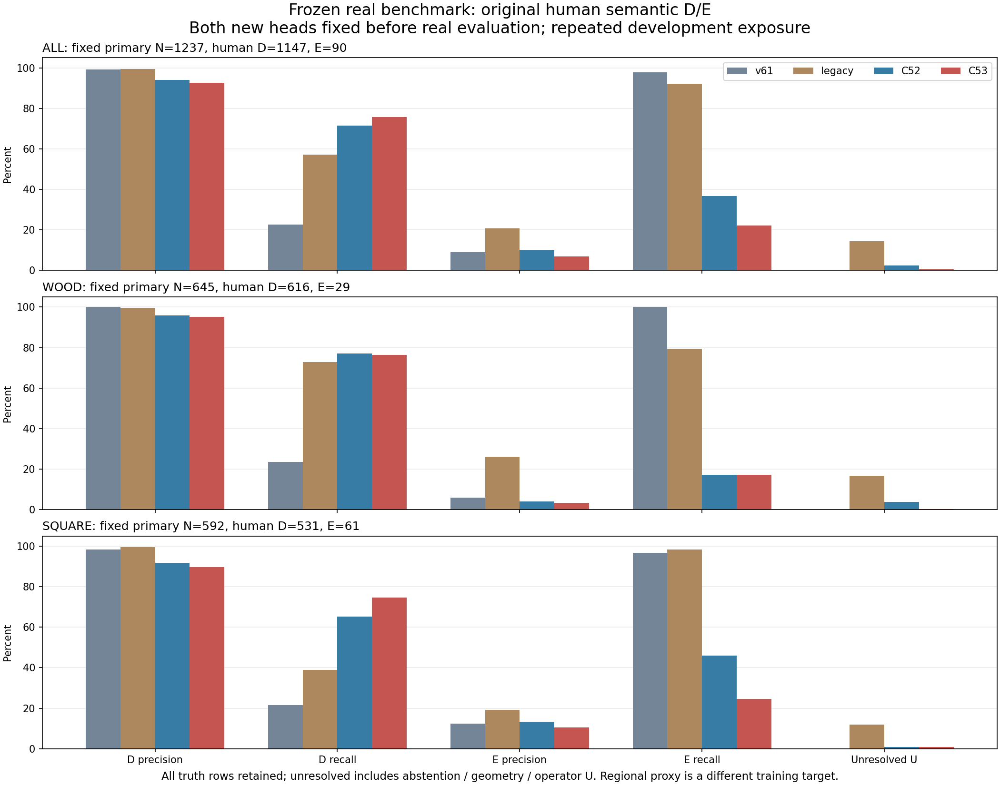

> [V253：합성·공개 실사 저장 오판과 FIT crop 진단](V253_SAVED_FAILURE_SOURCE_FIT_CROP_AUDIT/README_KO.md) — 새 학습 없이 저장 점수의 오판 전이와 참조 분포를 검산하고, 고정 규칙으로 선택한 Source FIT crop을 공개합니다. 현재 평가 데이터와 PnP는 사용하지 않았습니다.

> [V252：일반 참조·대상 참조 direct head의 SOURCE 비교](V252_DIRECT_REFERENCE_HEAD_SOURCE_FIT/README_KO.md) — 합성·공개 실사 FIT으로 direct head 두 개를 각각 1,000회 학습하고, 두 checkpoint를 봉인한 뒤 SOURCE DEV를 평가했습니다. 실제 팔레트 전이는 별도 검증 대상입니다.

> [V251：합성·공개 실사로 학습한 작은 참조 head](V251_FROZEN_CORE_REFERENCE_RESIDUAL_SOURCE_FIT/README_KO.md) — 합성·공개 실사 FIT으로 참조 head와 대조군을 각각 1,000회 학습하고, 두 checkpoint를 봉인한 뒤 SOURCE DEV를 평가했습니다. 실제 팔레트 전이는 별도 검증 대상입니다.

> [V250：입력만으로 RGB 참조를 선택한 SOURCE 진단](V250_INPUT_ONLY_REFERENCE_SELECTOR/README_KO.md) — 정답 라벨을 읽기 전에 1,521행의 참조 선택과 세 특징 점수를 봉인했습니다. SOURCE 진단이며 새 배포 모델·팔레트 정확도가 아닙니다.

<!-- V249 actual SOURCE oracle-reference diagnostic -->
## 2026-10-25 · V249 대상 RGB 참조 진단

[전체 결과·원 점수·독립 검산·공개 CPU 재현](V249_SOURCE_RGB_REFERENCE_ORACLE_DIAGNOSTIC/README_KO.md)

정답 물체 RGB 참조의 중심 특징 점수 차이는 SOURCE AUROC0.9837(오차≤3px 0.9919)이지만 teacher-ID oracle입니다. 기존 V248 head의 같은 SOURCE 순위는 약0.53이며, 배포 참조 선택·팔레트 전이는 미해결입니다. 새 분류기 학습·현재 평가·PnP는 없습니다.

---

<!-- V248 actual SOURCE results -->
## 2026-10-25 · V248 공개 픽셀 보조학습 실제 결과

[결과·코드·혼동행렬·실제 crop·재현 검산](V248_PUBLIC_PIXEL_AUX_ACTUAL_RESULTS/README_KO.md)

AUX 내부 DEV는 보임319/320·가림128/128이지만 기존 YCB 가림은 양군 모두0/57입니다. SOURCE 채택 기준 실패로 모델 채택·새 current/v61 평가·PnP는 없습니다.

---

## V247: 공개 TRAIN 원 q8 prompt의 동결 SAM 진단

[실제 실행·readout·고정 gallery·재검산](V247_FROZEN_SAM_PUBLIC_TRAIN_DIAGNOSTIC/README_KO.md). 원 q/L/native/U와 prompt/runtime 지원을 구분하고, logit>0 exact/5×5 proposal 근거를 별도로 기록합니다. teacher는 모델 입력이 아니며 native 라벨·모델 채택·새 학습 admission을 만들지 않았습니다.

## V246: 공개 TRAIN의 원 query를 바꾸지 않은 조건부 진단

[결과·출처·SOURCE 사례·재검산](V246_PUBLIC_PALLOX_SAME_QUERY_AUDIT/README_KO.md). 입력 메타데이터의 SOURCE VAL 읽기/폐기는 투명하게 기록하며, 인증 배열은 선택 TRAIN22쌍만 사용했습니다. 원 U와 native UNKNOWN을 보존하고 라벨·학습 admission을 만들지 않았습니다.

## V245: 같은 장면 CF 추가의 SOURCE 대조

[실제 결과·제한·고정 gallery·재생 코드](V245_SCENE_CF_SOURCE_TRIAL/README_KO.md). 기존 context baseline은 원본 바이트 재사용·새 업데이트0, treatment는 동일 seed17 초기값에서1,000회 학습했습니다. 사전 SOURCE 기준 미통과이며 현재 실사 개선이나 native gold 인증을 뜻하지 않습니다.

## V242/V244: 실제 장면 합성 검산과 동결 모델 행동 진단

[전체 설명·표·실제 crop·코드](V244_SCENE_DATA_AND_FROZEN_BEHAVIOR/README_KO.md). 실제 생성5,367쌍/미생성39개 보존, 원 BEFORE·q8·문맥·교사 조건의 독립 전량 검산 완료. TREAT 자체 base/residual/total과 V235 학습 COVER/SHAM 기능을 분리 진단했습니다. V243는 코드 준비 상태이며 새 학습 성능 결과가 아닙니다. [공개 검산](V244_PUBLICATION_REVIEW.json).

## V241: 원 장면 일치 가림 대조 데이터 준비 / 실제 생성·학습 전

[상태표·코드·전체 부모5,406행·donor64·검증 명령](V241_SCENE_CONSISTENT_CF_PREPARATION/README_KO.md). 계약/메타데이터 감사와 가상 장면4개 계산 검증까지 공개했습니다. 이전 가상 테스트 실패2개·수정 전 코드도 포함합니다. 실제 scene CF 생성0·새 학습0·현재223/held 새 사용0·PnP0이며 성능 개선 결과가 아닙니다. [공개 파일 검산](V241_PUBLICATION_REVIEW.json) · [가상 계산 재실행](V241_PORTABLE_TOY_REPLAY.json). 최근 실제 모델 결과·crop 시각화는 V240입니다.

## 최신 V239–V240: 공통 특징·두 모델 실제 학습 완료 / SOURCE 기준 미달

[전체 보고서·재현 명령](V240_CANONICAL_CONTEXT_ACTUAL_RESULTS/README_KO.md) · [CM/precision/recall/보류율](V240_CANONICAL_CONTEXT_ACTUAL_RESULTS/artifacts/V240_SOURCE_REPORT_C/results/PORTABLE_REPORT_KO.md) · [성공·실패 crop](V240_CANONICAL_CONTEXT_ACTUAL_RESULTS/artifacts/V239_SOURCE_GALLERY_A/gallery_v1/FIXED12_SOURCE_DEV.png) · [문맥과 8개 query](V240_CANONICAL_CONTEXT_ACTUAL_RESULTS/artifacts/V239_SOURCE_GALLERY_A/gallery_v1/PORTABLE_GALLERY_KO.html).

7,617개 활성 특징의 byte 일치와 원 좌표·분할 정합, 두 모델 각각 새 1,000회 학습과 동결, 독립 완료 검산·지표 재계산·CPU 예측 전량 일치를 확인했습니다. 공개 실사 SOURCE DEV E는 local0/57→context1/57, 가족 평균 균형 recall gain+0.345657pp로 사전 기준 FAIL입니다. 모델 채택·현재223 새 평가·문턱 조정은 없습니다. 6개 frozen 특징 배열과 두 작은 모델도 제공해 원 이미지·DINO 없이 CPU 검산할 수 있습니다. [공개 검증 기록](V240_PUBLICATION_REVIEW.json).

## 최신 공개 V237–V239: 입력 복원 완료·학습 전 중단 진단·다음 비교 준비

[전체 보고서와 상태표](V239_SOURCE_CONTEXT_INPUTS_AND_PREPARATION/README_KO.md) · [원 문맥과 8개 실제 crop](V239_SOURCE_CONTEXT_INPUTS_AND_PREPARATION/artifacts/V237_ROOT_SOURCE_CONTEXT_INPUTS/fixed4_original_input_gallery/FIXED4_SOURCE_INPUT_CONTEXT_AND_Q8.png) · [FIT 5,876개 행별 특징 차이](V239_SOURCE_CONTEXT_INPUTS_AND_PREPARATION/artifacts/V238_ALL_FIT_DESCRIPTOR_DIAG/ALL5876_DESCRIPTOR_DIFFERENCES.csv).

V237은 원 crop 7,617개의 픽셀·valid SHA 일치와 독립 입력 QA를 완료했습니다. V238은 1e-6 특징 검증 초과로 optimizer 전에 중단됐습니다(66/5,876개, 최대 약 1.55158e-6). V239는 한 번 생성한 공통 특징으로 두 모델을 새로 비교하도록 준비했으며 실제 생성·학습·새 DEV 결과는 아직 없습니다. 완료·실패·준비 상태와 한계를 구분해 보존합니다. [공개 검증 기록](V239_PUBLICATION_REVIEW.json).

## 최신 공개 V234–V236: 실패 원인 진단과 같은 점 가림 대조

[전체 보고서·실행 조건·재검산](V236_SOURCE_DIAGNOSIS_AND_PAIRED_TRAINING/README_KO.md) · [CM/precision/recall/보류율](V236_SOURCE_DIAGNOSIS_AND_PAIRED_TRAINING/artifacts/V235_SOURCE_REPORT_C/results/PORTABLE_REPORT_KO.md) · [성공·실패 crop](V236_SOURCE_DIAGNOSIS_AND_PAIRED_TRAINING/artifacts/V235_SOURCE_GALLERY_A/gallery_v1/FIXED12_SOURCE_DEV.png) · [crop과 공개 원 장면](V236_SOURCE_DIAGNOSIS_AND_PAIRED_TRAINING/artifacts/V236_CONTEXT_FRAMES_B/three_source_context_v1/THREE_SOURCE_CONTEXT_BOARD.png).

실제 SOURCE 대조쌍5,367개와 고정 head1000회 학습·독립 QA를 완료했습니다. 공개 실사 내부 DEV 외부 가림은 0/57이며 SOURCE 기준 미달로 모델을 채택하지 않았습니다. 실패57개 중56개는 crop 밖 다른 원 query에 대상 픽셀이 있음을 확인했고, 다음 입력 검증 경로를 기록했습니다. 새 context 모델은 아직 학습하지 않았습니다. [배포 검증 기록](V236_PUBLICATION_REVIEW.json). 이전 기록은 아래에 유지합니다.

## 최신 공개 V233: 공개 실사·합성 crop 대조

[보고서와 재검산 안내](V233_SOURCE_CROP_ENCODER_ADAPTATION/README_KO.md) · [실제 성공/실패 crop](V233_SOURCE_CROP_ENCODER_ADAPTATION/artifacts/V233_ROOT_CROP_ADAPTATION/fixed8_source_dev_gallery_v2/SOURCE_DEV_FIXED8.png) · [CM/P/R/U 표](V233_SOURCE_CROP_ENCODER_ADAPTATION/artifacts/V233_SOURCE_REPORT_C/results/METRICS.csv). 실제1000회 학습 비교와 독립 QA를 완료했습니다. SOURCE 순개선0pp여서 미채택이며 실사 해결 완료가 아닙니다. 이전 기록은 아래에 유지합니다.

[패키지 배포 검증 기록](V233_PUBLICATION_REVIEW.json)

[V231: 기존 head·라벨·Pallox·특징 cache 경로 점검 원본 추가. 새 학습·성능 개선 결과 없음. V229 실사 비교와 V230 표·실제 crop·검산 코드로 연결.](V231_EXISTING_HEAD_DATA_CACHE_AUDIT/PORTABLE_REPORT_KO.md)

[V230: 공개 YCB8,000점의 q/r 관측·원라벨 재현. 기준점과 crop 중심의 차이·실제6crop·기존 BCE 학습 경로·검산 자료 공개. 새 모델 성능 개선 결과 아님.](V230_YCB_QUERY_OBSERVATION/PORTABLE_REPORT_KO.md)

[V229: 90%대 SOURCE 후보를 실사에 고정 평가. 보임 recall83.26%·외부 가림30.00%로 채택하지 않음. 원1784출력·목재/정사각형 CM/P/R/U·성공/실패8crop·재검산 코드 공개.](V229_FIXED_CONTEXT_REAL/PORTABLE_REPORT_KO.md)

[V227: 공개 SOURCE에서 고정 읽기 대 학습 attention; attention 추가 효과 미확인. 원 특징·두 head·736출력·실제 crop·학습 없는 검산기 공개, 새 실사 개선 아님.](V227_CONTEXT_READ_SOURCE_PROBE/PORTABLE_REPORT_KO.md)

[V226: 공개 원 query368개 reference 정합; 가림37/44 crop안, 좌표·역할·문맥 혼재 확인. 새학습/실사개선 결과 아님.](V226_REFERENCE_ALIGNMENT/PORTABLE_REPORT_KO.md)

[V225: 원 query crop15장·장면분리 점검; 독립 분리 후보 FIT의 가림 weak8개, 새학습/성능개선 결과 아님](V225_DATA_AND_CROP_REVIEW/PORTABLE_REPORT_KO.md)

[V224: 새 학습 없이 원 초기 query 약라벨 연결·현재 loss 경로 점검; 성능 개선 결과 아님](V224_DATA_TARGET_READINESS/PORTABLE_REPORT_KO.md)

V223: 점·부위 출력 분리 대조와 입력일관성 검사를 완료했습니다. [표·전체crop·실행/QA·범위예외](EXPERIMENT_INDEX_THROUGH_V223_KO.md). 최신실사비교는V220이며 이번 SOURCE 공동개선은확인되지않았습니다.

V222: 예상 부위 COVER/SHAM 감독을 실제 학습했으나 SOURCE 검증 개선은 확인되지 않았습니다. [표·전체 crop·실행/QA 원문](EXPERIMENT_INDEX_THROUGH_V222_KO.md). 최신 실사 비교는V220입니다.

[V221 검토 대조·중복 시도와 남은 과제](EXPERIMENT_INDEX_THROUGH_V221_KO.md)

최신 모델은 보이는 점 보존이 늘었지만 외부 가림 검출은 함께 좋아지지 않았습니다. 첨부 V193 조언과 현재 계약·데이터·실험 이력을 대조한 결과이며 이번 새 학습·실사 추론은 없습니다.

---

# 초기 키포인트 crop의 보임·외부가림 실험 기록

초기 추론 좌표를 중심으로 자른 crop에서 **대상 팔레트가 보이는지, 다른 물체에 가려졌는지** 판단하는 연구입니다. 자기 가림은 초기 추론의 기하 처리와 구분하고, 위치 오차도 따로 분석합니다. WOOD/SQUARE와 native8 전체 목표는 아직 해결되지 않았습니다.

[전체 실험 목차](EXPERIMENT_INDEX_KO.md) · [전체 그림 목차](GALLERY_INDEX_KO.md) · [최신 실사 비교](archive/task-2/pallet-keypoint-visibility/query_visibility_jitter_heads_frozen_real_benchmark_20261024_v184/PORTABLE_REPORT_KO.md) · [데이터·코드 출처](THIRD_PARTY_ATTRIBUTION_KO.md) · [게시·재검산 방법](PUBLICATION_GUIDE_KO.md)

이 게시본은 허용된 모든 단계의 실행 코드·방법·저장 출력·표·검산·시각화와 실패 기록을 함께 보존합니다. V63–V186의 허용된124개 디렉터리와 초기 v60/v61/v62 관련 자료를 연결합니다. 버전번호가 중복된 V111 두 디렉터리는 따로 남기고, 명시적으로 접근이 금지된 V112는 포함하지 않습니다. 단계별 PASS/완료는 모델 성공을 뜻하지 않습니다.

## 시작 문서와 초기 비교군

[START_HERE_KO](archive/task-2/pallet-keypoint-visibility/START_HERE_KO.md) · [HANDOFF_KO](archive/task-2/pallet-keypoint-visibility/HANDOFF_KO.md) · [PATH_INDEX.csv](archive/task-2/pallet-keypoint-visibility/PATH_INDEX.csv)

[v60 외부가림 proxy](archive/task-2/external_ray_proxy_head_20261022_v60/REPORT_KO.md) · [v61 target presence](archive/task-2/target_presence_classifier_20261022_v61/REPORT_KO.md) · [v62 기존 모델 저장 출력 감사](archive/task-2/presence_previous_models_audit_20261022_v62/AUDIT_COMPLETE.json)

## 현재 실제 분류 결과

V184의 같은 초기 query 비교에서 사람의 D(직접 보임)1,147점·E(외부가림)90점, 총1,237점입니다. 아래 recall 분모에는 보류 U가 포함됩니다. 자기 가림·영상 밖·미주석·대응 불명은 이 이진 표와 분리해 원문에 보존했습니다.

| 모델 | D precision | D recall | E precision | E recall | 보류율 | 외부가림을 보임으로 오판 |
|---|---|---|---|---|---|---|
| v61 | 99.24% | 22.67% | 9.03% | 97.78% | 0.00% | 2 |
| 기존 실사 학습 모델 | 99.54% | 57.11% | 20.65% | 92.22% | 14.31% | 3 |
| C52 RGB | 94.04% | 71.58% | 9.85% | 36.67% | 2.34% | 52 |
| C53 RGB+SAM | 92.54% | 75.68% | 6.83% | 22.22% | 0.49% | 70 |

새 모델은 보이는 점을 더 살렸지만 외부가림을 보임으로 통과시키는 오류가 커졌습니다. **C52/C53 모두 채택하지 않았습니다.** [재질별 혼동행렬·precision/recall·보류율과 실제 crop](archive/task-2/pallet-keypoint-visibility/query_visibility_jitter_heads_frozen_real_benchmark_20261024_v184/PORTABLE_REPORT_KO.md)을 함께 확인하십시오.

평가에 사용한 자체 촬영223장과 공개 held45장 및 합성 VAL은 반복 노출된 자료이며 독립적인 blind test가 아닙니다. 최근 학습은 합성·공개 SOURCE TRAIN을 사용했고 이 평가 자료는 학습·보정·문턱 선택에 넣지 않았습니다. 기존 실사 학습 모델의 과거 CAL 이력은 원문 그대로 남겼습니다. 공개자료의 weak center-owner 정답과 팔레트 native 부위의 외부가림 정답도 구분합니다.

## 최근 어디까지 확인했나

- [V183](archive/task-2/pallet-keypoint-visibility/query_visibility_query_jitter_paired_source_training_20261024_v183/PORTABLE_REPORT_KO.md): SOURCE TRAIN 좌표 jitter 학습과 두 head의 고정 최종 출력. source 결과와 실제 전이는 분리합니다.
- [V184](archive/task-2/pallet-keypoint-visibility/query_visibility_jitter_heads_frozen_real_benchmark_20261024_v184/PORTABLE_REPORT_KO.md): 저장된 v61/기존 모델과 새 head를 동일 query로 실제 비교. 보임 회복과 외부가림 손상을 모두 공개했습니다.
- [V185](archive/task-2/pallet-keypoint-visibility/query_visibility_public_part_supervision_readiness_20261024_v185/PORTABLE_REPORT_KO.md): 공개 부위 감독 준비도와 기존 crop·감독 영역 교차를 확인했습니다. 원래 crop 밖의 부위를 감독하는 사례가 있었고, UNKNOWN은 유지했습니다.
- [V186](archive/task-2/pallet-keypoint-visibility/query_visibility_public_source_registration_probe_20261024_v186/PORTABLE_REPORT_KO.md): 고정 공개 SOURCE4프레임·5instance의 원 mesh/K/R/t 렌더와 독립400 ray 검산을 완료했습니다. 제공 mask와의 외곽 정합은 높지만 센서 깊이 차이·결측이 있어 정확한 부위 가림 정답으로 승격하지 않았습니다. 새 모델 개선 결과가 아닙니다.

## 원본과 게시용 문서

원문은 `archive/task-2/`의 원래 형제 구조로 보존하고 각 버전의 `PORTABLE_REPORT_KO.md`를 GitHub에서 읽을 수 있게 별도로 만들었습니다. 원문에 남은 `/home/...` 경로는 당시 실행 환경의 provenance입니다. HTML은 GitHub에서 실행되지 않으므로 Markdown 표·이미지를 먼저 보고, HTML 갤러리는 자료를 내려받아 열 수 있습니다.

[원본 파일·해시·포함/제외 manifest](PUBLICATION_MANIFEST.json)에서 코드, 저장 출력, 소형 자체 학습 head, 검토 그림을 확인할 수 있습니다. 큰 텍스트 원장은 무손실 gzip 분할본과 원문 SHA256으로 보존합니다. 원 데이터 은행·특징 캐시·환경·대형 사전학습 weights 등은 경로와 제외 사유를 남깁니다. 다운로드가 필요한 공식 공개 자료와 라이선스는 [출처 표](THIRD_PARTY_ATTRIBUTION_KO.md)를 따릅니다.

이후 완료하는 실험도 같은 방식으로 원문·실패·그림·검산 결과를 묶어 `main`에 계속 반영합니다. 게시 검산은 숫자와 파일 보존 검산이며 전체 가림 모델의 목표 달성 판정과는 별개입니다.
