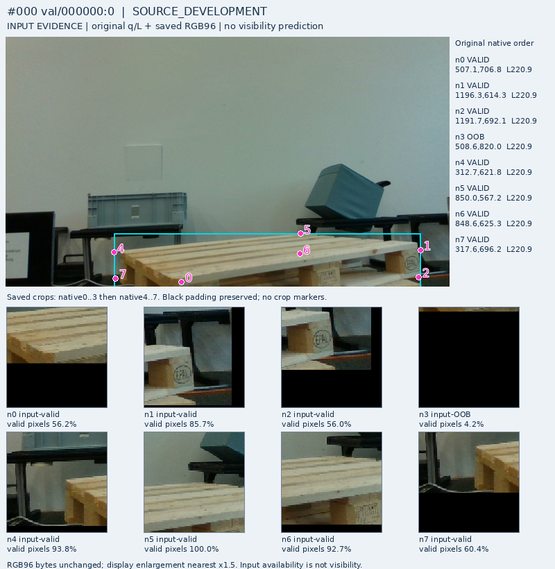

# V224: 새 학습 없이 원 초기 query의 기존 약라벨을 다시 연결한 결과

**성능 개선 결과가 아니다. 새 모델·학습·현재 평가223장 추론·PnP는 모두 0이다.** 최근 V223의 출력 분리 대조는 CF 검증17/27 및 자연 검증9/12를 개선하지 못했다. 같은 작은 자료에서 head·epoch·seed를 계속 바꾸는 경로는 진행하지 않았다. 목표는 여전히 미해결이다.

이번에는 다음 학습을 할 근거가 실제로 있는지 확인했다. 중요한 보완은 **실제 초기 추론 query와 연결된 기존 공개 약라벨이 별도로 존재한다**는 점이다. 입력 metadata에 대응 필드가 없다는 이유로 감독 자체가 없다고 결론내리면 안 된다. 다만 이것을 새로 수집한 정답이나 아직 전혀 사용하지 않은 사진으로 부르지도 않는다.

## 1. 분리해 확인한 자료

| 자료 | query와 라벨의 실제 권한 | 현재 한계 |
|---|---|---|
| MR6D 공개 원 초기query TRAIN | 151frame·1208행의 원 q/L/native/q8/inputU 유지. 별도 기존 V154 assistant instance/role 약판독을 동일 ID·좌표로 연결 | 사람 gold·정확한 물리점 gold가 아니며 좌표품질 정답 없음 |
| V218–223 공개 finite-part | 관찰한 유한 부위의 자연 D/E 및 같은 부위 COVER/SHAM 약감독 | GT 유래 학습 query. native 한 점 D/E로 자동 복사 불가 |
| YCB V109 natural surface | TRAIN1000instance·700frame·8000논리slot. GT reference 주변 고정 disk4px jitter 입력, reference의 owner/depth 기반 표면 상태 | 실제 pallet initializer 아님. pallet native mapping UNKNOWN. 기존 seal에 RAW96 packet 없음 |
| YCB V113 wood/foam | 기존 TRAIN2400slot의 surface AUX | GT jitter, native UNKNOWN. 혼합 행은 이번에 해석하지 않음 |

YCB 보조 정답이 존재한다는 사실만으로 pallet의 의도한 부위 대응과 실제 초기 추론 오차 전이가 해결되지는 않는다. 반대로 완벽한 mesh/물리점 gold가 없다는 이유로 유효한 약감독까지 모두 차단하지 않는다.

## 2. 원 query의 TRAIN-only 연결 결과

V219에서 이미 분리된 TRAIN-only 입력 metadata로 1208개 row-ID whitelist를 먼저 만들었다. 기존 V154 JSONL의 원 global 행 번호를 whitelist와 대조한 뒤 허용 행만 JSON으로 해석했다. 모든 허용 행의 ID·frame·native·q·L·가용성이 원 입력과 동일했다. 새 GT-nearest 매칭·순열 탐색·좌표 보정은 없다.

| 단위 | 결과 |
|---|---:|
| 원 입력 전체 | 151frame / 1208행 / 99선언component |
| 원 입력 가용 / 원 U | 1049 / 159 |
| 기존 role 상태 D / E / OOF / U | 333 / 44 / 85 / 746 |
| 입력 가용이고 기존 weak D/E가 있는 행 | **368 = D324 + E44** |
| 위368의 frame / 선언component | 81 / 29 |
| D324의 frame / 선언component | 80 / 28 |
| E44의 frame / 선언component | 41 / 15 |
| E의 native 분포 | **native4:10, native5:34**, 나머지0 |
| 정확한 좌표품질 라벨 | 1208행 모두 UNKNOWN |

E는 dataset sequence000002·000006에서만 나온다. 연속 frame·component 수를 물리적으로 독립된 장면 수로 인증하지 않는다. SELF 약라벨이 없다는 것은 실제 SELF가 없다는 뜻이 아니다. 자기 가림은 사용자 계획대로 초기 기하 필터와 구분하고 E로 합치지 않는다. 상류 SELF 제외 뒤 필요 없는 native까지 억지로 E 예시를 채울 요구도 하지 않는다.

좌표품질 UNKNOWN은 위치 오류와 가림 원인을 분리하는 진단의 한계다. 그 자체를 weak visibility 학습의 전면 금지 조건으로 삼지는 않는다.

## 3. 기존 학습에 사용됐는가

현재 **C65→V223 경로**의 V181 raw cache producer는 공개 원 query에서 `owner_aux_target`을 가져온다. V223 계약은 공개 `support_target=-1`을 유지하며, 기존 손실은 support/owner 출력을 감독한다. 별도의 합성 point0 및 natural/CF PART 손실과 구분된다.

확인한 두 코드 경로에는 이번에 연결한 V154 `role_target`을 직접 native D/E loss로 소비하는 경로가 없다. **같은 사진의 owner 보조 감독은 이미 owner head와 공유 encoder의 학습에 사용됐다.** 따라서368행을 완전 미사용 신규자료로 부를 수 없다. owner_aux와 role_target의 정확한 행별 겹침·간접 변환 계보는 배열을 다시 열지 않아 UNKNOWN이다. 모든 역사적 모델에서 이 라벨이 한 번도 쓰이지 않았다는 주장도 하지 않는다.

## 4. 점수로 고르지 않은 실제 원 crop 네 장

E sequence2/6, D sequence0/2에서 각각 원 global 순서가 가장 앞선 서로 다른 TRAIN frame을 하나씩 골랐다. 모델 점수는 사용하지 않았다. 기존 original-query panel4개의 SHA를 확인하고 Root가 네 장 모두 직접 열었다. 새 RGB crop이나 라벨을 만들지 않았고, 표시 panel을 본 사실을 RAW96 sampler 전수 재현으로 확대하지 않는다.

| 원 frame·선택 슬롯 | 기존 약라벨 | 직접 본 내용과 해석 한계 |
|---|---|---|
| 125 / native5 | E | 회색 통 아래쪽과 목재가 같은 crop에 함께 보인다. 전체 팔레트 문맥에서 뒤쪽 상부 역할을 가린다는 기존 설명은 타당해 보이지만, 목재 픽셀 존재만으로 이 역할의 D/E를 정할 수 없다. |
| 199 / native5 | E | 흰 포장블록의 경계와 노출된 목재가 함께 보인다. foreign 물체가 있음과 특정 뒤쪽 역할을 가림은 구분해야 한다. 정확한 점 좌표는 인증하지 않는다. |
| 0 / native0 | D | 노출된 전면 deck 끝과 판재 연결이 보인다. crop의 검은 padding도 크다(표시값 valid56.2%). 패딩/배경 존재를 E와 동일시하면 안 된다. |
| 124 / native0 | D | 전면 끝은 보이고 회색 통·파란 상자는 그 안쪽에 있다. 주변에 가림 물체가 있다는 것만으로 질문한 전면 역할을 E로 바꿀 수 없다. |

이 네 사례는 기존 약판독의 시각적 개연성 점검이다.368개 정답의 전수 검증·관찰자 독립 합의·실사 모델 개선 증거는 아니다.

[E frame199](figures/FRAME_199_val_000006_0.png) · [D frame124](figures/FRAME_124_val_000002_6.png)

## 5. 다음 비용을 쓰기 전의 판단

현재 결과는 문제의 불가능을 증명하지 않는다. **원 query에 맞는 기존 weak 감독은 찾았지만, 최근 모델이 그 질문을 직접 배운 경로와 충분한 독립 일반화 근거는 확인되지 않았다.** 직접 감독 경로 확인은 실패 진단을 바꾸는 근거이며 성능 향상은 아니다.

다음 유효 작업은 이 원 query 약판독의 intended instance/part 및 crop 근거를 공개 TRAIN에서 한정 검토하는 것이다. 같은 자료의 보조 감독·모든 파생 변형까지 묶어 장면 단위 분리를 먼저 고정해야 한다. 이미 그 장면으로 학습한 encoder를 그대로 재사용하고 새 blind 검증이라고 부르면 안 된다. semantic D/E/SELF, query 좌표 관계, crop에서 판독 가능 여부와 라벨 권한을 별도 기록한다. D/E를 full context에서 알아도 local crop에서 판단할 증거가 충분한지는 별도다.

이 근거와 비교 예산·허용 D 손상·필요 E 개선을 고정하기 전 새 학습을 자동 시작하지 않는다. 같은 갈래의 한정 대조에서 보임 보존과 외부 가림 검출의 공동 실익이 없으면 epoch·seed·미세 구조 변형으로 연장하지 않는다. 현재 평가223장은 이 결정에 사용하지 않는다. 이 문서는 새 모델 선택·실험 실행·학습 admission이 아니다.

## 6. 접근과 재현 한계

혼합 V154 파일1840행의 raw bytes는 통과했고, 제외632행은 JSON으로 해석하거나 label 값으로 사용하지 않았다. **제외 행 byte 접근도0이었다고 주장하지 않는다.** 혼합 파일 전체를 새로 hash하지 않았으며 기존 seal의 SHA는 선언된 출처로만 보존한다. 허용1208행은 별도 파일로 저장해 후속 검토가 혼합 원본을 다시 읽을 필요를 줄였다. B는 분리1208행과 TRAIN-only metadata만으로 전수 검산했다.

기존 공개 역사 seal의 집계·코드를 읽었지만, 현재223의 개별 RGB/GT/feature/score/model, 보호 평가 행의 label 해석, V112 filesystem, 새 fit/forward/PnP는0이다. V223에서 이미 공개한 별도 metadata 범위 예외는 기존 보고서에 그대로 보존한다.

원 사진과 query 표시 panel의 출처는 MR6D(배포자 anas-gouda, CC BY4.0 표기)이며, 새 사진을 수집하거나 사용자 촬영자료를 옮긴 것이 아니다. [원 배포 페이지](https://huggingface.co/datasets/anas-gouda/mr6d). 문서·추출 코드·TRAIN 선택 결과·원바이트 그림·점검 기록을 보존한다. 새 모델 성능표나 채택 모델은 없다.
