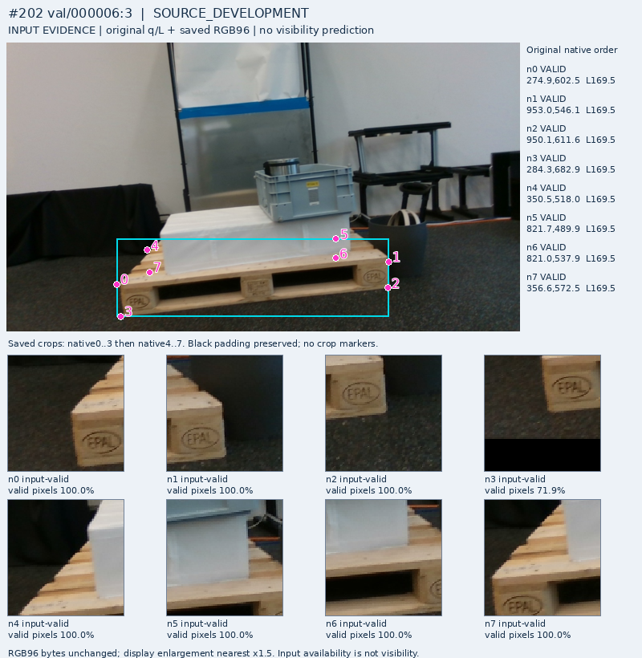
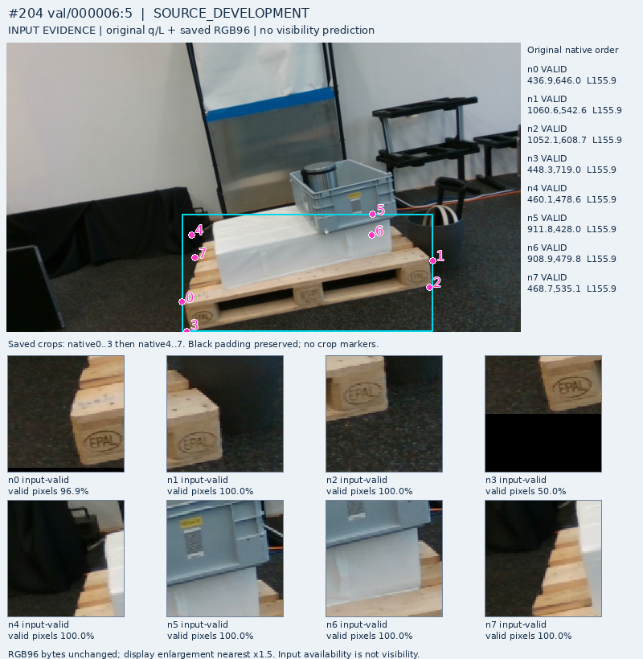
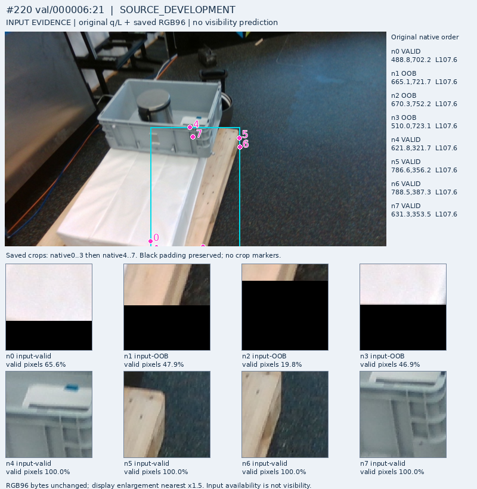
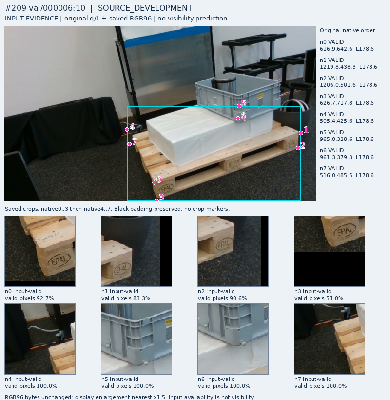
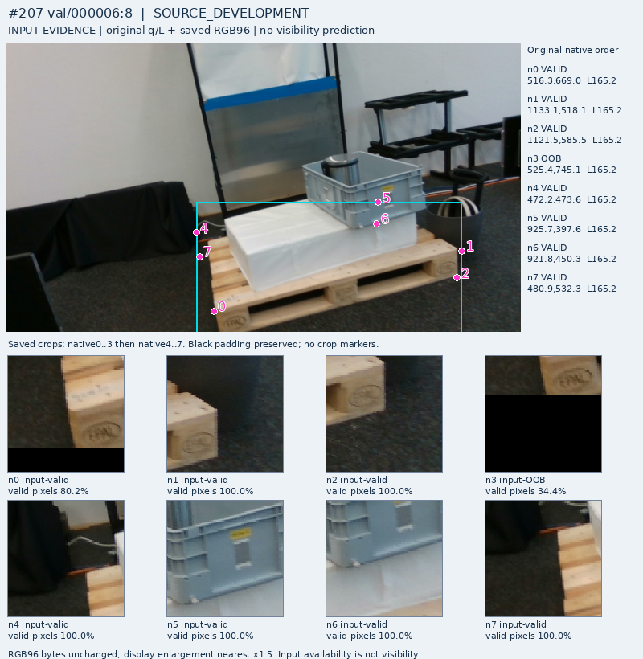
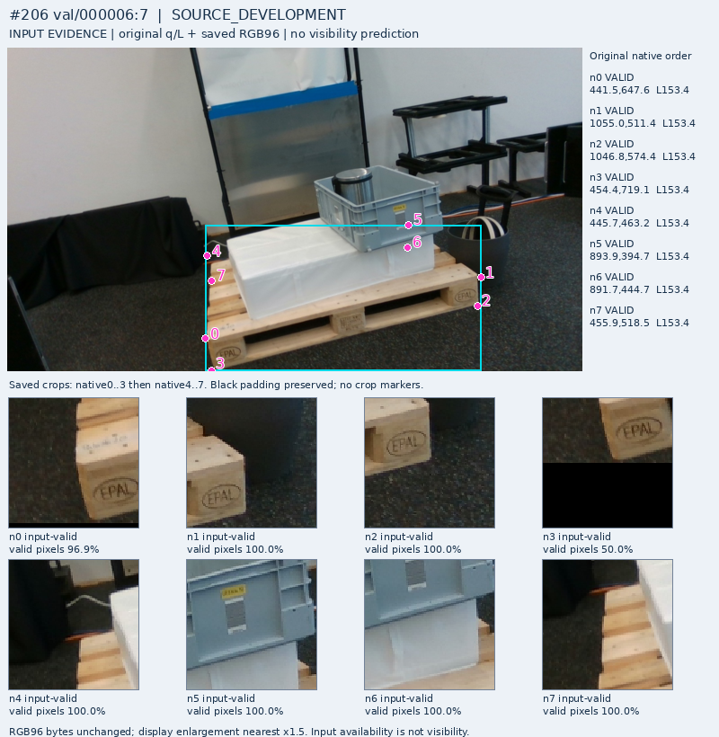
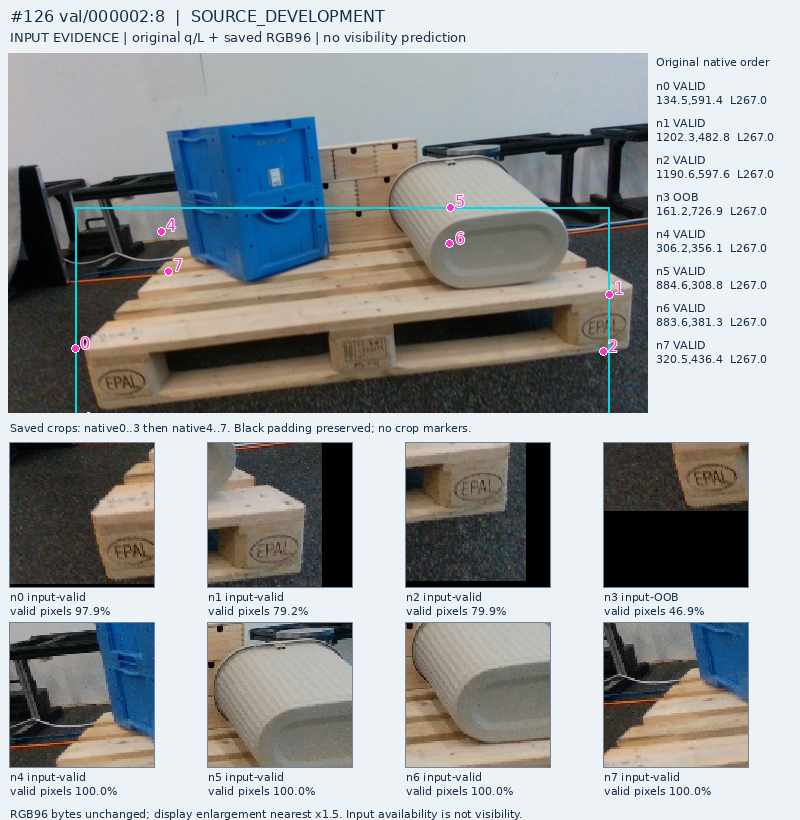
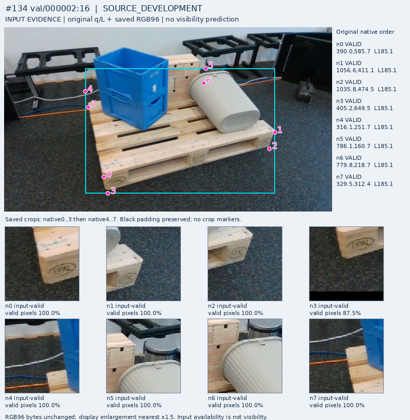

# 공개 TRAIN component15개: 원 query panel 전체

E와D는 기존 assistant 약라벨이며 모델 예측이 아니다. 원 q/L/native/U와 원 표시 PNG bytes를 보존했다. 모델 점수를 사용하지 않은15component 대표이며 물리적으로 독립된15장면·기존44E전수·native gold 검증이 아니다.

[판독·분리 결과](PORTABLE_REPORT_KO.md)

## frame202: E native5 / D native0

## frame153: E native4 / D native1

## frame204: E native5 / D native0

## frame149: E native5 / D native1

## frame155: E native4 / D control 없음

## frame220: E native4 / D native5

## frame209: E native5 / D native0

## frame207: E native5 / D native0

## frame205: E native5 / D native0

## frame206: E native5 / D native0

## frame125: E native5 / D native0

## frame126: E native5 / D native0

## frame217: E native4 / D native0

## frame134: E native5 / D native0

## frame133: E native5 / D native0

