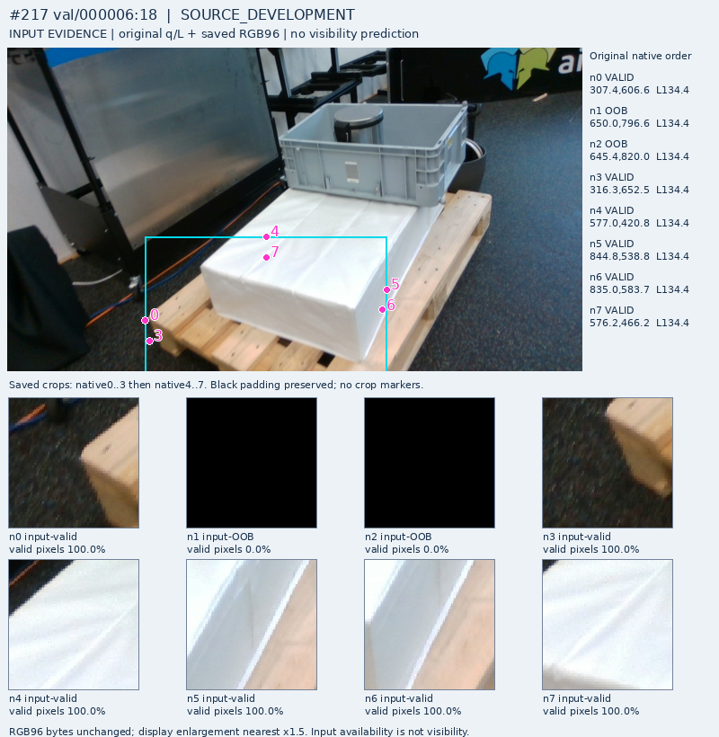

# V225: 원 초기 query 약라벨의 crop 근거와 장면 분리 점검

**새 학습·모델 추론·현재223장 재평가·PnP는0이다. 성능 개선을 보고하는 버전이 아니다.** V224에서 연결한 공개 원 query 약라벨368개(D324/E44)가 다음 학습을 뒷받침하는지 실제 그림과 한 번의 고정 분리 후보로 점검했다. 결론은 현재 작은 local crop head의 변형 학습을 재개할 근거가 충분하지 않다는 것이다. 전체 가시성 판별 문제가 불가능하다는 결론은 아니다.

## 실제 원 crop 15장과 29개 질문

기존 E44가 속한 선언component15개에서 입력 가용 E의 원 global 순서가 가장 앞선 행을 하나씩 선택했다. 같은 frame에 가용 D가 있으면 그중 첫 행도 질문해 E15+D14가 됐다. 모델 점수로 고르지 않았다. 원 q/L/native/U를 바꾸지 않았고, 기존 original-query panel15개의 SHA를 확인한 뒤 Root와 B가 모두15장을 실제 열었다. 기존 라벨을 수정하거나 새 사람 gold로 인증하지 않았다.

| B의 정성 판독 | E15 | 같은 frame의 D14 |
|---|---:|---:|
| 전체 문맥에서 기존 상태가 조건부 타당 | 13 | 14 |
| 전체 문맥에서도 역할·SELF 등이 미해결 | 2 | 0 |
| local crop에서 질문한 부위를 식별할 근거 | 0 | 13(노출 목재 부위 수준) |
| local crop에서 모호함 | 7 | 1 |
| local crop에서 특정 target을 주소화할 근거가 없음 | 8 | 0 |

이 표는 분류기의 정확도·혼동행렬이 아니다. `근거 없음`을 새 E·inputU·기존 주석 무효화로 바꾸지 않는다. native/q8 조건을 학습한 모델이나 추가 문맥이 있어도 판별이 불가능하다는 증거도 아니다. D의 노출 부위 판독은 정확한 native 한 점/3px 좌표 인증과 다르다. 관찰은 기존 약판독에 비블라인드였고, 두 AI 관찰자의 정성 점검이지 독립 사람 gold가 아니다. B는 Root의 비교 관측을 받기 전에 관측 파일을 봉인했고 수정하지 않았다.

공통 현상은 다음과 같다.

- **E인데 목재가 남는다:** frame125/133/134의 E5 crop에는 회색 통·검은 stool·세운 목재 또는 노출 deck이 함께 있다. 목재 존재만으로 질문한 뒤쪽 역할이 보인다고 할 수 없다.
- **foreign가 있어도 D다:** frame149/D1에는 회색 통 일부와 노출된 전면 목재 끝이 함께 있다. 주변 foreign 존재를 E로 복사하면 안 된다.
- **target 주소가 불명확하다:** frame155/E4의 원 query/crop은 파란 KLT 위다. 기존 설명의 역할과 그 주소를 강하게 연결하지 못했다. frame217/E4도 흰 블록 위주이며 가려진 역할·SELF 대응을 확정하지 않았다.
- **입력 자체의 판독 한계도 있다:** frame217/D0는 작고 흐린 목재 조각만 남아 local 판독이 모호했다. 보임/가림과 좌표 오류는 계속 별도 축으로 유지한다.

[전체15장과 원 질문 갤러리](PORTABLE_GALLERY_KO.md) · [Root 실제 관측](ROOT_ACTUAL_E15_D14_VISUAL_OBSERVATIONS.json) · [B 원 관측](B_OBSERVATIONS.json)

## 고정한 분리 후보는 학습 E를 8개만 남겼다

후보는 하나만 계산했다. 공개 sequence `val/000006`을 DEV seed로 지정하고, 그 component와 연결된 다른 sequence의 모든 행도 FIT에서 제외했다. 다른 split을 찾아 수치를 좋게 만들지 않았다.

| 후보 역할 | 전체 frame / 행 | 입력 가용 weak D / E |
|---|---:|---:|
| FIT | 81 / 648 | **57 / 8** |
| DEV | 70 / 560 | 267 / 36 |

원 sequence의27frame·18component 때문에 다른 sequence의43frame·344행도 제외됐다. FIT/DEV component 교집합은0이다. 전체frame수와 D/E 지원frame수는 다르며 FIT D/E는20frame·20component, DEV D/E는61frame·9component다. E는 여전히 native4/5에만 있다. 선언component나 촬영sequence 수를 물리적으로 독립된 장면 수로 인증하지 않는다.

기존 C65 계보는 이 공개 자료의 보조학습 계보에 노출돼 있어, 그대로 warm start하고 새 독립DEV라고 부를 수 없다. 실제 모든 후보DEV행의 gradient·normalizer 참여를 이번에 전수 재생한 것은 아니다. 새 비교를 한다면 scratch 또는 이 SOURCE로 적합하지 않은 범용 frozen 모델을 쓰고, 모든 보조 손실·정규화·CF/natural 파생에도 부모component 제외를 상속해야 한다. 현재 코드의 기존 SOURCE_FIT flag만 유지하는 것으로 새 분리가 자동 구현되지는 않는다.

[고정 후보 manifest](CANDIDATE_SOURCE_FIT_DEV_MANIFEST.json) · [분모·계보 검산](GROUP_SPLIT_SUMMARY.json)

## 이번 판단과 다음 작업의 경계

약라벨 자체가 없던 것은 아니다. 그러나 **원 query의 부위 대응, crop의 판독 가능성, 독립적인 검증을 함께 확보하기는 어렵다.** 직접 D/E loss에 연결하지 않았던 기존 라벨을 연결하는 것만으로 실사 문제가 해결된다고 기대해서는 안 된다. FIT8E를 더 반복하거나 epoch·seed·미세 head 변경을 추가하는 학습은 시작하지 않았다. 현재223장을 보고 split·데이터·문턱·모델을 고르지 않는다.

기존 weak/AUX 자료는 그 권한으로 보존한다. local crop 판독이 모호하다는 이유로 모든 유효한 약감독을 폐기하거나, 완벽한 mesh/native 물리 gold를 새 필수 조건으로 요구하지 않는다. SELF로 상류에서 제외할 native 전부에 E 라벨을 요구하지도 않는다.

다음 비용은 같은 crop head의 반복보다 **배포 가능한 RGB 문맥으로 대상 부위를 주소화할 수 있는지와, 이를 감독할 공개 원자료를 확보할 수 있는지**에 써야 한다. 기존 다중 문맥/범용 모델 이력을 먼저 확인하며 새 아이디어라고 재포장하지 않는다. 원 q/L/native/RAW96을 보정하거나 GT reference/pose/ROI를 배포 입력으로 추가하는 제안은 아니다. 추가 RGB 문맥의 사용·target 계약·부모 계보 제외·비교 예산·보임 손상과 가림 검출의 종료 기준을 고정하기 전 새로운 학습 admission은 없다.

## 추가 공개 RGB-D 원자료: metadata만 확인, 실제 사용0

원배포자 [RGBD Pallet Dataset 저장소](https://github.com/hoangcuongbk80/pallet_pose_est)의 공개 TRAIN path 목록에는24,247개 서로 다른 경로와26개 sequence prefix가 있다. [공식 loader](https://github.com/hoangcuongbk80/pallet_pose_est/blob/master/datasets/pallet/dataset.py)는 RGB·depth·label 파일과 pose 등의 metadata를 기대한다. 이는 코드/경로 목록 확인이며 원 RGB-D·정답·카메라 정합·native 가시성의 검증이 아니다. 이 저장소가 모든 과거 실험에서 미사용이었다는 주장도 하지 않는다.

README의 다운로드 서버는 web 도구에서 접근되지 않았고, 동일 공개 URL에 대한15초 제한 HTTP 요청도 시간 초과로 종료됐다. 다운로드·VPN/프록시 변경·새 가중치 획득·학습은 없다. 원자료 사용/재배포 조건과 pallet native 대응도 아직 확인되지 않아 입장시키지 않았다. 클래스명에 `occluded`가 있는 것을 키포인트 E 정답으로 취급하지 않는다. [확인한 원출처·경로 분포·접근 결과](ADDITIONAL_PUBLIC_RGBD_SOURCE_METADATA.json).

원래 사용자 촬영223장은 이번 작업의 개별 RGB/GT/feature/score 접근·학습·문턱/모델 선택에서 제외했다. 기존 보호 평가·혼합 원 label JSONL·V112 filesystem·새 모델/배열도 열지 않았다. 이번 그림은 MR6D 공개 TRAIN의 기존 표시 PNG 원바이트이며 원배포자 anas-gouda의 CC BY4.0 표기 출처를 유지한다. [MR6D 원 배포 페이지](https://huggingface.co/datasets/anas-gouda/mr6d).

전체 목표는 active이고 미해결이다. 이번 점검은 다음 학습을 제한할 근거를 만들었으며, 모델 성능 개선이나 해결 가능성의 보장을 만들지는 않았다.
