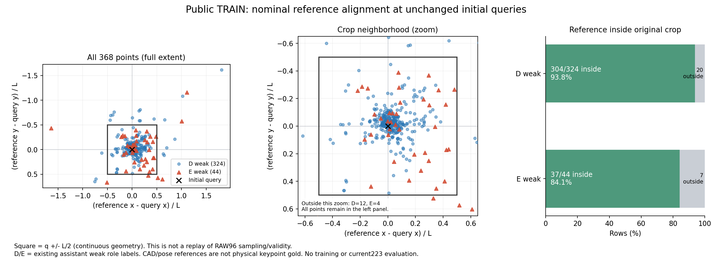

# V226: 해결 가능성의 현재 판단과 공개 원 query의 좌표·문맥 진단

**실용적인 보임·외부 가림 판별에 성공했다고 입증하지 못했다. 현재 local crop head를 조금씩 바꾸는 실험을 계속하면 해결된다고도 말할 수 없다.** 최근 V222/V223 대조에서는 SOURCE의 두 상태 공동 개선을 확인하지 못했다. V224~V226은 추가 학습을 재개하기 전에 데이터와 질문의 대응을 확인한 진단이다. 전체 문제가 불가능하다는 증거는 아니다.

이번 새 학습·모델 forward·현재223장 재평가·PnP는 모두 0이다. 최신 실제 학습은 V223, 최신 고정 실사 비교는 V220이며 채택 모델도 바뀌지 않았다. 이번 자료로 현재223장에서 모델·문턱·데이터를 선택하지 않았다.

## 공개 TRAIN에서 확인한 차이

V224가 연결한 원 초기 query의 입력 가용 약라벨 368개(D324/E44)에만 기존 제공 reference를 연결했다. 이미 선택돼 있던 instance와 native 대응을 그대로 사용했다. 새 nearest matching, permutation search, 초기 q/L/native/U 수정은 없다.

| 기존 약라벨 | 수 | 제공 reference가 원 연속 crop 안 | 밖 | 원 q와 reference 거리 중앙값 | 거리/L 중앙값 |
|---|---:|---:|---:|---:|---:|
| D: 보임 역할 | 324 | 304 (93.8%) | 20 | 18.48px | 0.093 |
| E: 외부 가림 역할 | 44 | 37 (84.1%) | 7 | 69.33px | 0.340 |

**E의 대부분도 reference가 crop 안에 있다. crop 밖으로 빗나간 경우만으로 어려움을 설명할 수 없다.** 동시에 E에는 훨씬 큰 q–reference 변위가 있어, 현재 공개 약감독에서 가림과 좌표·대응 차이가 섞여 있을 가능성을 직접 확인했다. 이것이 현재223장의 실패 원인 비율이라는 뜻은 아니다.

이 reference는 제공 CAD·pose에 근거한 명목값이며 원자료는 cm급 치수·pose 불확실성을 명시한다. 물리적인 한 점의 정확한 pixel 정답이나 3px gold가 아니다. 명목 거리 ≤3px은 D9/E0이므로 이 공개 E44만으로 “좌표가 정확한데도 가리는가”를 검증할 수 없다. reference의 `U_UNREVIEWED`, 기존 D/E, point-quality=-1을 그대로 보존했다. convex SELF proxy도 사람 SELF 정답이나 실제 상류 gate로 바꾸지 않았다.

crop 포함은 원 영상 좌표에서 `|reference-q|`가 두 축 모두 `L/2` 이하인 연속 정사각형 기준이다. RAW96 raster·valid pixel의 정확한 재생 결과나 crop 속 부위가 판독 가능하다는 인증은 아니다. [368행 CSV](REFERENCE_ALIGNMENT368.csv) · [집계](ALIGNMENT_SUMMARY.json) · [독립 수치 검산](ALIGNMENT_NUMERIC_QA.json).

## 실제 crop 관찰과 함께 보면

V225에서 이미 실제로 본 15개 panel의 E15와 같은 frame D14를 이번 수치에 연결했다. 그중 E13/15, D14/14가 위의 연속 crop 포함 기준을 만족한다. 새 이미지 판독이나 새 라벨링은 하지 않았다. 아래 링크는 원 q가 표시된 기존 panel이며 이번 reference를 새로 그린 그림은 아니다.

| 원 panel과 질문 | 제공 거리 / L | reference가 crop 안 | 앞서 확인한 현상과 이번 해석 |
|---|---:|---|---|
| [frame125 E5](../V225_DATA_AND_CROP_REVIEW/figures/FRAME_125_val_000002_7.png) | 93.91px / 0.337 | 예 | 통과 목재가 함께 남는다. 목재 존재만으로 질문한 부위가 보인다고 할 수 없다. |
| [frame134 E5](../V225_DATA_AND_CROP_REVIEW/figures/FRAME_134_val_000002_16.png) | 71.72px / 0.387 | 예 | 회색 통·검은 stool·세운 목재가 섞인다. crop 안에 reference가 있다는 사실도 역할 판독을 대신하지 못한다. |
| [frame155 E4](../V225_DATA_AND_CROP_REVIEW/figures/FRAME_155_val_000002_37.png) | 98.44px / 0.454 | 예 | 파란 KLT 위의 query이며 역할 대응은 여전히 모호하다. 제공 reference도 crop 아래쪽 가까이에 있다. |
| [frame217 E4 / D0](../V225_DATA_AND_CROP_REVIEW/figures/FRAME_217_val_000006_18.png) | E: 215.05px / 1.601; D: 17.45px / 0.130 | E 아니오 / D 예 | E는 reference 자체가 밖이다. D는 안이지만 작은 흐린 목재여서 판독이 모호했다. 포함 여부와 판독 가능성은 다르다. |

[전체 29개 질문의 연결 수치](PRIOR_VISUAL29_REFERENCE_ALIGNMENT.json) · [V225 실제 관찰과 15장 갤러리](../V225_DATA_AND_CROP_REVIEW/PORTABLE_REPORT_KO.md).

위 관찰은 기존 약라벨에 비블라인드인 AI 정성 점검이다. E15에서 local crop만으로 특정 부위를 주소화하기 어려웠다는 관찰은 학습된 모델의 불가능성 증명이 아니다. 모든 E를 좌표 오류로 바꾸거나 기존 weak/AUX를 폐기하는 근거로 사용하지 않는다.

## 현재 모델에 실제로 들어가는 정보

검토한 C65→V223 계보는 원 local RGB96/valid96에서 만든 `x[B,8,96,96]`을 인코딩·pooling한 뒤 native one-hot, 다른 점의 가용 mask, 상대 좌표를 결합한다. 여기서 8은 입력 channel 수이며 다른 8개 crop의 영상이 아니다. q8 조건에는 좌표 배치가 있고, 원 crop 밖 RGB나 다른 점의 crop 영상은 없다. 이번 명목 reference도 모델 입력으로 추가하지 않았다.

전체 pallet 문맥을 본 관찰자와 local crop head가 받는 영상 정보가 같지 않다는 점은 코드로 확인했다. 그렇다고 문맥을 추가하면 반드시 해결된다는 결론은 낼 수 없다. 과거 전체 문맥·witness·SAM 계열 전부를 이번에 재감사하지 않았으므로 이를 새롭거나 한 번도 안 한 방법이라고 부르지도 않는다. [확인 코드와 이력의 범위](CODE_CONTEXT_LIMITS.json).

## 해결된 부분과 아직 막힌 부분

| 항목 | 현재 확인한 상태 |
|---|---|
| 보임·외부 가림·좌표 오류·SELF의 구별 | 의미 축을 분리했다. 원 q가 빗나간 것을 자동 E로, 주변 foreign 존재를 자동 E로 바꾸지 않는다. SELF는 사용자가 정한 상류 기하 gate와 별도다. |
| 공개 원 query 약라벨의 존재와 연결 | D324/E44를 기존 instance/native 대응 그대로 연결했다. 현재 C65→V223의 직접 native D/E loss로 소비되지 않았던 경로도 확인했다. 같은 사진의 owner 보조학습 노출까지 없었다는 뜻은 아니다. |
| 독립 검증에 충분한 원 query 가림 자료 | 미확보다. V225의 고정 component 분리 후보에서는 FIT E가 8개뿐이며 native4/5에 치우친다. 후보는 학습에 입장시키지 않았다. |
| 좌표가 정확한 외부 가림의 실사 감독 | 현재 공개 E44의 명목 ≤3px은 0이며 reference 자체도 물리 gold가 아니다. 부족한 신호다. 완벽한 mesh가 모든 약감독 사용의 전제라는 뜻은 아니다. |
| 실제 실사용 수준의 두 상태 공동 성능 | 미해결이다. 최근 미세 head·감독 경로 대조가 공동 개선을 만들지 못했다. |

실패가 단지 “목표를 너무 높여서”라는 근거는 없다. 다만 대상 부위가 어디인지 불분명한 입력에 강제 D/E를 요구하면 다른 문제를 섞게 된다. **대상 부위의 노출 상태를 판단하고, 원 query의 위치·대응이 불확실하면 이를 별도로 보류할 수 있는 목표**를 유지해야 한다. 특정 crop에 목재나 foreign가 있는지만 맞히는 과제로 축소해 성공이라 부르지 않는다.

다음 학습 전에 확인해야 할 것은 원 query를 유지하면서 배포 가능한 영상 문맥으로 그 부위를 식별할 수 있는지, 그리고 그것을 검증할 공개 장면·대응 감독을 확보할 수 있는지다. 기존 문맥 방법의 실제 입력과 성능 이력을 먼저 대조하고, 보임 손상·가림 검출·허용 보류율과 한 번의 제한된 비교 기준을 고정해야 한다. 이번 단계에서 새 모델·학습 조건을 선택하거나 성능 개선을 약속하지 않았다.

## 접근 범위와 재현 정보

대상은 MR6D 공개 TRAIN으로 이미 승인된 368개 키다. 혼합 reference JSONL 2,424행은 binary stream으로 지나가며 세 identity header만 추출했고, 일치하는 368개 본문만 JSON decode했다. 제외 2,056개 본문은 decode·기하/라벨 해석하지 않았다. 제외 행 raw bytes와 identity header까지 접근 0이었다고 주장하지 않는다. 사전에 [선택 범위](SCOPE_BEFORE_SELECTED_REFERENCE_BODY.json)를 저장했으며 [추출 결과](REFERENCE_SELECTION_SUMMARY.json), [원 선택행](SELECTED_TRAIN_REFERENCE368.jsonl), [분석행](REFERENCE_ALIGNMENT368.jsonl), 코드 세 파일을 함께 보존한다.

현재223장의 개별 영상·GT·feature·score 및 다른 보호 평가 payload를 열지 않았다. V112 filesystem 접근은 0이다. q/L/native/U와 기존 label은 불변이고 학습·forward·PnP·새 학습 admission은 0이다. 이 진단은 [MR6D 원배포 자료](https://huggingface.co/datasets/anas-gouda/mr6d)의 기존 공개 TRAIN metadata에 근거하며 원배포자의 CC BY 4.0 출처를 유지한다. 기존 crop PNG는 V225 게시본 링크로 재사용했다. [스키마 확인](SCHEMA_READINESS.json) · [독립 해석 점검](INTERPRETATION_QA.json) · [이번 단계 결과](ROOT_PHASE_RESULT.json).
