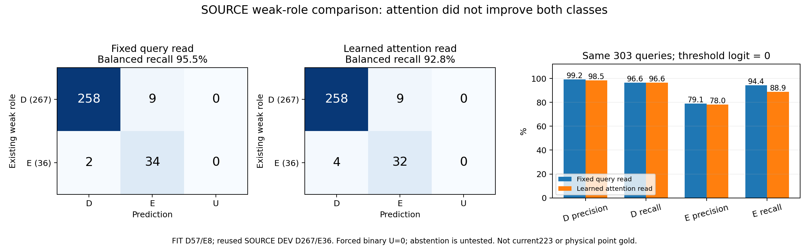
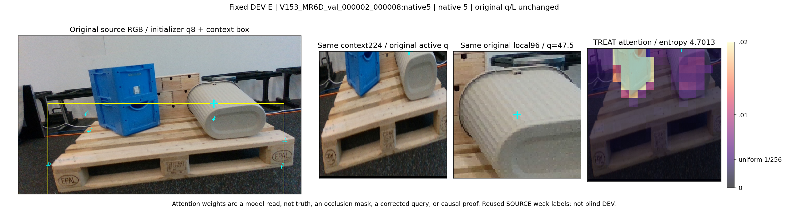

# V227: 고정 query 읽기와 학습 attention의 제한된 공개 SOURCE 대조

**공개 SOURCE 약라벨에서는 단순 고정 읽기가 잘 맞았지만, 학습 attention을 추가한 방식은 개선되지 않았다. 현재223장 성능 개선·실사용 성공을 입증한 결과는 아니다.** 새 실험은 각각 300회, 총600 optimizer update로 종료했다. 사전 기준 실패 후 epoch·seed·비슷한 head 변형을 추가하지 않았고 현재223장·보호 평가의 새 추론·PnP는 0이다.

## 같은 입력·라벨에서 읽는 방법만 대조

V226의 문맥 진단 뒤 과거 코드를 먼저 확인했다. V153은 이미 원 initializer q8의 minmax 영역으로 넓은 RGB 문맥을 만들었고, V111은 query 위치의 DINO patch 특징을 고정 bilinear 방식으로 읽었다. V155에는 V154 원query 역할 D/E의 직접 BCE 경로도 있었다. 따라서 문맥·DINO·원query D/E 자체를 신규 미시도라고 부르지 않는다. [제한된 코드 이력](qa/RUNTIME_INPUT_HISTORY.json).

이번 차이는 **고정 query 위치의 특징을 읽는 것과, query·점 배치에 따라 전체 문맥의 위치별 특징을 학습해 읽는 것**이다. 공식 frozen DINOv2 ViT-S/14 reg4의 같은 context224·원 local96 특징을 두 head가 함께 받았다. context 영역은 원 q8 minmax이며 GT 영역·pose·mask·reference를 쓰지 않았다. 원 q/L/native/U는 보존했다.

- CONTROL: local CLS384 + 원query bilinear 특징384 + context CLS384 + condition32를 단일 linear classifier로 읽는다.
- TREAT: 같은 classifier 입력의 bilinear 특징만, condition32 query와 256개 context patch key의 학습 softmax attention 읽기로 바꾼다. condition32는 native8·다른 점 가용mask8·원 상대XY16이다.
- 두 state는 각각4,561 parameters다. CONTROL의 attention3,376개는 미사용이며 실제 학습 classifier는1,185개다. TREAT는4,561개가 활성이다. 활성 학습 용량까지 같았다는 주장은 하지 않는다.
- 동일 zero classifier 초기값, seed17, full FIT65, balanced BCE + 활성 parameter L2합×0.001, Adam lr0.01, 각300회로 고정했다. 두 최종 state를 모두 저장·동결한 뒤 DEV descriptor·logit을 계산했다. checkpoint·epoch·seed·문턱 탐색은 없다.

[사전 프로토콜](PROTOCOL_BEFORE_CONTEXT_FEATURES_OR_PROBE_FIT.json) · [학습 코드](code/train_compare.py) · [양 모델 동결 barrier](results/ALL2_FINAL300_FROZEN_BEFORE_DEV_DESCRIPTOR_OR_LOGIT.json).

## 데이터와 권위

MR6D 공개 TRAIN151장의 원 query1208개에서 기존 입력 가용 weak D/E368개만 사용했다. V225의 component 분리 후보를 이번 한 번의 probe에 그대로 적용해 FIT D57/E8, DEV D267/E36을 썼다. 서로 다른 split을 검색하지 않았다. scratch head이며 C65 등 프로젝트 학습 weight를 warm start하지 않았다. 이번 프로젝트 SOURCE에 추가 적합하지 않은 공식 범용 frozen DINO weight만 공유했다.

이는 **기존 구조적 역할 약라벨**이며 정확한 한 물리점의 pixel 정답·3px gold가 아니다. 좌표 품질은 UNKNOWN을 유지하고 SELF·OOF·U를 E로 합치지 않았다. DEV는 이미 살펴본 SOURCE이며 독립적인 물리 장면이나 fresh blind 검증으로 인증하지 않는다. E는 native4/5에만 있고 FIT E는8개뿐이다. 이번 probe에 YCB·합성을 새로 혼합하지 않았으며, 원 목표의 올바른 권한에 따른 공개 실사·합성 통합과 실사 전이는 여전히 해결할 과제다.

입력 binding은 mixed RGB metadata230개에서 승인151개 본문만 decode해 만들었다. 제외79개의 raw byte와 identity header는 통과했으므로 제외 행 byte접근0 주장은 하지 않는다. 실제 특징 추출에서는 승인151개의 canonical RGB NPY만 읽고 저장 SHA와 decoded RGB SHA를 검증했다. JPEG 경로는 따라가지 않았다. 문맥 지원150개·미지원1개이며 미지원 frame185에는 eligible query가0개다. 368개 모두 지원 문맥에 연결된다. DINO22,058,112 parameters는 추출 전후 state hash가 같고 첫 batch 반복도 exact였다.

[원 입력151/1208](inputs/ORIGINAL_TRAIN151_CONTEXT_INPUT_BINDINGS.jsonl) · [특징 생성 사실표](features/INPUT_FEATURE_FACTS.json) · [실제 특징 검산](qa/ACTUAL_FEATURE_PACKET_QA.json).

## 공개 SOURCE 결과

행은 기존 weak 정답 D/E, 열은 예측 D/E/U이다. 문턱은 logit0으로 사전 고정했다. FIT는 두 모델 모두 D57/E8 전부 정답이다.

| DEV303 | 혼동행렬 [[D→D,E,U],[E→D,E,U]] | D precision / recall | E precision / recall | 보류율 |
|---|---|---:|---:|---:|
| CONTROL 고정 읽기 | [[258,9,0],[2,34,0]] | 99.23% / 96.63% | 79.07% / 94.44% | 0% 강제 이진 |
| TREAT 학습 attention | [[258,9,0],[4,32,0]] | 98.47% / 96.63% | 78.05% / 88.89% | 0% 강제 이진 |



TREAT는 D 정답 수가 같고 E를2개 더 놓쳤다. D 개별 판정도 회복1·손상1로 완전히 같지는 않다. balanced recall은95.54%→92.76%다. 사전 조건 중 D/E recall≥80%는 충족했으나 **CONTROL 대비 balanced recall +5pp와 어느 class도 하락하지 않기**는 실패했다. CONTROL 결과상 최대 개선폭은4.46pp라 +5pp 기준의 천장 문제도 드러났다. 이 사후 한계 때문에 기준을 완화하지 않았으며, 실제 E2개 추가 손실과 −2.78pp는 별도로 확인된 결과다.

E가 있는 native4/5만의 사후 진단은121개(D85/E36)다. 두 모델의 D recall은76/85=89.41%이고 E 결과는34/36 대32/36이다. 전체 D recall96.63%에는 다른 native의 D182개 전부 정답이 포함된다. 이 부분집합으로 primary 기준을 다시 판정하거나 모델을 고르지 않았다.

보류율0은 불확실성을 해결했다는 뜻이 아니다. 두 모델 모두 강제 이진이며 보류 head·confidence calibration을 검증하지 않았다. [분모별 P/R CSV](results/SOURCE_CLASS_PRECISION_RECALL.csv) · [736개 원 logit](results/ALL736_ARM_QUERY_LOGITS.csv) · [독립 수치 QA](qa/ACTUAL_SOURCE_RESULT_QA.json).

## 영상 근거인가, native·기하 편향인가

저장된 단일 linear classifier를 local/read/contextCLS/condition32와 bias의 합으로 정확히 분해했다. DEV606개 logit의 가산 오차는 최대1.91e−6이었다. 영상항을 빼고 condition32+bias 부분만 계산하면 CONTROL은 D240/267·E27/36, TREAT는 D242/267·E26/36이었다. native·기하 부분만으로도 상당한 신호가 있지만, 이는 **학습 후 영상항을 제거한 partial-logit/OOD 진단**이다. 영상이 필요 없다거나 특정 shortcut이 실패 원인이라는 인과 증명이 아니다.

점수·checkpoint를 읽기 전에 DEV 원행 순서 첫 D2/E2를 고정했다. 고유3개 원 RGB를 사용했고 local96/valid의 SHA도 feature 사실표와 일치했다. 아래 E 예시는 query가 회색 통 쪽에 있고 높은 attention은 다른 위치에도 분포한다. 따라서 밝은 부분을 정답 가림 mask나 교정 위치로 해석하면 안 된다. 정확한 물리 target 위치 gold가 없어 이것만으로 잘못된 부위 읽기의 인과를 확정하지도 않는다.



[고정4패널 갤러리](audit/FIXED4_GALLERY_KO.html) · [실제 모델 감사](audit/KO.md) · [606행 가산분해](audit/ALL606_DEV_ADDITIVE_LOGIT_CONTRIBUTIONS.csv). A는4패널 모두 실제 열었고 Root는 D/E 두 패널과 비교 plot을 확인했다. 색축0..0.02·균일1/256을 고정했다. attention entropy 평균은5.40435nats(균일5.54518)다.

## 이번 결정과 남은 작업

이 결과는 공개 SOURCE 역할 약라벨을 고정 DINO 문맥으로 분류할 신호가 있음을 보인다. 학습 attention을 추가하면 좋아진다는 가설은 이번 고정 대조에서 지지되지 않았다. 이 분기의 추가 epoch·seed·비슷한 head 학습과 현재223장 추론은 시작하지 않는다. 잘 나온 CONTROL만 사후 선택해 실사 개선을 주장하지도 않는다. 최신 고정 실사 benchmark는 V220이며, 이번 모델은 v61·기존 실사 모델보다 현재 평가에서 좋아졌다고 검증되지 않았다. 채택 모델은 없다.

사용자가 운용 기준에 대한 판단을 맡겨, 다음 개발 방향은 **D/E를 균형 있게 맞히고 불확실하면 보류**로 정리했다. 우선 개발 기준은 보임 recall≥80%·외부 가림 recall≥80%·보류율≤20%를 동시에 보되 각 precision도 함께 확인한다. 특히 가림 precision이 낮아 보이는 점을 잘못 버리는 문제를 감시한다. 이는 최종 배포 안전성의 인증 기준이 아니며 현재 평가에서 문턱을 고르는 허가도 아니다. 이번 사전 attention 비교 기준은 수정하지 않았다. SELF는 상류 기하 gate, 위치·부위 대응 불확실성은 별도 보류 축으로 유지한다.

다음 과제는 이 높은 SOURCE 점수가 독립적인 실제 native 노출과 연결되는지, 위치·부위 대응 UNKNOWN과 semantic 가림을 보류까지 포함해 구별할 감독을 확보하는 것이다. 이미 시도한 DINO/context/역할 loss를 신규 아이디어로 다시 제안하지 않는다. [기존 YCB·합성 입력 권위와 연결 한계](qa/CONTEXT_DATA_READINESS.json)에서 YCB의 GT-jitter associated-surface AUX/native UNKNOWN, 합성 BEFORE_ANCHOR2640행의 실제 영상과 query-origin 차이를 기록했다. 완벽한 물리 gold를 모든 유효 weak/AUX 사용의 새 필수 조건으로 요구하지는 않는다.

SAM3는 개념 prompt로 물체를 분할하는 별도 모델이지만 이번에 실행·추천·성능검증하지 않았다. [공식 README](https://github.com/facebookresearch/sam3/blob/f1647e8d0c1d280991f4d1b7d974c2704537fe66/README.md)는 Python≥3.12·Torch≥2.7·CUDA≥12.6 및 가중치 접근 승인·인증을 요구한다. 확인한 로컬3환경은 Python3.10/Torch2.1이고 SAM3가 없다. 새 설치·다운로드·약관 동의·계정 변경은0이다. [조건과 문서 불일치의 정확한 범위](qa/SAM3_OFFICIAL_EXECUTION_CONDITIONS.json). Pallox도 V94 처리 이력이 있어 신규 미사용 자료라고 부르지 않으며, 이번 공식 API 접근은 실패해 추가 원자료를 획득하지 않았다. [제한된 확인](qa/PALLOX_SOURCE_METADATA.json).

## 다른 사람이 저장 결과를 검산하는 방법

이 폴더에는 공개 SOURCE 특징 cache·두 자체 학습 head·원 logit·표·그림·코드를 함께 넣었다. 외부 DINO 가중치와 현재223장의 영상·GT·feature·score는 포함하지 않는다. 아래 검증기는 이 폴더의 상대경로만 사용하며 새 학습 없이736개 logit·부호·분모·P/R을 재계산한다.

```bash
python -B VERIFY_SAVED_SOURCE.py
```

Root가 실제 package에서 실행해 logit 차이0·736개 부호·네 FIT/DEV 지표군 일치를 확인했다. [실행 receipt](qa/ROOT_PORTABLE_REPLAY_RECEIPT.json) · [환경·실행 안내](VERIFY_README.md). 원 feature producer·학습 runner는 당시 절대경로와 code/asset pin을 보존한 provenance이며 임의 경로로 바로 이동해 실행된다고 주장하지 않는다.

원 영상과 derived 특징의 출처는 [MR6D 공개 배포](https://huggingface.co/datasets/anas-gouda/mr6d), 배포자 anas-gouda의 CC BY4.0이다. Frozen DINOv2의 [공식 코드](https://github.com/facebookresearch/dinov2/tree/7764ea0f912e53c92e82eb78a2a1631e92725fc8)와 Apache2.0 출처·weight SHA를 기록했다. 자체 head 두 개만 재배포하며 외부 encoder weight는 넣지 않았다. 전체 목표는 active·미해결이다. [이번 단계 결과](ROOT_PHASE_RESULT.json).
