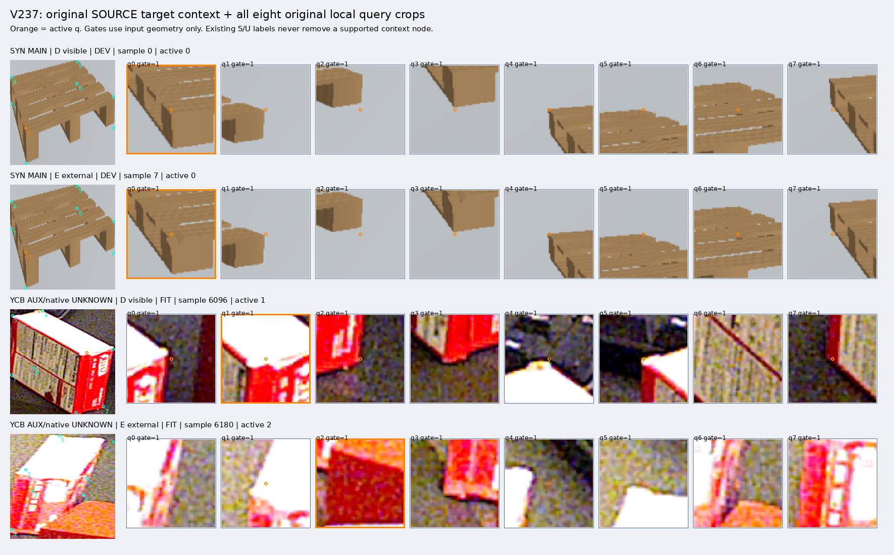

# V237–V239: 원 입력 복원·특징 경로 진단·다음 비교 준비

**새 모델의 개선 결과는 아직 없습니다.** V237 입력 복원은 완료했고, V238 실제 시도는 optimizer를 시작하기 전에 특징 일치 검사에서 중단됐습니다. V239는 이 문제를 피할 공통 특징 생성기와 두 모델의 비교 학습 코드를 준비한 단계입니다. 이 공개본에서 V239 실제 특징 생성·학습·새 DEV 추론은 0입니다.

| 단계 | 실제 수행한 일 | 확인된 결과 | 상태 |
|---|---|---|---|
| V237 | 합성·YCB-V 원 RGB에서 초기 q/L 그대로 8개 crop과 대상 문맥 복원 | 알려진 D/E 7,617개의 RGB96·valid SHA 모두 기존 입력과 일치. 독립 입력 QA 통과 | 완료 |
| V238 | 고정 DINO 특징과 문맥 residual head 비교 실행 시도 | 특징 검증에서 중단. 새 optimizer 0회, 새 DEV 출력 0개 | 실패 기록 보존 |
| V238 진단 | FIT 5,876개에서 기존 cached-prefix 경로와 새 full-forward 경로 비교 | 66개가 절대차 1e-6 초과, 최대 약 1.55158e-6. 첫 실패 batch 4 / sample 397 | 진단 완료 |
| V239 | 각 query 특징을 한 번 생성해 활성 query와 주변 query가 함께 사용하도록 구현 | 동일 공통 특징으로 local 기준 모델·context 모델을 각각 새로 1,000회 학습하는 계획 및 코드 준비 | 실제 실행 전 |

## 먼저 볼 자료

- [원 문맥과 8개 실제 crop 보드](artifacts/V237_ROOT_SOURCE_CONTEXT_INPUTS/fixed4_original_input_gallery/FIXED4_SOURCE_INPUT_CONTEXT_AND_Q8.png): SOURCE 합성 D/E·공개 실사 D/E에서 사전에 고정한 4개 사례. 주황색은 활성 query입니다. 성공·실패 예측 보드가 아닙니다.
- [V237 입력 복원 결과](artifacts/V237_ROOT_SOURCE_CONTEXT_INPUTS/original_source_inputs_v1/COMPLETE.json)와 [독립 검증](artifacts/V237_INPUT_REBUILD_REVIEW_C/REVIEW.json).
- [실제 V238 중단 traceback](artifacts/V238_ROOT_CONTEXT_RESIDUAL/context_residual_source_fit_v1/FAILED_EXECUTION.json), [최초 32개 경로 진단](artifacts/V238_FEATURE_ROUTE_DIAG/DIAGNOSIS.json), [전체 FIT 진단](artifacts/V238_ALL_FIT_DESCRIPTOR_DIAG/DIAGNOSIS.json), [행별 차이 CSV](artifacts/V238_ALL_FIT_DESCRIPTOR_DIAG/ALL5876_DESCRIPTOR_DIFFERENCES.csv).
- [V239 사전 프로토콜](artifacts/V239_ROOT_CANONICAL_CONTEXT/PROTOCOL_BEFORE_CANONICAL_FEATURES_OR_PAIRED_FIT.json), [공통 특징 생성 코드](artifacts/V239_CANONICAL_FEATURE_PRODUCER_B/build_canonical_source_features.py), [두 모델 학습 코드](artifacts/V239_CANONICAL_PAIRED_TRAINER_A/train_canonical_pair.py).
- 이전 완료 실험의 [혼동행렬·precision/recall·보류율](../V236_SOURCE_DIAGNOSIS_AND_PAIRED_TRAINING/artifacts/V235_SOURCE_REPORT_C/results/PORTABLE_REPORT_KO.md). 새 V238/V239 성능표로 해석하면 안 됩니다.



## 데이터와 라벨

SOURCE 원행 15,040개를 유지합니다. 알려진 D/E는 7,617개(FIT 5,876·DEV 1,741)이고, S/U 등 target=-1인 7,423개는 활성 binary loss에서 제외합니다. 문맥 노드는 의미 라벨이 아니라 원 입력의 좌표·valid 지원 여부로 사용합니다. 그룹은 1,767개이고, 원 RGB 자산은 합성 NPZ의 RGB_uint8 440개와 공개 YCB-V PNG 700개입니다. 다른 NPZ 멤버·depth·ownership을 이번 RGB 복원에서 디코딩하지 않았습니다.

합성은 지정된 native 표면점, YCB-V는 연관된 reference 주변의 공개 query 모사입니다. YCB의 native 대응은 UNKNOWN이며 8개 논리 슬롯이 실제 팔레트 native 키포인트를 뜻하지 않습니다. q/L·기존 native/U·내부 FIT/DEV 분할은 유지합니다. GT/reference/소유권/물체 ID/포즈는 모델의 입력 특징에 넣지 않습니다. SOURCE 내부 DEV는 이미 노출·재사용된 자료이며 새로운 독립 평가셋이 아닙니다.

현재223과 held 자료는 이번 작업에서 새로 읽거나 학습·정규화·문턱·모델·데이터·구조 선택에 사용하지 않았습니다. 좌표 회귀·GT recrop·PnP도 수행하지 않았습니다.

## 무엇이 막혔고 무엇을 바꿀 예정인가

V238은 원 crop의 픽셀·valid가 일치했지만, 기존 cached-prefix 경로와 새 full-forward 경로의 FP32 특징에 작은 차이가 있었습니다. 처음 진단한 32개는 기준을 통과했으나 전체 FIT 검사에서 66개가 초과했습니다. 새 full-forward와 새 prefix+finish는 해당 32개에서 byte-exact였습니다. 이 결과만으로 모든 차이의 원인을 특정 CUDA 연산 하나로 단정하지 않습니다. 분류기 성능 실패로도 해석하지 않습니다.

허용 오차 1e-6을 완화하지 않았습니다. V239는 하나의 full-forward 결과로 local 입력과 NODE_CLS를 구성하고, 알려진 7,617개에서 활성 특징의 byte 일치를 검증하도록 준비했습니다. 학습 기준 모델도 같은 공통 특징으로 새로 학습해 비교할 계획입니다. 기존에 학습한 CONTROL을 새로 학습한 모델처럼 취급하지 않습니다.

V239 계획은 CONTROL 76,098개 파라미터, TREAT 86,054개(문맥 residual 추가 9,956개)입니다. 동일 seed17 초기 base·동일 1,000×32 draw·AdamW·문턱 logit 0을 고정합니다. 두 최종 모델과 로그를 동결한 뒤 SOURCE DEV를 출력합니다. 사전 SOURCE 최소 기준은 가족 평균 balanced recall +3pp, 각 클래스 recall 하락 최대 2pp, YCB DEV E recall 50% 이상, 합성 DEV D/E 각각 90% 이상입니다. 통과해도 실사 팔레트 성공을 뜻하지 않으며 현재 평가에 대한 별도 후보 승인 절차가 필요합니다.

V238의 `CONTROL_LOCAL_CROP_FINAL1000.pt`, 로그, 행별 CSV는 이전 V233 CONTROL의 바이트 복사본입니다. 새 TREAT 체크포인트·훈련 로그·성능표는 생성되지 않았습니다. V239 준비 폴더의 toy 검증 결과는 실제 SOURCE 실행 결과와 구분해야 합니다.

## 파일 검산과 재현 범위

패키지를 내려받은 뒤 Python 표준 라이브러리만으로 선언된 파일의 SHA256·크기를 확인할 수 있습니다.

```bash
python -B verify_package.py --package . --manifest MANIFEST.json
```

[공개 원본 대응표](PUBLICATION_SOURCE_MAP.json)와 [공개 계획](PUBLICATION_PLAN.json)에 로컬 원본 경로·SHA·크기·압축 여부·제외 캐시를 기록했습니다. 큰 JSONL은 gzip으로 무손실 압축했습니다. 약 1.67GB의 RGB/valid 캐시 및 중단된 V238 중간 NODE/CONTEXT 특징은 Git에 복사하지 않았으며 로컬에 보존합니다. 생성 코드·입력 매핑·해시·작은 기하 정보·진단 배열·CSV·실제 crop 이미지는 포함합니다.

보존된 실행 entry의 절대 경로는 원 환경의 출처 기록입니다. 다른 환경에서 전체 실험을 실행하려면 해당 자산과 경로를 마련해야 하며, 이 패키지를 단독으로 곧바로 전체 학습할 수 있다는 뜻은 아닙니다. `verify_v238_saved_head_cpu.py`는 준비 코드이고 이번 V238/V239의 새 학습 모델 재검산에 실제 사용되지 않았습니다. 공식 DINO 가중치·vendor 전체 소스·비공개 평가 이미지는 배포하지 않습니다. [제3자 출처·라이선스](THIRD_PARTY_NOTICES.md)를 함께 확인하세요.
