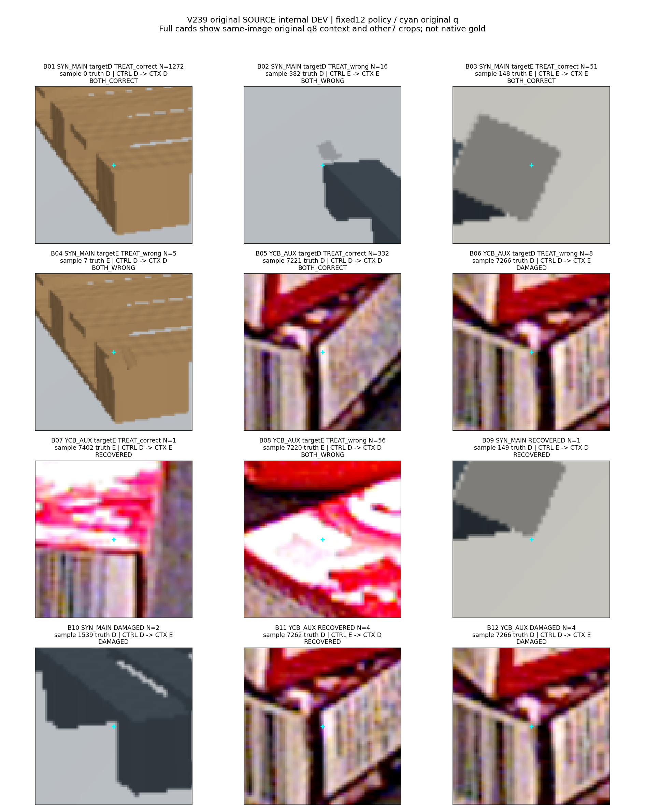

# V239–V240: 공통 특징·문맥 모델 실제 비교 결과

**기술적인 특징 일치 문제는 해결했지만, 가림 판별은 아직 해결하지 못했습니다.** 공통 특징으로 새 local 모델과 context 모델을 각각 1,000회 학습했습니다. 공개 YCB-V 내부 DEV 외부 가림은 0/57 → 1/57이며 사전 SOURCE 기준을 통과하지 못했습니다. 모델을 채택하지 않았고 현재223에 대한 새 평가도 하지 않았습니다.

| SOURCE 내부 DEV | 모델 | D recall | E recall | E precision | 보류율 |
|---|---|---:|---:|---:|---:|
| 합성, D1,288 / E56 | local | 98.84% | 91.07% | 77.27% | 0% |
| 합성, 같은 행 | context | 98.76% | 91.07% | 76.12% | 0% |
| YCB-V, D340 / E57 | local | 97.94% | 0.00% | 0.00% | 0% |
| YCB-V, 같은 행 | context | 97.65% | 1.75% | 11.11% | 0% |

보류율 0%는 원 입력을 만들 수 있는 known D/E 7,617개에서 문턱 0으로 강제 이진 출력한 결과입니다. 불확실성을 해결했다는 의미가 아닙니다. 원 target=-1인 S/U 등 7,423개는 손실·D/E 지표에서 제외하고 원 metadata에 유지합니다. SELF를 외부 가림 E로 합치지 않았습니다.

## 결과와 실제 이미지

- [혼동행렬·precision/recall·보류율·paired 결과](artifacts/V240_SOURCE_REPORT_C/results/PORTABLE_REPORT_KO.md), [지표 CSV](artifacts/V240_SOURCE_REPORT_C/results/METRICS.csv), [요약 JSON](artifacts/V240_SOURCE_REPORT_C/results/SUMMARY.json).
- [성공·실패 crop 보드](artifacts/V239_SOURCE_GALLERY_A/gallery_v1/FIXED12_SOURCE_DEV.png), [원 문맥·8개 query·두 모델 logit 갤러리](artifacts/V239_SOURCE_GALLERY_A/gallery_v1/PORTABLE_GALLERY_KO.html), [사례 표](artifacts/V239_SOURCE_GALLERY_A/gallery_v1/CASES.csv).
- [여전히 놓친 YCB E 사례](artifacts/V239_SOURCE_GALLERY_A/gallery_v1/CASE_08_SAMPLE_7220/CARD.png), [새로 회복한 유일한 YCB E 사례](artifacts/V239_SOURCE_GALLERY_A/gallery_v1/CASE_07_SAMPLE_7402/CARD.png).
- [SOURCE 오류 조인 검증](artifacts/V240_SOURCE_ERROR_JOIN_B/REVIEW.json). 기존 object·논리 aux·q–reference 구간과 새 예측을 연결했습니다.
- [실제 학습 COMPLETE](artifacts/V239_ROOT_CANONICAL_CONTEXT/canonical_pair_source_fit_v1/COMPLETE.json), [독립 학습 완료 검산](artifacts/V240_ROOT_COMPLETION_QA_B/actual_review_v1/REVIEW.json), [독립 공통 특징 검산](artifacts/V239_FEATURE_PACKET_QA_C/actual_feature_review_v1/REVIEW.json).



정해 둔 12개 bucket에서 최소 sample_index를 선택했습니다. 11개 고유 sample·9개 고유 group이며 중복 사례를 독립 표본으로 세지 않습니다. 같은 원 장면의 q8 문맥과 원 q/L의 local crop을 표시합니다. cyan은 원 query이며 GT reference/pose/ownership을 그림 입력이나 모델 입력으로 넣지 않았습니다. 이 보드는 재사용·노출된 SOURCE 내부 DEV 사례이고 팔레트 current 평가 결과가 아닙니다.

## 무엇을 실제로 확인했나

V238은 기존 cached-prefix와 새 full-forward의 작은 FP32 차이로 optimizer 전에 중단됐습니다. V239는 각 node의 full96·centre32 특징을 한 번 만들고, 그 결과를 local 입력과 NODE_CLS에 함께 사용했습니다. 활성 query 7,617개 모두 first384 byte 일치, 원 condition32·valid fractions·group/slot·q/L·FIT/DEV 대응을 독립 검산했습니다. 허용 오차 완화나 불일치 특징 덮어쓰기는 없었습니다. 공식 DINO의 가중치는 생성 전후 상태 SHA가 같고 encoder 학습은 0입니다.

이번 두 arm은 모두 새로 학습했습니다. 이전 V233 CONTROL 체크포인트를 재사용하지 않았습니다. CONTROL 76,098개·TREAT 86,054개 파라미터이며 TREAT에 residual 9,956개가 추가됩니다. 같은 seed17 초기 base·같은 원 PCG17 draw 1,000×32·동일 AdamW·동일 문턱 logit 0을 사용했습니다. 두 최종 체크포인트와 로그를 동결한 뒤에만 DEV head 출력을 만들었습니다. 추가 파라미터 수가 다르므로 문맥 효과만을 분리한 parameter-matched 인과 실험은 아닙니다.

합성은 intended-native witness0 MAIN, YCB는 associated-r AUX 교사입니다. YCB native는 UNKNOWN이며 aux slot을 팔레트 물리 native8로 해석하지 않습니다. 공개 q는 원 GT-jitter emulation으로 실제 detector 오차 분포 인증이 아닙니다. 문맥 node 지원 여부는 원 query availability·valid central4·anyvalid로만 계산하며 S/U 의미 라벨을 이용해 node를 지우지 않습니다.

## 남은 실패와 채택 판단

가족 평균 DEV balanced-recall gain은 **+0.345657pp**입니다. 사전 최소 +3pp에 못 미치고 YCB DEV E recall도 최소 50%보다 낮습니다. 합성 D/E 각각 90% 이상과 최대 클래스 하락 2pp 이하는 만족했지만 전체 기준은 FAIL입니다. 문턱·epoch·seed를 다시 고르지 않았으며 selected arm은 null, current admission은 false입니다.

YCB FIT E는 두 모델 모두 283/283을 맞혔지만 DEV에서는 TREAT도 1/57입니다. SOURCE 오류 조인에서 E 회복 1·계속 미검출 56·E 손상 0을 확인했습니다. 공개 q–reference 차이가 3px 이하인 E30개는 모두 여전히 놓쳤고, 3px 초과 E27개 중 1개가 회복됐습니다. 이 차이는 구성된 공개 query jitter 구간이며 실제 initializer 오차에 대한 새 실사 결과가 아닙니다.

DEV E53/57이 scene6/object7에 있고, DEV E57개 모두 같은 object×aux 조합의 FIT E 지원은 0이라는 기존 분포도 그대로입니다. 물체 자체의 FIT E 지원이 전혀 없는 것은 아닙니다. 높은 FIT 적합·새 장면의 낮은 E 검출·감독 구성 편중을 관측했지만 특정 shortcut이나 실패 원인의 인과를 확정하지 않습니다. 같은 무늬의 상자가 겹친 이미지 한 장도 원인 빈도의 증거로 사용하지 않습니다.

현재223·held 자료는 이번 특징 생성·학습·정규화·문턱·모델·데이터·구조 선택 또는 새 추론에 사용하지 않았습니다. PnP·좌표 회귀·GT recrop도 없습니다. [이전 공개 시점 V237–V239 준비 기록](../V239_SOURCE_CONTEXT_INPUTS_AND_PREPARATION/README_KO.md)과 [이전 V234–V236 진단·실험](../V236_SOURCE_DIAGNOSIS_AND_PAIRED_TRAINING/README_KO.md)을 유지합니다. 이전 팔레트 평가 수치를 새 V239 성능으로 바꾸지 않았습니다.

다음 검증 후보는 같은 q의 COVER/SHAM을 **원 장면 한 번에 합성한 뒤 local·다른 q8·대상 문맥을 함께 추출**하는 데이터 경로입니다. COVER/SHAM 자체는 이미 V235에서 시험한 방법이며 새 아이디어라고 주장하지 않습니다. 이번에 새로 확인할 차이는 모든 입력이 같은 합성 장면을 보는지입니다. 기존 local96 합성을 clean context와 붙이지 않습니다. 데이터 생성·감독 근거·분리 검증 후에만 별도 사전 학습 프로토콜을 정할 예정이며 아직 새 대조 데이터나 후속 학습 결과는 없습니다.

## 다른 환경에서 확인하기

선언된 파일의 SHA256·크기 검산은 Python 표준 라이브러리로 실행합니다.

```bash
python -B verify_package.py --package . --manifest MANIFEST.json
```

저장된 행별 결과에서 지표·보고서를 다시 계산합니다. 원 source 경로를 따라가지 않습니다.

```bash
python -B artifacts/V239_FEATURE_PACKET_QA_C/summarize_saved_pair.py \
  --verify-saved "$PWD/artifacts/V240_SOURCE_REPORT_C/results"
```

이미 설치된 NumPy·PyTorch 환경에서는 아래 명령으로 공개된 frozen 특징과 작은 모델만 CPU에서 다시 실행할 수 있습니다. 이미지·DINO base·원 GT가 필요하지 않습니다.

```bash
python -B code/verify_v239_saved_head_cpu.py \
  --module code/relational_query_head.py \
  --checkpoint artifacts/V239_ROOT_CANONICAL_CONTEXT/canonical_pair_source_fit_v1/CONTROL_CANONICAL_LOCAL_FINAL1000.pt \
  --features-dir artifacts/V239_ROOT_CANONICAL_CONTEXT/canonical_source_features_v1 \
  --geometry replay/INPUT_GEOMETRY.npz \
  --csv artifacts/V239_ROOT_CANONICAL_CONTEXT/canonical_pair_source_fit_v1/CONTROL_CANONICAL_LOCAL_ALL_SOURCE_ROWS.csv \
  --arm CONTROL_CANONICAL_LOCAL

python -B code/verify_v239_saved_head_cpu.py \
  --module code/relational_query_head.py \
  --checkpoint artifacts/V239_ROOT_CANONICAL_CONTEXT/canonical_pair_source_fit_v1/TREAT_CANONICAL_CONTEXT_FINAL1000.pt \
  --features-dir artifacts/V239_ROOT_CANONICAL_CONTEXT/canonical_source_features_v1 \
  --geometry replay/INPUT_GEOMETRY.npz \
  --csv artifacts/V239_ROOT_CANONICAL_CONTEXT/canonical_pair_source_fit_v1/TREAT_CANONICAL_CONTEXT_ALL_SOURCE_ROWS.csv \
  --arm TREAT_CANONICAL_CONTEXT
```

원 환경의 CPU 재실행에서는 각 arm의 7,617개 예측이 모두 일치했습니다. 두 logit의 GPU 대비 최대 절대차는 local 약 3.815e-6·context 약 4.768e-6으로, 결과를 보기 전에 정한 atol=rtol=1e-5 안에 들었습니다. TREAT의 self/unsupported attention 0과 행 합도 전량 확인했습니다. 다른 하드웨어의 bitexact 보장을 뜻하지 않습니다.

[MANIFEST](MANIFEST.json)·[원본 대응표](PUBLICATION_SOURCE_MAP.json)·[공개 계획](PUBLICATION_PLAN.json)에 파일 해시와 출처·제외 항목을 기록합니다. 6개 frozen feature 배열·2개 작은 모델·로그·CSV·기하 정보·SOURCE samples metadata·실제 이미지·실행 코드를 포함합니다. 중복 NODE_PIXEL_FEATURES 캐시는 로컬에 보존하고 SHA·크기만 기록합니다. 원 RGB/valid 캐시·공식 DINO 가중치·vendor 전체·비공개 평가 이미지는 포함하지 않습니다. 원 실행 entry의 절대 경로는 출처 기록이며 전체 원영상 생성·DINO 특징 생성·학습을 즉시 재현하는 휴대형 설치 패키지는 아닙니다. [제3자 출처와 라이선스](THIRD_PARTY_NOTICES.md)를 확인하세요.
