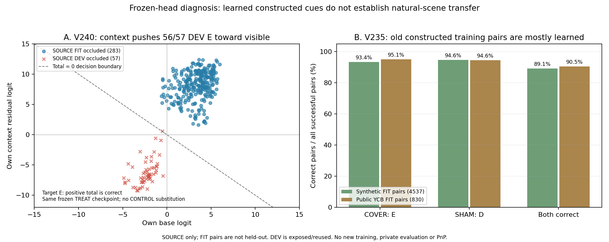
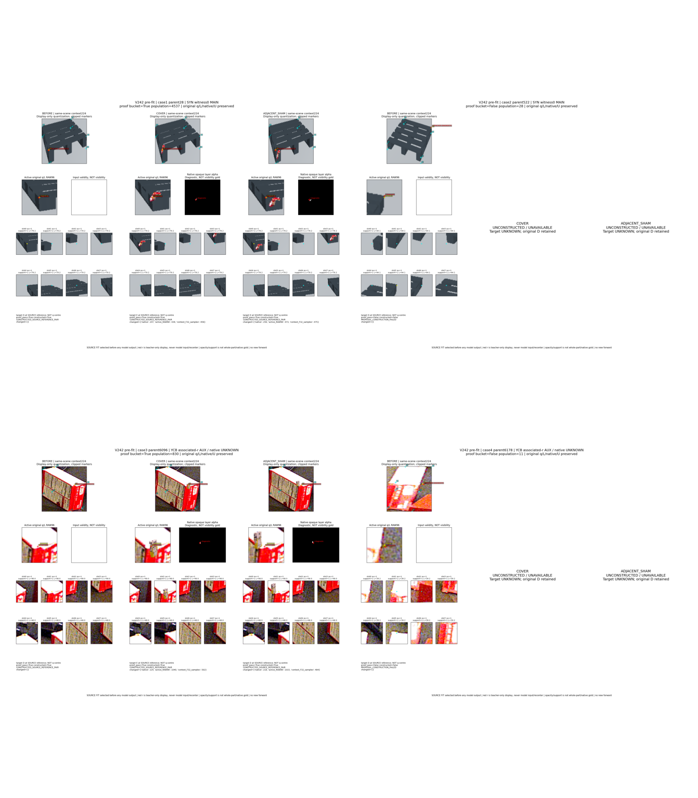

# V242–V244: 실제 합성 데이터 검산과 동결 모델 실패 진단

**새 모델 성능이 좋아졌다는 결과는 아직 없습니다. 대신 두 가지 미확인 동작을 실제로 검산해, 실패 위치를 좁혔습니다.** V242 실제 scene-consistent 합성 쌍과 독립 전량 검산·시각화는 완료했습니다. V243는 코드 준비 상태이고 실제 새 학습은 0입니다. 현재 팔레트223/held 새 사용과 PnP도 0입니다. [전체 상태](STATUS.json).

## 이번에 확인한 것

| 질문 | 실제 관측 | 해석의 범위 |
|---|---|---|
| V240 문맥 경로가 약해서 고치지 못했나? | YCB DEV 외부 가림57개 중56개에서 잔차가 반대인 **보임 방향**. TREAT 자체 base0/57 → total1/57. 잔차 중앙값 −6.675 | 작은 영향만의 문제가 아님. 학습 FIT E283개에서는 잔차가 전부 가림 방향. 반복 노출된 SOURCE의 장면 전이가 실패함. 특정 물체/이미지가 원인이라고 확정하지 않음 |
| V235가 인위적 COVER/SHAM을 배웠나? | YCB 학습용 pool830쌍에서 COVER 가림789/830(95.1%), SHAM 보임785/830(94.6%), 둘 다751/830(90.5%) | 인위적 가림 기능을 대부분 배움. 같은 V235의 이전 자연 DEV 가림은0/57이었음. 학습용 pool 성적을 자연 가림 성적으로 부를 수 없음 |
| 자연 가림 실패 조합에 CF 학습이 빠졌나? | object7/aux3·7 및 object2/aux2의143성공쌍 모두 양 역할에 실제 draw됨. COVER650/SHAM694회.143쌍 모두 COVER>SHAM, 둘 다 정답130/143 | 이 조합에 CF가 한 번도 없었다는 설명은 맞지 않음. 물체/aux와 장면의 영향은 여전히 얽혀 있음 |
| 새 입력이 같은 장면인가? | V2425,406부모 전부 시도.5,367proof PASS/39미생성 UNKNOWN. 원 BEFORE SHA 및 실제 생성된 모든 native 합성·q8 crop·context 독립 전량 검산 PASS | 깨끗한 문맥과 활성 crop만 합성한 가림의 불일치를 데이터 단계에서 해소. 분류 개선은 미검증 |



왼쪽은 **같은 V240 TREAT checkpoint의 내부 base와 residual**입니다. 별도 CONTROL을 base 대신 쓰지 않았습니다. 양수 total은 가림 E이며 점선은 total=0 문턱입니다. 오른쪽은 **다른 실험인 V235**의 인위적 학습용 쌍 기능 검사입니다. V235와 V240을 같은 모델인 것처럼 합쳐 해석하지 않습니다. SOURCE DEV는 이미 노출·재사용됐으며 새 blind 검증이 아닙니다.

## V235 학습용 쌍의 혼동행렬

원본 post96 COVER/SHAM과 당시 full96+center32 전처리·동결 official DINO·최종 V235 head를 그대로 재구성했습니다. 실제 새 학습 없이10734개 역할 입력의 특징을 계산해 저장했습니다. 과거 CF 특징이 저장되지 않았으므로 그 없는 원 특징과 byte 비교했다고 주장하지 않습니다. 새 저장 특징의 CPU head 재생은 양 family logits21468개를 기존1e-5 허용오차로 확인했고10734개 역할 예측이 정확히 일치했습니다.

행=정답 D(SHAM)/E(COVER), 열=예측 D/E/U입니다. 두 family 출력은 각각 binary logit이며 argmax 두-class 분류가 아닙니다. 문턱은0을 유지했습니다.

| SOURCE FIT pool | D행: D/E/U | E행: D/E/U | E precision / recall | D precision / recall |
|---|---|---|---|---|
| 합성4537쌍 |4294 /243 /0|301 /4236 /0|94.57% /93.37%|93.45% /94.64%|
| 공개 YCB830쌍 |785 /45 /0|41 /789 /0|94.60% /95.06%|95.04% /94.58%|

미생성39쌍은 target−1/예측U/null로 별도 보존했습니다. 생성 성공분에서 예측 보류는0이며,39개를 모델의 자신감 기반 보류로 부르지 않습니다. 성공 pool의 모든 쌍이 양 역할 모두 실제 optimizer에 노출된 것은 아닙니다. YCB는 COVER823·SHAM815개 고유 쌍이 draw됐고, 위 실패 조합143개는 전부 양 역할에 노출됐습니다. 합성 pool은4537개 중 COVER2654·SHAM2630개 고유 쌍만 실제 draw됐습니다.

- [V235 역할별 전체5406행](artifacts/V244_ROOT_FROZEN_BEHAVIOR/v235_pair_replay_v1/ALL5406_OLD_PAIR_BEHAVIOR.csv), [집계](artifacts/V244_ROOT_FROZEN_BEHAVIOR/v235_pair_replay_v1/SUMMARY.json), [실행 완료·동결 상태](artifacts/V244_ROOT_FROZEN_BEHAVIOR/v235_pair_replay_v1/COMPLETE.json).
- [V240 TREAT 내부 전체7617행](artifacts/V244_OWN_BRANCH_DIAGNOSTIC_A/actual_diagnosis_v1/ALL7617_OWN_BRANCH_ROWS.csv), [분기 통계](artifacts/V244_OWN_BRANCH_DIAGNOSTIC_A/actual_diagnosis_v1/FAMILY_ROLE_TARGET_BRANCH_STATS.csv), [원 total 재현 QA](artifacts/V244_OWN_BRANCH_DIAGNOSTIC_A/actual_diagnosis_v1/TOTAL_REPLAY_QA.json).
- [실패 object/aux 조합·실제 draw 감사](artifacts/V244_ROOT_FROZEN_BEHAVIOR/ycb_pair_join_v1/COMPLETE.json), [독립 분기 산술 QA](artifacts/V244_SAVED_OUTPUT_QA_C/actual_own_branch_review_v1/REVIEW.json), [독립 쌍 산술 QA](artifacts/V244_SAVED_OUTPUT_QA_C/pair_review_v1/results/REVIEW.json).

## 같은 장면에서 만든 새 V242 데이터



[확대 가능한 사례 갤러리](artifacts/V242_SCENE_GALLERY_A/gallery_v2/PORTABLE_GALLERY_KO.html) · [사례 목록](artifacts/V242_SCENE_GALLERY_A/gallery_v2/CASES.csv) · [독립 전량 검산](artifacts/V242_SCENE_DATA_QA_C/actual_review_v1/REVIEW.json).

원래 FIT D5406개(합성4565·YCB841)를 모두 유지했습니다. 같은 원 해상도 장면에 가림층을 한 번 합성하고 원 q/L로8개 crop과 context를 다시 추출했습니다.5,367개가 새 r footprint proof를 통과했고39개는 미생성 상태로 남았습니다. 예시 선정은 모델 결과를 보기 전 family×proof 상태의 고정 최소 sample 규칙이며 실패 두 사례도 포함합니다. 원 BEFORE 활성 crop SHA는5406개 모두 기존과 같습니다.

라벨은 supervision 기준점 **r의 가림**입니다. 모델 입력은 최초 추론점 **q**를 유지합니다. 둘의 footprint가 다른 사례를 별도 집계했으며 라벨/부모를 재선택하지 않았습니다. [q/r 거리별 관측표](artifacts/V242_QUERY_REFERENCE_DIAGNOSTIC_C/FOOTPRINT_FAILURES_BY_FAMILY_DISTANCE.csv), [해석](artifacts/V242_QUERY_REFERENCE_DIAGNOSTIC_C/KO.md). 이 관측은 r proof와 q footprint의 차이이며 q 단일 픽셀의 물체 존재 GT가 아닙니다.2D alpha 증명도3D 물리/native gold가 아닙니다. YCB는 associated-r AUX이고 팔레트 native는 UNKNOWN입니다. self/UNKNOWN을 E로 바꾸지 않았고 r·owner·depth·물체ID는 모델 입력이 아닙니다.

## 코드·검증·원본 보존

- [검토 문서 대조](artifacts/V244_ROOT_FROZEN_BEHAVIOR/REVIEW_RECONCILIATION_KO.md), [동결 행동 진단 사전 프로토콜](artifacts/V244_ROOT_FROZEN_BEHAVIOR/PROTOCOL_BEFORE_FROZEN_SOURCE_DIAGNOSTICS.json).
- [실제 scene pair 생성 코드](artifacts/V242_SCENE_CF_DRIVER_B/build_scene_pairs_v2.py), [독립 pixel 검산 코드](artifacts/V242_SCENE_DATA_QA_C/verify_scene_pairs.py), [고정 gallery 코드](artifacts/V242_SCENE_GALLERY_A/build_gallery_v2.py).
- [TREAT 내부 분해 코드](artifacts/V244_OWN_BRANCH_DIAGNOSTIC_A/diagnose_own_branches.py), [옛 CF 특징·head 재생 코드](artifacts/V244_V235_PAIR_DIAGNOSTIC_B/replay_v235_pairs.py).
- [미실행 CF 특징 생산기](artifacts/V242_CF_FEATURE_PRODUCER_B/FINAL_READY_V2.json), [미실행 V243 trainer](artifacts/V243_SCENE_CF_TRAINER_A/FINAL_READY_V2.json). 코드 준비를 실제 학습으로 세지 않습니다.
- [전체 manifest](MANIFEST.json), [원 파일 SHA·압축 대응](PUBLICATION_SOURCE_MAP.json), [큰 cache 제외 명세](LARGE_CACHE_EXCLUSIONS.json), [제3자 고지](THIRD_PARTY_NOTICES.md). 수정 전 코드·가상 fixture 실패·수리 원본도 포함합니다. 원본 metadata의 절대 경로는 출처 기록이며 자동으로 따라가지 않습니다.

표준 Python만으로 복사 파일 무결성과 두 동결 진단의 저장 표 산술을 재현할 수 있습니다. 아래 명령은 checkpoint/특징/평가 이미지/GT를 읽지 않습니다.

```bash
python -B verify_package.py --package . --manifest MANIFEST.json
python -B verify_saved_outputs.py --package .
```

PyTorch/NumPy 환경에서는 저장된 쌍 특징으로 작은 head 예측도 CPU에서 재현할 수 있습니다. 기존 V236 공개 checkpoint를 명시해 사용하며 DINO나 원 RGB는 필요 없습니다.

```bash
python -B artifacts/V244_ROOT_FROZEN_BEHAVIOR/replay_old_pair_head_cpu.py \
  --saved-dir artifacts/V244_ROOT_FROZEN_BEHAVIOR/v235_pair_replay_v1 \
  --checkpoint ../V236_SOURCE_DIAGNOSIS_AND_PAIRED_TRAINING/artifacts/V235_ROOT_PUBLIC_COUNTERFACTUAL/data_only_source_fit_v1/TREAT_CF_DATA_ONLY_FINAL1000.pt
```

SOURCE 원 RGB·donor 및9.35GB의 큰 입력 cache는 Git에 중복 싣지 않았습니다. 대신 정확한 SHA/크기·생성 코드·독립 검산·고정 실제 사례·작은 배열·압축 원 metadata를 보존했습니다. 전량 native 이미지 재생에는 그 원 SOURCE 파일들이 필요합니다. 공개 파일의 무결성 검사와 원 이미지 전량 재생은 서로 다른 검증입니다.

## 다음 판단

단순히 같은 CF를 처음 제안하거나 문맥을 처음 넣는 단계가 아닙니다. V235는 인위적 가림 기능을 대체로 배웠고 V240의 문맥 경로는 자연 DEV 가림에서 잘못된 방향으로 작동했습니다. **학습용 가림에서 자연 가림으로 이어지는 판단 근거가 아직 해결되지 않았습니다.** 같은 native 장면으로 q8와 context를 맞춘 제한된 SOURCE 비교를 준비했지만, 그 결합의 효과·상호작용·현재 팔레트 전이는 아직 검증하지 않았습니다. 새 모델 채택이나 현재셋 재평가에 앞서 고정 SOURCE 비교가 필요합니다.

[이전 실제 학습 V240](../V240_CANONICAL_CONTEXT_ACTUAL_RESULTS/README_KO.md) · [V235–V236 학습·자연 DEV 결과](../V236_SOURCE_DIAGNOSIS_AND_PAIRED_TRAINING/README_KO.md) · [V241 준비 원본](../V241_SCENE_CONSISTENT_CF_PREPARATION/README_KO.md) · [전체 색인](../EXPERIMENT_INDEX_KO.md).
