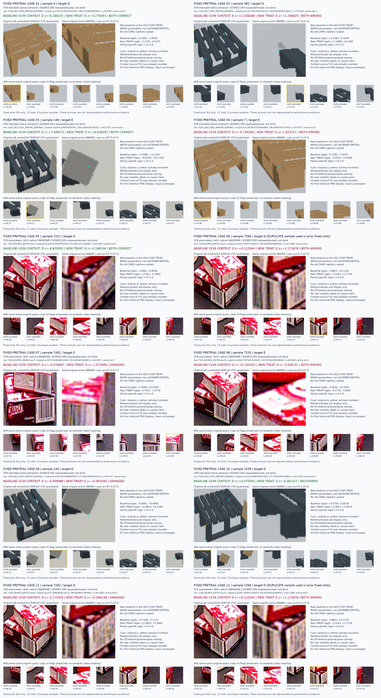

# V245: 동일 장면 합성 가림을 추가한 실제 학습 결과 — 채택하지 않음

공개 실사(YCB-V)와 합성으로 학습하는 작은 query head에, 같은 장면에서 만든 COVER/ADJACENT_SHAM 가림 쌍을 추가했습니다. 새 head의 고정 1,000회 학습, 독립 CPU 재생, 저장 결과 재집계를 완료했습니다. **자연 가림의 개선보다 보이는 점의 오판 증가가 커서 채택 기준에 미달했습니다. 현재 팔레트 평가셋에는 이 후보를 적용하지 않았습니다. 문제는 아직 해결되지 않았습니다.**

## 무엇을 실제로 했나

- 이전 V239의 q8+context head를 baseline으로 그대로 재사용했습니다. baseline checkpoint·학습 로그·CSV는 원본과 바이트가 같고, 추가 학습은 0회입니다. 이번 새 head도 같은 86,054개 파라미터 구조이며, seed 17·AdamW·문턱 logit 0·1,000회로 사전에 고정했습니다.
- 원래 FIT의 보임 부모 5,406개에서 만든 동일 장면 가림 쌍을 사용했습니다. 5,367개는 구성·proof 검증을 통과했고, 구성하지 못한 39개는 UNKNOWN으로 남겼습니다. 단일 합성 장면으로부터 8개 query crop과 context를 함께 읽도록 했습니다. q·crop 크기 L·키포인트 순서·원래 U와 split은 유지했습니다.
- frozen DINO의 canonical CF feature 9개를 실제 추출했습니다. 원래 자연 데이터 7,617행과 CF를 학습 전에 검사했고, 사전에 봉인한 1,000회 draw ledger와 실제 ledger가 바이트까지 일치했습니다. 새 head를 마지막 update에서 고정한 뒤 자연 DEV를 출력했습니다.
- 독립 CPU 재생은 자연 7,617행의 예측이 전부 일치했습니다. logit 15,234개의 최대 절대 차이는 0.0000038147이며 고정 허용오차 이내입니다. 결과 CSV를 표준 Python으로 다시 집계해 생산자 산술과 대조했습니다. 이 QA 통과는 모델 성능 통과와 별개입니다.

## 자연 SOURCE DEV 결과

D=보임, E=외부 가림, U=입력 불가/보류입니다. precision/recall은 각 데이터의 기존 라벨 정의에 따릅니다. 두 데이터의 라벨 권위와 결과를 합치지 않았습니다. SOURCE DEV는 이미 노출·재사용된 개발 자료이며 독립적인 최종 평가가 아닙니다.

| 데이터 | 지표 | 이전 q8+context | 새 동일 장면 CF head |
|---|---|---:|---:|
| 합성 | D recall | 98.76% (1,272/1,288) | 98.06% (1,263/1,288) |
| 합성 | E recall | 91.07% (51/56) | 91.07% (51/56) |
| 합성 | E precision | 76.12% | 67.11% |
| 공개 실사 YCB | D recall | 97.65% (332/340) | 87.06% (296/340) |
| 공개 실사 YCB | E recall | 1.75% (1/57) | 10.53% (6/57) |
| 공개 실사 YCB | E precision | 11.11% | 12.00% |
| 두 데이터 각각 | U 비율 | 0% | 0% |

혼동행렬은 **행=정답 D/E, 열=예측 D/E/U**입니다.

| 데이터 | 이전 | 새 head |
|---|---|---|
| 합성 DEV | `[[1272,16,0],[5,51,0]]` | `[[1263,25,0],[5,51,0]]` |
| 공개 실사 DEV | `[[332,8,0],[56,1,0]]` | `[[296,44,0],[51,6,0]]` |

공개 실사는 가림 정답이 순수하게 5개 늘었지만, 보이는 점을 가림으로 오판한 수가 8개에서 44개로 늘었습니다. 행별로 보면 정답으로 회복한 7개에 비해 기존 정답이 오답이 된 38개가 더 많습니다. 합성 DEV도 회복 3개·악화 12개입니다. 데이터별 balanced recall의 평균 변화는 **−0.6288%p**입니다.

사전 기준은 평균 balanced recall +3%p 이상, 각 class recall 감소 2%p 이하, YCB E recall 50% 이상, 합성 D/E recall 각각 90% 이상이었습니다. 평균 변화·YCB D 감소·YCB E 기준을 통과하지 못했습니다. 결과를 본 뒤 seed·epoch·문턱을 조정하지 않았습니다.

[전체 CM·precision·recall·U 표](artifacts/V245_SOURCE_REPORT_C/results_v1/PORTABLE_REPORT_KO.md) · [metric CSV](artifacts/V245_SOURCE_REPORT_C/results_v1/NATURAL_METRICS.csv) · [전체 자연 행별 비교](artifacts/V245_SOURCE_REPORT_C/results_v1/PAIRED_NATURAL7617.csv) · [CF 별도 진단](artifacts/V245_SOURCE_REPORT_C/results_v1/CF_DIAGNOSTIC10812.csv)

## 좌표와 실제 crop 확인

YCB SOURCE의 저장 q–r 거리가 3px 이하인 DEV 211행(D 181/E 30)을 따로 확인했습니다. D 정답은 177→155개, E 정답은 0→4개입니다. **가까운 query에서도 E 30개 중 26개를 놓치므로, 위치 어긋남만으로 실패를 설명할 수 없습니다.** 이 거리는 공개 데이터에서 기준점 주변에 만든 query의 변위이며, 현재 팔레트 검출기의 실제 좌표 오차를 측정한 값은 아닙니다.

[거리별 전체 분모·결과](artifacts/V245_QUERY_ERROR_JOIN_A/results_v1/KO.md) · [1,521행 거리 결합표](artifacts/V245_QUERY_ERROR_JOIN_A/results_v1/ALL1521_YCB_QUERY_ERROR_ROWS.csv)

기존 V239에서 고정했던 동일 사례를 재사용했습니다. 12슬롯은 11개 고유 표본·9개 group이며, 중복 1개를 표시했습니다. 새 결과를 보고 사례를 다시 고르지 않았습니다. 아래 그림에서 녹색은 정답 유지/회복, 붉은색은 오답 유지/악화입니다. 그림은 사례 설명이며 모집단 성능은 위 전체 표에서 확인해야 합니다.



[큰 이미지와 사례별 보기](artifacts/V245_FIXED_GALLERY_A/fixed12_gallery_v1/PORTABLE_GALLERY_KO.html) · [사례 표](artifacts/V245_FIXED_GALLERY_A/fixed12_gallery_v1/CASES.csv) · [합성 보임 악화 사례](artifacts/V245_FIXED_GALLERY_A/fixed12_gallery_v1/CASE_09_SAMPLE_0149/CARD.png) · [공개 실사 보임 악화 사례](artifacts/V245_FIXED_GALLERY_A/fixed12_gallery_v1/CASE_11_SAMPLE_7262/CARD.png)

## 무엇을 알게 됐고 무엇이 남았나

동일 장면으로 crop·context의 가림을 일치시키고 matched sampling으로 학습해도, 이 고정 recipe는 자연 가림 일반화를 해결하지 못했습니다. 새 head의 공개 실사 CF FIT에서는 COVER E 정답이 804/830, SHAM D 정답이 768/830이지만 자연 DEV E는 6/57입니다. CF FIT 성적을 자연 가림 성능으로 볼 수 없습니다. 앞서 V244에서 확인한 옛 CF 함수 학습 여부와 이번 새 head 결과도 서로 다른 checkpoint의 증거입니다.

합성 가림의 형태·자연 장면의 단서·대상/부위의 학습 범위 차이가 남은 후보 원인입니다. 이번 비교만으로 특정 물체, 장면 또는 단서 하나를 원인으로 확정할 수 없습니다. YCB DEV의 E 57개가 모두 사전에 표시했던 object/aux 조합에 몰려 있어, 조합 효과와 가림 class 효과도 분리할 수 없습니다. 인공 가림 쌍의 점수를 더 올리는 반복보다, 공개 자연 자료의 라벨 정의와 대상·부위·가림 범위를 점검하는 것이 다음 진단 과제입니다. 현재 평가 데이터는 이 판단에 사용하지 않습니다.

최종 목표는 초기 추론 query 중심 crop에서 해당 팔레트 부위가 보이는지/외부에 가렸는지를 판단하는 것입니다. 이번 head는 좌표를 보정하지 않았고 PnP도 수행하지 않았습니다. 자기 가림은 사용자가 설명한 상위 기하 필터의 역할로 유지합니다. 현재 평가셋의 목재/정사각형·외부/자기 가림 및 v61 대비 최종 개선은 이번 SOURCE 결과로 주장할 수 없습니다.

## 라벨·재현 범위

합성의 기존 intended-native witness0와 공개 YCB의 associated-r AUX 라벨을 구분합니다. YCB native physical gold는 UNKNOWN이며, 좁은 r 지지 영역의 2D 가림 proof를 literal q 픽셀·팔레트 전체 부위의 물리적 가림 정답으로 승격하지 않습니다. r·소유권·depth·pose·object ID는 teacher/진단 정보이며 head 입력에 넣지 않았습니다. 원래 15,040행 중 S/U 7,423행은 loss mask를 유지했습니다.

저장 결과는 이 폴더에서 다음 명령으로 CPU/GPU 모델 실행 없이 다시 집계할 수 있습니다.

```bash
python -B artifacts/V245_SOURCE_REPORT_C/report_saved_source.py --verify-saved artifacts/V245_SOURCE_REPORT_C/results_v1
```

[feature COMPLETE](artifacts/V242_ROOT_SCENE_CF/cf_canonical_features_v1/COMPLETE.json) · [fit COMPLETE](artifacts/V243_ROOT_SCENE_CF_TRAINING/scene_CF_source_fit_v1/COMPLETE.json) · [독립 feature QA](artifacts/V242_CF_FEATURE_PACKET_QA_C/actual_review_v1/REVIEW.json) · [학습·CPU QA](artifacts/V245_TRAIN_COMPLETION_QA_B/actual_review_v1/REVIEW.json) · [사전 고정 protocol](artifacts/V245_ROOT_SCENE_CF_ACTUAL/PROTOCOL_BEFORE_CF_FEATURES_AND_FIXED_SOURCE_FIT.json) · [상태](STATUS.json) · [SHA manifest](MANIFEST.json) · [원본 대응](PUBLICATION_SOURCE_MAP.json)

공개 범위는 새 feature 9개·작은 head checkpoint·학습 로그·행별 CSV·QA·고정 crop·코드입니다. 원본 대형 RGB 캐시와 공식 backbone 가중치는 다시 올리지 않으며 [제외 목록](LARGE_CACHE_EXCLUSIONS.json)에 기존 SHA와 재생성 근거를 남깁니다. 절대 경로는 provenance이며 임의로 따라가서 읽는 경로가 아닙니다. 원본과 재생성 코드는 [V244 기록](../V244_SCENE_DATA_AND_FROZEN_BEHAVIOR/README_KO.md), 원래 canonical feature는 [V240 기록](../V240_CANONICAL_CONTEXT_ACTUAL_RESULTS/README_KO.md)에 있습니다. [출처·라이선스](THIRD_PARTY_NOTICES.md)도 함께 확인할 수 있습니다.
