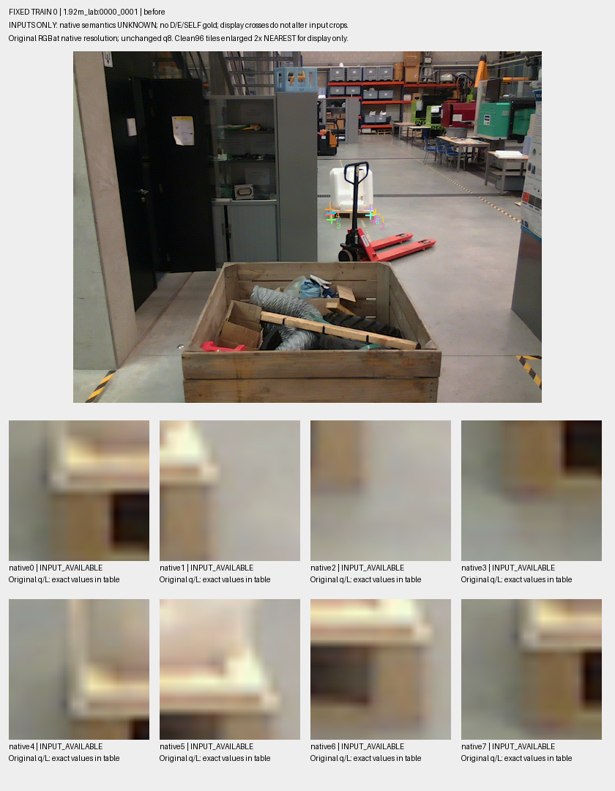
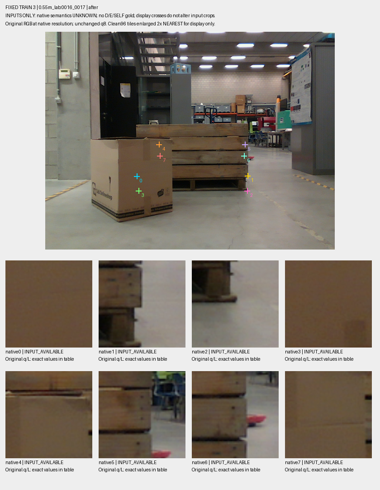

# V246: 공개 팔레트 실사의 원 query와 가림 근거를 실제 대조

Pallox 공개 실사의 기존 TRAIN 44장·원 query 352개를 분리하고, 저장된 SAM·mesh·paired-depth 근거를 **원래 q에서** 읽었습니다. 조건부 근거는 정확한 한 픽셀에서 보임 25개·외부 가림 9개·판단 불가 318개입니다. 전체 352행의 입력과 계산을 독립 구현으로 재검산했습니다. **이 수치는 모델 정확도가 아니며 native 키포인트 정답도 아닙니다. 새 학습·모델 채택·현재 평가셋 추론·PnP는 0입니다. 전체 목표는 아직 해결되지 않았습니다.**

## 실제로 확인한 것

이전 [V245 고정 학습](../V245_SCENE_CF_SOURCE_TRIAL/README_KO.md)은 자연 SOURCE 성능 기준을 통과하지 못했습니다. 이번에는 공개 팔레트 자료의 입력과 라벨 대응을 먼저 검증했습니다.

| 항목 | 실제 확인 결과 |
|---|---|
| 원 초기추론 입력 | 기존 TRAIN 22쌍·44장·352 query 원문을 그대로 분리 |
| 입력 유효성 | 원 continuous-valid 297개, 원 입력 U 55개 보존 |
| native 순서 | 원 detector first-argmax의 raw 채널 0…7 보존, centroid8 제외. 해부학적 부위 대응은 UNKNOWN |
| 독립 입력 QA | 원문·순서·396개 행의 원 index/byte offset/SHA 전수 일치 |
| 저장 근거 | TRAIN 22쌍의 네 Boolean 필드/view만 사용. 원 RGB-depth·pose·mesh를 다시 추정하지 않음 |
| 같은 q 계산 | exact 1pixel·radius2·strict 5×5 E를 분리. 입력·라벨 권위·352행 전체 독립 재계산 일치 |
| 실제 crop | 결과를 보기 전에 고정한 2쌍·4장·32 query. 원 PNG 복사 4/4, crop 바이트·valid 해시 32/32 재생 일치 |

Pallox는 목재 pallet **bin** 자료입니다. 공식판 1.0·CC-BY-4.0 및 RGB/depth/pose/mask 제공을 공식 기록과 대조했습니다. mask는 수동 prompt를 넣은 SAM 계보이며, native8별 D/E/SELF나 완전한 amodal 정답이 제공됐다고 확인된 것은 아닙니다. [공식 데이터](https://doi.org/10.48804/DJLDFS), [공식 자료 검산과 출처](artifacts/V246_PALLOX_OFFICIAL_SOURCE_QA_C/KO.md)

## 서로 다른 라벨 근거를 구분

기존 V94의 `FULL`은 V91에서 AI가 관찰한 특정 구조 cue의 불확실 영역 전체가 crop 안에 들어간다는 뜻이었습니다. TRAIN의 FULL-known 81개(D-only70/E-only11)는 **그 cue와 native 부위가 같거나 q 중심이 보인다는 정답이 아닙니다.**

이번 계산은 별도 계보인 V66의 조건부 픽셀 근거입니다. 보임은 erode2 SAM-positive와 공급 mesh/측정 depth의 일치가 있어야 합니다. 외부 가림은 같은 픽셀의 paired reference에 보임 근거가 있고, 현재 view의 유효 depth가 정해진 여유 이상 가까운 조건 등을 만족해야 합니다. 기존 nominal 50mm 정책과 순수 `paired_truth` 함수를 사용했습니다. mask=0·누락 depth·입력 U를 E로 바꾸지 않았습니다.

공통 native grid·정적인 bin·공급 pose/K 및 근사 mesh라는 가정이 남습니다. RGB-depth 정합이나 물리적인 native 부위 정답을 새로 인증하지 않았습니다. `SELF=None`, full-negative/O 비활성, `native_visibility_label=null`을 유지했습니다. 좁은 근거는 별도 weak AUX namespace에서 다룰 수 있지만 native D/E로 자동 승격할 수 없습니다.

[라벨 정의와 코드 대응](artifacts/V246_PALLOX_LABEL_READINESS_A/KO.md) · [V91 cue와 V66 pixel 근거의 분리](artifacts/V246_PALLOX_TEACHER_CODE_A/CODE_AUTHORITY_AND_FUTURE_INPUTS.json) · [조건부 픽셀 코드·접근 경로](artifacts/V246_PALLOX_PIXEL_CERTIFICATE_CLOSURE_A/READ_CLOSURE.json)

## 원 q에서 얻은 조건부 근거

| 질문 | 보임 V | 외부 가림 E | UNKNOWN | 전체 |
|---|---:|---:|---:|---:|
| 원 q를 반올림한 1pixel | 25 | 9 | 318 | 352 |
| q 주변 radius2, 최대 5×5 | 29 | 7 | 316 | 352 |

radius2의 E 7개는 모두 25픽셀 전체에 E 근거가 있는 strict core입니다. 원 continuous-valid 297개 중 1개는 반올림 좌표가 영상 밖이어서 helper-valid는 296개입니다. 원 입력 U 55개를 수정하지 않았습니다. UNKNOWN에는 입력 불가와 충분한 조건부 근거가 없는 경우가 함께 있으므로, 318개를 모두 가림이나 위치 오류로 해석할 수 없습니다.

위 두 창 정의와 기존 FULL81은 서로 다른 질문입니다. 숫자의 차이를 모델 오류율로 비교하지 않았습니다. 현재 팔레트 평가셋에서의 precision/recall이나 v61 대비 개선도 이 표로 주장할 수 없습니다.

[전체 352행](artifacts/V246_ROOT_PALLOX_TRAIN/same_q_conditional_probe_v2/TRAIN352_SAME_Q_CONDITIONAL_PIXEL_TRUTH.jsonl) · [집계](artifacts/V246_ROOT_PALLOX_TRAIN/same_q_conditional_probe_v2/SUMMARY.json) · [독립 전수 검산](artifacts/V246_SAME_Q_RESULT_QA_C/REVIEW.json)

## 실제 crop에서 드러난 대상 대응

두 쌍은 조건부 결과를 읽기 전에 원 TRAIN 순서로 고정했습니다. 첫 `1.92m_lab:0000_0001` 쌍의 q8은 앞쪽 주석 대상 목재 bin 대신 뒤쪽 흰 팔레트에 모입니다. 흰 팔레트도 실제 팔레트이므로 초기추론 자체의 오류라고 단정하지 않습니다. **공개 teacher의 대상 instance와 초기추론이 선택한 instance가 다르다는 문제**입니다. 좌표가 영상 안에 있다는 이유만으로 앞쪽 bin의 D/E를 붙일 수 없습니다.

둘째 `0.55m_lab:0016_0017` 쌍은 after의 왼쪽 query crop들에 cardboard가 나타나고 오른쪽에는 목재와 배경이 남습니다. 각 view의 원 q를 유지했으며, 같은 native index를 두 사진의 동일 물리적 지점이라고 가정하지 않았습니다. 조건부 근거는 각 q의 같은 native 픽셀에서 paired reference를 확인합니다.





[고정4 전체 gallery](artifacts/V246_FIXED_PUBLIC_TRAIN_CROPS_C/gallery_v1/PORTABLE_GALLERY_KO.html) · [32개 원 q/L/U·crop 표](artifacts/V246_FIXED_PUBLIC_TRAIN_CROPS_C/gallery_v1/ALL32_INPUTS.csv) · [원본·crop 재생 QA](artifacts/V246_FIXED4_ARTIFACT_REPLAY_QA_A/REVIEW.json) · [Root 실제 시각 검토](artifacts/V246_ROOT_PALLOX_SOURCE/ROOT_FIXED4_ACTUAL_VISUAL_REVIEW.json)

이 두 쌍의 관찰을 전체 자료의 비율이나 V245 실패의 단일 원인으로 일반화하지 않았습니다. 다만 새 공개 실사를 추가할 때 대상 instance와 query/라벨 주소를 먼저 맞춰야 한다는 구체적인 확인입니다.

## 데이터 경계와 실패 기록

TRAIN을 분리하기 위해 공개 SOURCE의 INPUT_ONLY 메타데이터 100장·800행을 읽고 기존 TRAIN_LAB만 선택했습니다. SOURCE VAL 56장·448행의 입력 메타데이터를 읽고 폐기한 사실을 기록했습니다. 영상·GT·visibility label·성능 출력은 읽지 않았습니다. certificate manifest에서는 제외 28쌍의 첫 pair-ID 이후 값을 JSON으로 해석하지 않고 건너뛰었습니다. 현재 223장 및 보호된 평가용 영상·GT·성능 출력은 이 작업에 사용하지 않았습니다.

첫 selector는 원 근거의 상대 경로를 절대 경로로 예상해 certificate 접근 전에 멈췄습니다. V1 실패를 보존하고, 정확한 `SYMMETRIC_ALL50_V2/<TRAINpair>.npz`만 기존 public_pallet 기준 경로로 연결했습니다. 원 상대 문자열·SHA를 보존했으며 q·라벨 계산식은 변경하지 않았습니다. [V1 실패](artifacts/V246_ROOT_PALLOX_TRAIN/train_pair_certificate_metadata_v1/FAILURE.json), [V2 코드 검토](artifacts/V246_SAME_Q_CODE_QA_B/REVIEW_V2.json)

## 재검산과 다음 작업

이 폴더에는 원 TRAIN 입력·352행 결과·22쌍의 저장 근거·고정 crop·코드·QA를 함께 둡니다. Python과 NumPy가 있는 환경에서 다음 명령으로 원본 로컬 경로에 접근하지 않고 독립 계산을 재생할 수 있습니다.

```bash
python -B verify_v246_published_sameq.py
```

CLI는 manifest의 선언 바이트와 SHA를 확인하고, 저장된 원 절대경로를 package 내부 파일로만 대응시킵니다. 원본 경로로의 filesystem fallback은 없습니다. 독립 checker의 계산식은 바꾸지 않았습니다. 이 검사는 조건부 근거의 산술·입력 보존을 검증하며 물리적 gold나 모델 성능을 인증하지 않습니다.

현재 준비된 좁은 근거는 native 정답으로 과장하지 않고 AUX로 유지합니다. 다음에는 이미 존재하는 frozen SAM 경로가 원 q와 선택한 대상 instance를 어떻게 읽는지 SOURCE에서 확인할 수 있습니다. V68/V180의 기존 경로를 먼저 대조하며 새 방법이라고 부르지 않습니다. 현재 평가셋을 보고 학습 데이터·모델·문턱을 선택하지 않습니다. 외부 가림 판단을 실제로 개선하고 동결한 뒤 v61과 같은 평가 대상에서 비교하는 작업은 남아 있습니다.

[상태](STATUS.json) · [SHA manifest](MANIFEST.json) · [원본 대응](PUBLICATION_SOURCE_MAP.json) · [출처·라이선스](THIRD_PARTY_NOTICES.md)
