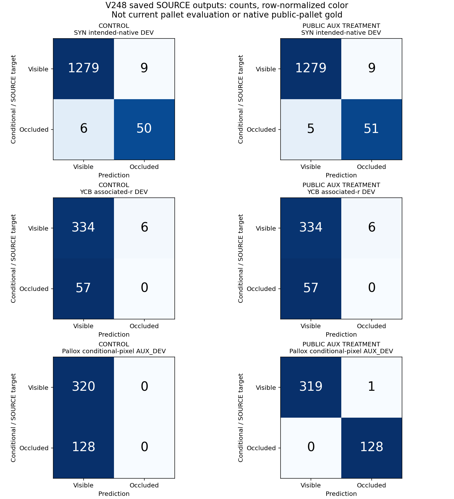

# V248 — 공개 실사 픽셀 보조학습은 성공, 기존 SOURCE 판정으로 전이는 확인하지 못함

**판정: SOURCE 채택 기준 실패. 새 모델 채택 없음, 새 current/v61 평가 없음. 목표는 아직 미해결이다.**

V241 검토 문서가 구분한 “질문 픽셀”, “연결된 표면점”, “지정 native 키포인트”를 별도 목표로 유지했다. 이번에 추가한 것은 공개 Pallox의 조건부 픽셀 감독을 공유 시각 처리층에 주는 손실이다. 보조 head 자체의 높은 점수를 팔레트 native 가시성 정확도로 해석하지 않는다.

## 실제 수행

- 공개 TRAIN 22쌍·44 view의 기존 조건부 certificate만 사용했다. 원래 352 query의 좌표·crop 크기·native·U·분할은 바꾸지 않았다.
- 새로운 AUX query를 별도 생성했다. 각 pair/view의 V 최대32개, 완전히 영상 안에 있는 5×5 E core 최대32개, L=64px, seed17, 부족분 보충 없음이다.
- pair 단위로 미리 정한 17 FIT/5 DEV를 모든 view·파생 픽셀에 상속했다. 실제 생성은 FIT 1,120개(V832/E288), DEV 448개(V320/E128), 총1,568개이며 입력 지원은 모두 유효했다.
- 고정 DINOv2 vits14_reg4로 RGB/valid crop의 pixel1154 특징만 추출했다. encoder 상태 전후 동일·같은 batch 반복 바이트 일치를 확인했다. fitted normalizer는 없다.
- 양군은 같은 V239 final1000 core와 같은 새 보조 head에서 시작했다. 기존 main 입력·손실·draw는 같고, 처리군만 보조손실 가중치0.25를 추가했다. 각1,000회, 총2,000회 새 optimizer update를 실제 수행했다. core 누적 update는 각2,000회이다.
- 보조손실이 공유층의 시각1154열·bias에 도달하고, 조건32열·기존 출력층·관계 분기에는 직접 도달하지 않는지 optimizer 전 확인했다. 대조군 보조 readout은 업데이트·weight decay가 없었다.
- 양 최종 checkpoint와 학습 log를 고정한 뒤에만 새 DEV 출력과 이전 baseline CSV를 해석했다. 문턱은 미리 정한 E logit≥0이며 sweep·early stop·재학습을 하지 않았다.

## 같은 저장 출력의 비교

| 평가 목표 | 학습군 | 보임 recall | 가림 recall | 가림 precision | 보류율 |
|---|---|---:|---:|---:|---:|
| SYN intended-native DEV | 대조 | 99.30% | 89.29% | 84.75% | 0.00% |
| YCB associated-r DEV | 대조 | 98.24% | 0.00% | 0.00% | 0.00% |
| Pallox conditional-pixel AUX_DEV | 대조 | 100.00% | 0.00% | 정의 불가 | 0.00% |
| SYN intended-native DEV | 보조학습 | 99.30% | 91.07% | 85.00% | 0.00% |
| YCB associated-r DEV | 보조학습 | 98.24% | 0.00% | 0.00% | 0.00% |
| Pallox conditional-pixel AUX_DEV | 보조학습 | 99.69% | 100.00% | 99.22% | 0.00% |

행은 정답 보임/가림, 열은 예측 보임/가림이다. 원 SOURCE의 S/U 7,423행은 binary 감독에서 제외된 행이며 모델의 성공적인 보류로 세지 않았다. 위 보류율은 표에 포함된 입력 지원이 유효한 행에서의 모델 U 비율이다.

대조군의 새 보조 readout은 학습하지 않았으므로 AUX 점수 차이는 보조학습 연결 확인용이다. 방법의 유효한 전이 비교는 동일하게 학습한 기존 SOURCE 경로끼리의 비교이다.

보조학습 처리군은 AUX_FIT 1,120개를 모두 맞혔고 내부 AUX_DEV에서는 보임319/320·가림128/128개를 맞혔다. 그러나 YCB associated-r DEV의 가림은 양군 모두0/57개였다. SYN DEV에서는 대조군50/56 → 처리군51/56으로 가림 한 점이 늘었다.

기존 두 family의 DEV balanced recall 평균에서 처리군의 대조군 대비 이득은 **0.4464pp**로, 사전 +1pp 기준을 통과하지 못했다. V239 대비 이득은 **-0.1557pp**이고 YCB E recall은0%라 기존 SOURCE 기준도 실패했다. AUX_DEV V/E≥80% 조건만 통과했다.

## 무엇을 알게 됐는가

**관측:** 이번 작은 head와 고정 특징으로 공개 Pallox의 조건부 픽셀 V/E를 학습할 수 있었다. gradient 단절이나 학습을 시작하지 못한 기술 문제로 이번 결과를 설명할 근거는 없다. **아직 미확인:** 그 감독으로 지정 native 점의 가시성을 판별할 수 있는지, 새로운 물체·장면·카메라에서 유지되는지는 검증하지 못했다. 공개 보조 문제에서 성공한 사실과 기존 SOURCE 판정에서의 실패가 함께 남았다.

**범위:** Pallox는 같은 물리 bin의 조건부 SAM+depth+mesh 교사 감독이다. RGB-depth 정합·정적 카메라/물체·교정 가정이 남으며 native 키포인트 대응과 SELF는 UNKNOWN이다. pair를 나눴지만 물리 장면이 독립인 blind 평가가 아니다. 기존 SOURCE DEV도 반복 노출된 개발 자료다. 따라서 447/448을 일반적인 실사 팔레트 정확도나 외부 가림 gold 정확도로 부르지 않는다.

이번 모델은 고정 SOURCE 기준에 실패했으므로 current223/v61 비교 단계에 진입하지 않았다. 목재/정사각형·외부/자기 가림·초기 좌표 오차별 현재 평가 수치는 이번에 갱신하지 않았다. 현재 평가 자료와 파생 점수로 학습·문턱·모델·데이터·구조를 고르지 않았고, PnP·위치 회귀·원 query의 GT 중심 재crop도 하지 않았다.

실제로 고정한 네 pair board도 확인했다. 여기의 V crop은 목재 bin 표면, E crop은 그 앞의 판지 상자를 보여준다. 이 내부 보조 문제는 목재/판지 외관 차이로도 풀 수 있다는 경쟁 설명이 남는다. 이를 대상·부위가 달라져도 유지되는 일반 가림 관계 학습의 증명으로 쓰지 않는다.

## 실제 crop과 검증 자료

- [미리 정한 SOURCE crop 12개·빈 stratum 4개](visuals/PORTABLE_GALLERY_KO.html) — 새 출력 전에 고른 사례이며 조건부 픽셀 목표만 보여준다.
- [비교표 CSV](DEV_COMPARISON.csv)
- [원 CM·precision/recall·고정 gate JSON](artifacts/V248_ROOT_PUBLIC_PIXEL_AUX/matched_source_public_pixel_aux_fit_v1/SOURCE_RESULTS.json)
- [실제 실행과 terminal 기록](artifacts/V248_ROOT_PUBLIC_PIXEL_AUX/ACTUAL_EXECUTION_TERMINALS.json)
- [학습 전 명세](artifacts/V248_ROOT_PUBLIC_PIXEL_AUX/PROTOCOL_BEFORE_NEW_AUX_ARRAYS_OR_FEATURES_OR_FIT.json)
- [crop 명세 정정 — 실제 데이터 읽기 전](artifacts/V248_ROOT_PUBLIC_PIXEL_AUX/CROP_CONTRACT_CLARIFICATION_BEFORE_PAYLOADS.json)
- [행별 출력·draw·log 독립 검산](artifacts/V248_SAVED_SOURCE_QA_C/actual_review_v1/REVIEW.json)
- [기존 공개 의존 파일 17개와 SHA 매핑](artifacts/V248_PUBLISHED_DEPENDENCIES_A/dependency_map.json)
- [독립 CODE QA](artifacts/V248_PUBLIC_AUX_TRAINER_CODE_QA_C/REVIEW.json)
- [V241 첨부 문서 시점과 최신 완료 작업의 대조](artifacts/V248_REFERENCE_DOCUMENT_QA_C/KO.md)

## 공개 자료와 재현 범위

Pallox 원자료: Yanming Wu·Eric Demeester, KU Leuven, CC-BY 4.0, [DOI 10.48804/DJLDFS](https://doi.org/10.48804/DJLDFS). 사용자가 직접 촬영한 평가 자료와 원본을 공유하지 않는다고 확인했다. 새 기록·특징·checkpoint·draw·log·출력·코드와 실제 crop을 함께 보존한다. 기존 SOURCE 의존 파일은 저장소의 앞선 실험 패키지와 SHA로 연결하며, 공식 encoder 가중치를 이번 패키지에 재배포하지 않는다. 저장 결과 검산과 모델 재학습은 별개이다. GPU 모델 forward를 다시 하지 않고도 공개된 행별 CSV·log·manifest를 검산할 수 있다.

V241 첨부 문서는 진단 참고자료로 읽었다. 그 안의 조건부 실행 제안을 별도 사용자 지시로 취급하지 않았다. 이번 실험 권한은 기존 공개 실사+합성 SOURCE 학습 및 지속 수행 요청에 따른다.

과거 평가 aggregate 접근에 대한 V247 공개 범위 설명은 유지한다. 이번 선택에는 사용하지 않았다. 명시적으로 지정한 artifact 경로의 접근을 통제했으며, 설치 라이브러리 내부의 모든 filesystem/cache 활동을 감사했다는 주장은 하지 않는다.

저장 결과 산술 재현: 패키지 안에서 `python -S -B artifacts/V248_SAVED_SOURCE_QA_C/verify_saved_source.py --saved-dir artifacts/V248_ROOT_PUBLIC_PIXEL_AUX/matched_source_public_pixel_aux_fit_v1 --out <새 검산 폴더>`를 실행한다. 세부 인수는 해당 checker의 `--help`로 확인한다. 이는 학습·feature/weight/RGB 재실행 없이 CSV와 저장 요약의 산술만 재현한다.
