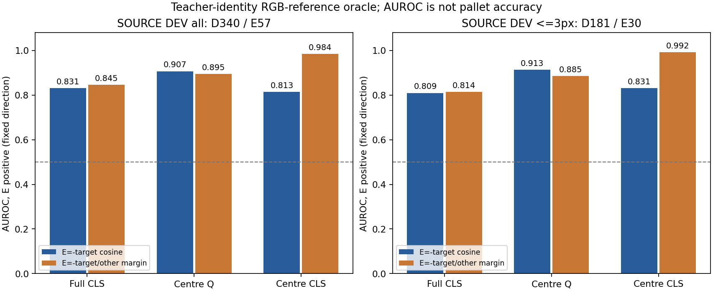
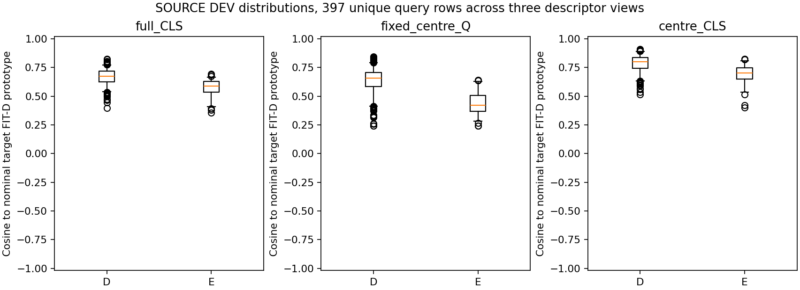
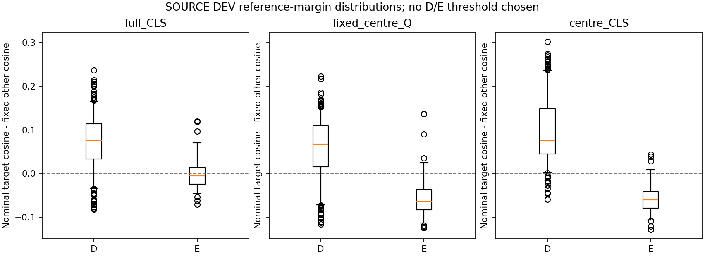

# V249 — 정답 물체 RGB 참조를 준 SOURCE 특징 진단

**이 결과는 teacher-identity oracle 진단이다. 배포 모델·팔레트 정확도·새 v61 비교가 아니다.**

V248의 픽셀 보조학습 성공이 기존 판정으로 전이되지 않아, 이미 저장된 특징에 대상 RGB 참조를 연결했을 때의 구분 신호를 확인했다. 기존 q8/context와 same-image context cosine 경로는 이미 시험한 것이며, 이를 새 해결책으로 다시 제안하지 않는다.

## 고정한 계산

원 YCB known 1,521행의 좌표·crop·라벨·분할을 유지했다. SOURCE FIT D 841행만 물체별 참조 계산에 사용했다. 각 특징을 원 sample 순서로 FP64 평균하고 L2 정규화했다. SOURCE DEV 397행(D340/E57)은 참조 계산에 쓰지 않았다. 숫자순으로 다음 물체를 다른 참조로 정했으며, 유사도나 DEV 결과로 비교 물체를 고르지 않았다.

세 특징(전체 crop CLS, 고정 중심 Q, 중심 crop CLS)을 모두 보고한다. 정답 물체 ID는 SOURCE 교사 메타데이터에서 참조를 선택하는 oracle이며 배포 입력이 아니다. 보임 참조도 r 상태가 D인 q crop 특징의 평균이므로, 대상만 잘라낸 깨끗한 template이나 물리 부위 대응을 보장하지 않는다.

SOURCE FIT 참조 통계는 실제로 적합했다. 새 optimizer update·encoder/head forward·원 RGB/depth/mesh/annotation archive·가중치 읽기·PnP는 없다. 사용한 SOURCE 파생 정답 메타데이터(r·대상 ID·D/E)는 숨기지 않는다. 현재·보호 평가 자료는 사용하지 않았다.

## 모든 사전 지정 특징의 결과

|특징|q–r 범위|D / E|E: −참조 cosine AUROC|E: −참조 차이 AUROC|D에서 자기 참조>다른 참조|
|---|---|---:|---:|---:|---:|
|full_CLS|all|340 / 57|0.8306|0.8455|0.8824|
|fixed_centre_Q|all|340 / 57|0.9066|0.8951|0.7882|
|centre_CLS|all|340 / 57|0.8134|0.9837|0.9529|
|full_CLS|<=3px|181 / 30|0.8094|0.8144|0.8729|
|fixed_centre_Q|<=3px|181 / 30|0.9129|0.8855|0.7569|
|centre_CLS|<=3px|181 / 30|0.8308|0.9919|0.9558|



**AUROC는 정확도가 아니다.** 0.5는 이 점수 방향의 순위 구분이 우연 수준이라는 뜻이다. E의 점수 방향을 −참조 cosine 및 −참조 차이로 미리 정했고, 결과를 보고 반전·문턱·best-view를 선택하지 않았다. 비교 점수가 없는 행과 클래스가 없는 stratum은 UNKNOWN/NA로 남겼다.



YCB의 정답은 q 픽셀 소유자가 아니라 연결된 표면점 r의 상태다. q는 r 주변 반경≤4px의 인공 jitter로 만들어졌으므로 실제 초기 검출 오차를 재현했다고 부르지 않는다. <=1px, >1–3px, <=3px, >3px와 물체별 전체 결과는 원 JSON에 모두 보존했다. 1,191개의 점수 행은 397개 query를 세 특징으로 본 것으로, 독립 표본 1,191개가 아니다. 또한 같은 scene/frame에서 여러 query를 읽으므로 397개도 독립 가림 사건 수를 뜻하지 않는다.



## 기존 판정 head의 순위와 비교한 사후 진단

참조 점수를 확인한 뒤, 기존 head가 단지 0 문턱에서만 실패했는지 구분하기 위해 저장된 V248 SOURCE 점수로 **사후 descriptive 비교**를 추가했다. 원 prototype 실험을 변경하거나 문턱을 고르지 않았다.

|같은 YCB DEV397|원 E logit AUROC|좌표 오차≤3px AUROC|원 0 문턱 E 검출|
|---|---:|---:|---:|
|V248 대조군|0.5348|0.4993|0/57|
|V248 픽셀 보조학습 처리군|0.5317|0.4895|0/57|

기존 판정 경로의 실패는 이 SOURCE에서 높은 순위 신호가 문턱 때문에만 숨은 상황은 아니었다. 반면 정답 물체 참조를 사용하는 진단에서는 구분 신호가 나타났다. 두 조건은 입력 권한과 계산이 다르므로, 이 비교가 대상 식별 부족이라는 단일 원인을 증명하거나 배포 모델의 개선폭을 보장하지는 않는다.

SOURCE FIT 참조 대상은 네 물체 ID(2,3,7,8)이며 DEV는 세 물체다. DEV의 D/E 수는 ID2=94/4, ID7=133/53, ID8=113/0이다. E 57개 중53개가 ID7에 몰렸고 ID8은 E가 없어 AUROC가 정의되지 않는다. 중심 CLS의 margin AUROC는 ID2에서1.0000(E4), ID7에서0.9908(E53)이지만 다른 물체·장면의 성능으로 일반화하지 않는다. 고정 비교 대상은 2→3,3→7,7→8,8→2이며 다른 비교 대상에 대한 강건성은 시험하지 않았다.

## 해석의 한계

이 단순 참조 점수에서 구분 신호가 있어도 배포 가능한 참조 선택·분류기가 완성된 것은 아니다. 반대로 구분이 약해도 모든 RGB 기반 가림 판정이 불가능하다거나 다른 참조·특징 구조도 실패한다고 증명하지 않는다. SOURCE DEV는 반복 노출된 개발 자료이며, 물체별 지원과 장면·외관의 상관관계를 함께 봐야 한다. physical native 대응과 SELF 의미는 이 진단에서 만들지 않았다. 새 모델 채택과 현재 평가 진입은 없다.

## 확인 자료

- [수치 표 CSV](AUC_COMPARISON.csv)
- [모든 오류 범위·물체별 분포 및 지원](artifacts/V249_ROOT_TARGET_RGB_DIAGNOSTIC/oracle_rgb_reference_diagnostic_v1/DESCRIPTIVE_TABLES.json)
- [397 query × 3 특징의 원 점수](artifacts/V249_ROOT_TARGET_RGB_DIAGNOSTIC/oracle_rgb_reference_diagnostic_v1/DEV397_DESCRIPTOR_SCORES.csv)
- [참조 지원 표](artifacts/V249_ROOT_TARGET_RGB_DIAGNOSTIC/oracle_rgb_reference_diagnostic_v1/PROTOTYPE_SUPPORT.csv)
- [데이터 읽기 전 명세](artifacts/V249_ROOT_TARGET_RGB_DIAGNOSTIC/PROTOCOL_BEFORE_SOURCE_REFERENCE_PAYLOADS.json)
- [기존 입력·시도와 차이의 CODE 근거](artifacts/V249_TARGET_IDENTITY_CODE_A/KO.md)
- [공개된 SOURCE 입력 세 개의 SHA 매핑](artifacts/V249_PUBLISHED_DEPENDENCIES_A/dependency_map.json)


[사후 기존 점수 순위 결과·모든 stratum](artifacts/V249_ROOT_TARGET_RGB_DIAGNOSTIC/POSTHOC_BASELINE_RANK_RESULTS.json) · [점수 읽기 전 사후 비교 범위](artifacts/V249_ROOT_TARGET_RGB_DIAGNOSTIC/POSTHOC_BASELINE_RANK_APPENDIX_SCOPE_BEFORE_SCORE_READ.json)

공개 저장소 파일만 사용한 전체 primary CPU 재현도 실행했다. 원 6개 산출물(점수·분포표·prototype 포함)이 바이트까지 일치했다. 이는 같은 알고리즘의 공개 경로 재현이며, 별도 독립 수학 QA와 구분한다. 사후 baseline 순위 비교는 이 primary 재현 범위와 별개다.

## 공개 파일로 primary 계산 재현

Python과 NumPy가 있는 환경에서 이 패키지 폴더를 기준으로 다음을 실행한다. 공개 저장소 안의 기존 SOURCE 파일 3개와 고정 코드를 먼저 SHA·size로 검증한다. 원 로컬 절대경로 fallback은 없다.

```sh
python -B artifacts/V249_PUBLIC_REPLAY_A/replay_public.py --public-repo <저장소의 절대경로> --output-dir <새 출력폴더의 절대경로>
```

이 명령은 primary 참조 계산과 6개 산출물을 재현한다. 사후 V248 baseline 비교와는 별도다. 이번 실제 CPU 재현에서는 6개 모두 원 산출물과 바이트까지 일치했다. 독립 수학 QA는 생성 함수를 import하지 않고 참조·점수를 다시 계산하고 다른 순위합 수식으로 AUROC를 검산했다. 두 종류의 검증을 구분한다.

[독립 실제 수학 검산](artifacts/V249_ACTUAL_SOURCE_QA_C/actual_review_v1/REVIEW.json) · [원 실행과 공개 CPU 재현 대조](artifacts/V249_ROOT_TARGET_RGB_DIAGNOSTIC/PRIMARY_VS_PUBLIC_CPU_REPLAY_QA.json)

DEV397 query는 저장된 scene ID 6/7의176개 scene-frame에 걸쳐 있다. E57개가 서로 다른 frame에 있더라도 같은 scene·연속 촬영 자료의 상관관계가 남으므로 독립 사건57개로 보장하지 않는다.
