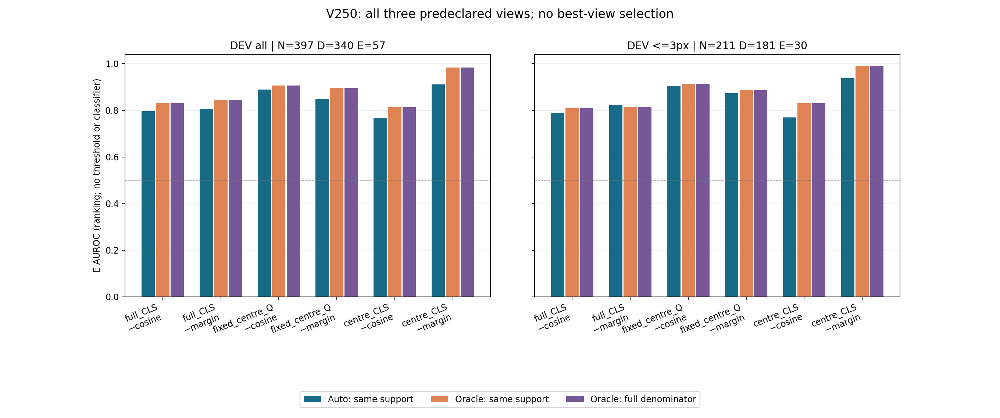
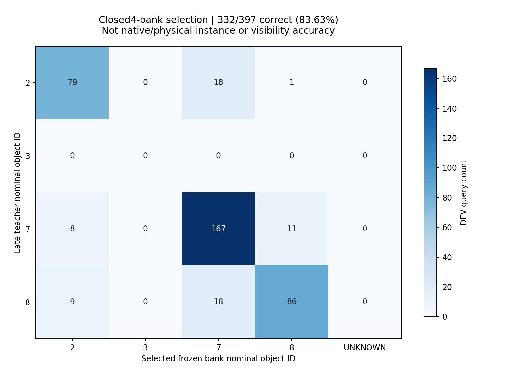

# V250 입력 기반 SOURCE reference 선택 진단

입력의 다른 q8 RGB 노드로 동결 reference bank를 선택했습니다. DEV397(D340/E57)에서 명목 object 선택은 332/397, 잘못 선택한 bank는 65/397, 지원 행 정확도 83.63%, 선택 UNKNOWN 0/397입니다. 이것은 closed4-bank 선택 정확도이며 D/E visibility 정확도가 아닙니다. 전체 입력 예측1521개·세 view 점수4563개를 정답/역할/object ID/oracle 판독 전에 봉인하고 DEV1191개 view 행을 후결합했습니다.

active 슬롯을 제외하고 original_available8 & node_available & 유한한 비영 full-CLS만 사용했습니다. 최소 두 다른 노드가 필요하며, 네 bank별 top2 cosine 평균을 비교하고 수치 동률은 가장 작은 bank index로 정했습니다. query의 실제 명목 object ID는 선택 API에 들어가지 않았습니다. bank 자체는 기존 SOURCE FIT-D 감독 통계이며 이번에는 재적합하지 않았습니다.

E 방향은 사전 고정된 −cosine 및 −margin입니다. 표의 Auto/Oracle 동일지원은 정확히 같은 지원 행을 비교하고 Oracle 전체는 원래 고정 분모를 보존합니다. 모든 세 view와 all/≤3px를 함께 표시하며 다른 strata·object별 빈 클래스/NA는 연결된 JSON에 보존합니다. centre-CLS −margin AUROC는 Auto 0.9106, 동일지원 Oracle 0.9837, 전체 Oracle 0.9837입니다. 이는 입력 기반 bank 선택을 거친 값과 teacher-object Oracle reference의 차이이며, 채택한 view·문턱·분류기가 아닙니다.

네 개의 이미 본 SOURCE 명목 object bank를 비교한 진단입니다. E 53/57개가 object 7에 집중되어 있으며, 이는 독립 물리 instance 53개나 자연 가림 일반화를 뜻하지 않습니다. q는 associated-r 주변 GT-jitter emulation이고 physical pallet native·SELF 권한은 UNKNOWN입니다. SOURCE DEV는 반복 노출되었습니다.

새 optimizer/encoder/head 학습, reference 재적합, neural forward, 원RGB·weight·annotation archive 읽기, PnP·좌표 교정은 없습니다. 저장 SOURCE feature와 감독 bank 및 late teacher 메타데이터로 기술 통계를 계산했습니다. UNKNOWN을 E로 바꾸지 않았고 성공적인 보류라고 해석하지 않습니다. threshold·best-view·모델 선택이나 현재 실사223 평가·성능 향상·배포 채택을 주장하지 않습니다.

## 고정 AUROC 비교

| 분모 | view | E 점수 방향 | Auto 동일지원 | Oracle 동일지원 | Oracle 전체 | D/E (원분모) | 지원 행 |
| --- | --- | --- | --- | --- | --- | --- | --- |
| all | full_CLS | negative_cosine | 0.7966 | 0.8306 | 0.8306 | 340/57 | 397 |
| all | full_CLS | negative_margin | 0.8051 | 0.8455 | 0.8455 | 340/57 | 397 |
| all | fixed_centre_Q | negative_cosine | 0.8885 | 0.9066 | 0.9066 | 340/57 | 397 |
| all | fixed_centre_Q | negative_margin | 0.8498 | 0.8951 | 0.8951 | 340/57 | 397 |
| all | centre_CLS | negative_cosine | 0.7675 | 0.8134 | 0.8134 | 340/57 | 397 |
| all | centre_CLS | negative_margin | 0.9106 | 0.9837 | 0.9837 | 340/57 | 397 |
| <=3px | full_CLS | negative_cosine | 0.7882 | 0.8094 | 0.8094 | 181/30 | 211 |
| <=3px | full_CLS | negative_margin | 0.8230 | 0.8144 | 0.8144 | 181/30 | 211 |
| <=3px | fixed_centre_Q | negative_cosine | 0.9042 | 0.9129 | 0.9129 | 181/30 | 211 |
| <=3px | fixed_centre_Q | negative_margin | 0.8727 | 0.8855 | 0.8855 | 181/30 | 211 |
| <=3px | centre_CLS | negative_cosine | 0.7698 | 0.8308 | 0.8308 | 181/30 | 211 |
| <=3px | centre_CLS | negative_margin | 0.9383 | 0.9919 | 0.9919 | 181/30 | 211 |

## 선택 분모와 UNKNOWN

| view | 부분집합 | 원분모 | 선택 정답/지원 | 선택 정확도 | 선택 UNKNOWN | 선택 UNKNOWN율 | query 점수 UNKNOWN/율 |
| --- | --- | --- | --- | --- | --- | --- | --- |
| full_CLS | ALL | 397 | 332/397 | 83.63% | 0 | 0.00% | 0 / 0.00% |
| full_CLS | D | 340 | 281/340 | 82.65% | 0 | 0.00% | 0 / 0.00% |
| full_CLS | E | 57 | 51/57 | 89.47% | 0 | 0.00% | 0 / 0.00% |
| fixed_centre_Q | ALL | 397 | 332/397 | 83.63% | 0 | 0.00% | 0 / 0.00% |
| fixed_centre_Q | D | 340 | 281/340 | 82.65% | 0 | 0.00% | 0 / 0.00% |
| fixed_centre_Q | E | 57 | 51/57 | 89.47% | 0 | 0.00% | 0 / 0.00% |
| centre_CLS | ALL | 397 | 332/397 | 83.63% | 0 | 0.00% | 0 / 0.00% |
| centre_CLS | D | 340 | 281/340 | 82.65% | 0 | 0.00% | 0 / 0.00% |
| centre_CLS | E | 57 | 51/57 | 89.47% | 0 | 0.00% | 0 / 0.00% |

## 저장 근거와 재현

- [전체 strata·object별 표](artifacts/V250_ROOT_INPUT_REFERENCE/input_reference_selector_v1/DESCRIPTIVE_TABLES.json)
- [저장 요약](artifacts/V250_ROOT_INPUT_REFERENCE/input_reference_selector_v1/SUMMARY.json)
- [DEV1191 late join](artifacts/V250_ROOT_INPUT_REFERENCE/input_reference_selector_v1/DEV1191_AUTO_ORACLE_COMPARISON.csv)
- [예측 선봉인](artifacts/V250_ROOT_INPUT_REFERENCE/input_reference_selector_v1/PREDICTIONS_FROZEN_BEFORE_TARGET_ROLE_ID_OR_ORACLE_READ.json)
- [생성 완료·접근 범위](artifacts/V250_ROOT_INPUT_REFERENCE/input_reference_selector_v1/COMPLETE.json)
- [AUC CSV](AUC_COMPARISON.csv)
- [선택·UNKNOWN CSV](REFERENCE_SELECTION.csv)
- [사전 고정 protocol](artifacts/V250_ROOT_INPUT_REFERENCE/PROTOCOL_BEFORE_SELECTOR_PAYLOADS.json)
- [선택기 CODE](artifacts/V250_INPUT_REFERENCE_SELECTOR_B/select_input_reference.py)
- [독립 CODE QA](artifacts/V250_SELECTOR_CODE_QA_C/REVIEW.json)
- [독립 저장값 QA](artifacts/V250_ACTUAL_SELECTOR_QA_C/actual_review_v1/REVIEW.json)
- [입력 경계·dependency closure](artifacts/V250_REFERENCE_SELECTOR_BOUNDARY_A/dependency_closure.json)
- [공개 재현 wrapper](artifacts/V250_PUBLIC_REPLAY_A/replay_public_selector.py)
- [공개 dependency map](artifacts/V250_PUBLIC_REPLAY_A/public_dependencies.json)
