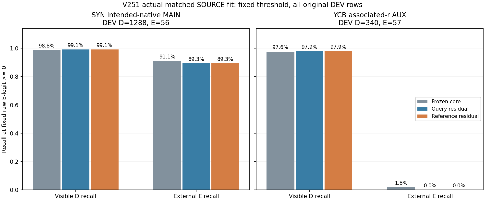
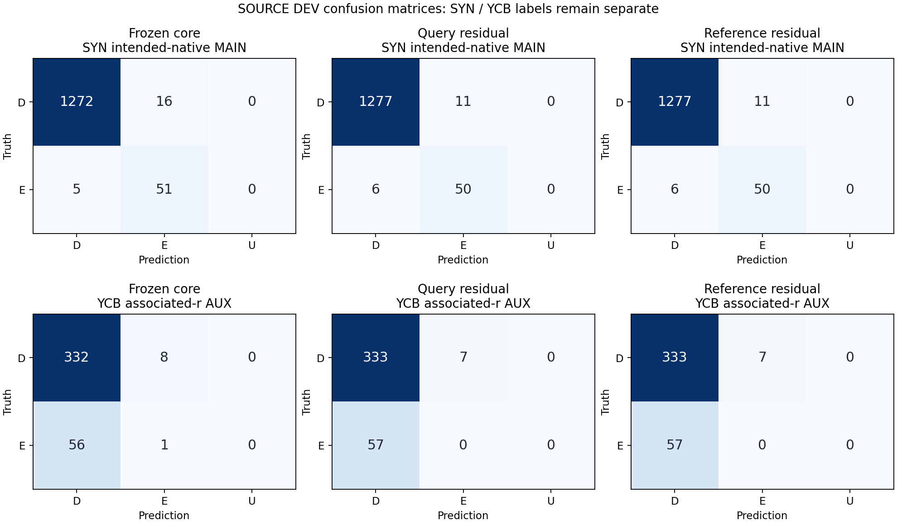

# V251 — 동결 core에 참조 residual을 학습한 실제 SOURCE 비교

고정 문턱의 SOURCE 판정은 개선되지 않았습니다. 참조 모델과 대조군의 DEV 혼동행렬이 동일하고, 공개 실사 YCB 외부 가림은 두 모델 모두 0/57개를 검출했습니다. 합성 DEV 가림은 50/56개(89.29%)로 사전 기준90%에 못 미칩니다. 전체 SOURCE gate는 FAIL이며 현재 평가 진입과 모델 채택은 없습니다.

기존 V239 core 86,054개 파라미터를 동결하고, 같은 query hidden64에 작은 residual MLP(73→32→2, 학습 파라미터2,434개)를 연결했습니다. CONTROL은 참조9값을0으로, TREAT는 세 특징의 선택/대안 참조 cosine6개와 지원3개를 사용했습니다. 같은 초기값·PCG17 draw ledger·AdamW·1,000회 업데이트로 두 모델을 실제 학습했습니다. 두 최종 checkpoint·로그·bank를 모두 봉인한 뒤 DEV를 평가했습니다.

합성 참조는 SOURCE FIT-D의 기존 native 입력 주소0..7별 평균 특징이며 목재/정사각형 class나 CAD ID를 가정하지 않았습니다. 주소는 깨끗한 물리 부위 template이라는 인증이 아닙니다. 다음 주소는 고정 비교 참조이며 가림 음성 정답이 아닙니다. YCB는 기존 FIT-D 감독 bank4개를 재사용하고 다른 q8 노드로 참조를 선택했습니다. query의 정답 object ID는 선택·head 입력에 넣지 않았습니다.

기존 core는 YCB FIT의 D841/E283개를 이미 모두 맞혔지만 DEV에서는 E1/57개만 맞혔습니다. 새 참조 residual도 FIT100%와 DEV 실패가 이어집니다. 학습점의 기존 logit이 이미 정답을 맞히는 구조에서는 새로운 참조를 활용하도록 학습할 유인이 부족했을 가능성이 있습니다. 이는 원인 가설이며, 저장 모델의 참조 입력 개입 결과는 아래 별도 posthoc 진단으로 구분합니다.

SYN intended-native-address MAIN과 YCB associated-r3×3 AUX는 다른 라벨 권한입니다. YCB native·SELF 상태는 UNKNOWN이고, q는 정답 r 주변≤4px jitter를 모사했습니다. 반복 노출 SOURCE DEV와 이미 본 네 YCB class에서 얻은 결과이며 실제 팔레트 전이를 입증하지 않습니다. 기존 S/U7,423행은 binary loss에서만 제외되며 context의 입력 지원 노드를 의미 라벨로 지우지 않았습니다. 보류는 원 입력 가용성으로만 결정했고 이번 known SOURCE의 모델 U와 참조 UNKNOWN은0입니다.

새 DINO encoder 학습·forward·공식 backbone 가중치 읽기, 새 RGB/depth/annotation archive 읽기, 현재/보호 평가 자료 사용, PnP·좌표 교정은 없습니다. 기존 SOURCE core checkpoint는 실제 읽었고, 합성 FIT-D 참조 통계와 두 residual은 실제 학습했습니다. SOURCE gate의 기준이나 문턱0을 결과에 맞춰 바꾸지 않았습니다.

## 모든 FIT·DEV 결과

| 모델 | 라벨 | 분할 | 원 D/E | E precision | D recall | E recall | BR | E AUROC |
| --- | --- | --- | --- | --- | --- | --- | --- | --- |
| BASE_FROZEN_V239 | SYN intended-native MAIN | FIT | 4565/187 | 83.48% | 99.19% | 100.00% | 99.59% | 0.9989 |
| BASE_FROZEN_V239 | SYN intended-native MAIN | DEV | 1288/56 | 76.12% | 98.76% | 91.07% | 94.91% | 0.9954 |
| BASE_FROZEN_V239 | YCB associated-r AUX | FIT | 841/283 | 100.00% | 100.00% | 100.00% | 100.00% | 1.0000 |
| BASE_FROZEN_V239 | YCB associated-r AUX | DEV | 340/57 | 11.11% | 97.65% | 1.75% | 49.70% | 0.5295 |
| CONTROL_NO_REFERENCE | SYN intended-native MAIN | FIT | 4565/187 | 89.05% | 99.50% | 100.00% | 99.75% | 0.9989 |
| CONTROL_NO_REFERENCE | SYN intended-native MAIN | DEV | 1288/56 | 81.97% | 99.15% | 89.29% | 94.22% | 0.9954 |
| CONTROL_NO_REFERENCE | YCB associated-r AUX | FIT | 841/283 | 100.00% | 100.00% | 100.00% | 100.00% | 1.0000 |
| CONTROL_NO_REFERENCE | YCB associated-r AUX | DEV | 340/57 | 0.00% | 97.94% | 0.00% | 48.97% | 0.5500 |
| TREAT_REFERENCE | SYN intended-native MAIN | FIT | 4565/187 | 89.05% | 99.50% | 100.00% | 99.75% | 0.9989 |
| TREAT_REFERENCE | SYN intended-native MAIN | DEV | 1288/56 | 81.97% | 99.15% | 89.29% | 94.22% | 0.9954 |
| TREAT_REFERENCE | YCB associated-r AUX | FIT | 841/283 | 100.00% | 100.00% | 100.00% | 100.00% | 1.0000 |
| TREAT_REFERENCE | YCB associated-r AUX | DEV | 340/57 | 0.00% | 97.94% | 0.00% | 48.97% | 0.5460 |

## 사전에 고정한 SOURCE gate

| 조건 | 실측 | 비교 | 기준 | 결과 |
| --- | --- | --- | --- | --- |
| TREAT−BASE mean family BR gain (pp) | -0.714446 | >= | 3.0 | FAIL |
| Maximum class recall drop vs BASE (pp) | 1.785714 | <= | 2.0 | PASS |
| YCB DEV E recall | 0.000000 | >= | 0.5 | FAIL |
| SYN DEV D recall | 0.991460 | >= | 0.9 | PASS |
| SYN DEV E recall | 0.892857 | >= | 0.9 | FAIL |
| TREAT−CONTROL mean family BR gain (pp) | 0.000000 | >= | 1.0 | FAIL |

## 별도 posthoc 저장 모델 진단

같은 저장 가중치와 query hidden을 유지하고 참조9값만0으로 바꾼 별도 사후 진단입니다. DEV1,741개 판정의 변화는0개였습니다. logit 변화 자체는 존재하므로 참조 branch가 전부0이거나 참조 정보가 없다는 증거는 아닙니다. YCB 학습 BCE는 첫100회 평균0.00052623, 마지막100회 평균0.00026458로 이미 작았습니다. 기존 core가 FIT을 완벽하게 맞히는 구조에서 참조 보정이 최종 결정에 충분한 영향을 주지 못했다는 해석과 부합합니다. 원인 전체를 증명하거나 이 결과로 문턱·모델을 다시 선택한 것은 아닙니다. CPU 재구성 최대 logit 오차는3.8146973e-06이며 원래7,617개 예측은 모두 일치했습니다.

| 라벨 | 분할 | 원 query | 참조0 판정변화 | 평균 절대 E-logit 기여 | 최대 기여 |
| --- | --- | --- | --- | --- | --- |
| SYN MAIN | FIT | 4752 | 3 | 0.488338 | 0.563972 |
| SYN MAIN | DEV | 1344 | 0 | 0.484976 | 0.557899 |
| YCB AUX | FIT | 1124 | 0 | 0.105939 | 0.226692 |
| YCB AUX | DEV | 397 | 0 | 0.080943 | 0.165119 |

## 검토·재현 자료

- [학습 전 고정 명세](artifacts/V251_ROOT_REFERENCE_RESIDUAL/PROTOCOL_BEFORE_REFERENCE_FIT_PAYLOADS.json)
- [모든 원 점수·checkpoint·로그의 COMPLETE](artifacts/V251_ROOT_REFERENCE_RESIDUAL/matched_reference_residual_v1/COMPLETE.json)
- [Source 결과 원 JSON](artifacts/V251_ROOT_REFERENCE_RESIDUAL/matched_reference_residual_v1/SOURCE_RESULTS.json)
- [두 checkpoint의 DEV 이전 봉인](artifacts/V251_ROOT_REFERENCE_RESIDUAL/matched_reference_residual_v1/BOTH_FINAL1000_LOGS_BANKS_FROZEN_BEFORE_ANY_DEV_OUTPUT.json)
- [독립 수학·로그·bank 검산](artifacts/V251_ACTUAL_REFERENCE_FIT_QA_C/actual_review_v1/REVIEW.json)
- [학습 코드](artifacts/V251_FROZEN_CORE_REFERENCE_TRAINER_B/train_reference_residual_v2.py)
- [공개 저장 모델 추론 재현](artifacts/V251_PUBLIC_REPLAY_A/verify_saved_fit.py)
- [모든 FIT/DEV 수치 CSV](SOURCE_COMPARISON.csv)
- [고정 gate CSV](SOURCE_GATE.csv)
- [Posthoc 참조 입력 개입 원 결과](artifacts/V251_ROOT_REFERENCE_RESIDUAL/reference_effect_posthoc_v1/SUMMARY.json)
