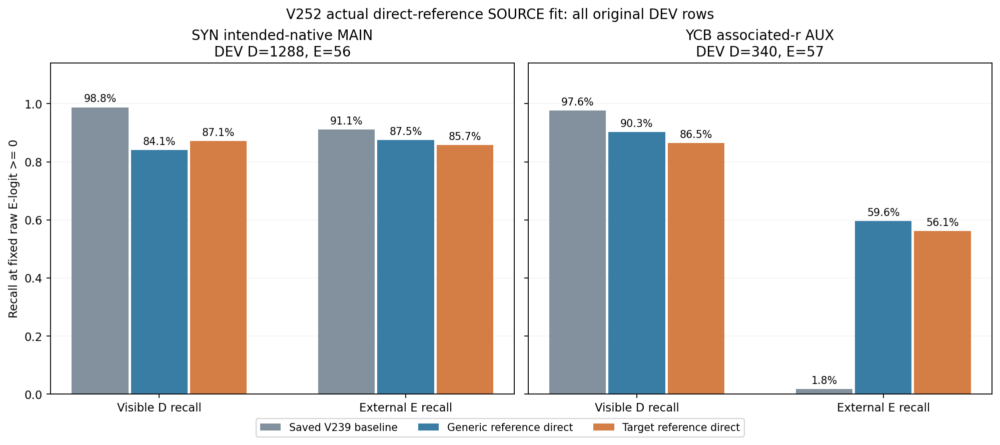
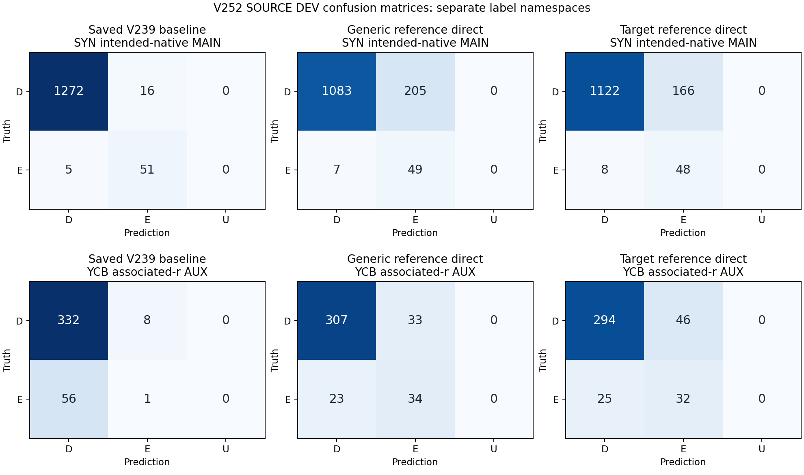

# V252 — 일반 참조와 대상 참조에서 직접 보임·가림 판정

고정 조건의 direct head 학습을 완료했습니다. 대상 참조 모델의 SYN DEV 보임 recall은 87.11%, 외부 가림 recall은 85.71%입니다. 공개 실사 YCB AUX의 보임 recall은 86.47%, 외부 가림 recall은 56.14%입니다. 사전 SOURCE gate는 FAIL이며, 현재 팔레트 평가 결과를 뜻하지 않습니다.

공개 실사 YCB DEV의 E 검출은 저장 BASE 1/57에서 TREAT 32/57로 늘었습니다. 그러나 SYN DEV의 보이는 D를 E로 오판한 수는 16/1288에서 166/1288로 늘었고, TREAT E precision은 SYN 22.43%, YCB 41.03%입니다. 일반 참조 CONTROL의 YCB E recall은 59.65%, E precision은 50.75%로 대상 참조보다 높습니다. TREAT−CONTROL 평균 family DEV BR 차이는 -1.523pp입니다. 이번 구성에서 공개 실사 가림 신호를 더 읽었지만 대상 참조의 추가 효과나 보임·가림 동시 개선은 입증되지 않았습니다.

기존 모델의 hidden·logit·checkpoint를 입력이나 초기값에 쓰지 않았습니다. 참조 비교9값과 원 condition32값에서 MLP41→32→2(학습 파라미터1,410개)가 두 라벨 권한의 출력을 직접 예측합니다. 일반 참조 CONTROL과 대상 참조 TREAT는 같은 초기값·최종층0·PCG17 draw ledger·AdamW·1,000회 업데이트를 사용합니다. 두 최종 checkpoint와 로그·bank·정책을 모두 봉인한 뒤 새 DEV 추론과 기존 BASE CSV 비교를 시작했습니다.

CONTROL도 감독 학습 참조입니다. SOURCE FIT-D의 원 특징을 각 family·세 view별로 동등 가중 평균(FP64, 원 행 순서)한 뒤 L2 정규화했습니다. 선택/대안 슬롯에 같은 일반 참조 cosine을 넣습니다. TREAT는 V251의 고정 대상 참조9값을 재사용합니다. SYN은 기존 native 입력 주소별 참조이고, YCB는 정답 object ID 없이 다른 초기 q8 노드로 선택한 참조입니다. 세 view를 함께 쓰며 view·문턱·epoch 선택은 없습니다.

두 참조의 FIT 통계에는 그 FIT-D 학습점 자체가 포함될 수 있습니다. DEV는 참조 통계와 loss에 기여하지 않습니다. 따라서 이 비교는 두 학습된 표현의 효과를 비교하며 참조 대상 정체성만의 순수 인과 효과를 뜻하지 않습니다. 합성 주소별 참조가 깨끗한 물리 부위 template이라는 인증도 아닙니다.

SYN intended-native-address MAIN과 YCB associated-r3×3 AUX의 라벨 정의를 합치지 않습니다. YCB native·SELF는 UNKNOWN이며 q는 정답 주변 jitter를 모사합니다. 자기 가림은 upstream 기하로 처리한다는 현재 목표를 유지합니다. 기존 S/U7,423행은 binary loss에서만 제외되며 E 또는 성공 보류로 계산하지 않습니다. 이번 known SOURCE7,617행의 모델 보류 U는0개(0%)이고 두 모델 모두 세 참조 view를100% 지원합니다. 반복 노출 SOURCE DEV 성능으로 새 실사 팔레트 전이를 단정할 수 없습니다.

이번에는 합성·공개 실사에서 저장된 특징만 사용했습니다. 새 encoder·backbone·RGB/depth/annotation archive·현재 또는 보호 평가 데이터·PnP·좌표 교정은 사용하지 않았습니다. 기존 BASE는 저장 CSV를 최종 봉인 뒤 읽어 비교했습니다. 모델 채택과 현재 평가 진입은 고정 입력·라벨의 배포 가능성을 감사한 뒤 판단할 다음 단계입니다.

## 모든 FIT·DEV 결과

| 모델 | 라벨 | 분할 | 원 D/E | D precision | E precision | D recall | E recall | BR | E AUROC |
| --- | --- | --- | --- | --- | --- | --- | --- | --- | --- |
| BASE_FROZEN_V239 | SYN intended-native MAIN | FIT | 4565/187 | 100.00% | 83.48% | 99.19% | 100.00% | 99.59% | 0.9989 |
| BASE_FROZEN_V239 | SYN intended-native MAIN | DEV | 1288/56 | 99.61% | 76.12% | 98.76% | 91.07% | 94.91% | 0.9954 |
| BASE_FROZEN_V239 | YCB associated-r AUX | FIT | 841/283 | 100.00% | 100.00% | 100.00% | 100.00% | 100.00% | 1.0000 |
| BASE_FROZEN_V239 | YCB associated-r AUX | DEV | 340/57 | 85.57% | 11.11% | 97.65% | 1.75% | 49.70% | 0.5295 |
| CONTROL_GENERIC_REFERENCE | SYN intended-native MAIN | FIT | 4565/187 | 99.09% | 18.48% | 85.41% | 80.75% | 83.08% | 0.9249 |
| CONTROL_GENERIC_REFERENCE | SYN intended-native MAIN | DEV | 1288/56 | 99.36% | 19.29% | 84.08% | 87.50% | 85.79% | 0.9234 |
| CONTROL_GENERIC_REFERENCE | YCB associated-r AUX | FIT | 841/283 | 96.77% | 68.16% | 85.61% | 91.52% | 88.57% | 0.9558 |
| CONTROL_GENERIC_REFERENCE | YCB associated-r AUX | DEV | 340/57 | 93.03% | 50.75% | 90.29% | 59.65% | 74.97% | 0.8652 |
| TREAT_TARGET_REFERENCE | SYN intended-native MAIN | FIT | 4565/187 | 99.44% | 24.74% | 89.07% | 87.70% | 88.38% | 0.9520 |
| TREAT_TARGET_REFERENCE | SYN intended-native MAIN | DEV | 1288/56 | 99.29% | 22.43% | 87.11% | 85.71% | 86.41% | 0.9502 |
| TREAT_TARGET_REFERENCE | YCB associated-r AUX | FIT | 841/283 | 97.95% | 78.07% | 91.08% | 94.35% | 92.71% | 0.9787 |
| TREAT_TARGET_REFERENCE | YCB associated-r AUX | DEV | 340/57 | 92.16% | 41.03% | 86.47% | 56.14% | 71.31% | 0.8593 |

## 사전 SOURCE gate

| 조건 | 실측 | 비교 | 기준 | 결과 |
| --- | --- | --- | --- | --- |
| TREAT−BASE mean family BR gain (pp) | 6.551597 | >= | 3.0 | PASS |
| Maximum class recall drop vs BASE (pp) | 11.645963 | <= | 2.0 | FAIL |
| YCB DEV E recall | 0.561404 | >= | 0.5 | PASS |
| SYN DEV D recall | 0.871118 | >= | 0.9 | FAIL |
| SYN DEV E recall | 0.857143 | >= | 0.9 | FAIL |
| TREAT−CONTROL mean family BR gain (pp) | -1.522516 | >= | 1.0 | FAIL |

## 검토·재현 자료

- [학습 전 고정 명세](artifacts/V252_ROOT_DIRECT_REFERENCE/PROTOCOL_BEFORE_DIRECT_HEAD_FIT.json)
- [전체 산출물 COMPLETE](artifacts/V252_ROOT_DIRECT_REFERENCE/matched_direct_reference_v1/COMPLETE.json)
- [원 SOURCE 결과](artifacts/V252_ROOT_DIRECT_REFERENCE/matched_direct_reference_v1/SOURCE_RESULTS.json)
- [DEV 이전 두 모델 봉인](artifacts/V252_ROOT_DIRECT_REFERENCE/matched_direct_reference_v1/BOTH_FINAL1000_LOGS_BANKS_FROZEN_BEFORE_ANY_DEV_OUTPUT.json)
- [모든 FIT·DEV 수치 CSV](SOURCE_COMPARISON.csv)
- [고정 gate CSV](SOURCE_GATE.csv)
- [학습 코드](artifacts/V252_DIRECT_REFERENCE_TRAINER_B/train_direct_reference.py)
- [학습 전 독립 코드 검토](artifacts/V252_DIRECT_TRAINER_CODE_QA_C/REVIEW.json)
- [학습 결과 독립 검산](artifacts/V252_ACTUAL_DIRECT_FIT_QA_C/actual_review_v1/REVIEW.json)
- [공개 CPU 저장 추론 재현 코드](artifacts/V252_PUBLIC_REPLAY_A/verify_saved_direct.py)
- [공개 재현 방법](artifacts/V252_PUBLIC_REPLAY_A/README_KO.md)
