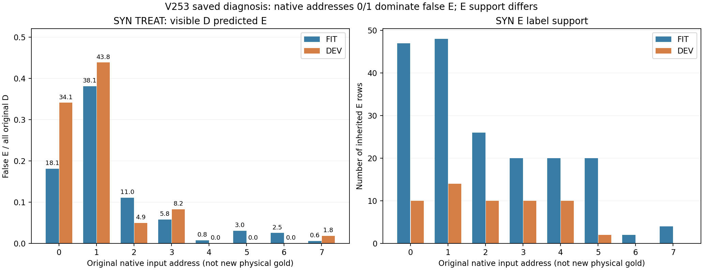
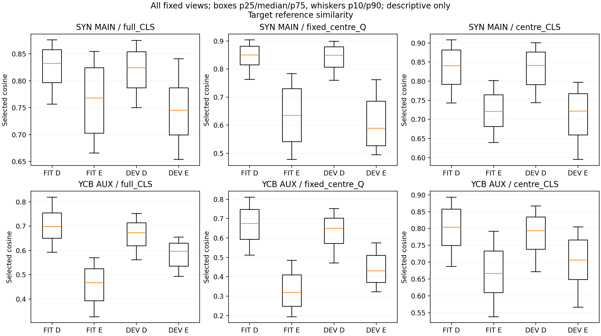
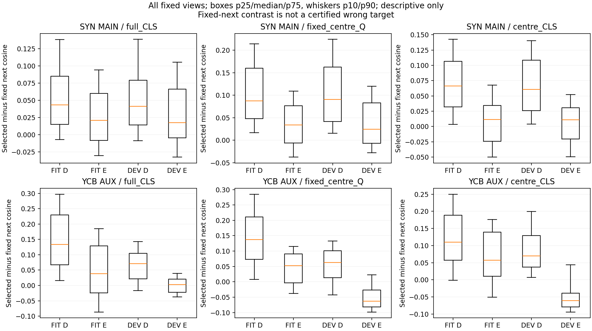

# V253 — 저장 오판·Source FIT crop·라벨 연결 진단

V252의 실패는 실사 전이에서만 생긴 것이 아닙니다. 합성 학습 FIT의 보이는 D4,565개 중 499개(10.93%)를 이미 E로 판정했습니다. 합성 DEV에서는 D1,288개 중 166개를 E로 판정했고, 이는 기존 BASE D정답을 새로 틀린 152개와 기존부터 E오판이던 14개로 나뉩니다.

오판은 원 입력 주소0·1에 집중됩니다. 두 주소가 SYN DEV falseE 140/166개(84.34%)와 FIT falseE 354/499개를 차지합니다. 주소6·7은 FIT E가 각각2개·4개, DEV E가 모두0개입니다. 따라서 전체 SYN 평균 성능으로 모든 부위의 가림 판정을 입증할 수 없습니다.

고정 FIT 사례 S000057·S000119는 목재처럼 보이는 모서리를 E로 오판했고, 같은 주소의 S000028·S000029는 어두운 사각 구조를 D로 판정했습니다. 이는 선택된 사례의 시각 관찰이며 재질 정답이나 전체 데이터의 재질별 오판율이 아닙니다. 단일 평균 참조가 형태·시점 차이를 충분히 보존하는지 의심할 근거가 되지만, 재질 편향이나 원인을 확정하지 않습니다.

S000035와 S000755처럼 팔레트 표면이 보이면서 inherited E인 사례도 보존했습니다. 추가 CODE 추적으로 SYN target-alone은 전체 등록 pallet 기하이며, witness ray의 앞을 별도 foreign BOX(owner999)가 막을 때 E임을 확인했습니다. 자기 기하가 막는 상태는 S로 구분하므로 SELF를 E에 합친 규칙은 아닙니다. point0는 각 native record의 첫 witness이며 physical native0의 별칭이 아닙니다. 이 정답을 q 중심 한 픽셀·부위 전체·crop 안의 팔레트 존재·실사 native 정답으로 확대하지 않습니다. YCB는 associated-r 주변 라벨입니다. 카드만 보고 라벨 오류나 새 물리 부위 정답을 만들지 않았습니다.

YCB 라벨은 output1의 마지막 readout을 직접 감독하고, 팔레트용 SYN output0에는 공유 trunk를 통해서만 영향을 줍니다. YCB associated-r AUX 개선은 실제 팔레트 MAIN 개선을 입증하지 않습니다. 공통 출력·native residual·COVER/SHAM은 이전 CODE에 이미 존재하므로 단순히 처음 시도하는 해결책이라고 설명하지 않습니다.

36개 고정 셀에서 sample_index가 작은 두 개까지 선택해 FIT 66개를 표시했고 빈 셀 2개를 유지했습니다. 원96 RGB·valid·선택 miniNPZ·픽셀 hash를 함께 보존했습니다. q 표식은 원96 좌표(47.5,47.5)의 별도 표시이며 입력·좌표를 보정하지 않습니다. 원 Source 배열 전체의 hash에는 DEV bytes도 포함되지만 숫자 pixel 접근은 선택 FIT66행뿐입니다.

이번에는 저장 점수·참조와 Source에서 유래한 라벨·입력 조건을 읽었습니다. 새 학습·모델/CP forward·bank 적합·문턱 선택·현재/보호 평가 자료·PnP는0입니다. S/U7,423행은 E나 성공 보류로 바꾸지 않았습니다. Source DEV는 반복 노출된 검증 자료입니다. 이 진단으로 모델 성능이나 현재 팔레트 전이가 개선됐다고 주장하지 않습니다.

다음에 입증해야 할 것은 원 q/L에서 의도한 대상 부위에 대한 반응과 참조의 형태·시점 대응입니다. 기존 Source COVER/SHAM의 정확한 frozen input과 원 q/L·현재 입력 변환의 대응부터 닫아야 합니다. 이번에는 새 recipe를 선택하거나 현재 평가에 진입하지 않았습니다.

## 기존 정답의 손상과 회복

| 라벨 권한 | 분할 | 원 D | TREAT falseE 전체 | BASE정답→새오판 | 기존오판 유지 | E 새검출 | E 새누락 |
| --- | --- | --- | --- | --- | --- | --- | --- |
| SYN MAIN | FIT | 4565 | 499 | 469 | 30 | 0 | 23 |
| SYN MAIN | DEV | 1288 | 166 | 152 | 14 | 5 | 8 |
| YCB AUX | FIT | 841 | 75 | 75 | 0 | 0 | 16 |
| YCB AUX | DEV | 340 | 46 | 41 | 5 | 32 | 1 |

## 원 입력 주소별 전체 분모

| 원 주소 | FIT D | FIT E | FIT falseE | FIT falseE/D | DEV D | DEV E | DEV falseE | DEV falseE/D |
| --- | --- | --- | --- | --- | --- | --- | --- | --- |
| 0 | 631 | 47 | 114 | 18.07% | 182 | 10 | 62 | 34.07% |
| 1 | 630 | 48 | 240 | 38.10% | 178 | 14 | 78 | 43.82% |
| 2 | 652 | 26 | 72 | 11.04% | 182 | 10 | 9 | 4.95% |
| 3 | 658 | 20 | 38 | 5.78% | 182 | 10 | 15 | 8.24% |
| 4 | 660 | 20 | 5 | 0.76% | 182 | 10 | 0 | 0.00% |
| 5 | 660 | 20 | 20 | 3.03% | 190 | 2 | 0 | 0.00% |
| 6 | 318 | 2 | 8 | 2.52% | 80 | 0 | 0 | 0.00% |
| 7 | 356 | 4 | 2 | 0.56% | 112 | 0 | 2 | 1.79% |

## 전체 고정 FIT 사례와 재현 자료

- [전체66개 FIT crop 갤러리](artifacts/V253_ROOT_SAVED_FAILURE_DIAGNOSIS/source_fit_crop_cards_v1/PORTABLE_GALLERY_KO.html)
- [선택 원96 RGB·valid miniNPZ](artifacts/V253_ROOT_SAVED_FAILURE_DIAGNOSIS/source_fit_crop_cards_v1/SELECTED_FIT_RAW96.npz)
- [합성 주소1 D→E: S000057](artifacts/V253_ROOT_SAVED_FAILURE_DIAGNOSIS/source_fit_crop_cards_v1/cards/S000057.png)
- [합성 주소1 D정답: S000029](artifacts/V253_ROOT_SAVED_FAILURE_DIAGNOSIS/source_fit_crop_cards_v1/cards/S000029.png)
- [합성 주소0 E정답: S000035](artifacts/V253_ROOT_SAVED_FAILURE_DIAGNOSIS/source_fit_crop_cards_v1/cards/S000035.png)
- [합성 주소0 E누락: S000755](artifacts/V253_ROOT_SAVED_FAILURE_DIAGNOSIS/source_fit_crop_cards_v1/cards/S000755.png)
- [실행 전 고정 진단 명세](artifacts/V253_ROOT_SAVED_FAILURE_DIAGNOSIS/PROTOCOL_BEFORE_SAVED_SOURCE_FAILURE_DIAGNOSIS.json)
- [모든 저장 점수·참조 대응표](artifacts/V253_ROOT_SAVED_FAILURE_DIAGNOSIS/saved_failure_diagnosis_v1/ALL7617_SAVED_PREDICTION_AND_REFERENCE_JOIN.csv)
- [모든 그룹 혼동행렬·precision/recall](artifacts/V253_ROOT_SAVED_FAILURE_DIAGNOSIS/saved_failure_diagnosis_v1/GROUP_METRICS.csv)
- [모든 참조 점수 분포](artifacts/V253_ROOT_SAVED_FAILURE_DIAGNOSIS/saved_failure_diagnosis_v1/REFERENCE_DISTRIBUTIONS.csv)
- [주소별 손상·회복 원표](artifacts/V253_ROOT_SAVED_FAILURE_DIAGNOSIS/saved_failure_diagnosis_v1/FIXED_D_DAMAGE_COUNTS.csv)
- [YCB 보조 출력과 MAIN 연결 감사](artifacts/V253_DEPLOYMENT_SEMANTICS_A/SEMANTIC_BRIDGE.json)
- [선택20카드 독립 시각 검토](artifacts/V253_DEPLOYMENT_SEMANTICS_A/AFTER_RENDER_VISUAL_REVIEW.json)
- [렌더링 정답의 target-alone 범위 감사](artifacts/V253_DEPLOYMENT_SEMANTICS_A/RENDER_ENTITY_AUTHORITY_REVIEW_V2.json)
- [독립 수치 검산](artifacts/V253_ACTUAL_DIAGNOSIS_QA_C/actual_review_v1/REVIEW.json)
- [원96·miniNPZ·PNG 픽셀 검산](artifacts/V253_ACTUAL_DIAGNOSIS_QA_C/pixel_review_v1/REVIEW.json)
- [공개 저장 데이터 재현 코드](artifacts/V253_PUBLIC_REPLAY_ROOT/verify_saved_diagnosis.py)
- [기존 COVER/SHAM 입력 경로의 남은 한계](artifacts/V253_DIAGNOSTIC_CODE_QA_C/CF_INERT_ROUTE.json)
- [공개 마스크 라벨 정의의 한계](artifacts/V253_ROOT_SAVED_FAILURE_DIAGNOSIS/PUBLIC_LABEL_DEFINITION_READINESS.json)
