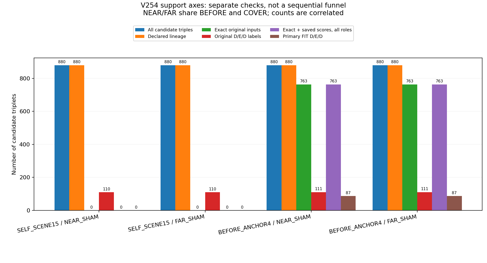
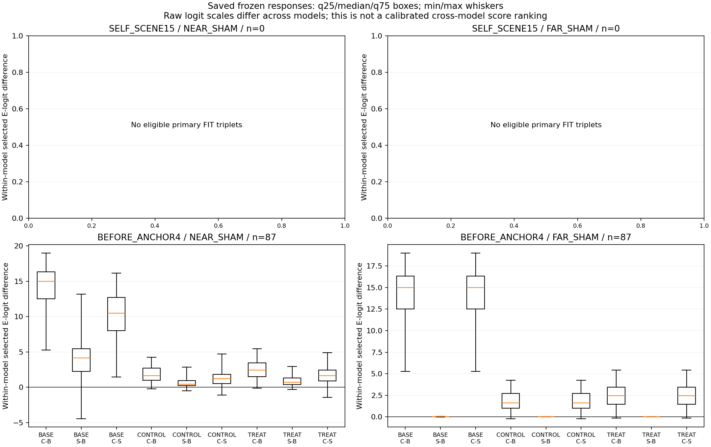
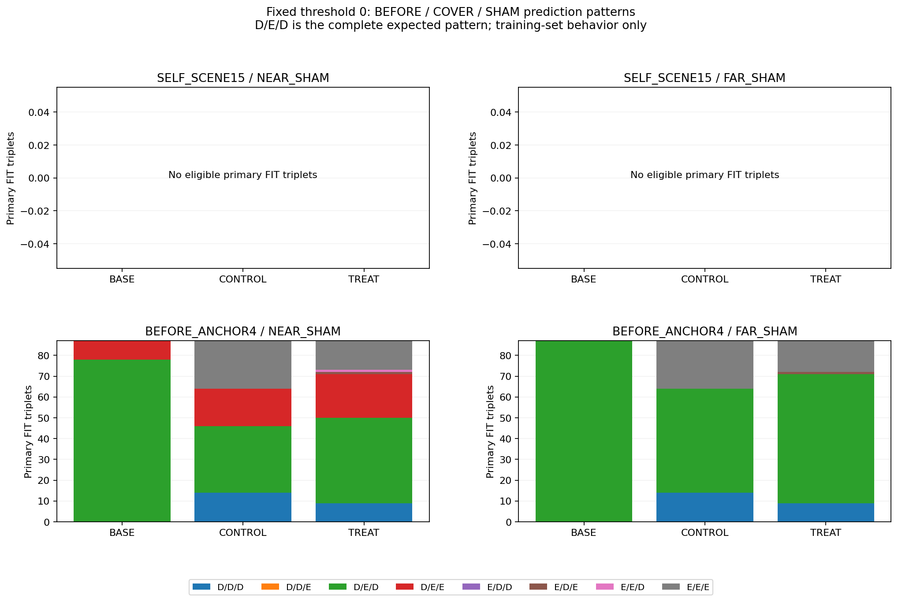

# V254 — 저장된 동일 query의 COVER·SHAM 반응

좌표를 완전히 고정한 BEFORE-anchor FIT에서 최신 대상 참조 TREAT의 완전 D/E/D 정답은 가까운 SHAM 41/87, 먼 SHAM 62/87입니다. 기존 BASE는 각각 78/87, 87/87입니다. TREAT도 COVER 점수를 SHAM보다 높이는 방향은 각각 83/87, 84/87에서 맞았습니다. 따라서 가림 조작에 전혀 반응하지 않는다는 설명은 맞지 않지만, 보임까지 함께 지키는 최종 판정은 부족합니다. 이 자료에서 참조 모델이 BASE보다 개선됐다는 근거는 없습니다. 원 native 주소6·7은 이 strict FIT 대조에 적격 사례가0개이므로 모든8개 부위의 가림 반응을 검증한 결과로 볼 수 없습니다.

첨부 V241은 V240까지의 검토입니다. 이후 분기·참조·생성 쌍 관련 진단과 학습이 추가됐으므로, 문서의 미실행 목록을 현재 상태처럼 다시 쓰지 않습니다. 이번 V254는 새 모델을 학습하지 않고 기존 V129의 전체 장면 가림 대조와 V252 세 모델의 저장 점수를 연결해 행동을 확인한 결과입니다.

원 Source 15,040행과 1,767개 입력 그룹을 먼저 검산했습니다. 모든 그룹의 원 8개 slot을 확인했고, 별칭 행을 제거하지 않았습니다. SYN 7,040행의 masked 944행과 전체 masked 7,423행은 E나 성공 보류로 바꾸지 않았습니다. 후보 triplet 3,520개를 누락·입력 불일치·라벨 상태와 함께 보존했습니다.

SELF_SCENE15는 각 장면 자체의 초기 추론 좌표를 사용하고, BEFORE_ANCHOR4는 원 BEFORE 초기 좌표를 다른 variant에도 유지합니다. 두 가족을 섞지 않았습니다. q/L·가용성뿐 아니라 원 q8/L8/availability8·box·known condition32의 정확한 일치를 요구했습니다. 좌표를 보정하거나 근처 사례로 대체하지 않았습니다.

표의 primary는 모든 구성원이 FIT이며, 원 정답이 BEFORE D·COVER E·SHAM D이고, 선언된 대상 관계·원 입력·저장 점수 가용성을 모두 만족한 경우입니다. 실제 판정 D/E/D와 COVER−SHAM 점수 양의 비율을 각각 표시합니다. 방향만 맞아도 원 보임과 대조 보임을 함께 맞힌 것은 아닙니다. NEAR와 FAR는 BEFORE/COVER를 공유하므로 두 수를 독립 사건으로 더하지 않습니다.

합성 정답은 선택된 native record의 첫 witness에 대한 상태입니다. 전체 대상 팔레트가 단독으로 보일 때와 foreign BOX가 앞을 막을 때를 구분하며, 자기 기하가 가린 S는 E에 합치지 않습니다. 이 검사는 q 한 픽셀의 소유자·부위 전체 가시성·실사 팔레트의 사람 정답을 새로 증명하지 않습니다. 공개 YCB의 associated-r 보조 정답도 이번 합성 triplet 성능에 합치지 않았습니다.

이는 학습용 FIT 분할 소속 장면의 저장 행동 진단입니다. 이 감사는 개별 행이 실제 학습 draw에 등장했는지 새로 검산하지 않았습니다. 성능 개선 실험이나 독립 일반화 검증이 아니며, 최신 모델을 채택하거나 현재 평가에 진입한 결과도 아닙니다. 세 모델의 raw logit 크기는 서로 보정된 확률이 아니므로, 크기 차이만으로 모델 순위를 정하지 않습니다.

새 학습·모델/encoder/체크포인트 forward·RGB/원 GT 해독·bank 적합·문턱 선택·PnP는 없습니다. 여섯 Source 컨테이너 전체를 읽고 hash했으므로 DEV 메타데이터와 저장 출력도 포함됩니다. 이는 고정 census와 진단용이며 새 설정 선택에 사용하지 않았습니다. 사용자가 첨부한 검토문 전체 바이트는 읽고 hash했지만, 그 안의 과거 현재/held 평가 집계를 새 선택 근거로 사용하지 않았습니다.

## 전체 후보와 primary 분모

| 원 입력 가족 | SHAM | 전체 후보 | 선언 관계 | 입력 exact | 원 D/E/D | exact+점수(모든 분할) | primary FIT |
| --- | --- | --- | --- | --- | --- | --- | --- |
| SELF_SCENE15 | NEAR_SHAM | 880 | 880 | 0 | 110 | 0 | 0 |
| SELF_SCENE15 | FAR_SHAM | 880 | 880 | 0 | 110 | 0 | 0 |
| BEFORE_ANCHOR4 | NEAR_SHAM | 880 | 880 | 763 | 111 | 763 | 87 |
| BEFORE_ANCHOR4 | FAR_SHAM | 880 | 880 | 763 | 111 | 763 | 87 |

## 고정 세 모델의 FIT 행동

| 원 입력 가족 | SHAM | 모델 | FIT n | 예측 D/E/D | COVER>SHAM | median C−B | median S−B | median C−S |
| --- | --- | --- | --- | --- | --- | --- | --- | --- |
| SELF_SCENE15 | NEAR_SHAM | BASE | 0 | NA | NA | NA | NA | NA |
| SELF_SCENE15 | NEAR_SHAM | CONTROL | 0 | NA | NA | NA | NA | NA |
| SELF_SCENE15 | NEAR_SHAM | TREAT | 0 | NA | NA | NA | NA | NA |
| SELF_SCENE15 | FAR_SHAM | BASE | 0 | NA | NA | NA | NA | NA |
| SELF_SCENE15 | FAR_SHAM | CONTROL | 0 | NA | NA | NA | NA | NA |
| SELF_SCENE15 | FAR_SHAM | TREAT | 0 | NA | NA | NA | NA | NA |
| BEFORE_ANCHOR4 | NEAR_SHAM | BASE | 87 | 78/87 (89.7%) | 87/87 (100.0%) | 15.0072 | 4.1670 | 10.4984 |
| BEFORE_ANCHOR4 | NEAR_SHAM | CONTROL | 87 | 32/87 (36.8%) | 83/87 (95.4%) | 1.6271 | 0.4414 | 1.2209 |
| BEFORE_ANCHOR4 | NEAR_SHAM | TREAT | 87 | 41/87 (47.1%) | 83/87 (95.4%) | 2.4419 | 0.6976 | 1.6520 |
| BEFORE_ANCHOR4 | FAR_SHAM | BASE | 87 | 87/87 (100.0%) | 87/87 (100.0%) | 15.0072 | 0.0000 | 15.0021 |
| BEFORE_ANCHOR4 | FAR_SHAM | CONTROL | 87 | 50/87 (57.5%) | 85/87 (97.7%) | 1.6271 | 0.0000 | 1.6271 |
| BEFORE_ANCHOR4 | FAR_SHAM | TREAT | 87 | 62/87 (71.3%) | 84/87 (96.6%) | 2.4419 | 0.0000 | 2.4419 |

## 원 native 주소별 BEFORE-anchor FIT 지원

| 원 native 주소 | NEAR n | FAR n | BASE NEAR 정답 | BASE FAR 정답 | TREAT NEAR 정답 | TREAT FAR 정답 |
| --- | --- | --- | --- | --- | --- | --- |
| 0 | 23 | 23 | 21 | 23 | 15 | 17 |
| 1 | 24 | 24 | 23 | 24 | 5 | 12 |
| 2 | 10 | 10 | 9 | 10 | 5 | 7 |
| 3 | 10 | 10 | 8 | 10 | 5 | 7 |
| 4 | 10 | 10 | 10 | 10 | 6 | 9 |
| 5 | 10 | 10 | 7 | 10 | 5 | 10 |
| 6 | 0 | 0 | 0 | 0 | 0 | 0 |
| 7 | 0 | 0 | 0 | 0 | 0 | 0 |

## 원 행·코드·재현 자료

- [V241 검토와 후속 기록의 대조](artifacts/V254_REVIEW_RECONCILIATION_A/RECONCILIATION_DRAFT_KO.md)
- [사전 계약](artifacts/V254_ROOT_SAVED_CF_RESPONSE/PROTOCOL_BEFORE_SOURCE_PAIR_ROWS.json)
- [모든 후보와 누락](artifacts/V254_ROOT_SAVED_CF_RESPONSE/saved_cf_response_v1/CF_TRIPLETS.csv)
- [세 모델의 전체 저장 반응](artifacts/V254_ROOT_SAVED_CF_RESPONSE/saved_cf_response_v1/RESPONSE_MODEL_ROWS.csv)
- [원 주소 0–7 포함 전체 집계](artifacts/V254_ROOT_SAVED_CF_RESPONSE/saved_cf_response_v1/RESPONSE_SUMMARY.csv)
- [원 SYN 7,040행과 masked 상태](artifacts/V254_ROOT_SAVED_CF_RESPONSE/saved_cf_response_v1/SYN7040_ROWS.csv)
- [기계 판독 요약](artifacts/V254_ROOT_SAVED_CF_RESPONSE/saved_cf_response_v1/SUMMARY.json)
- [독립 산술 QA](artifacts/V254_PREVIOUS_PROGRESS_AND_CF_QA_C/actual_review_v1/REVIEW.json)
- [공개 저장 입력 재현 코드](artifacts/V254_PUBLIC_REPLAY_ROOT/verify_saved_cf_response.py)
- [공개 재현 입력 매핑](runtime_dependencies.json)
