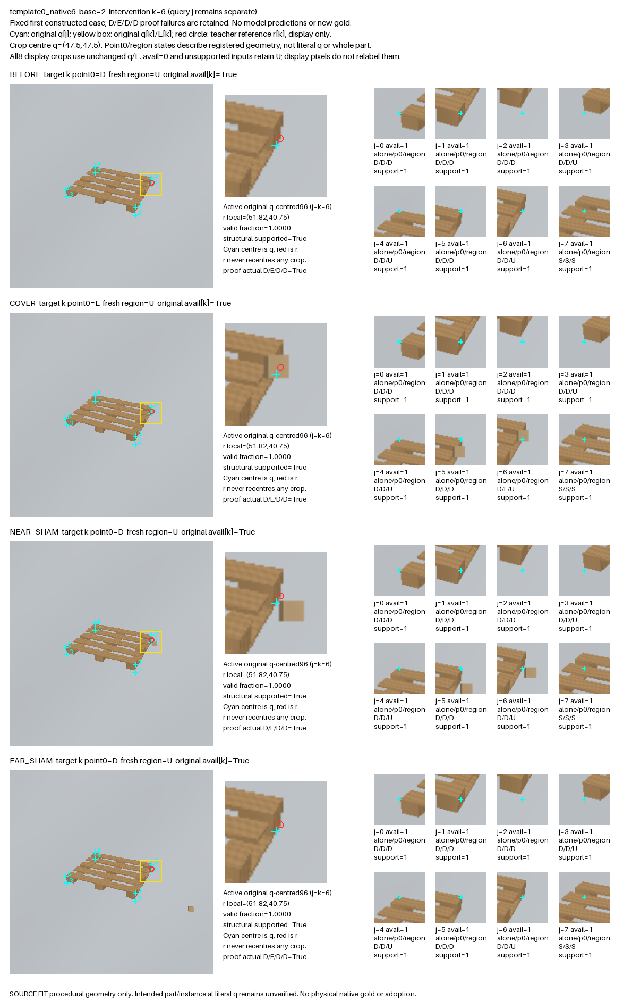

# V255 — 원 query를 유지한 8개 점별 3D 가림 대조

**새 합성 장면 생성과 데이터 검산을 완료했습니다. 새 모델 성능 개선은 아직 입증하지 않았습니다.**

V254에서는 같은 원 query를 사용하는 엄격한 진단 짝에 6·7번 점의 사례가 없었습니다. 이번에는 모델 점수나 기존의 성공 사례로 원본을 고르지 않고, 원래 SOURCE FIT에 속한 합성 원본 86개 전부에서 각 native 점 0~7을 가림 대상으로 시도했습니다. 이전 결과와 분모가 다르므로 아래 개수를 모델 성능 향상으로 비교하면 안 됩니다.

## 실제 완료 범위

- 86개 원본, 688개 점별 시도, 1,892개 실제 RGB 장면입니다. **생성된 RGB와 점별 메타데이터를 모두 이 폴더에 포함했습니다.**
- 먼저 원본 BEFORE RGB를 다시 렌더해 기존 decoded RGB SHA와 86개 모두 일치시켰습니다. 원래 추론 q8·crop 크기 L8·입력 가능 여부·context box를 유지했습니다.
- 가림 대상 점이 원래 직접 보이는 경우, 같은 3D BOX를 COVER / 가까운 SHAM / 먼 SHAM으로 배치했습니다. 나머지 자기 가림 86개 시도는 미생성 사유와 함께 남겼습니다.
- 생성한 장면마다 **8개 점 전체**의 point0 및 region 교사 판정을 새로 계산했습니다. SHAM이라는 이름으로 정답을 만들지 않았습니다.

| 원 native 점 | 시도 | 실제 생성된 대조 짝 | 자기 가림으로 미생성 | 실제 D→E→D→D 확인 |
|---|---:|---:|---:|---:|
| 0 | 86 | 86 | 0 | 86 |
| 1 | 86 | 86 | 0 | 86 |
| 2 | 86 | 86 | 0 | 86 |
| 3 | 86 | 86 | 0 | 86 |
| 4 | 86 | 86 | 0 | 86 |
| 5 | 86 | 86 | 0 | 86 |
| 6 | 86 | 40 | 46 | 40 |
| 7 | 86 | 46 | 40 | 46 |

D는 직접 보임, E는 외부 BOX에 가림, S는 자기 가림, U는 판정 불가능입니다. 위 패턴은 가림 대상으로 선택한 점의 BEFORE / COVER / NEAR_SHAM / FAR_SHAM 순서입니다. 602개 생성 짝 모두 해당 점의 실제 패턴을 통과했습니다. 원래 입력 불가 8개와 기존 masked 회원 93개도 기록에서 지우지 않았습니다. 이 수치는 장면 교사의 생성 검증이며, 사용 가능한 학습 loss 표본 수나 모델 정확도가 아닙니다.

## 실제 crop에서 확인한 것

[16개 고정 사례 갤러리](artifacts/V255_NATIVE_VISUAL_QA_A/gallery_v1/PORTABLE_GALLERY_KO.html) · [전체 그림](artifacts/V255_NATIVE_VISUAL_QA_A/gallery_v1/OVERVIEW.png) · [전체 장면 목록](dataset/SCENES.jsonl) · [688개 시도와 미생성 사유](dataset/ALL_NATIVE_TRIALS.jsonl)

사례는 template × native마다 base index가 가장 작은 생성 사례를 고정했습니다. 증명 성공 여부나 그림의 선명함으로 선택하지 않았습니다. 각 사례에서 전체 RGB, 원 q 중심 crop, 다른 7개 원 query crop을 함께 볼 수 있습니다. 청록 십자가는 원 q, 빨간 원은 교사의 기준 r이며 r로 crop을 옮기지 않았습니다. RAW96 crop 중심은 (47.5,47.5)입니다.



SHAM은 **선택한 점**을 보이게 유지합니다. 다른 점까지 모두 보이게 유지한다는 뜻은 아닙니다. 전체 point0 판정에는 NEAR_SHAM의 E 49개, FAR_SHAM의 E 4개가 있습니다. 다른 점의 가림까지 새로 판정했기 때문에 이 사례들이 잘못된 D 라벨로 복사되지 않았습니다.

point0와 region도 다른 목표입니다. 예를 들어 위 6번은 point0 D/E/D/D가 성립하면서 region은 U로 남을 수 있습니다. 이는 점 하나와 여러 witness로 구성한 영역의 판정 조건이 다르기 때문입니다. 단일 점 교사를 전체 부위의 보임이나 실제 팔레트 어노테이션 정답으로 확대 해석하지 않았습니다.

육안 검토에서는 팔레트와 BOX 색이 비슷하여 끝점 변화가 작은 사례도 확인했습니다. 모든 가림을 고대비의 명확한 단서로 만들었다고 주장하지 않습니다. 이 관찰만으로 기존 모델 실패 원인을 확정하지 않았고, 관찰 뒤 데이터나 생성 규칙을 바꾸지 않았습니다.

## 독립 검산과 재현

[독립 데이터 검산](artifacts/V255_NEXT_INTERVENTION_QA_C/actual_native_review_v1/REVIEW.json)은 명시된 3,873개 파일 binding, 1,892개 RGB-only NPZ와 decoded pixel SHA, 원 q8/L8/U/box, 688개 시도, 모든 점 교사 상태 및 산술을 전수 확인했습니다. 사전에 고정한 16개 사례의 64개 장면은 생성기를 호출하지 않고 동결된 ray 교사 정의로 재계산했습니다. 전체 86개를 다시 렌더한 독립 증명은 아닙니다.

패키지 루트에서 아래 명령으로 전체 파일을 검증할 수 있습니다. 두 번째 명령은 원 NumPy 2.3.5 환경에서 최소 base index 원본의 22개 RGB·새 교사 메타데이터·8개 시도를 실제로 재생성해 대조합니다. 메타데이터에 있는 원 컴퓨터의 절대 경로는 사용하지 않습니다.

```bash
python -B artifacts/V255_PUBLIC_REPLAY_ROOT/verify_and_replay.py --package .
python -B artifacts/V255_PUBLIC_REPLAY_ROOT/verify_and_replay.py --package . --replay-first-base
```

[생성 전 규칙](artifacts/V255_ROOT_NATIVE_COVERAGE/PROTOCOL_BEFORE_NATIVE_3D_RENDER.json) · [실제 완료 receipt](dataset/COMPLETE.json) · [모든 파일 SHA](MANIFEST.json) · [선택된 FIT 구성](artifacts/V255_ROOT_NATIVE_COVERAGE/source_fit_parent_manifest_v1/SELECTED_FIT_CONFIGS.json)

## 공개 실사 확인과 다음 실제 단계

공식 KU Leuven Pallox DOI [10.48804/DJLDFS](https://doi.org/10.48804/DJLDFS)의 공개 API와 README를 확인했습니다. 라이선스는 CC BY 4.0이며 API에는 RGB 322개·depth 322개·mask 290개·pose 284개가 나옵니다. [저장한 공식 메타데이터와 확인 기록](artifacts/V255_PUBLIC_PALLET_METADATA_ROOT/PUBLIC_METADATA_READINESS.json)을 함께 공개합니다. 출처: Yanming Wu·Eric Demeester, KU Leuven, 해당 DOI.

README의 가시성 CSV는 물체 전체의 mesh 면적 비율이며 키포인트별 가림 정답이 아닙니다. pose 변환 방향 설명도 대조가 필요합니다. 이 단계에서 공개 RGB/depth/pose/mask/mesh/calibration/visibility CSV를 내려받아 학습한 적은 없습니다. 현재 223장은 사용자 직접 촬영 자료이며 KU 자료와 무관하다고 확인받았지만, 별도 공개 held45의 upstream 영상 중복 여부까지 확인된 것은 아닙니다.

다음은 위 새 합성 RGB에서 원 query crop/context를 뽑아 기존 frozen encoder로 실제 특징을 추출하는 단계입니다. 원 입력 불가·자기 가림·판정 불가능·기준점이 crop 밖인 경우는 외부 가림 loss에서 제외하고 사유를 유지합니다. 기존 공개 YCB 실사의 역할을 임의로 팔레트 native 정답으로 바꾸지 않습니다. 같은 기존 모델 구조에서 데이터 추가 효과를 분리해 확인해야 하며, 현재 평가·held 결과로 데이터/문턱/모델을 고르지 않습니다. PnP는 변경하지 않았습니다.

목표는 계속 진행 중입니다. 이 자료는 데이터 보완의 실제 완료 기록이며, 실사용 90%나 v61 우위를 입증한 최종 결과가 아닙니다.
