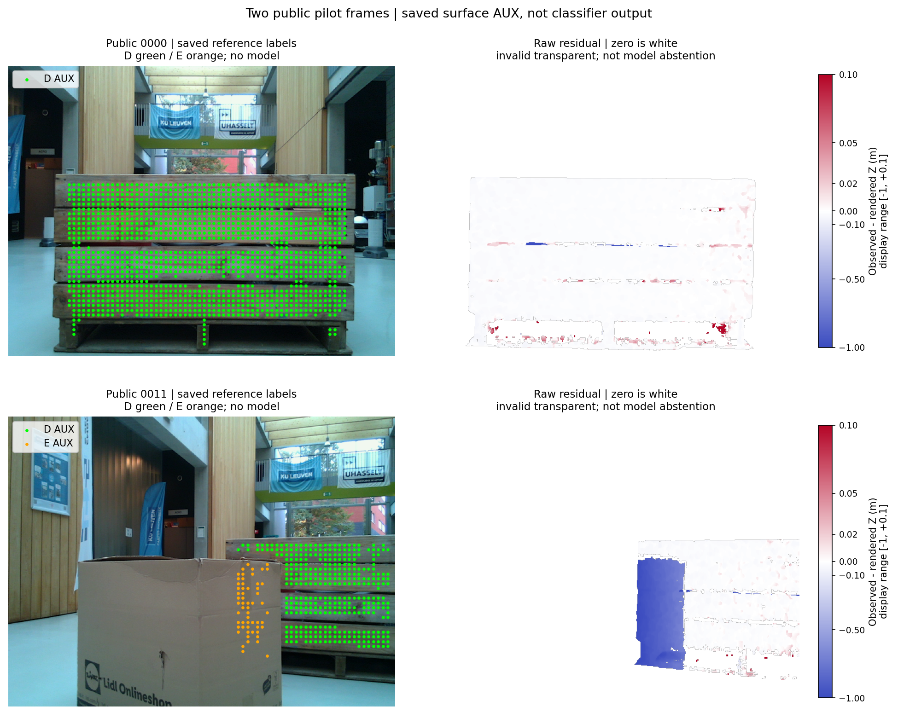
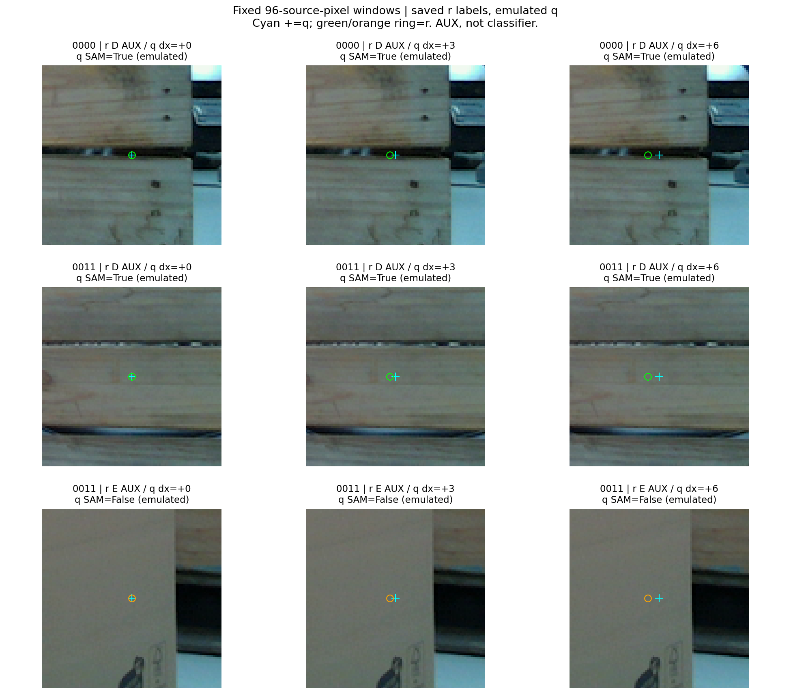

# V259 공개 RGB-D 보임·외부 가림 교사 후보

공개 실사에서 앞 물체에 의한 가림을 깊이로 확인하고, 보수적인 표면점 보조 라벨을 실제로 만들었습니다. 새 모델 학습·추론은 0회입니다. 현재 평가 223장의 영상·주석·출력은 이번 작업에 사용하지 않았고, PnP·좌표 보정도 하지 않았습니다. V258의 주소 정의·투영 검사와 V260의 입력 CODE 감사도 함께 보존합니다.

자료는 KU Leuven Pallox의 `0.55m_hall/0000`과 `0011` 두 장입니다. 0000은 파일명 순 첫 완전한 묶음입니다. 0011은 같은 capture에서 RGB/depth/pose/mask가 모두 있는 28개 중 공식 `occluded_percent`가 최대인 장이며, 동률은 작은 frame ID를 택하도록 CSV를 읽기 전에 고정했습니다. 모델 예측을 보고 선택하지 않았습니다. 독립 영상 수는 **2장**이고, 아래 격자점과 q 이동은 여기에서 파생된 자료입니다.

| 확인 | 0000 | 0011 |
| --- | ---: | ---: |
| T 투영 mesh와 SAM mask IoU | 0.90625 | 0.66487 |
| inverse(T) 투영 IoU | 0.34666 | 0.15885 |
| T render와 SAM 내부의 관측−렌더 깊이 중앙값 | −12.59mm | −12.44mm |
| T render 안·SAM 밖의 유효 깊이 중앙값 | −15.54mm | −857.34mm |

0011에는 실제 종이상자가 목재 pallet bin 앞을 가립니다. 마지막 행은 render 안·SAM 밖의 관측이며, 이 행 전체를 가림 정답으로 만든 것은 아닙니다. 실제 보이는 목재의 약 12mm 잔차와 앞 상자의 약 857mm 차이를 확인한 뒤, 아래 고정 조건을 만족하는 부분만 보조 라벨로 남겼습니다. 가림 영상의 visible SAM mask와 target-only render의 IoU는 모델 정확도 지표가 아닙니다.

라벨은 참조점 r의 11×11 창 전체에 유효한 관측·렌더 깊이가 있고, 각각의 깊이 범위가 40mm 이하일 때만 허용합니다. D는 창 전체가 SAM target이고 중심 깊이 차이 절댓값이 50mm 이하입니다. E는 창 전체가 SAM background이며 관측 깊이가 예상 target 표면보다 150mm 이상 앞입니다. 나머지는 이유를 붙여 U로 보존합니다. 깊이 bias를 빼거나 pose를 최적화하지 않았습니다. 이 정책은 0011을 decode하기 전에 고정했고 결과 수에 맞춰 변경하지 않았습니다.

| 공개 frame | 격자 r 전체 | D 후보 | E 후보 | U·제외 |
| --- | ---: | ---: | ---: | ---: |
| 0000 | 4,800 | 1,434 | 0 | 3,366 |
| 0011 | 4,800 | 352 | 57 | 4,391 |
| 합계 | 9,600 | 1,786 | 57 | 7,757 |

E 57개는 정책을 만족한 **보조 교사점 수**입니다. 이전 YCB의 0/57 모델 결과와 별개입니다. 전체 pixel map에서는 0000의 D/E가 91,892/0, 0011은 22,254/3,890입니다. 격자는 stride8·offset4로 모두 보존했습니다. U에는 물체 밖과 depth 결측·경계·불연속 등이 포함되며, 모델의 보류율이나 정답으로 세지 않습니다. 이유 map은 서로 겹칠 수 있습니다.

r 상태와 q 위치의 SAM pixel presence를 분리했습니다. q는 0·±3·±6px의 정해진 축 방향 이동이며 실제 초기 추론 출력이 아닙니다. 86,400개 q 기록을 보존했고, r의 D/E를 q pixel gold로 복사하지 않았습니다. 이번 안전한 내부점 조건에서는 이 이동들에서 r 상태와 q SAM 항목의 D/target·E/background 불일치가 0입니다. 따라서 현재의 경계·가상 코너·작은 초기 오차 실패를 해결했다는 증거로 사용할 수 없습니다.

이 그림은 96 source-pixel 표시 창입니다. cyan은 q, ring은 r이며, green D·orange E는 교사 후보입니다. 실제 classifier feature crop이나 모델 예측을 보여주는 그림은 아닙니다. 모든 원장과 고정된 선택 규칙을 보존했습니다.

독립 checker는 compiler를 호출하지 않고 두 원본 depth와 SAM, 저장 T-render를 사용해 모든 r 9,600개와 q 86,400개를 검산했습니다. 출력 12개의 hash와 저장 map/summary 합계도 일치했습니다. 독립 scope는 모든 grid·원장과 저장 map algebra이며, 전체 pixel window 재계산이나 geometry 재렌더까지 독립 수행한 것은 아닙니다.

- [독립 실제 데이터·원장 QA](artifacts/V259_PUBLIC_PILOT_QA_A/actual_review_v1/REVIEW.json)
- [고정 라벨 정책](artifacts/V259_ROOT_PUBLIC_OCCLUSION_PILOT/PROSPECTIVE_SURFACE_LABEL_POLICY.json)
- [보조 라벨 SUMMARY](artifacts/V259_ROOT_PUBLIC_OCCLUSION_PILOT/public_aux_label_pilot_v1/SUMMARY.json)
- [모든 r/q와 map의 COMPLETE·hash](artifacts/V259_ROOT_PUBLIC_OCCLUSION_PILOT/public_aux_label_pilot_v1/COMPLETE.json)
- [clear 투영·연속 깊이 검사](artifacts/V258_ROOT_PUBLIC_POINT_TEACHER/public_frame_geometry_v2/GEOMETRY_DIAGNOSTIC.json)
- [occluded 투영·연속 깊이 검사](artifacts/V259_ROOT_PUBLIC_OCCLUSION_PILOT/public_frame_geometry_v1/GEOMETRY_DIAGNOSTIC.json)

기존 native sign order는 `---,+--,++-,-+-,--+,+-+,+++,-++`, centroid는 8입니다. `perm[CF]=canonical` 방향을 CODE로 확인했습니다. 가상 cuboid 주소가 반드시 mesh 표면점이어야 하는 것은 아닙니다. 별도 공개 AABB 진단은 8개 중 frame 안 7개, SAM/render pixel 지원 4개·미지원 3개·frame 밖 1개를 보였습니다. exact 미지원이면서 7×7 이웃은 지원되는 사례는 0개였습니다. 이 공개 AABB를 현재 pallet native gold로 선언하거나 미지원을 E/SELF로 바꾸지 않았습니다. [모든 8개 관측·crop](artifacts/V258_PUBLIC_VIRTUAL_QUERY_DIAGNOSIS_C/observations_v1/PORTABLE_GALLERY_KO.html)을 공개합니다.

현재 작은 head의 입력 설명도 CODE 기준으로 명확히 했습니다. 1186차원은 full96 CLS384 + full96의 fixed4-patch Q read384 + centre32 CLS384 + valid fractions2 + condition32입니다. Q read는 CLS가 아니며, 별도 저장된 global bbox CONTEXT_CLS나 다른 query RGB는 이 head의 forward에 들어가지 않습니다. condition32는 기존 native/다른 query의 수치 기하 정보입니다. 과거의 ‘3 CLS’ 설명은 이 layout으로 정정합니다. 단일 공개 query의 pixel1154+zero32는 tensor상 표현할 수 있지만, native onehot을 강제하는 기존 8-slot driver에 가짜 슬롯을 넣지 않습니다. [정확한 channel·정규화·입력 계약 감사](artifacts/V260_PUBLIC_POINT_FEATURE_TRANSPORT_B/TRANSPORT_COMPATIBILITY_REVIEW.json)에 CODE hash와 근거 위치를 보존했습니다.

보호된 공개 MR6D 45개의 원본 encoded-byte SHA256는 publisher metadata만으로 확보해 새 공개 RGB와 비교했습니다. exact-byte hit는 없었습니다. JPEG와 PNG의 byte 불일치는 재인코딩된 동일 촬영본의 완전한 비중복 증명이 아닙니다. 공식 자료의 서로 다른 촬영 팀·센서·절차 근거와 이 한계를 함께 유지하며, 이번 접근은 공개 교사 진단으로 한정했습니다. 보호 사례의 pixel·depth·pose·주석·점수는 읽지 않았습니다. [metadata 추출·제외 목록](artifacts/V258_PUBLIC_HELD_DIGEST_IDENTITY_B/IDENTITY_EXTRACTION_REVIEW.json)을 보존합니다.

다음 작업은 teacher 값이 입력에 섞이지 않는 단일-query feature 전달을 실제 검증하고, 공개 source의 학습/검증 분할과 native query·보조 과제의 연결을 고정하는 것입니다. 두 장의 안전한 내부점에서 멈추지 않고 경계·가상 코너와 예상 target의 식별 문제를 포함해야 합니다. 이후 동결 모델을 같은 현재 query에서 v61과 비교해야 합니다. 현재 사용 가능한 성능 개선은 아직 입증되지 않았으며, [최근 모델 비교 V256](../V256_MATCHED_NATIVE_DATA_PAIR/README_KO.md)의 실사 전이 실패는 남아 있습니다.

원 자료는 Yanming Wu·Eric Demeester의 [KU Leuven Pallox 데이터](https://doi.org/10.48804/DJLDFS), [CC BY 4.0](https://creativecommons.org/licenses/by/4.0/)입니다. 관련 논문: *6D Pose Estimation of Pallet Bins for Autonomous Logistics Using a Synthetically Trained Object Detector and FoundationPose*, ICPRAM2026, [DOI10.5220/0014455600004067](https://doi.org/10.5220/0014455600004067). 원 RGB-D·pose·mask·mesh를 수정하지 않았습니다. overlay와 보조 라벨은 이번 작업의 파생물입니다. 원본·코드·실패 V1·수정 V2·표·그림을 함께 보존합니다.
