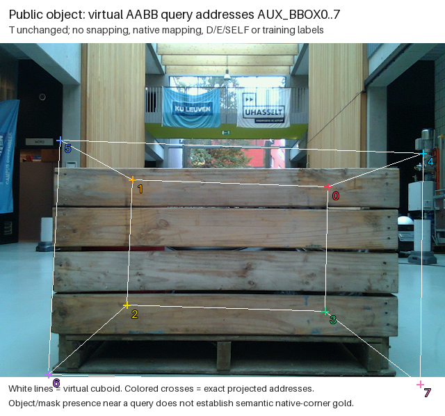
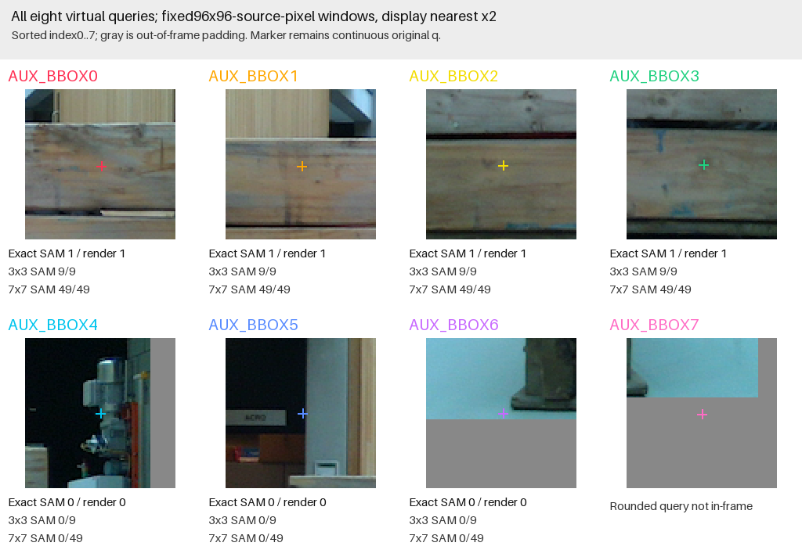

# 공개 Pallox 한 frame의 가상 AABB query와 pixel support

선택된 공개 `0.55m_hall/0000`의 mesh AABB8개를 고정 sign 순서로 구성하고 원 T로 투영했습니다. 이름은 AUX_BBOX0..7이며 우리 pallet native 주소와 연결하지 않습니다. q는 정확한 가상주소 투영값으로, initializer/v61 예측이 아닙니다. snapping·좌표 보정·새 학습/추론은 없습니다.

모든8개를 순서대로 보존했습니다. 양의Z 8, rounded in-frame 7, SAM exact pixel 있음 4, 없음 3, 3×3 중 SAM지원 4, 7×7 중 지원 4, target render exact support 4입니다. exact SAM없지만7×7에 지원이 있는 주소는 0개입니다. 이것은 이 frame/mask/render의 관측이며 negative mask를 E/SELF로 라벨링하거나 모델 정확도를 계산하지 않습니다.

crop은 source96×96pixel 창을 nearest2배로 표시한 주석화 자료입니다. 원 q는 그대로이며 crop용 정수 anchor는 query 보정이 아닙니다. 회색은 frame 밖 padding입니다. 3×3/7×7은 rounded floor(q+.5)를 중심으로 frame에 clip한 실제 window 크기를 분모로 기록합니다. 전체 object가 보인다는 것은 시각 관측이며 semantic corner/native gold 인증이 아닙니다. 3D physical-native support는 원 query presence 판단의 필수조건으로 부과하지 않습니다.

원 mesh AABB는 외접 cuboid이므로 address에 실제 surface/target pixel이 존재한다는 보장이 없습니다. 주변 구조가 보이는지와 정확한 virtual pixel presence를 구분하기 위한 단일 공개 AUX 진단이며, native-point 정의·SELF·visibility gold를 만들지 않습니다. T의 옳음이나 mask 완전성을 이 표만으로 인증하지 않습니다. encoded-byte identity no-hit은 reencoding/공통capture 비중복 증명이 아니며 학습 admission도 아닙니다.

[모든8 observations CSV](ALL8_VIRTUAL_QUERY_OBSERVATIONS.csv) · [full rows JSON](ALL8_VIRTUAL_QUERY_OBSERVATIONS.json) · [요약·입력binding](SUMMARY.json) · [완료 영수증](COMPLETE.json)
