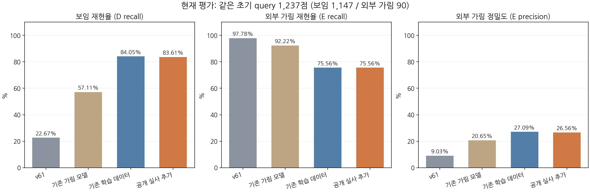
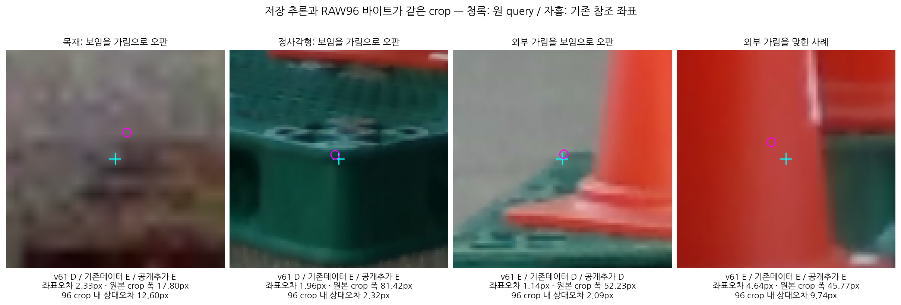

# V261: 마지막 공개 실사 추가 학습 비교

**결론: 공개 실사 보조 과제는 학습됐지만, 현재 키포인트 평가의 전체 개선은 확인하지 못했습니다. 이번 접근을 추가 학습 없이 종료합니다.**

사용자 요청은 공개 실사 학습 비교 마지막 1회입니다. 동일한 작은 head를 같은 초기값·1,000회 update로 각각 학습한 대조군과 추가군을 비교했습니다. 키포인트 위치·PnP는 변경하지 않았고, 현재 평가셋은 학습·정규화·문턱 선택에 쓰지 않았습니다. 두 최종 가중치를 고정한 뒤 현재 RGB를 열었고, 두 모델의 전체 예측을 저장한 뒤 기존 정답·v61 저장 출력과 결합했습니다.

## 현재 평가 결과

동일 query 비교가 가능한 1,237점(222개 영상, 보임 D 1,147점·외부 가림 E 90점)입니다. 전체 등록은 223장·1,784점입니다. `SQUARE118` 그룹 중 한 영상은 이 주 비교에 포함되는 D/E 점이 없어 주 비교 영상 수는 117장입니다. SELF는 주 비교에서 제외하고 별도 기록했습니다.

| 모델 | 보임 precision | 보임 recall | 외부 가림 precision | 외부 가림 recall | 보류율 | 전체 정답 비율 |
|---|---:|---:|---:|---:|---:|---:|
| v61 | 99.24% | 22.67% | 9.03% | 97.78% | 0.00% | 28.13% |
| 기존 가림 모델 | 99.54% | 57.11% | 20.65% | 92.22% | 14.31% | 59.66% |
| 기존 학습 데이터 | 97.77% | 84.05% | 27.09% | 75.56% | 0.00% | 83.43% |
| 공개 실사 추가 | 97.76% | 83.61% | 26.56% | 75.56% | 0.00% | 83.02% |

공개 실사 추가 전후 보임 정답은 **964→959**, 외부 가림 정답은 **68→68**입니다. 24점을 회복했고 29점을 새로 틀려 순 5점 감소했습니다. 외부 가림으로 판정한 256점 중 실제 가림은 68점뿐이며, 보이는 188점을 가림으로 오판했습니다. 이 평가에서 기존 가림 모델보다 보임 recall은 높지만 외부 가림 recall은 낮습니다. 따라서 일괄적인 우수성이나 실사용 성공을 주장하지 않습니다.

기존 가림 모델은 이 자료의 CAL/반복 노출 이력이 있어 새 독립 검증이 아닙니다. 현재 평가도 실험 과정에서 여러 차례 관찰된 자료입니다. 이번 학습·문턱 선택에는 쓰지 않았지만, 새 블라인드 테스트라는 뜻은 아닙니다.

### 목재·정사각형

| 그룹 | 모델 | D recall | E recall | E precision | 보류율 |
|---|---|---:|---:|---:|---:|
| 목재 | v61 | 23.54% | 100.00% | 5.80% | 0.00% |
| 목재 | 기존 가림 모델 | 72.73% | 79.31% | 26.14% | 16.59% |
| 목재 | 기존 학습 데이터 | 86.69% | 72.41% | 20.39% | 0.00% |
| 목재 | 공개 실사 추가 | 89.12% | 68.97% | 22.99% | 0.00% |
| 정사각형 | v61 | 21.66% | 96.72% | 12.42% | 0.00% |
| 정사각형 | 기존 가림 모델 | 38.98% | 98.36% | 19.11% | 11.82% |
| 정사각형 | 기존 학습 데이터 | 80.98% | 77.05% | 31.76% | 0.00% |
| 정사각형 | 공개 실사 추가 | 77.21% | 78.69% | 28.40% | 0.00% |

목재는 대조군 대비 순 14점 개선됐지만 정사각형은 순 19점 악화됐습니다. 한 재질의 개선을 전체 해결로 해석하면 안 됩니다.

### 혼동행렬

각 행은 `(보임으로 판정, 외부 가림으로 판정, 보류)`입니다. D=정답 보임, E=정답 외부 가림. 분모와 보류를 그대로 유지했습니다.

| 그룹 | 모델 | 정답 D → (D,E,U) | 정답 E → (D,E,U) |
|---|---|---|---|
| 전체 | v61 | (260,887,0) | (2,88,0) |
| 전체 | 기존 가림 모델 | (655,319,173) | (3,83,4) |
| 전체 | 기존 학습 데이터 | (964,183,0) | (22,68,0) |
| 전체 | 공개 실사 추가 | (959,188,0) | (22,68,0) |
| 목재 | v61 | (145,471,0) | (0,29,0) |
| 목재 | 기존 가림 모델 | (448,65,103) | (2,23,4) |
| 목재 | 기존 학습 데이터 | (534,82,0) | (8,21,0) |
| 목재 | 공개 실사 추가 | (549,67,0) | (9,20,0) |
| 정사각형 | v61 | (115,416,0) | (2,59,0) |
| 정사각형 | 기존 가림 모델 | (207,254,70) | (1,60,0) |
| 정사각형 | 기존 학습 데이터 | (430,101,0) | (14,47,0) |
| 정사각형 | 공개 실사 추가 | (410,121,0) | (13,48,0) |

새 모델의 주 비교 보류율 0%는 신뢰도 보류 기능을 학습했다는 뜻이 아닙니다. 고정 logit 0으로 양분하며, 입력 자체가 없는 점은 U로 유지합니다. 전체 1,784점의 원래 입력 U 45점은 제외하지 않고 별도 원장에 남겼습니다.

## 실제 crop과 3px 이하 사례

[고정 12개 전체 사례 갤러리](artifacts/V261_ROOT_FINAL_PUBLIC_REAL_COMPARISON/final_current_crop_gallery_v1/GALLERY.html) · [선택 규칙과 후보 수](artifacts/V261_ROOT_FINAL_PUBLIC_REAL_COMPARISON/final_current_crop_gallery_v1/CASE_SELECTION_BEFORE_RGB.json) · [crop 좌표·바이트 일치·출력 원장](artifacts/V261_ROOT_FINAL_PUBLIC_REAL_COMPARISON/final_current_crop_gallery_v1/CASE_FACTS.json)

사례는 미리 정한 재질×정답×추가군 성공/실패 셀에서 row ID의 SHA256 최솟값으로 선택했습니다. 좋은 사례만 고르지 않았으며 12개 셀 모두 남겼습니다. crop 중심과 크기는 초기 추론 그대로입니다. 참조 좌표는 표시에만 썼습니다. 이 그림은 실패 형태를 보여주는 예시이며, 전체 실패 원인의 빈도를 입증하는 표본은 아닙니다.

목재 실패 예시는 원본 좌표 오차가 2.33px이지만 crop 폭이 17.80px여서 96×96 입력 안에서는 약 12.60px 이동입니다. 정사각형 실패 예시는 오차 1.96px·crop 폭 81.42px로 상대 오차 약 2.32px이며, 이 경우에도 보임을 가림으로 판정했습니다. 따라서 모든 실패를 큰 초기 좌표 오차 하나로 설명할 수 없습니다. 경계 위치, 작은 crop의 정보 부족·흐림, 합성/실사 외관 및 감독 정의 차이가 함께 남습니다. 이 한 번의 비교로 각 원인의 기여율까지 분리한 것은 아닙니다.

기존 오차 LE3 표는 수동 클릭 외의 기존 PnP 투영·불명 참조도 포함합니다(주 비교 479점: D461/E18). PnP를 새로 실행하거나 정답을 갱신하지 않았습니다. 수동 클릭만의 세부 집계는 별도 진단에 기록합니다.

## 데이터와 학습 구성

| 항목 | 구성 |
|---|---|
| 기존 FIT | 합성 native MAIN 4,752점(D4,565/E187) + 공개 YCB 관련점 AUX 1,124점(D841/E283) |
| 공개 추가 원본 | KU Leuven Pallox DOI 10.48804/DJLDFS, CC BY 4.0, RGB/depth/pose/SAM 완비 284장, 원본 1,142파일 |
| 공개 분리 | 디렉터리 단위 고정 해시 TRAIN168장 / DEV116장. 같은 물체·연속 촬영 상관 가능; 독립 세션/새 물체 검증 아님 |
| 공개 전체 teacher | 장당 4,800 표면 참조점, 총 1,363,200점. U 및 제외 사유·전 q 원장 보존 |
| 공개 선택 | 영상·클래스당 고정 해시 상위 최대64점. q=r, L=96, native=None, SELF=UNKNOWN. 총9,133점 |
| 공개 TRAIN | D4,688/E1,798, 총6,486점 |
| 공개 DEV | D2,249/E398, 총2,647점 |
| 특징 | 고정 공식 DINO full CLS384 + 중앙 patch384 + centre32 CLS384 + 유효율2 + condition32 = 1,186 |
| 공개 condition | 32개 0. 존재하지 않는 native8 슬롯을 만들어 붙이지 않음 |
| head | 기존 1,186→64 ReLU→2, 76,098개 파라미터. 현재 판정 MAIN0, 공개 감독 AUX1 |
| 동일 조건 | seed17, 같은 초기 가중치, 같은 4개 난수 스트림, 각1,000 AdamW update, lr0.001/wd0.0001, batch32 |
| 달라진 것 | 추가군 AUX 학습 풀에 공개 TRAIN6,486점 추가. 합성 풀과 batch 내 두 family·D/E 수는 동일 |
| 금지·고정 | 현재/held 학습 없음, PnP·키포인트 변경 없음, threshold 탐색 없음, warm start/LoRA 없음 |

공개 라벨은 관측·렌더 깊이가 유효하고 작은 윈도우의 깊이 범위가 작을 때, SAM target 내부+깊이 일치면 D, SAM 배경+관측면이 렌더 표면보다 15cm 이상 앞이면 E로 정했습니다. 나머지는 U입니다. 이 라벨은 **앞면 표면점의 보임**이며, 현재 평가의 **등록된 가상 cuboid 키포인트 보임**과 동일한 정답이 아닙니다. 깊이·pose·SAM 값은 감독 생성에만 쓰고 RGB encoder/head 입력에는 넣지 않았습니다.

현재 223장은 사용자가 직접 촬영했으며 KU Leuven과 무관하다고 확인했습니다. 별도 보호 공개45장의 encoded-byte 중복은 검토했으나, 재인코딩된 동일 촬영 원본까지 독립이라고 인증하지 않았습니다. 보호45장 성능을 새 결과로 주장하지 않습니다.

### 공개 보조 과제와 전이 결과

| 평가 | 기존 데이터 모델 CM D/E→D/E/U | 공개 추가 모델 CM D/E→D/E/U |
|---|---|---|
| 공개 DEV 표면점 | [[168, 2081, 0], [181, 217, 0]] | [[2249, 0, 0], [41, 357, 0]] |
| 기존 합성 DEV native | [[1267, 21, 0], [4, 52, 0]] | [[1264, 24, 0], [4, 52, 0]] |
| 기존 YCB DEV 관련점 | [[333, 7, 0], [57, 0, 0]] | [[316, 24, 0], [54, 3, 0]] |

공개 DEV에서 추가군은 D2,249/2,249, E357/398(89.70%)를 맞혔습니다. 외부 가림 recall은 1.23m_lab 251/259(96.91%), 1.92m_lab 106/139(76.26%)로 촬영 그룹에 따라 다릅니다. 클래스당 최대64개를 뽑았으므로 precision을 자연 분포 전체의 precision으로 해석할 수 없습니다. 이 내부 과제를 학습한 것은 확인됐지만, 현재 native MAIN 판정은 전체 개선되지 않았습니다. **단순히 공개 실사를 더 넣으면 현재 과제가 해결된다는 가설은 이번 조건에서 지지되지 않았습니다.**

## 해결한 것과 남은 한계

- 데이터·감독·특징 경로를 연결하고 공개 실사 보조 과제의 학습을 실제로 확인했습니다. 전체 원본·teacher·선택 원장·학습 draw/log·최종 가중치·현재 저장 출력·실제 crop을 보존합니다.
- 보임을 가림으로 판단하는 오류가 여전히 많고, 외부 가림 precision이 낮습니다. 공개 내부 성능이 현재 native 성능으로 전이되지 않았습니다.
- 표면 내부의 보수적인 D/E 감독과 등록된 가상 키포인트의 보임은 목표가 다릅니다. 외관 전이 실패와 목표 차이를 이 실험 하나로 완전히 분리하지 못했습니다.
- 자기 가림은 upstream 기하학 필터로 처리한다는 사용자 방침을 유지했습니다. human SELF136점의 이진 반응은 별도 표이며 외부 가림 정답에 합치지 않았습니다.
- 이 접근을 현재 성공한 모델로 채택하지 않습니다. 공개 실사 추가 비교 마지막1회는 소진됐으며, 이후 재학습·문턱 변경·새 실험을 자동으로 이어가지 않습니다. 전체 문제의 불가능성을 증명한 것은 아니지만 현재 학습·감독 조합은 실사용 성공을 입증하지 못했습니다.

## 확인·재현 경로

- [현재 전체 비교 원장](artifacts/V261_ROOT_FINAL_PUBLIC_REAL_COMPARISON/frozen_current_comparison_v1/ALL1784_FINAL_COMPARISON_LEDGER.csv)
- [precision/recall/보류 원표](artifacts/V261_ROOT_FINAL_PUBLIC_REAL_COMPARISON/frozen_current_comparison_v1/PRIMARY.csv) · [2×3 혼동행렬](artifacts/V261_ROOT_FINAL_PUBLIC_REAL_COMPARISON/frozen_current_comparison_v1/D_VS_EXTERNAL_E_2X3.csv)
- [좌표 오차별](artifacts/V261_ROOT_FINAL_PUBLIC_REAL_COMPARISON/frozen_current_comparison_v1/COORDINATE_ERROR_BINS.csv) · [native8별](artifacts/V261_ROOT_FINAL_PUBLIC_REAL_COMPARISON/frozen_current_comparison_v1/PRIMARY_NATIVE8.csv) · [SELF 별도](artifacts/V261_ROOT_FINAL_PUBLIC_REAL_COMPARISON/frozen_current_comparison_v1/HUMAN_SELF_BINARY_RESPONSE.csv)
- [최종 학습 COMPLETE](artifacts/V261_ROOT_FINAL_PUBLIC_REAL_COMPARISON/final_public_aux_matched_v1/COMPLETE.json) · [공개·기존 source 상세 결과](artifacts/V261_ROOT_FINAL_PUBLIC_REAL_COMPARISON/final_public_aux_matched_v1/SUMMARY.json)
- [학습 전 고정 정책](artifacts/V261_ROOT_FINAL_PUBLIC_REAL_COMPARISON/PROSPECTIVE_FINAL_ONE_COMPARISON_POLICY.json) · [양 head 고정](artifacts/V261_ROOT_FINAL_PUBLIC_REAL_COMPARISON/final_public_aux_matched_v1/BOTH_FINAL1000_LOGS_DRAWS_FROZEN_BEFORE_ANY_DEV_OR_CURRENT_OUTPUT.json)
- [GT/v61 읽기 전 양 현재 예측 고정](artifacts/V261_ROOT_FINAL_PUBLIC_REAL_COMPARISON/frozen_current_comparison_v1/BOTH_CURRENT_PREDICTIONS_FROZEN_BEFORE_GT_OR_V61_READOUT.json)
- [전체 public 선택 rank 재계산](artifacts/V261_ROOT_FINAL_PUBLIC_REAL_COMPARISON/ROOT_PUBLIC_FULL_SELECTION_REPLAY.json) · [특징 검증](artifacts/V261_ROOT_FINAL_PUBLIC_REAL_COMPARISON/ROOT_PUBLIC_FEATURE_VERIFICATION.json)
- [전체 운반 바이트 목록](MANIFEST.json)과 `tools/restore_artifacts.py`로 큰 파일을 복원할 수 있습니다. 저장된 절대 원본 경로는 provenance이며 복원기는 이 경로를 열지 않습니다.
- 공개284 원본은 `public_data/DOI10.48804_DJLDFS_V1_0/`, 원래 디렉터리 구조의 새 실험 자료는 `artifacts/`입니다. 90MiB 초과 원본만 gzip 후 64MiB 이하 조각으로 운반하며 전체 복원 SHA/size를 확인합니다.
- 기존 source 전체 특징·samples 및 이전 V255/V256 실험도 이미 같은 저장소 main에 공개돼 있습니다. 이번 패키지는 새 시도를 보존하며 과거 원본을 중복 업로드하지 않습니다.
- 공개 데이터: Yanming Wu·Eric Demeester, [KU Leuven Pallox V1.0](https://doi.org/10.48804/DJLDFS), CC BY4.0. 공식 DINOv2 코드·가중치 attribution은 포함된 dependency closure와 기존 저장소 라이선스를 따릅니다.
