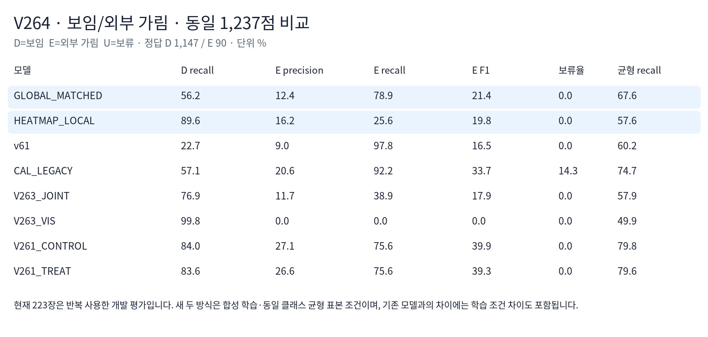

# V264 · Heatmap 위치 주변 특징으로 보임/외부 가림 분류

**비교 완료 · 새 모델 채택 안 함.** 합성에서는 개선됐지만 실사 외부 가림 누락이 늘었습니다. 위치 모델과 좌표는 고정하고 새 분류기 두 개만 학습했습니다. 실사223장은 이번 fit·normalizer·설정/임계값 선택에 쓰지 않았습니다.

| 동일 실사 PRIMARY D1,147/E90 | 보임 recall | 외부 가림 precision | 외부 가림 recall | E F1 | 보류율 |
|---|---:|---:|---:|---:|---:|
| 새 전체 평균 대조군 |56.2%|12.4%|78.9%|21.4%|0%|
| Heatmap 위치 주변 |89.6%|16.2%|25.6%|19.8%|0%|
| 이전 V263 JOINT |76.9%|11.7%|38.9%|17.9%|0%|
| 이전 V261 CONTROL |84.0%|27.1%|75.6%|39.9%|0%|
| 과거 실사 CAL 모델 |57.1%|20.6%|92.2%|33.7%|14.3%|

새 두 모델은 같은 seed17·초기값·D16/E16 배치·25,025 parameter·1,000업데이트를 썼습니다. 국소 pooling 효과는 새 대조군과 비교해야 합니다. 기존 V263 대비에는 특징/분류기·균형 학습 차이도 포함됩니다. CAL 모델은 과거 실사 학습 이력이 있고,223장은 반복 사용한 개발 평가입니다.

합성 DEV에서 D→E66→9, E 정답50→54/56으로 개선됐지만, 실사에서는 D→E502→119와 동시에 E→D19→67로 늘었습니다. 정사각형의 보임 recall97.6%, 외부 가림 recall19.7%; 목재는82.8%/37.9%입니다. 자기 가림136점은 D/E 정답과 분리해 집계했습니다.

[전체 보고 HTML](artifacts/V264_HEATMAP_LOCAL_VISIBILITY/ROOT_READOUT_KO.html) · [96개 집계 CSV](artifacts/V264_HEATMAP_LOCAL_VISIBILITY/evaluation_v1/CLASSIFICATION.csv) · [행별1,784점](artifacts/V264_HEATMAP_LOCAL_VISIBILITY/evaluation_v1/ALL1784_COMPARISON.csv) · [유형별 고정16셀 crop](artifacts/V264_HEATMAP_LOCAL_VISIBILITY/evaluation_v1/INDEX_KO.html) · [학습 전 조건](artifacts/V264_HEATMAP_LOCAL_VISIBILITY/PROTOCOL_BEFORE_FIT.json) · [재현 안내](artifacts/V264_HEATMAP_LOCAL_VISIBILITY/RUN_GUIDE_KO.md)

위: 보이는 점을 복구한 G840. 아래: 기존 외부 가림 주석의 G908에서 위치 분포와 국소 가중 영역이 콘 경계 쪽을 읽고 보임으로 판단하는 사례입니다. 원인 가설이며 인과 증명은 아닙니다. 색은 보임 확률이 아닙니다.

G996의 주석/시각 해석 불일치, G981/G200의 작은3px 경계 초과는 별도 주의 문구로 유지했습니다. 기존 주석과 집계를 변경하지 않았습니다. 준비 단계 중단2건은 업데이트0이며 로그를 보존했습니다. 새 학습은 최종 두 번·합계2,000업데이트로 끝냈고 실사 결과 이후 재학습·threshold 변경·PnP는 없습니다.

[최종 요약](artifacts/V264_HEATMAP_LOCAL_VISIBILITY/FINAL_RESULT_SUMMARY.json) · [실사 전 설정 동결](artifacts/V264_HEATMAP_LOCAL_VISIBILITY/NEW_CONFIG_FROZEN_BEFORE_CURRENT.json) · [주석 결합 전 예측 동결](artifacts/V264_HEATMAP_LOCAL_VISIBILITY/CURRENT_PREDICTIONS_FROZEN.json) · [원자료 의존성](artifacts/V264_HEATMAP_LOCAL_VISIBILITY/SOURCE_DEPENDENCIES.json) · [파일 목록·SHA](RESULTS_PACKAGE_MANIFEST.json)
