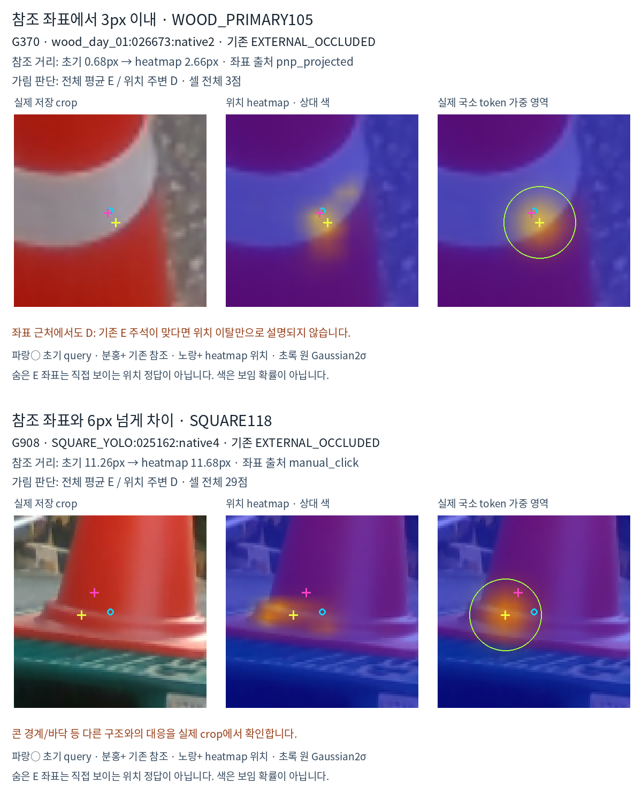

# V265 · 외부 가림 누락 진단과 보임 조건 위치 보정

**Heatmap은 보임이 별도로 확인된 점의 보정 후보를 만드는 역할이 더 맞습니다.** 현재 근거는 정사각형에서 유효하고 목재는 개선되지 않았습니다. 새 학습·모델 forward·PnP·threshold 변경·재라벨링은 없습니다.

## 외부 가림 누락67점

| 기존 참조점 기준 진단 | 전체 | 목재 | 정사각형 |
|---|---:|---:|---:|
| 참조 위치가 원래 crop 밖 |5|4|1|
| crop 안·heatmap 거리≤3px |10|3|7|
| crop 안·3–6px 차이 |15|3|12|
| crop 안·6px 넘게 차이 |37|8|29|

숨은 E의 참조 좌표는 직접 보이는 위치 정답이 아닙니다. 위 표는 거리 구간이며 원인별 확정 개수가 아닙니다. 초기와 제안 모두 참조에서3px 이내인8점도 D를 출력했습니다. 위치 이탈만으로 모든 가림 누락이 설명되지는 않습니다.

G370은 콘의 흰 띠/몸체에서 참조 거리2.66px인데 D였습니다. G908·G256은 콘 받침/바닥 쪽으로 반응했습니다. G300·G1772는 검색 범위 문제입니다. G792·G1233·G996 등 작은 팔레트 조각이 보이는 경계는 native 대응/주석 재검토 대상으로 유지했습니다.

[전체 결과 HTML](artifacts/V265_EXTERNAL_MISS_LOCATION_DIAGNOSIS/ROOT_READOUT_KO.html) · [67점 전체 crop](artifacts/V265_EXTERNAL_MISS_LOCATION_DIAGNOSIS/all67_gallery_v1/INDEX_KO.html) · [67점 수치와 좌표 출처](artifacts/V265_EXTERNAL_MISS_LOCATION_DIAGNOSIS/diagnosis_v1/MISSED_EXTERNAL_67.csv) · [대표12개 확대 crop](artifacts/V265_EXTERNAL_MISS_LOCATION_DIAGNOSIS/diagnosis_v1/INDEX_KO.html) · [전체 육안 감사 범위와 한계](artifacts/V265_EXTERNAL_MISS_LOCATION_DIAGNOSIS/audit_agent_pixels/ALL67_VISUAL_REVIEW.json)

## 보임이 확인된 점에서의 위치 보정

사람이 D로 주석하고 수동 위치가 있으며 입력이 유효한854점을 사후 분석했습니다. 아래는 JOINT 원시 제안을 모두 적용한 가상 비교이며, 실제 보임 승인 규칙이나 배포 성능을 뜻하지 않습니다.

| 유형 | 초기≤3px | 원시 제안≤3px | 중앙값 오차 | P90 오차 |
|---|---:|---:|---:|---:|
| 정사각형531점 |223(42.0%)|352(66.3%)|3.68→2.23px|9.11→5.91px|
| 목재323점 |153(47.4%)|136(42.1%)|3.26→3.62px|18.95→19.61px|

이전 고정 승인 적용 JOINT는 정사각형317/531,목재140/323입니다. 그 승인 적용의3px 경계 악화59점 중55점은 최종3–6px,4점은6–10px,10px 초과는0입니다. 작은 경계 초과를 모두 큰 실패로 표현하지 않습니다.

권하는 방향은 위치 후보 생성과 보임 확인·채택을 분리하는 것입니다. 초기 self-occlusion 기하 필터만으로 외부 가림까지 없어지지는 않습니다. 불확실한 점은 초기 좌표를 유지하고, 정사각형의 조건부 보정부터 별도 검증할 근거가 있습니다. 이번223장으로 새 게이트나 threshold를 선택하지 않았습니다.

[위치 비교15행](artifacts/V265_EXTERNAL_MISS_LOCATION_DIAGNOSIS/diagnosis_v1/VISIBLE_LOCATION_SUMMARY.csv) · [854점 원시 오차](artifacts/V265_EXTERNAL_MISS_LOCATION_DIAGNOSIS/diagnosis_v1/VISIBLE_MANUAL_854.csv) · [독립 검산](artifacts/V265_EXTERNAL_MISS_LOCATION_DIAGNOSIS/INDEPENDENT_AUDIT.json) · [재현 안내](artifacts/V265_EXTERNAL_MISS_LOCATION_DIAGNOSIS/RUN_GUIDE_KO.md) · [진단 코드](artifacts/V265_EXTERNAL_MISS_LOCATION_DIAGNOSIS/diagnose_saved_v265.py) · [입력 SHA](artifacts/V265_EXTERNAL_MISS_LOCATION_DIAGNOSIS/SEALED_INPUTS.json) · [공개 파일 목록](RESULTS_PACKAGE_MANIFEST.json)

현재223장은 반복 확인한 개발 평가입니다.67개 crop 전체를 개괄 검토하고10개 대표를 자세히 검토했지만 숨은 점의 native 가림 정답을 새로 확정하지는 않았습니다. 인접 프레임/여러 점의 반복을67개 독립 원인으로 해석하지 않습니다. 이전 버전/병렬 감사에서 이미 본 crop을 포함하므로 블라인드 검증이 아닙니다.
