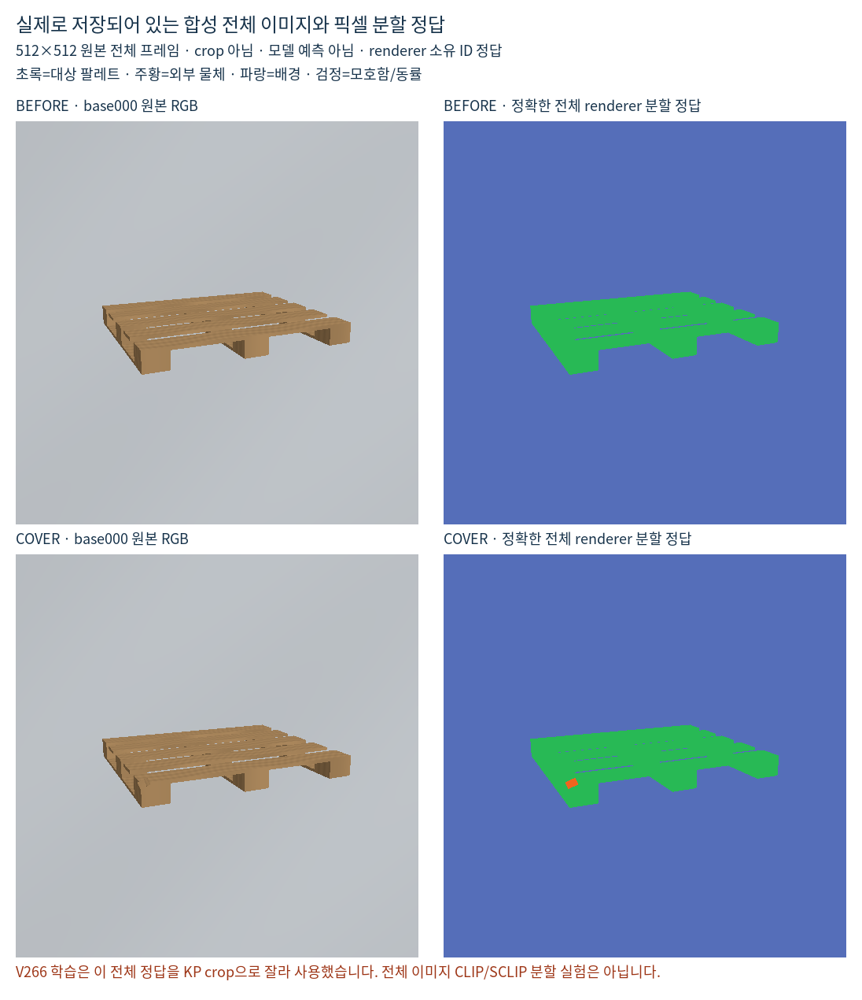

# V266 범위 정정 — 전체 이미지 분할은 아직 검증하지 않음

사용자가 제안한 방식은 **전체 이미지를 보고 팔레트·다른 물체·배경의 영역을 구분한 뒤, 초기 키포인트가 어디에 놓였는지 읽는 것**입니다. V266은 이를 키포인트 crop의 기존 DINO 특징에 분할 모듈을 붙이는 방식으로 좁혀 구현했습니다. 사용자의 의도와 달랐습니다.

**V266의 부정 결과는 crop 기반 DINO 분할 추가 구성에 대한 결과입니다. 전체 이미지 기반 CLIP 개선형 분할이 실패했다는 근거로 사용할 수 없습니다.** CLIP/SCLIP/CLIP Surgery를 실행하거나 학습한 실험도 아닙니다. CLIP에 crop을 입력할 수 없다는 일반적인 주장을 하는 것은 아니며, 이 문제에서 전체 물체의 문맥을 먼저 보려는 사용자의 설계를 시험하지 못했다는 정정입니다.

기존 수치·모델·예측·주석·문턱은 보존합니다. 이 문서와 GT 예시는 설명 정정이며 새 학습이나 새 성능 결과가 아닙니다.

## 서로 다른 합성 자료를 구분

| 자료 | 분할 정답 | 의미 |
|---|---|---|
| 사용자가 말한 원래 합성 데이터 | 보이는 대상 팔레트 마스크(M4), 기존 인계에는 target-only M0도 별도로 기록 | 원래 데이터의 나머지 영역에 콘·배경 등 세부 의미 정답이 있다고 가정하지 않음 |
| V266에서 재사용한 별도 진단용 합성 440개 buffer | 전체512×512 `part_id`, depth, ambiguity 등 | renderer가 저장한 대상/외부 형상/배경 픽셀 소유 ID. 특정 콘·상자 범주를 사람이 주석한 자료가 아님 |
| 현재 실사223장 | 키포인트별 D/E/S 등 주석 | 실사 픽셀 분할 GT는 없음. 학습에는 쓰지 않고 평가에만 사용 |

앞서 “3종 GT가 있다”고 한 것은 두 번째 자료를 뜻합니다. 사용자의 원래 합성 데이터에 모든 물체의 의미 분할 GT가 있다는 뜻으로 설명하면 안 됩니다.

## 팔레트 visible mask만 있어도 이용 가능

보이는 대상 팔레트의 모든 픽셀이 표시된 완전한 binary mask라면, 그것만으로 **전체 이미지의 대상 팔레트 / 대상 아님 이진 분할**을 학습할 수 있습니다. 팔레트=1, 그 외=0이며, 그 외를 콘·상자·바닥 등으로 더 나눌 정답은 필수가 아닙니다. 일부 팔레트만 표시한 불완전 주석이라면 미표시 팔레트까지0으로 강제하면 안 됩니다.

사용자의 의도에 맞는 구성은 다음과 같습니다.

1. 전체 합성 RGB와 같은 전체 크기의 visible-target mask로 공간 특징/분할 처리를 학습하거나, 동결된 전체 영상 분할 방법의 출력과 비교합니다.
2. 이미지 간 특징 묶기는 대상 픽셀을 positive로, 확실한 non-target 픽셀을 negative로 사용할 수 있습니다. 다양한 non-target를 모두 하나의 같은 의미로 강제할 필요는 없습니다.
3. 추론에서도 전체 실사 이미지를 먼저 처리해 대상 팔레트 확률 지도를 만듭니다. 초기 native 키포인트와 그 주변의 지도를 원영상 좌표에서 읽습니다. 마지막 위치 보정에 crop을 사용할 수는 있지만 분할 모델의 첫 입력을 KP crop으로 제한하지 않습니다.
4. 대상 마스크 밖이라고 즉시 외부 가림 E로 판정하지 않습니다. 초기 좌표 오차·빈틈·대응 오류도 가능하므로 예상 native 위치/주변 구조와 구분합니다. 보임을 확인한 뒤 heatmap 위치 보정을 적용하는 역할도 분리합니다.

이진 마스크만으로는 **non-target 내부에서 외부 물체와 배경을 구분하는 3종 GT**를 얻지 못합니다. 그 구분이 필요하면 전체 이미지의 사전학습 의미/물체 분할 출력을 보조 근거로 쓸 수 있지만, 그것은 pseudo label 또는 모델 출력이며 실제 정답으로 부르면 안 됩니다. M0와 M4가 동일 장면에서 정확히 대응한다면 `M0 - M4`는 대상이 덮인 footprint를 보조 감독하는 데 쓸 수 있지만, 외부 물체 전체 마스크는 아닙니다.

## V266은 실제로 어떻게 학습했나

초기 KP 중심96×96 crop →224 resize →동결 DINOv2의16×16 공간 특징을 사용했습니다. 전체512×512 owner GT도 같은 위치로 잘라16×16 soft label로 맞췄습니다. 기준 V264 분류기는 고정하고, 23,204개 파라미터의 분할/가림 점수 추가 모듈만 학습했습니다.

학습은 별도 진단용 합성110개 base 중86개, 검증은24개입니다. 각 새 모듈은 동일 초기값·D16/E16 표본으로1,000업데이트했습니다. 손실은 native D/E BCE + 픽셀 분할 CE이며, 대조 방식만 이미지 간 픽셀 대조 손실0.1을 더했습니다. 원래 사용자의 대용량 visible-mask 합성 전체를 새로 학습한 실험이 아닙니다.

## 별도 진단용 자료에 있는 전체 GT 예시

아래는 **V266의 별도 진단용 합성**에서 렌더러가 저장한 전체 영상과 소유 ID입니다. 사용자의 원래 데이터에 나머지 모든 물체의 GT가 있다는 증거가 아닙니다. 모델 예측도 아닙니다. V266은 이 전체 정답을 crop으로 잘라 학습했습니다.

[출처·SHA·픽셀 ID 정의](SOURCE.json) · [예시 생성 코드](render_full_gt_example.py)

이 정정 단계의 새 학습·모델 추론·PnP·문턱 조정·실사 주석 변경은 모두0입니다. 전체 이미지 CLIP 기반 비교는 미실행 상태입니다.
