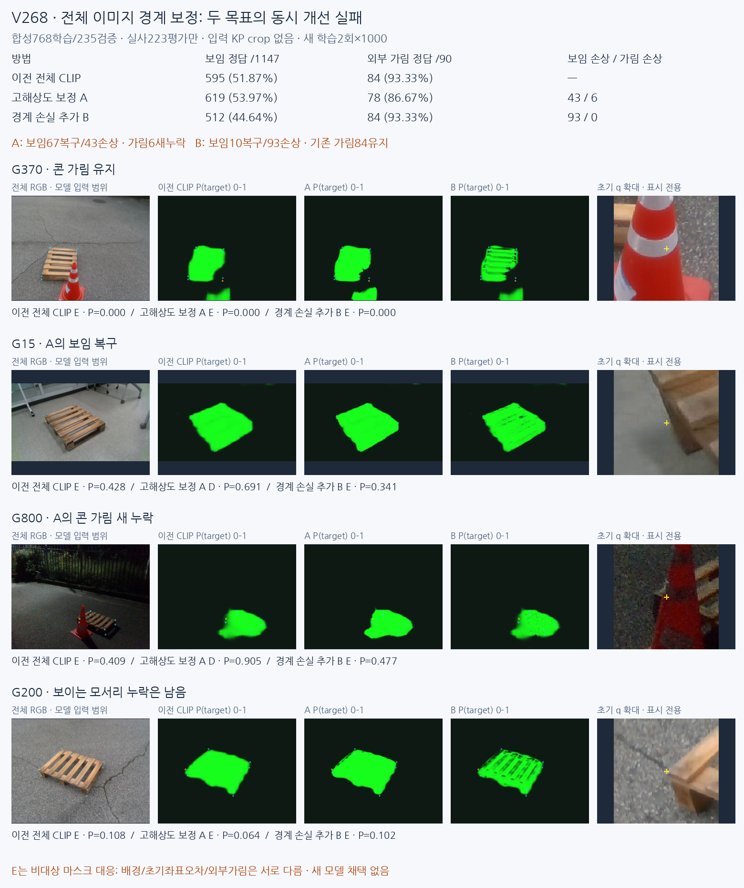

# V268 — 전체 이미지 경계 보정 비교

**보이는 모서리 누락과 콘 가림을 함께 개선하지 못했습니다. 새 모델을 채택하지 않았습니다.** 전체 이미지 CLIP 방식은 유지하고 원래 합성 마스크로 고해상도 보정 A / 같은 보정+경계 손실 B를 각1000회 학습했습니다. 실사223장은 평가에만 사용했습니다. 두 고정 실험 뒤 추가 학습·문턱 조정은 없습니다.

**Full-image CLIP Surgery는 팔레트 영역을 찾는 앞단으로 사용할 수 있습니다.** 보류한 것은 그 지도의 한 점만으로 지정 native 키포인트의 보임/가림을 확정하는 방식입니다. 사용자가 좋아 보인다고 한 V267 출력만 따로 [실패5개·수동 참조좌표 진단](artifacts/V268_FULL_IMAGE_BOUNDARY_REFINEMENT/v267_baseline_failures_v1/INDEX_KO.html)에 모았습니다. 초기 오차≤3px 수동D376점의 원래 q에서는194D, 평가용 수동좌표 oracle에서도200D이며176점은 E입니다. 실제 q나 결과를 바꾸지 않았습니다.

[DeCLIP/DCLIP 공식 자료 확인](artifacts/V268_FULL_IMAGE_BOUNDARY_REFINEMENT/PRIMARY_SOURCE_DCLIP_REVIEW_KO.md): 공간 localisation 설명에는 CVPR2025 DeCLIP이 더 가깝습니다. 특징의 content/context를 나눠 CLIP/DINO 증류로 국소 구분력·공간 일관성을 학습합니다. 공식 코드·가중치는 확인했으며 이번 팔레트 실험에 실행하지는 않았습니다. 현재 초록 지도는 CLIP Surgery 영상 구조+합성 M4 head로, 전체 zero-shot text/feature-surgery pipeline은 아닙니다.

## 같은 실사 대상에서의 비교

PRIMARY1237점=보임 D1147/외부 가림 E90. 단위%이며 혼동행렬 열은 D/E/U입니다. 새 모델은 M4 target/non-target 지도에서 원래 초기 q를 읽은 **MASK_PRESENCE_PROXY**입니다. 외부 가림 원인 분류를 별도로 학습한 것이 아닙니다.

| 방법 | D→D/E/U | E→D/E/U | D precision | D recall | E precision | E recall | 보류율 |
|---|---|---|---:|---:|---:|---:|---:|
| 이전 전체 CLIP V267 |595/552/0|6/84/0|99.00|51.87|13.21|93.33|0.00|
| 고해상도 보정 A |619/528/0|12/78/0|98.10|53.97|12.87|86.67|0.00|
| 경계 손실 추가 B |512/635/0|6/84/0|98.84|44.64|11.68|93.33|0.00|
| 이전 V264 |1028/119/0|67/23/0|93.88|89.63|16.20|25.56|0.00|
| 이전 v61 |260/887/0|2/88/0|99.24|22.67|9.03|97.78|0.00|
| 과거 실사학습 모델 |655/319/173|3/83/4|99.54|57.11|20.65|92.22|14.31|

과거 실사학습 모델은 historical CAL 노출 이력을 유지합니다. 새 두 모델만 이번 합성 전용 적합입니다. 자기 가림은 외부 가림에 합치지 않았으며, 전체1784점의 기존 입력불가45U도 유지합니다.

| 집단 | 이전 V267 D/E recall | 고해상도 A D/E recall | 경계 B D/E recall |
|---|---:|---:|---:|
| 목재105장 |49.84 / 93.10|54.55 / 82.76|47.73 / 93.10|
| 정사각형118장 |54.24 / 93.44|53.30 / 88.52|41.05 / 93.44|

A는 이전에 놓친 보임67점을 회복했지만 보임43점을 새로 놓쳐 **순24점 증가**, 기존 가림 정답6점도 새로 놓쳤습니다. B는 보임10점 회복·93점 신규 누락으로 **순83점 감소**, 기존 가림84점은 유지했습니다. 새 모델을 선택하거나 사후 게이트를 맞추지 않았습니다.

초기 오차≤3px인 수동 보임376점의 정답은 이전194→A209/B166점입니다. A24복구/9손상, B4복구/32손상입니다. 좌표가 크게 틀린 경우만의 문제는 아닙니다.

## 실제 그림에서 확인한 문제

- G370/G908/G1515는 콘을 제외하는 판정을 유지합니다. G15 목재·G904 정사각형은 A가 보임으로 회복합니다.
- A의 새 가림 누락6점은 G800/G803/G837/G1274/G1692/G1772입니다. 앞의 밤 콘 접촉부·받침에는 대상 영역이 번지는 오류가 보입니다. G1274에서는 파란 배경 덮개에도 대상 반응이 늘어납니다.
- G1692/G1772는 초기 q에 다른 보이는 팔레트 부분이 섞이고, 해당 숨은 native 참조점과13.91/32.46px 떨어집니다. 이 둘을 명백한 콘 몸체 오분할로 단정하지 않습니다. 픽셀의 팔레트 존재와 특정 native 점의 가시성이 다릅니다.
- G200은 초기 오차1.77px인 보이는 모서리인데 세 모델 모두 E입니다. B가 슬랫·구멍처럼 자세한 구조를 표시해도 실사 pixel GT가 없으므로 더 정확한 분할이라고 확정하지 않습니다. 일부 목재 영역을 깎는 전이 문제도 남습니다.
- G996의 사용자 판단과 기존 E 주석 이견은 유지했습니다. 주석을 바꿔 성능을 계산하지 않았습니다.

[실사111사례 전체](artifacts/V268_FULL_IMAGE_BOUNDARY_REFINEMENT/evaluation_v1/INDEX_KO.html) · [가림 신규 누락6개](artifacts/V268_FULL_IMAGE_BOUNDARY_REFINEMENT/visual_QA_v1/EXTERNAL_SIX_REGRESSIONS_KO.png) · [보임 복구·신규 누락4개](artifacts/V268_FULL_IMAGE_BOUNDARY_REFINEMENT/visual_QA_v1/DETERMINISTIC_D_RECOVER_NEW_MISS_KO.png) · [기존 보임 실패6개](artifacts/V268_FULL_IMAGE_BOUNDARY_REFINEMENT/visual_QA_v1/FIXED_VISIBLE_FAILURES_KO.png)

## 데이터와 학습 방법

원래 RGB/M4 1003장, 기존 학습768·합성 DEV235의 분할을 유지했습니다. **원본 M4 PNG에서256 정답을 다시 만들었습니다.** 이전32 정답을 늘린 것이 아닙니다. 내부 진단용 SYN440·M0·실사 주석은 새 학습에 쓰지 않았습니다.

전체 RGB512 bicubic→2×2평균/255→RGB256과, 같은 전체512에서 얻은 동결 CLIP Surgery 영상 구조의32격자 특징·기존 coarse logit를 입력합니다. 초기 키포인트 crop이나 GT 중심 crop은 없습니다. 전체256 분할을 저장·동결한 다음에만 기존 native q를 읽습니다. 그림의 crop은 표시 전용입니다.

새26177개 파라미터 residual refiner 두 개는 구조·초기값·PCG64배치·seed17·각1000업데이트가 같습니다. 출력은 기존 logit를256으로 보간한 값+6*tanh(raw delta/6)입니다. A는 FIT 마스크 통계로만 정한 balanced BCE+Dice, B는 여기에0.5양쪽 경계 균형 BCE만 추가합니다. band는 손실 가중치일 뿐 정답/출력 마스크 팽창이 아닙니다.

두 final1000 체크포인트를 합성 DEV 전에 봉인했고, 실사 전체 지도/1784점 예측을 저장한 뒤 주석을 연결했습니다. 실사 통계·문턱·체크포인트 적합, 새 backbone 학습·좌표 보정·PnP는0입니다. 기존223장은 반복 개발 평가로 독립 블라인드 검증이 아닙니다.

## 합성 경계 개선과 실사 보임 목표의 차이

같은 DEV235장의 **원래 해상도 M4**로 검산했습니다. 서로 다른32/256 target-grid IoU를 직접 비교하지 않았습니다.

| 방법 | 원본 pixel micro IoU% | 경계 F1@1px% | 경계 F1@3px% |
|---|---:|---:|---:|
| 이전 V267 |65.29|12.52|24.99|
| 고해상도 A |66.01|13.57|27.41|
| 경계 B |67.30|18.99|34.94|

B는 합성 FP를1,179,713→985,444로 줄였지만 FN은619,015→645,409로 늘렸습니다. 합성 분할 경계 개선만으로 native 보임 recall 개선을 기대할 수 없다는 결과입니다. 작은 어두운 대상 미검출·다른 팔레트 선택도 남습니다. 실사 분할 IoU는 pixel GT가 없어 보고하지 않습니다.

후속에서는 전체 문맥을 유지하면서 **native 주변 구조가 보이는가**라는 감독과 판정을 연결해야 합니다. 현재 마스크 한 지점의 비대상 출력을 외부 가림으로 읽는 목표 차이와 실제 영역 분할 전이 실패를 함께 다뤄야 합니다. 이 보고 이후 추가 학습은 진행하지 않았습니다.

## 결과·재현 경로

- [전체 보고서](artifacts/V268_FULL_IMAGE_BOUNDARY_REFINEMENT/ROOT_READOUT_KO.html), [72행 혼동행렬/P/R/U](artifacts/V268_FULL_IMAGE_BOUNDARY_REFINEMENT/evaluation_v1/CLASSIFICATION.csv), [자기 가림18행](artifacts/V268_FULL_IMAGE_BOUNDARY_REFINEMENT/evaluation_v1/SELF_RESPONSES.csv), [1784점 결과](artifacts/V268_FULL_IMAGE_BOUNDARY_REFINEMENT/evaluation_v1/ALL1784_COMPARISON.csv).
- [합성 원본 정답 대조6개](artifacts/V268_FULL_IMAGE_BOUNDARY_REFINEMENT/syn_mask_diagnostic_v1/INDEX_KO.html), [원해상도 지표](artifacts/V268_FULL_IMAGE_BOUNDARY_REFINEMENT/syn_mask_diagnostic_v1/ORIGINAL_PIXEL_RESULTS.json), [선택6개 원본 RGB/M4 SHA](artifacts/V268_FULL_IMAGE_BOUNDARY_REFINEMENT/syn_selected_raw_inputs_v1/SOURCE_RGB_M4_PAIRS.json).
- [학습 전 조건](artifacts/V268_FULL_IMAGE_BOUNDARY_REFINEMENT/PROTOCOL_BEFORE_FIT.json), [모델](artifacts/V268_FULL_IMAGE_BOUNDARY_REFINEMENT/model_mask_refine_v268.py), [학습](artifacts/V268_FULL_IMAGE_BOUNDARY_REFINEMENT/train_mask_refine_v268.py), [전체 영상 추론](artifacts/V268_FULL_IMAGE_BOUNDARY_REFINEMENT/infer_fullframe_v268.py).
- [독립 원본/전처리/학습 감사](artifacts/V268_FULL_IMAGE_BOUNDARY_REFINEMENT/INDEPENDENT_SCOPE_TRAINING_REVIEW.json), [72행 별도 검산](artifacts/V268_FULL_IMAGE_BOUNDARY_REFINEMENT/ROOT_INDEPENDENT_METRICS_CHECK.json), [CPU5전체영상/1784점 재현](artifacts/V268_FULL_IMAGE_BOUNDARY_REFINEMENT/fullframe_replay_v1/COMPLETE.json), [재현 안내](artifacts/V268_FULL_IMAGE_BOUNDARY_REFINEMENT/RUN_GUIDE_KO.md).
- [원본 데이터 없는 합성235 픽셀·경계 CPU재현](artifacts/V268_FULL_IMAGE_BOUNDARY_REFINEMENT/syn_pixel_replay_v1/README_KO.md). M4 packbits·이전32logit·새 두 DEV지도만으로 세 모델의 모든 aggregate CM/IoU/Dice/경계P/R을 확인합니다.
- [파일별 SHA·대형 입력 제외 목록](RESULTS_PACKAGE_MANIFEST.json). 전체223장 지도·1784판정·새 head2개·SYN DEV235 저장 지도·compact CPU fixture·실제 시각화는 포함합니다. 원본1003 전체 RGB/M4 corpus와 약1.05GB frozen SYN token·394MB RGB256 입력은 중복하지 않고 경로/SHA를 보존했습니다. 저장소만으로 원래 전체 데이터의 재학습을 즉시 실행한다고 주장하지 않습니다.

HTML은 폴더 구조째 내려받아 브라우저에서 열면 됩니다. GitHub에서는 README/PNG/CSV를 직접 확인할 수 있습니다. 원본 그림을 복사하는 보조 코드의 split 이름 확인 오류1건은 기록하고 수정했습니다. 모델·예측·평가 수치에는 영향이 없습니다.
