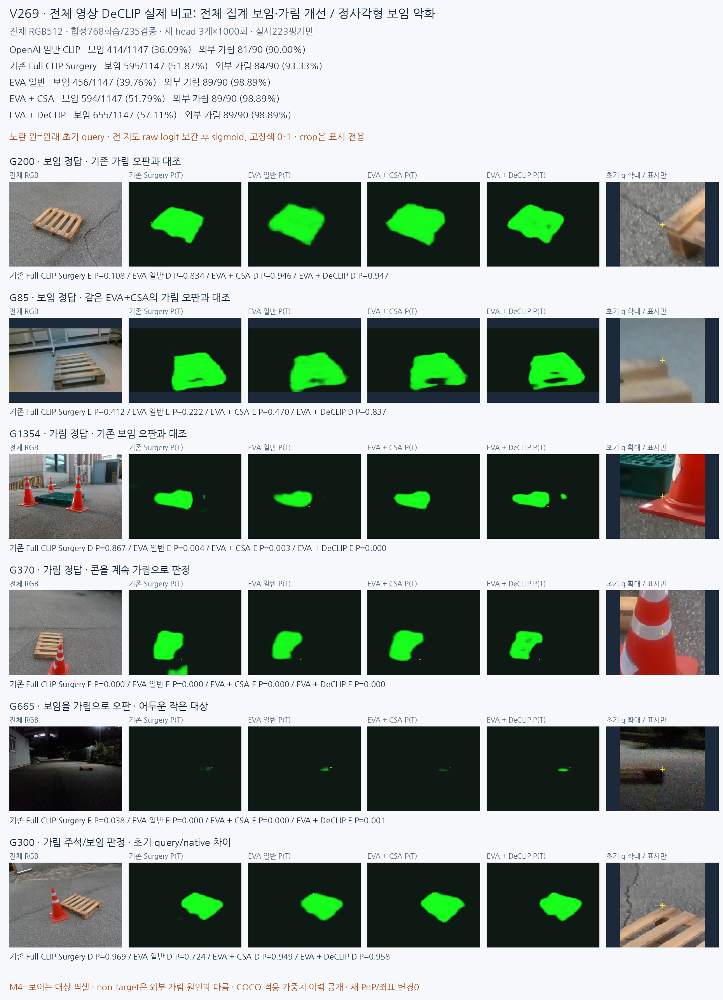

# V269 전체 이미지 DeCLIP: 보임/외부 가림 판정 비교

**좌표는 바꾸지 않고 원래 초기 query의 보임/가림만 비교했습니다.** 전체 집계는 기존보다 좋아졌지만 정사각형의 보임 판정은 악화했고, 보이는 점을 가림으로 오판하는 문제가 남았습니다. 새 분할 head 세 개를 합성768장으로 각1000회 학습했고, 합성235장 검증과 실사223장 평가는 설정 동결 후 수행했습니다.

| 방법 | 보임 정답 /1147 | 가림 정답 /90 | 보임 precision/recall % | 가림 precision/recall % | 보류 % |
|---|---:|---:|---:|---:|---:|
| OpenAI 일반 CLIP | 414 | 81 | 97.87/36.09 | 9.95/90.00 | 0.00 |
| 기존 Full CLIP Surgery | 595 | 84 | 99.00/51.87 | 13.21/93.33 | 0.00 |
| EVA 일반 | 456 | 89 | 99.78/39.76 | 11.41/98.89 | 0.00 |
| EVA + CSA | 594 | 89 | 99.83/51.79 | 13.86/98.89 | 0.00 |
| EVA + DeCLIP | 655 | 89 | 99.85/57.11 | 15.32/98.89 | 0.00 |

기존 Surgery→DeCLIP: 목재 보임307→393/616, 가림27→28/29. **정사각형 보임288→262/531로 악화**, 가림57→61/61. 모든 수치를 같은 대상·초기 query·native에 계산했습니다. 자기 가림은 별도 표에 있으며 원래 전체1784점의 입력 불가45개(U)를 보존했습니다.

가림 recall98.89%는 전체 정확도가 아닙니다. DeCLIP이 가림으로 판정한581점 중 실제 외부 가림은89점(precision15.32%)이고 나머지492점은 보임을 가림으로 오판했습니다. PRIMARY 전체 정확도는60.15%입니다. 초기 오차≤3px 수동 보임376점의 정답은 기존194→212점이지만, 이 또한 위치 보정 결과가 아닙니다.

백본 차이를 분리했습니다. OpenAI 일반→EVA 일반은 구조+일반 사전학습 패키지 차이입니다. EVA 일반→EVA+CSA는 같은 원본 가중치의 attention/readout 차이입니다. EVA+CSA→DeCLIP은 같은 구조와 CSA 경로에 공개 dense 적응 가중치를 적용하고 동일 조건으로 새 head를 학습한 차이입니다. 이 마지막 비교는 보임594→655, 가림89→89입니다. 외부 가림 정답 증가가 DeCLIP만의 효과라는 근거는 없습니다.

공개 DeCLIP 가중치에는 COCO 이미지·DINOv2 교사를 통한 사전 적응 이력이 있습니다. **이번 팔레트용 추가 학습은 합성 M4만** 사용했습니다. 실사223장은 이번 fit/정규화/문턱/체크포인트 선택에 사용하지 않았지만, 이미 여러 차례 열람한 개발 평가이므로 독립 블라인드 테스트가 아닙니다.

M4는 보이는 대상 팔레트 픽셀입니다. 마스크 밖에는 배경·구멍·다른 물체가 함께 있으므로 현재 E 출력은 외부 가림 원인을 직접 학습한 값이 아니라, 비대상 마스크를 가림 판정에 대응한 proxy입니다. G300은 초기 q가 보이는 상판 근처인데 숨은 native 참조(pnp_projected)는103.57px 떨어져 있어 남은 한 가림→보임 오판을 별도로 해석해야 합니다. G996 사용자/기존 E 주석 이견은 보존했습니다. 새 PnP·좌표 보정·추가 fit은 없습니다.

합성 원본 픽셀 IoU는 기존 CS65.29→DeCLIP72.04%입니다. 원본1/3px 경계F1은 기존보다 개선되지 않았고, 팔레트 위 상자를 대상 영역으로 채우는 오류도 남았습니다. 실사 픽셀 GT가 없어 실사 IoU는 보고하지 않습니다.

[실제 전체 영상·모든 표](artifacts/V269_FULL_IMAGE_DECLIP_MATCHED_BACKBONE/ROOT_READOUT_KO.html) · [123개 성공/실패 사례](artifacts/V269_FULL_IMAGE_DECLIP_MATCHED_BACKBONE/evaluation_v1/INDEX_KO.html) · [84행 CM/P/R/보류](artifacts/V269_FULL_IMAGE_DECLIP_MATCHED_BACKBONE/evaluation_v1/CLASSIFICATION.csv) · [자기 가림21행](artifacts/V269_FULL_IMAGE_DECLIP_MATCHED_BACKBONE/evaluation_v1/SELF_RESPONSES.csv) · [외부 가림90점](artifacts/V269_FULL_IMAGE_DECLIP_MATCHED_BACKBONE/evaluation_v1/EXTERNAL90_TRANSITIONS.csv) · [합성 RGB/M4 대조](artifacts/V269_FULL_IMAGE_DECLIP_MATCHED_BACKBONE/syn_mask_diagnostic_v1/INDEX_KO.html)

학습 전 프로토콜·공식 source/weights SHA·실제 학습 로그·체크포인트·실사 전체 지도/1784점 출력·123개 실제 시각화·고정5프레임 특징을 포함합니다. 대형 일반 가중치, 타사 source 전체, 전체 합성 특징3.15GB는 중복하지 않고 공식 링크·commit·SHA·다운로드 코드와 제외 manifest를 제공합니다.

[재현 안내](artifacts/V269_FULL_IMAGE_DECLIP_MATCHED_BACKBONE/RUN_GUIDE_KO.md) · [학습 전 조건](artifacts/V269_FULL_IMAGE_DECLIP_MATCHED_BACKBONE/PROTOCOL_BEFORE_FIT.json) · [독립 검산](artifacts/V269_FULL_IMAGE_DECLIP_MATCHED_BACKBONE/ROOT_INDEPENDENT_METRICS_CHECK.json) · [CPU head/query 재현](artifacts/V269_FULL_IMAGE_DECLIP_MATCHED_BACKBONE/fullframe_replay_v2/COMPLETE.json) · [합성235×5 원본픽셀 CPU 재현](artifacts/V269_FULL_IMAGE_DECLIP_MATCHED_BACKBONE/syn_pixel_replay_v1/COMPLETE.json)

공식 방법: [DeCLIP 논문](https://arxiv.org/html/2505.04410v1), [공식 코드](https://github.com/xiaomoguhz/DeCLIP). 기존 Full CLIP Surgery는 공식 영상 구조 특징+합성 head를 뜻하며 text feature surgery/full zero-shot 전체 파이프라인 재현은 아닙니다.
