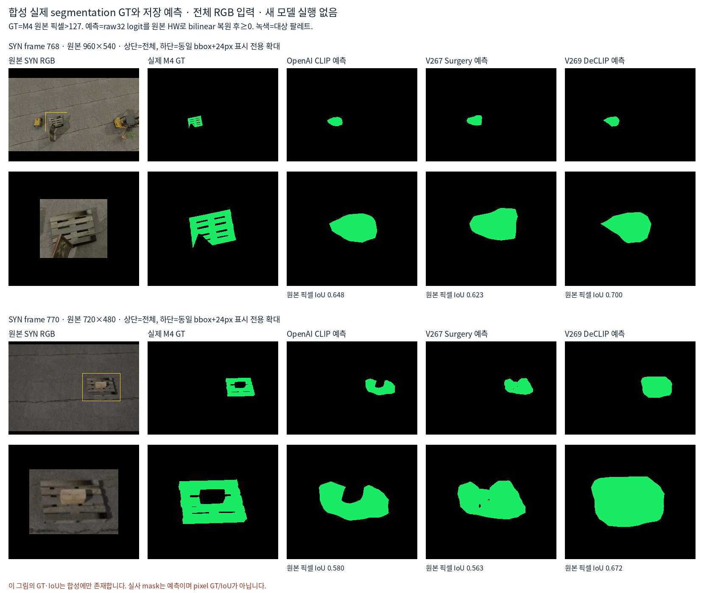

# 방법과 팔레트 segmentation 마스크의 의미

현재 그림에서 **키포인트 위치, native 보임·외부가림, 이미지의 팔레트 마스크는 서로 다른 출력**이다. 실사223장에는 이번 비교에 사용한 pixel segmentation GT가 없으므로 실사 마스크 IoU나 pixel 정확도를 제시하지 않는다.

| 방법 | 모델 입력 | 학습 교사와 출력 | 해석 제한 |
|---|---|---|---|
| R0_RAW_KP / OLD_N3_SUBPIX | Whole RGB for original R0 detector; N3/SubPix are historical pointwise coordinate processing. Numbered oldq is a correspondence/display reference. | Original R0 keypoint-coordinate/canvas-validity training; no new training here. Original point confidence is not native external-occlusion probability. 9 coordinates plus original keypoint/canvas confidence; no new semantic E output. | Do not interpret heatmap peak or original confidence as visibility. This audit does not recertify every historical N3/SubPix implementation. |
| CAL_LEGACY | Only historical stored per-native D/E/U outputs are reused here. Exact legacy input recipe is not re-audited in V271. | Historical own-real CAL training exposure; separate from new SYN-only methods. Stored D/E/U labels; historical comparison, not a controlled architecture ablation. | Do not label this model SYN-only; input details are intentionally left unspecified rather than guessed. |
| V61_TARGET_PRESENCE | Frozen YOLO P3 9x9 ROI + source-valid channel at unchanged initial predicted q; one new local classifier. | Original SYN1003 TRAIN768/DEV235. Center pixel M4[floor(q+.5)]>127. M0 auxiliary; no native semantic D/E gold. Whether target pallet occupies the queried image pixel. | Target absence can mean background, target hole, wrong q, external object or virtual boundary, not uniquely external occlusion. |
| V263_SPATIAL / V264_HEATMAP_LOCAL | Initial-q-centered crop, frozen DINOv2 patch features, externally supplied native ID. V264 pools local features around frozen heatmap softargmax plus global features and aux12. | V263 geometry/material-anchor/edge-witness localization teacher, not photometric native gold. V264 source synthetic D0/E1; S/U ignored; different corpus from original1003. V263 location heatmap/softargmax and separate visibility; V264 new pointwise E classifier with frozen heatmap/coordinates. | A sharp heatmap is a learned location hypothesis, not proof that the point is visible. V264 does not output full-image segmentation. |
| V267_OPENAI_FULL_CLIP / V267_CS | Entire RGB→PIL bicubic512square, CLIP normalization; frozen OpenAI ViT-B/16 dense32x32 projected tokens→small learned pallet mask head. CS uses architecture surgery, no text-feature surgery. | Original SYN M4 visible-target pixel mask only, TRAIN768/DEV235. No q/native/pose/M0 input to mask generation. One-channel target-pallet mask logit32x32; fixed q sample is an additional mask-presence proxy. | This is a trained binary pallet segmenter on CLIP features, not a text-prompt zero-shot attention map or native external-cause classifier. |
| V269_EVA_STANDARD / EVA_CSA / EVA_DECLIP | Entire RGB512square; same small mask head. STANDARD→CSA keeps generic EVA weights and changes dense attention/readout; CSA→DECLIP keeps CSA path and changes released adapted weights. | Same original SYN M4 and splits as V267; three fixed final1000 pallet-head fits. Released DeCLIP encoder has public COCO-image dense adaptation/DINO teacher history. One-channel target mask32x32. Sampling original q gives target-presence D/E proxy, not native visibility. | New pallet-head fits are SYN-only; not all pretrained weights are SYN-only. OpenAI→EVA also changes backbone/pretraining package, not only one algorithm. |
| V270_VIS_ONLY / V270_JOINT | Whole RGB→reflect101 pad100→square640 letterbox. Original R0 shared pose cv4 stem plus new per-channel E head; frozen backbone/neck and existing terminal xy/canvas readout. | Original SYN1003, strict external9ray fraction0=D,>=.5=E; partial/self/outside ignored. Joint also supervises projected virtual8+centroid coordinates. No M4 supervision. 9 xy coordinates plus native8 semantic E logits; centroid E ignored. | Not segmentation. Strict filtering left TRAIN raw2/3/6/7 with D0, yielding E-only slot supervision. On current223 JOINT0/1 alwaysD,2/3/6/7 alwaysE; this is not corrected by displaying better coordinates. |

## 실제 팔레트 segmentation이 무엇을 배웠는가

V267/V269는 CLIP attention을 색칠한 그림이 아니라 **합성의 최종 보이는 팔레트 M4를 교사로 학습한 binary mask head**다. 원 RGB 전체를512×512로 입력하며 keypoint crop이나 GT bbox를 모델 입력으로 사용하지 않는다. M4는 원본 uint8>127로 이진화한 뒤 전체 이미지를 bilinear512(align_corners=False, antialias=True)로 변환하고16×16 평균을 취해32×32 soft target으로 만든다.

M4의 반대쪽은 배경·팔레트 구멍·외부 물체 등 모든 non-target을 포함한다. 가려진 팔레트 전체를 복원하는 amodal 교사나 외부 물체 자체의 mask 교사는 아니다.

저장 raw32 logit를 원본 H×W로 bilinear 복원한 뒤 sigmoid를 취해 P(target)을 표시한다. 이진 마스크는 logit≥0, 즉 P(target)≥0.5다. 확률 색 범위는0..1 고정이며 이미지별 minmax 정규화를 하지 않는다.640×480 원본에서32grid 한 칸은 약20×15px이므로 화면에서 부드러워 보이는 경계가 실제 고해상도 증거를 뜻하지 않는다.

원 query q를 읽을 때도 raw logit를 bilinear로 샘플하고 그 뒤 sigmoid를 취한다. 정규화 좌표는2(q+.5)/[W,H]−1, align_corners=False, border padding이다. **CLIP의 P(target)≥0.5는 D proxy, V270 별도 head의 P(E)≥0.5는 E**이므로 두 확률의 의미와 방향을 혼동하면 안 된다. CLIP mask 생성에는 q를 입력하지 않는다.

## GT가 있는 합성과 없는 실사의 구별

합성 DEV235에는 원본 M4 pixel GT가 있어 원본 해상도 IoU/Dice와 경계F1을 저장 출력으로 계산했다. 이 비교의 실사는 native 점별 D/E/S 어노테이션만 사용했으므로, 실사 마스크가 육안으로 팔레트를 잘 덮는지와 native 가림 판정 점수를 별도로 읽어야 한다. Native D/E를 mask pixel GT로 바꿔 쓰지 않았다.

| 합성 DEV235 방법 | 원본 micro IoU | Dice | 경계 F1@3px |
|---|---:|---:|---:|
| OPENAI_FULL_CLIP | 0.6602 | 0.7953 | 0.2515 |
| V267_CS | 0.6529 | 0.7900 | 0.2499 |
| EVA_STANDARD | 0.6446 | 0.7839 | 0.2147 |
| EVA_CSA | 0.5107 | 0.6761 | 0.1460 |
| EVA_DECLIP | 0.7204 | 0.8375 | 0.2457 |

DeCLIP은 이 합성 DEV에서 영역 IoU가 가장 높지만 경계3px F1은 OpenAI/V267 Surgery와 비슷하다. 틈·모서리·작은 가림 경계가 충분히 정밀하다는 결과는 아니다. DeCLIP의 공개 pretrained encoder에는 COCO 이미지 기반 dense adaptation과 DINO teacher 이력이 있으며 새 팔레트 head만 SYN으로 학습했다. 실제223장은 새 head fit·정규화·문턱·checkpoint 선택에 쓰지 않았다.



그림은 기존 고정 예제768/770의 원본 RGB/M4와 저장 OpenAI/Surgery/DeCLIP raw logits만 사용한다. 아래 확대는 같은 GT bbox+24px의 표시 전용이며 입력 crop이 아니다. 원본 RGB/M4 bytes와2개 예제 logit는 `SYN_GT_COMPACT_INPUTS_V1`에 들어 있다. 원 데이터나 모델 없이 다음 명령으로 그림을 다시 만들 수 있다.

```sh
python -B make_syn_gt_comparison_v271.py --out SYN_GT_VS_PRED_REPLAY.png
```

## 위치가 좋아 보여도 가림·segmentation과 다른 이유

- V263 heatmap의 peak는 학습한 위치 가설이다. 가려진 점도 구조로 추정할 수 있으므로 peak만으로 보임을 증명하지 않는다.
- CLIP 마스크가 팔레트 전체를 잘 덮어도 초기 query가 외곽·구멍·실제 재료가 없는 virtual corner에 있으면 그 점의 P(target)은 낮을 수 있다. 반대로 그 픽셀에 팔레트가 있어도 목표 native 점이 보인다는 뜻은 아니다.
- V270은 full-image native E head다. 이번 strict D0 선택이 하단2/3/6/7의 보임 후보를 모두 제외해 E-only 교사가 됐고, 실제223장에서 해당 슬롯을 전부 E로 냈다. 좌표가 더 좋아 보이는 것만으로 이 별도 분류 편향이 해결되지 않는다.
- 역사적 CAL/v61/V264/CLIP/V270는 교사·데이터·입력이 달라 단순한 동일 구조 비교가 아니다. V270 공동학습의 직접 대조는 동일 자료·초기화·300회인 VIS_ONLY↔JOINT다.

## 감사 범위

새 학습·모델 forward·실사 pixel 어노테이션은0회다. CAL_LEGACY는 저장 출력과 기존 실사 CAL 학습 이력만 확인했고 정확한 옛 입력 recipe는 이번에 재감사하지 않았다. 원 코드·프로토콜 SHA는 `METHOD_AND_MASK_SEMANTICS_KO.json`에 기록했다. V271의 실제 clear/corner/cone mask atlas에 대한 육안 검토는 별도 시각 QA로 남긴다.
