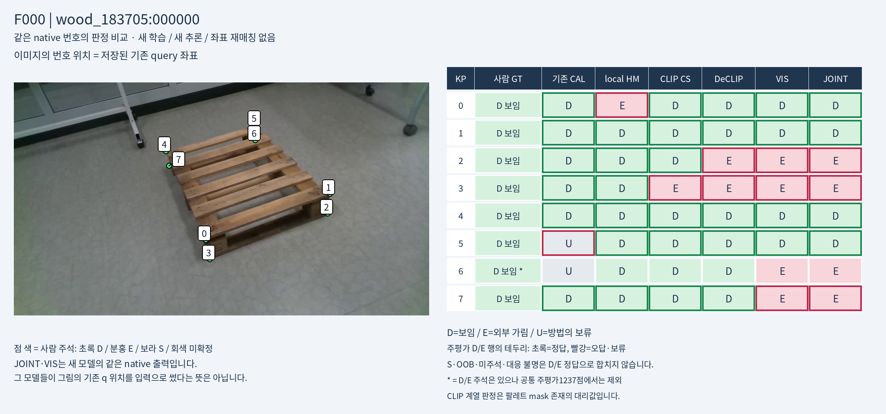

# V271 KP별 가림 판정과 CLIP 팔레트 분할 전체 시각 비교

저장 출력만으로 실사223장×8점의10가지 방법을 묶었습니다. 새 학습·모델 추론·PnP·문턱 변경은 없습니다. 같은 대표10장의 실제 팔레트 분할 마스크와 분할된 RGB, 각 native KP의 D/E/U를 볼 수 있습니다.

**문제는 세 가지입니다:** KP 공동 모델의 번호 사전값 의존, CLIP 마스크의 거친 경계·가림 물체 오포함, 기존 query와 사람 native 가림 정답의 위치·의미 차이. 빨간 CLIP 판정을 모두 픽셀 분할 실패로 해석하면 안 됩니다. real pixel GT는 없고 합성 M4 GT와는 별도로 직접 대조했습니다.

- [장면·모델·마스크 종류·KP 번호를 바꿔 보는 전체 페이지](ROOT_READOUT_KO.html)
- [흑백 팔레트 마스크 자체](segmentation_atlas/SEGMENTATION_MASK_OVERVIEW.png)
- [10장×5분할 모델 전체](segmentation_atlas/INDEX_KO.html)
- [같은 장면 KP 위치와 정답·오판](kp_comparison/INDEX_KO.html)
- [223장1784점10방법 전체 검색](kp_comparison/POINT_MODEL_COMPARISON.html)
- [재질·번호별540행 지표](kp_comparison/METRICS_OVERALL_MATERIAL_NATIVE.csv)
- [실제 합성 M4 GT와 예측 비교](SYN_GT_VS_PRED.png)
- [방법별 학습·입력·출력 의미](METHOD_AND_MASK_SEMANTICS_KO.md)
- [시각·수치 검산](ROOT_VISUAL_AND_NUMERIC_QA.json)

대표10장은 무작위 성능 표본이 아닙니다. 수치는 고정 PRIMARY1237(D1147/E90)에서 집계하며 자기 가림·영상 밖·미주석·대응 불명은 별도입니다. 기존 CAL은 실사 학습 이력이 있고 각 방법은 입력·교사·백본·예산이 달라 역사적 참고 비교입니다. 이번 그림의 마스크는 전체 이미지를 사용한 CLIP 계열 특징+합성 mask head의 저장 결과이며 text-only zero-shot 분할은 실행하지 않았습니다.223장은 반복 개발 평가입니다.
