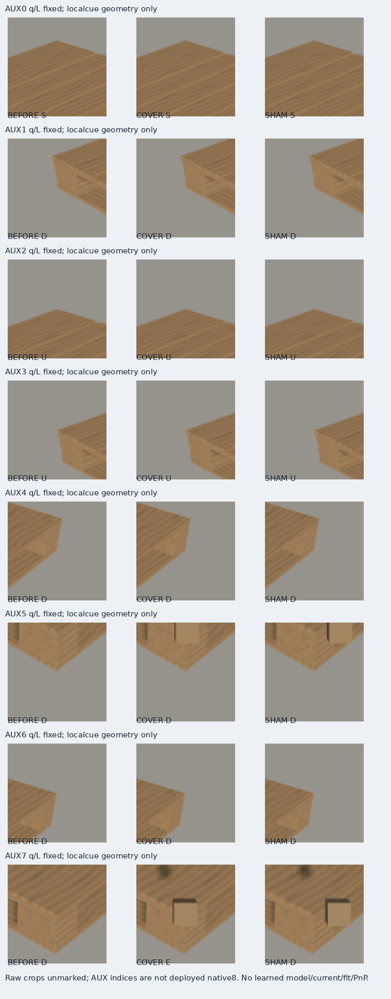

# V98 — query_visibility_C1_warmstart_20261023_v98

기존 보고서에서 추출한 게시용 파생 개요입니다. 원본 파일을 수정하거나 실험·평가를 다시 실행하지 않았습니다. 원문 해시와 링크 대응은 publication manifest로 확인합니다.

**상태:** {"completed":true,"fully_solved":false,"goal_status":"active"}

원본:

- [ROOT_READOUT_KO.html](ROOT_READOUT_KO.html) — SHA256 `8e47b4611683eb0233f7a3b204fab8276c9035a7048d9889e0d34740c46723f7`
- [ROOT_RESULTS_KO.json](ROOT_RESULTS_KO.json) — SHA256 `8948fdac573b66be0a7e1c0779a9f3a05307c338373a47978a8d1d87454195fc`

## 방법·목표의 원문 필드

자동 추출 가능한 해당 최상위 필드가 없습니다. 원문 보고서와 phase receipt를 확인하십시오.

## 입력·학습·평가 분모의 원문 필드

자동 추출 가능한 해당 최상위 필드가 없습니다. 원문 보고서와 phase receipt를 확인하십시오.

## 결론·실패·한계의 원문 필드

`$.conclusion_KO`

```text
C1에서 작은 학습률로 시작해도 C4는 원본/SHAM의 보임을 보존하지 못해 소스 기준을 통과하지 못했습니다. 별도 V97 렌더는 단서와 가림을 연결한 자료 구성의 실행가능성만 보여주며 학습 성능이나 전이 성공이 아닙니다.
```

`$.limits_KO`

```text
[
  "194rank쌍은 학습10/검증18개 원 query에 중첩돼 있고 성공 controls는 모두Pallox입니다. LOCO controlled E는0이라 미검증입니다.",
  "자연 E는TRAIN2/VAL2이며, 조건부 AI AUX 라벨은 사람 D/E/S 또는 native8 gold가 아닙니다.",
  "초기화와 학습률을 함께 바꾼 소스 실험이며 이 원인만의 효과를 분리하지 않습니다. 반복 노출된 sourceVAL입니다.",
  "V97은 onecamera/procedural appearance/GT기하로 배치한 floating foreign object 한쌍입니다. 그림자와 crop내 물체면적도 완전히 같지 않습니다.",
  "저장 검산 PASS는 수치·입력·선택 재현 확인이며 과학적 일반화 검증이 아닙니다."
]
```


## 코드·검증·전체 표·갤러리

아래 목록은 원 보고서가 참조한 파일의 경로를 다시 연결한 것입니다. 이 개요 작성 중 이미지 내용이나 raw 평가 데이터를 새로 검사하지 않았습니다.

- [query_visibility_C1_warmstart_20261023_v98/ROOT_SAVED_EXECUTION_REVIEW.json](ROOT_SAVED_EXECUTION_REVIEW.json)
- [query_visibility_expected_cue_triplets_20261023_v97/render_preparation/actual_matched_rgb_triplet/EXPECTED_LOCAL_CUE_GEOMETRY_GT_ONLY.json](../query_visibility_expected_cue_triplets_20261023_v97/render_preparation/actual_matched_rgb_triplet/EXPECTED_LOCAL_CUE_GEOMETRY_GT_ONLY.json)
- [query_visibility_expected_cue_triplets_20261023_v97/render_preparation/saved_actual_visual_QA/ACTUAL_VISUAL_OBSERVATIONS_AND_DRIFT.json](../query_visibility_expected_cue_triplets_20261023_v97/render_preparation/saved_actual_visual_QA/ACTUAL_VISUAL_OBSERVATIONS_AND_DRIFT.json)
- [query_visibility_query_anchored_cue_20261023_v96/ROOT_READOUT_KO.html](../query_visibility_query_anchored_cue_20261023_v96/ROOT_READOUT_KO.html)
- [query_visibility_matched_query_scalar_20261023_v94/ROOT_READOUT_KO.html](../query_visibility_matched_query_scalar_20261023_v94/ROOT_READOUT_KO.html)
- [query_visibility_C1_warmstart_20261023_v98/ROOT_RESULTS_KO.json](ROOT_RESULTS_KO.json)
- [query_visibility_C1_warmstart_20261023_v98/runs/C4_C1_WARMSTART_SOURCE_V1/FIT_COMPLETE.json](runs/C4_C1_WARMSTART_SOURCE_V1/FIT_COMPLETE.json)
- [query_visibility_C1_warmstart_20261023_v98/runs/C4_C1_WARMSTART_SOURCE_V1/SOURCE_RESULTS.json](runs/C4_C1_WARMSTART_SOURCE_V1/SOURCE_RESULTS.json)
- [query_visibility_C1_warmstart_20261023_v98/runs/C4_C1_WARMSTART_SOURCE_V1/SOURCE_GATE_RESULTS.json](runs/C4_C1_WARMSTART_SOURCE_V1/SOURCE_GATE_RESULTS.json)
- [query_visibility_C1_warmstart_20261023_v98/runs/C4_C1_WARMSTART_SOURCE_V1/UPDATE0_C1_PARITY.json](runs/C4_C1_WARMSTART_SOURCE_V1/UPDATE0_C1_PARITY.json)
- [query_visibility_expected_cue_triplets_20261023_v97/render_preparation/actual_matched_rgb_triplet/RENDER_SEAL.json](../query_visibility_expected_cue_triplets_20261023_v97/render_preparation/actual_matched_rgb_triplet/RENDER_SEAL.json)

## 원 보고서의 그림

원 보고서 참조 순서의 처음 최대4개를 표시합니다. 새 outcome 선택이나 전수 이미지 검증을 뜻하지 않습니다. 전체 갤러리는 위 원문 링크에서 확인합니다.

[query_visibility_expected_cue_triplets_20261023_v97/render_preparation/actual_matched_rgb_triplet/MATCHED_FULL_RGB_CONTACT.png](../query_visibility_expected_cue_triplets_20261023_v97/render_preparation/actual_matched_rgb_triplet/MATCHED_FULL_RGB_CONTACT.png)


[query_visibility_expected_cue_triplets_20261023_v97/render_preparation/saved_actual_visual_QA/AUX7_SAVED_UNMARKED_RGB96_LARGE_CONTACT.png](../query_visibility_expected_cue_triplets_20261023_v97/render_preparation/saved_actual_visual_QA/AUX7_SAVED_UNMARKED_RGB96_LARGE_CONTACT.png)


[query_visibility_expected_cue_triplets_20261023_v97/render_preparation/actual_matched_rgb_triplet/ALL8_UNCHANGED_QUERY_RGB96_CONTACT.png](../query_visibility_expected_cue_triplets_20261023_v97/render_preparation/actual_matched_rgb_triplet/ALL8_UNCHANGED_QUERY_RGB96_CONTACT.png)




현재 사용자 목표 전체의 해결·새 모델 채택·실사 가림 원인 확정을 이 파생 개요가 추가로 주장하지 않습니다. UNKNOWN/U와 불리한 결과, 실패 실행 및 수정 provenance는 원문대로 보존해야 합니다.
