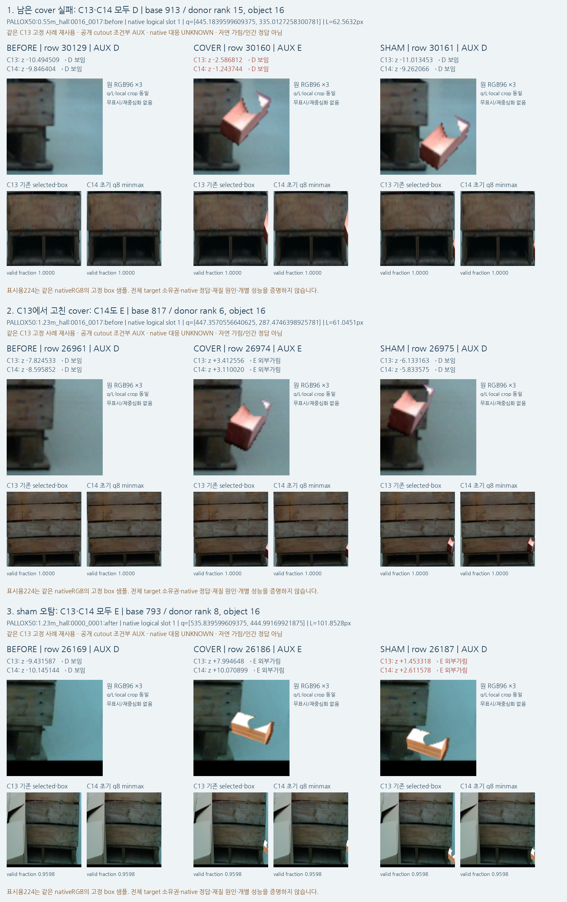

# V119 — query_visibility_consistent_query_context_20261023_v119

기존 보고서에서 추출한 게시용 파생 개요입니다. 원본 파일을 수정하거나 실험·평가를 다시 실행하지 않았습니다. 원문 해시와 링크 대응은 publication manifest로 확인합니다.

**상태:** {"completed":true,"fully_solved":false,"goal_status":"active"}

원본:

- [ROOT_READOUT_KO.html](ROOT_READOUT_KO.html) — SHA256 `bef396ad2b3980cf2a6fcdd1e91a02163c29d1510bd5e0f48ee026f40a16b691`
- [ROOT_RESULTS_KO.json](ROOT_RESULTS_KO.json) — SHA256 `791af2dc5c73a74047bb05253b8694703145d12c8aa9612860bcf18a3ba0fe39`

## 방법·목표의 원문 필드

자동 추출 가능한 해당 최상위 필드가 없습니다. 원문 보고서와 phase receipt를 확인하십시오.

## 입력·학습·평가 분모의 원문 필드

`$.current_primary_comparison`

```text
{
  "excerpt": "[{\"group\": \"WOOD_PRIMARY105\", \"model\": \"v61\", \"display_model\": \"v61\", \"human_D_N\": 616, \"human_E_N\": 29, \"confusion_rows_D_E_cols_D_hidden_U\": [[145, 471, 0], [0, 29, 0]], \"D_precision\": 1.0, \"D_recall\": 0.2353896103896104, \"E_precision\": 0.058, \"E_recall\": 1.0, \"U_rate\": 0.0}, {\"group\": \"WOOD_PRIMARY105\", \"model\": \"legacy\", \"display_model\": \"기존 실사 모델\", \"human_D_N\": 616, \"human_E_N\": 29, \"confusion_rows_D_E_cols_D_hidden_U\": [[448, 65, 103], [2, 23, 4]], \"D_precision\": 0.9955555555555555, \"D_recall\": 0.7272727272727273, \"E_precision\": 0.26136363636363635, \"E_recall\": 0.7931034482758621, \"U_rate\": 0.16589147286821707}, {\"group\": \"WOOD_PRIMARY105\", \"model\": \"V111_C11_RAW\", \"display_model\": \"C11\", \"human_D_N\": 616, \"human_E_N\": 29, \"confusion_rows_D_E_cols_D_hidden_U\": [[598, 18, 0], [11, 18, 0]], \"D_precision\": 0.9819376026272578, \"D_recall\": 0.9707792207792207, \"E_precision\": 0.5, \"E_recall\": 0.6206896551724138, \"U_rate\": 0.0}, {\"group\": \"WOOD_PRIMARY105\", \"model\": \"V114_C12_RAW\", \"display_model\": \"C12\", \"human_D_N\": 616, \"human_E_N\": 29, \"confusion_rows_D_E_cols_D_hidden_U\": [[601, 15, 0], [21, 8, 0]], \"D_precision\": 0.9662379421221865, \"D_recall\": 0.9756493506493507, \"E_precision\": 0.34782608695652173, \"E_recall\": 0.27586206896551724, \"U_rate\": 0.0}, {\"group\": \"WOOD_PRIMARY105\", \"model\": \"V118_C13_RAW\", \"display_model\": \"C13\", \"human_D_N\": 616, \"human_E_N\": 29, \"confusion_rows_D_E_cols_D_hidden_U\": [[599, 17, 0], [21, 8, 0]], \"D_precision\": 0.9661290322580646, \"D_recall\": 0.9724025974025974, \"E_precision\": 0.32, \"E_recall\": 0.27586206896551724, \"U_rate\": 0.0}, {\"group\": \"W",
  "truncated": true
}
```

`$.current_changed_paired_rows`

```text
[
  {
    "id": "wood_night_01:031016",
    "native_slot": 0,
    "group": "WOOD_PRIMARY105",
    "human_state": "EXTERNAL_OCCLUDED",
    "C13": "D",
    "C14": "E"
  },
  {
    "id": "wood_night_01:032089",
    "native_slot": 2,
    "group": "WOOD_PRIMARY105",
    "human_state": "DIRECT_VISIBLE",
    "C13": "D",
    "C14": "E"
  },
  {
    "id": "wood_night_01:033821",
    "native_slot": 2,
    "group": "WOOD_PRIMARY105",
    "human_state": "DIRECT_VISIBLE",
    "C13": "E",
    "C14": "D"
  }
]
```

`$.manual_near_D_rows`

```text
{
  "excerpt": "[{\"group\": \"WOOD_PRIMARY105\", \"model\": \"v61\", \"scope\": \"MANUAL_CLICK_DIRECT_VALID_QUERY_ERROR_LE3\", \"N\": \"153\", \"pred_visible\": \"42\", \"pred_binary_hidden\": \"111\", \"unresolved\": \"0\", \"semantic_D_recall\": \"0.27450980392156865\"}, {\"group\": \"WOOD_PRIMARY105\", \"model\": \"legacy\", \"scope\": \"MANUAL_CLICK_DIRECT_VALID_QUERY_ERROR_LE3\", \"N\": \"153\", \"pred_visible\": \"116\", \"pred_binary_hidden\": \"11\", \"unresolved\": \"26\", \"semantic_D_recall\": \"0.7581699346405228\"}, {\"group\": \"WOOD_PRIMARY105\", \"model\": \"V91_RAW\", \"scope\": \"MANUAL_CLICK_DIRECT_VALID_QUERY_ERROR_LE3\", \"N\": \"153\", \"pred_visible\": \"145\", \"pred_binary_hidden\": \"8\", \"unresolved\": \"0\", \"semantic_D_recall\": \"0.9477124183006536\"}, {\"group\": \"WOOD_PRIMARY105\", \"model\": \"V91_PLUS_OLD_GEOMETRY\", \"scope\": \"MANUAL_CLICK_DIRECT_VALID_QUERY_ERROR_LE3\", \"N\": \"153\", \"pred_visible\": \"145\", \"pred_binary_hidden\": \"8\", \"unresolved\": \"0\", \"semantic_D_recall\": \"0.9477124183006536\"}, {\"group\": \"WOOD_PRIMARY105\", \"model\": \"V111_C11_RAW\", \"scope\": \"MANUAL_CLICK_DIRECT_VALID_QUERY_ERROR_LE3\", \"N\": \"153\", \"pred_visible\": \"150\", \"pred_binary_hidden\": \"3\", \"unresolved\": \"0\", \"semantic_D_recall\": \"0.9803921568627451\"}, {\"group\": \"WOOD_PRIMARY105\", \"model\": \"V111_C11_PLUS_OLD_GEOMETRY\", \"scope\": \"MANUAL_CLICK_DIRECT_VALID_QUERY_ERROR_LE3\", \"N\": \"153\", \"pred_visible\": \"150\", \"pred_binary_hidden\": \"3\", \"unresolved\": \"0\", \"semantic_D_recall\": \"0.9803921568627451\"}, {\"group\": \"WOOD_PRIMARY105\", \"model\": \"V119_C14_RAW\", \"scope\": \"MANUAL_CLICK_DIRECT_VALID_QUERY_ERROR_LE3\", \"N\": \"153\", \"pred_visible\": \"153\", \"pred_binary_hidden\": \"0\", \"unresolved\": \"0\", \"sema",
  "truncated": true
}
```

`$.self_binary_response_rows`

```text
{
  "excerpt": "[{\"cohort\": \"paired_same_query_RGB\", \"group\": \"WOOD_PRIMARY105\", \"model\": \"v61\", \"human_S_support\": \"21\", \"binary_hidden_response\": \"12\", \"visible_response\": \"9\", \"unresolved\": \"0\", \"human_S_binary_hidden_response_rate\": \"0.5714285714285714\", \"learned_self_prediction\": \"False\", \"external_vs_self_identified\": \"False\", \"scope\": \"HumanS subset apparentvisibility binary response; oldgeometry route separately named. ZeroS support is no gold evidence.\"}, {\"cohort\": \"paired_same_query_RGB\", \"group\": \"WOOD_PRIMARY105\", \"model\": \"legacy\", \"human_S_support\": \"21\", \"binary_hidden_response\": \"3\", \"visible_response\": \"13\", \"unresolved\": \"5\", \"human_S_binary_hidden_response_rate\": \"0.14285714285714285\", \"learned_self_prediction\": \"False\", \"external_vs_self_identified\": \"False\", \"scope\": \"HumanS subset apparentvisibility binary response; oldgeometry route separately named. ZeroS support is no gold evidence.\"}, {\"cohort\": \"paired_same_query_RGB\", \"group\": \"WOOD_PRIMARY105\", \"model\": \"V91_RAW\", \"human_S_support\": \"21\", \"binary_hidden_response\": \"2\", \"visible_response\": \"19\", \"unresolved\": \"0\", \"human_S_binary_hidden_response_rate\": \"0.09523809523809523\", \"learned_self_prediction\": \"False\", \"external_vs_self_identified\": \"False\", \"scope\": \"HumanS subset apparentvisibility binary response; oldgeometry route separately named. ZeroS support is no gold evidence.\"}, {\"cohort\": \"paired_same_query_RGB\", \"group\": \"WOOD_PRIMARY105\", \"model\": \"V91_PLUS_OLD_GEOMETRY\", \"human_S_support\": \"21\", \"binary_hidden_response\": \"2\", \"visible_response\": \"19\", \"unresolved\": \"0\", \"human_S_binary_hidden_response_rat",
  "truncated": true
}
```

`$.coordinate_error_rows`

```text
{
  "excerpt": "[{\"cohort\": \"paired_same_query_RGB\", \"group\": \"WOOD_PRIMARY105\", \"task\": \"D_vs_E\", \"error_bin\": \"LE3\", \"model\": \"v61\", \"manual_click_reference_N\": \"153\", \"other_or_unspecified_reference_N\": \"92\", \"scope\": \"Existing general q-reference error; not coordinate correction or verified query-miss truth\", \"N\": \"245\", \"frames\": \"89\", \"visible_support\": \"238\", \"occluded_support\": \"7\", \"TP\": \"52\", \"FN_decided\": \"186\", \"FP\": \"0\", \"TN\": \"7\", \"U_visible\": \"0\", \"U_occluded\": \"0\", \"out_of_task_S_visible\": \"0\", \"out_of_task_S_occluded\": \"0\", \"other_unresolved_visible\": \"0\", \"other_unresolved_occluded\": \"0\", \"visible_precision\": \"1.0\", \"visible_recall_all_GT\": \"0.2184873949579832\", \"occluded_precision\": \"0.03626943005181347\", \"occluded_recall_all_GT\": \"1.0\", \"abstention_rate\": \"0.0\", \"out_of_task_S_rate\": \"0.0\", \"unresolved_rate\": \"0.0\", \"decision_coverage\": \"1.0\", \"correct_fraction_all_GT\": \"0.24081632653061225\", \"selective_accuracy\": \"0.24081632653061225\"}, {\"cohort\": \"paired_same_query_RGB\", \"group\": \"WOOD_PRIMARY105\", \"task\": \"D_vs_E\", \"error_bin\": \"LE3\", \"model\": \"legacy\", \"manual_click_reference_N\": \"153\", \"other_or_unspecified_reference_N\": \"92\", \"scope\": \"Existing general q-reference error; not coordinate correction or verified query-miss truth\", \"N\": \"245\", \"frames\": \"89\", \"visible_support\": \"238\", \"occluded_support\": \"7\", \"TP\": \"181\", \"FN_decided\": \"21\", \"FP\": \"1\", \"TN\": \"6\", \"U_visible\": \"36\", \"U_occluded\": \"0\", \"out_of_task_S_visible\": \"0\", \"out_of_task_S_occluded\": \"0\", \"other_unresolved_visible\": \"0\", \"other_unresolved_occluded\": \"0\", \"visible_precision\": \"0.9945054945054945\", ",
  "truncated": true
}
```

`$.current_used_for_training_normalizer_threshold_checkpoint_or_arm_choice`

```text
false
```


## 결론·실패·한계의 원문 필드

`$.outcome_KO`

```text
문맥 입력 통일 후 외부가림 정답 목재8→9/29, 정사6/61유지. 보임599/616과531/531유지. 이 변경만으로 외부가림 문제는 해결되지 않았다.
```

`$.interpretation_KO`

```text
[
  "공개 source에서 확인한 context 생성 차이만 통일한 대조다. q/L/local특징/라벨/fold/head/loss/batch/selector/문턱은 유지했다.",
  "목재 가림1점 증가는 확인됐지만 정사 가림55점·목재20점 누락이 남는다. 입력 범위 통일만으로 실사용 문제가 해결되지는 않았다.",
  "source VAL손실은C13 .032754→C14 .027326이나,119쌍 중 cover118유지/sham117→116. source손실 개선을 자연영상 가림 성능으로 대신하지 않는다.",
  "q8범위 안에 q가 들어가는 것은 구성상 성질이며, 대상·native부품·좌표 정확성의 증명이 아니다.",
  "C14는최신 source동결 비교이며 current로선택한최고모델이 아니다."
]
```


## 코드·검증·전체 표·갤러리

아래 목록은 원 보고서가 참조한 파일의 경로를 다시 연결한 것입니다. 이 개요 작성 중 이미지 내용이나 raw 평가 데이터를 새로 검사하지 않았습니다.

- [query_visibility_consistent_query_context_20261023_v119/source_visual_followup/SAVED_PUBLIC_FIXED3_C13_C14_KO.html](source_visual_followup/SAVED_PUBLIC_FIXED3_C13_C14_KO.html)
- [query_visibility_consistent_query_context_20261023_v119/source_visual_followup/RESULT.json](source_visual_followup/RESULT.json)
- [query_visibility_consistent_query_context_20261023_v119/public_source_comparison/RESULT.json](public_source_comparison/RESULT.json)
- [query_visibility_same_material_query_head_20261023_v118/visual_followup/SAVED_C13_VISUAL_REVIEW_KO.html](../query_visibility_same_material_query_head_20261023_v118/visual_followup/SAVED_C13_VISUAL_REVIEW_KO.html)
- [query_visibility_consistent_query_context_20261023_v119/ROOT_RESULTS_KO.json](ROOT_RESULTS_KO.json)
- [query_visibility_consistent_query_context_20261023_v119/feature_integrity_review/REVIEW.json](feature_integrity_review/REVIEW.json)
- [query_visibility_consistent_query_context_20261023_v119/saved_source_review/REVIEW.json](saved_source_review/REVIEW.json)
- [query_visibility_consistent_query_context_20261023_v119/saved_current_review/REVIEW.json](saved_current_review/REVIEW.json)
- [query_visibility_consistent_query_context_20261023_v119/private_evaluation/C14_FROZEN_CURRENT223/evaluation/METRICS.csv](private_evaluation/C14_FROZEN_CURRENT223/evaluation/METRICS.csv)
- [query_visibility_consistent_query_context_20261023_v119/private_evaluation/C14_FROZEN_CURRENT223/evaluation/HUMAN_SELF_BINARY_RESPONSE.csv](private_evaluation/C14_FROZEN_CURRENT223/evaluation/HUMAN_SELF_BINARY_RESPONSE.csv)
- [query_visibility_consistent_query_context_20261023_v119/private_evaluation/C14_FROZEN_CURRENT223/evaluation/COORDINATE_ERROR_BINS.csv](private_evaluation/C14_FROZEN_CURRENT223/evaluation/COORDINATE_ERROR_BINS.csv)
- [query_visibility_consistent_query_context_20261023_v119/ROOT_C14_DESIGN_BEFORE_SOURCE_FORWARD.json](ROOT_C14_DESIGN_BEFORE_SOURCE_FORWARD.json)
- [query_visibility_consistent_query_context_20261023_v119/consistent_context_features/FEATURE_COMPLETE.json](consistent_context_features/FEATURE_COMPLETE.json)
- [query_visibility_consistent_query_context_20261023_v119/runs/C14_CONSISTENT_Q8_CONTEXT_SPATIAL_QUERY/FIT_COMPLETE.json](runs/C14_CONSISTENT_Q8_CONTEXT_SPATIAL_QUERY/FIT_COMPLETE.json)
- [query_visibility_consistent_query_context_20261023_v119/runs/C14_CONSISTENT_Q8_CONTEXT_SPATIAL_QUERY/MODEL_FREEZE.json](runs/C14_CONSISTENT_Q8_CONTEXT_SPATIAL_QUERY/MODEL_FREEZE.json)
- [query_visibility_consistent_query_context_20261023_v119/private_evaluation/C14_FROZEN_CURRENT223/INFERENCE_SEAL.json](private_evaluation/C14_FROZEN_CURRENT223/INFERENCE_SEAL.json)
- [query_visibility_consistent_query_context_20261023_v119/private_evaluation/C14_FROZEN_CURRENT223/evaluation/EVALUATION_SEAL.json](private_evaluation/C14_FROZEN_CURRENT223/evaluation/EVALUATION_SEAL.json)

## 원 보고서의 그림

원 보고서 참조 순서의 처음 최대4개를 표시합니다. 새 outcome 선택이나 전수 이미지 검증을 뜻하지 않습니다. 전체 갤러리는 위 원문 링크에서 확인합니다.

[query_visibility_consistent_query_context_20261023_v119/source_visual_followup/CONTACT_SAME_FIXED3_C13_C14.png](source_visual_followup/CONTACT_SAME_FIXED3_C13_C14.png)




현재 사용자 목표 전체의 해결·새 모델 채택·실사 가림 원인 확정을 이 파생 개요가 추가로 주장하지 않습니다. UNKNOWN/U와 불리한 결과, 실패 실행 및 수정 provenance는 원문대로 보존해야 합니다.
