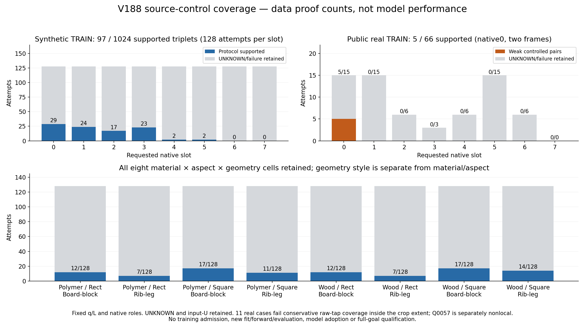

# V188: 질문한 끝부분만 가리는 source 대조 데이터

이번 결과는 **대조 데이터 진단 완료**입니다. 새 모델 학습·추론·실사 평가·PnP는 모두 0회이며, 모델 채택과 전체 가림 판단 목표는 미해결입니다.

| 구분 | 전체 시도 | 끝부분 대조 조건 통과 | UNKNOWN·실패 보존 |
|---|---:|---:|---:|
| 합성 TRAIN | 1,024 | 97 | 927 |
| 공개 실사 TRAIN 기반 | 66 | 5 | 61 |

통과율은 모델 정확도가 아닙니다. 같은 초기 q·crop 크기 L에서 BEFORE, 끝부분 COVER, 같은 외부 물체를 옆으로 옮긴 SHAM을 구성할 수 있었는지 나타냅니다.

## 무엇을 구분했나

주변에 목재가 조금이라도 보이는 broad support, 질문한 의미적 끝부분의 보임, 중심 픽셀의 물체 소유권, 좌표 정확도를 서로 다른 목표로 유지했습니다. COVER에서 끝부분을 가려도 같은 판재의 다른 부분은 남아 보일 수 있습니다. 기존 native D/E/S·좌표 품질 라벨은 바꾸지 않았고, 이번 direct-end 상태는 별도의 약한 감독입니다.

## 데이터와 실제 검사

합성은 기존 TRAIN 128개 base × native 8개를 모두 사용했습니다. 목재/폴리머 × 직사각형/정사각형 × 두 구조의 8개 조합을 각각 128시도씩 보존했습니다. 기존 V127 패치의 고정 inner 0.2를 유한한 끝부분으로 정의했으며, 정확한 실물 코너 정답을 뜻하지 않습니다. 원 q/L·카메라·native 대응은 고정하고 원 V90의 F64 네 점 bilinear 및 uint8 반올림을 재사용했습니다. 초기 입력 U16, 3,072 variant 상태와 예정 native 슬롯 24,576개를 보존했습니다. 원 BEFORE 1,024개의 RGB96·valid96은 저장 SHA와 모두 일치했습니다.

공개 실사는 기존 22개 source 사례와 동일한 3개 donor 배정, 총 66개 시도를 유지했습니다. 원 CARD·표시 전용 diagnostic 44개를 실제 확인한 뒤 끝부분 후보 영역 16건을 약하게 관찰했고, runner 대응 불확실 5건과 원 crop 밖 Q0057 1건은 UNKNOWN으로 남겼습니다. 정확한 픽셀 마스크나 완벽한 mesh/pose 증명을 요구하지 않았습니다. YCB TRAIN의 같은 opaque RGB/alpha를 COVER/SHAM에 사용하고, 모든 후보 raw tap 가림·SHAM 분리·같은 판재 witness 유지·원 crop 재현을 실제 배열로 검사했습니다.

## 남은 문제와 탈락 원인

실사 66시도는 통과 5, 배치 조건 실패 10, UNKNOWN 51입니다. UNKNOWN 중 15시도는 runner 끝부분/대상 대응이 불확실한 5사례이고, 3시도는 원 crop 밖 끝부분 Q0057 1사례입니다. 나머지 33시도는 11사례에서 **축소 샘플 간격 사이의 raw tap 공백** 때문에 탈락했습니다. 끝부분이 모두 crop 밖이라는 뜻이 아닙니다. 이번 보수적 규칙은 후보 영역의 모든 raw 픽셀이 RGB96 샘플에 참여해야 한다고 요구하므로, 실제 축소 crop에서 끝부분을 알아볼 수 있는지보다 엄격합니다. 원 범위 밖 끝부분 사례 Q0057은 별도로 유지합니다.

배치 실패 10건은 고정한 주변 same-part witness가 두 donor bbox 밖에 남지 않는 경우 9건과, 여기에 in-frame 조건도 실패한 1건입니다. donor 재선택·배치 탐색·영역 축소·실패 삭제 없이 원 시도를 보존했습니다.

고정 8개 factor의 합성 그림을 실제 확인하면 일부 COVER/SHAM 차이는 작은 윤곽 변화이고, 같은 재질의 외부 평면은 원 판재와 매우 비슷하게 보입니다. 픽셀 가림·byte 변화 증명이 학습하기 쉬운 시각 신호나 실사 전이를 보증하지 않습니다. 실사에서는 두 원 프레임의 끝부분 가림과 주변 판재 잔존을 실제 crop으로 확인했습니다.

주변 same-part witness 역시 RGB의 약한 관찰입니다. Q1088은 같은 앞 상판의 넓은 윗면을 확인했고, Q1624는 blur가 있는 상판 면 접합 근처라 정밀한 면 경계 인증으로 해석하지 않습니다. Q1608은 fascia와 EPAL 블록 접합 인접성 우려를 별도로 보존했으며 세 시도 모두 이미 배치 조건에서 탈락했습니다. 기존 관찰을 덮어쓰거나 이 불확실성을 새 human gold로 바꾸지 않았습니다.

합성 통과 97건은 8개 factor 조합 모두에 있지만 native6/7 통과는 0건입니다. 실사 통과 5건은 두 프레임의 native0에 한정됩니다. 공개 실사 정사각형 및 모든 native 역할을 해결했다는 근거가 아닙니다. 합성 UNKNOWN 927건은 기존 입력 U16, 끝부분 self/모호성/등록/OOF 조건 828, 배치 조건 83으로 나뉩니다.

## 표·그림·재현 자료

- [8개 합성 factor 조합](root_descriptive_source_tables/SYNTHETIC_FACTOR_CELLS.csv)
- [native0..7 전체 분모](root_descriptive_source_tables/FULL_NATIVE8_DENOMINATORS.csv)
- [실사 22사례의 raw-support 진단](root_descriptive_source_tables/ALL22_REAL_LOCALITY_DIAGNOSTIC.csv)
- [집계 원문](root_descriptive_source_tables/SUMMARY.json)
- [합성 생성 완료·입력 provenance](synthetic_direct_end_controls_v1/COMPLETE.json)
- [실사 생성 완료·모든 실패 포함](real_end_local_pairs_v1/COMPLETE.json)
- [22개 끝부분 관찰과 불확실성](actual_fixed22_end_observation_a/COMPLETE.json)

- [그림 갤러리: synthetic_end_review_visuals_b](synthetic_end_review_visuals_b/PORTABLE_GALLERY_KO.md)
- [그림 갤러리: actual_saved_real_review_v1](independent_actual_real_review_a/actual_saved_real_review_v1/PORTABLE_GALLERY_KO.md)

## 다음 단계의 경계

다음 source 단계에서는 실제 RGB96에 남는 끝부분 증거를 기준으로 감독 정의를 먼저 고정하고, 실사 native·재질 범위를 넓힙니다. 현재 평가 223장, 공개 held, 합성 VAL은 학습·문턱·checkpoint·구조·데이터 선택에 사용하지 않습니다. 반복 노출된 평가셋의 not-blind 한계도 유지합니다. 이번 데이터를 즉시 학습에 넣지 않았고, RAW/SAM 두 후보의 전향적 학습 설계는 별도입니다.

기존 V187 feasibility 설명의 step 괄호 표기를 정정합니다. 실제 원 코드의 식은 `min(0.03, float(min(part_side)) * 0.7)`입니다. 과거 게시 원문은 보존하고 V188의 `ROOT_SAMPLER_AND_STEP_AUTHORITY_CORRECTIONS.json`에 정정 근거를 남겼습니다. RGB sampler의 nearest 표기도 원 코드와 대조해 실제 V90 bilinear로 정정했으며, 준비 문구가 실제 입력 변형으로 실행된 적은 없습니다.
