# V188 합성 끝점 국소 COVER/SHAM 전체 그림

고정 source TRAIN 128개 base·native8의 **1024 시도 전체**를 보존했습니다. 이 중 구성된 97쌍의 원 q/L·sampler로 만든 clean96 그림 291장과 contact 97장을 모두 연결합니다. 나머지 927 UNKNOWN은 삭제하지 않았습니다.

이 자료는 미리 정한 등록 합성 끝점의 inner 0.2 영역에 대한 제어입니다. 기존 native D/E/S·center owner·넓은 부위 support와 별개이며, 실사 물리 정답이나 모델 성공·학습 완료를 뜻하지 않습니다. 새 학습·편입은 없습니다.

- [전체 1024 상태 CSV](ALL1024_STATUS.csv)
- [전체 HTML gallery 원문](index.html)
- [독립 저장 배열 감사](../independent_actual_synthetic_review_b/actual_review_v1/REVIEW.json)
- [실제 8개 contact view QA](ACTUAL_VISUAL_QA.json)
- [고정 factor별 첫 구성 사례 선택 기록](FIRST_CONSTRUCTED_PER8_FACTOR_CELL.json)

3072는 모든 시도의 variant 상태 수, 24576은 시도된 all8 native 입력 슬롯 수입니다. 실제 구성된 97쌍에는 2328개 native RGB96 행이 있습니다. 입력 U16의 선택된 variant 상태 48개는 UNKNOWN으로 유지됩니다.

## 고정 8 factor별 첫 구성 사례 미리보기

예측·성과를 보고 고르지 않고, 원 시도 순서에서 각 material/aspect/geometry cell의 첫 구성 사례를 사용했습니다. 이 8개 contact만 실제 도구로 시각검토했고 97개 전체의 배열은 독립 검산했습니다.

### DARK_POLYMER / RECTANGULAR / BOARD_BLOCK_RUNNER — V188_BASE001_NATIVE0

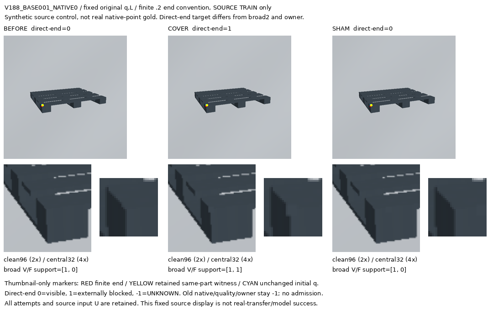

### DARK_POLYMER / RECTANGULAR / RIB_LEG_RUNNER — V188_BASE037_NATIVE0

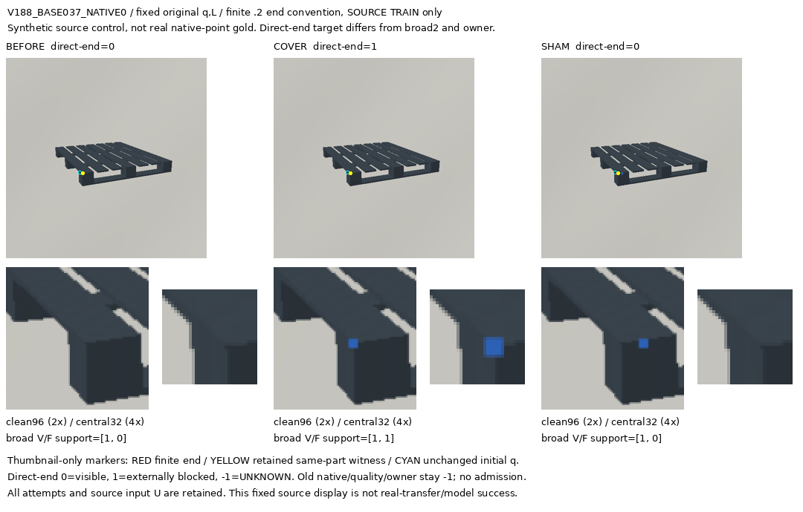

### DARK_POLYMER / SQUARE / BOARD_BLOCK_RUNNER — V188_BASE017_NATIVE3

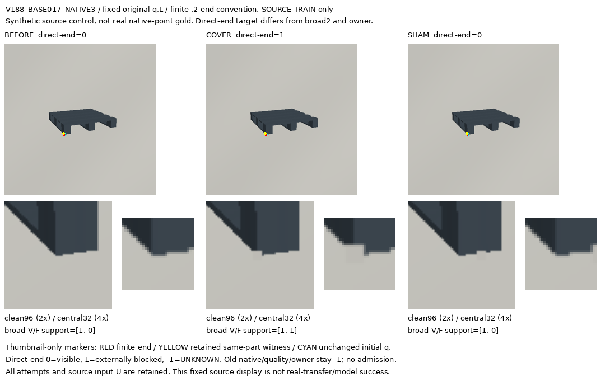

### DARK_POLYMER / SQUARE / RIB_LEG_RUNNER — V188_BASE051_NATIVE1

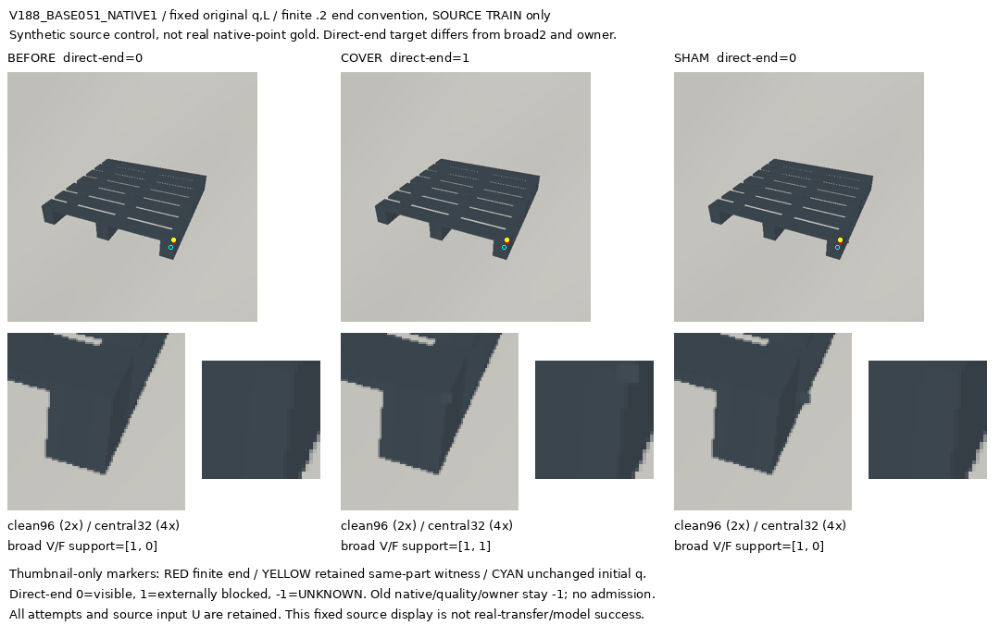

### PROCEDURAL_WOOD / RECTANGULAR / BOARD_BLOCK_RUNNER — V188_BASE000_NATIVE0

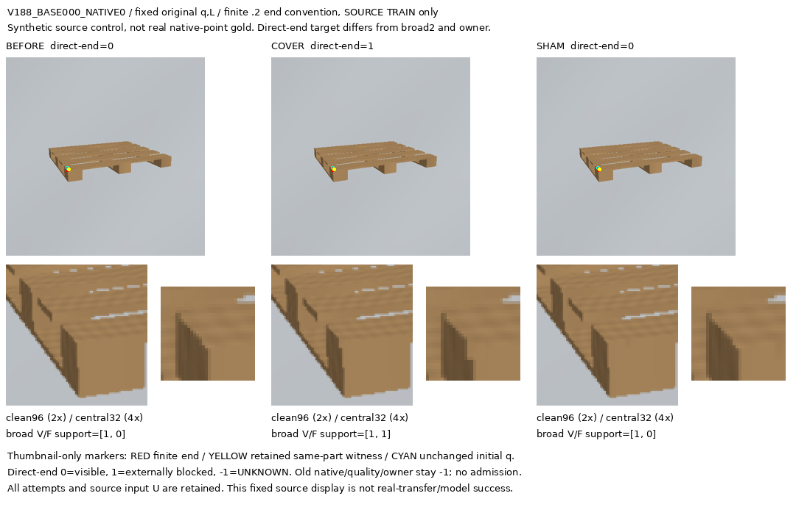

### PROCEDURAL_WOOD / RECTANGULAR / RIB_LEG_RUNNER — V188_BASE036_NATIVE0

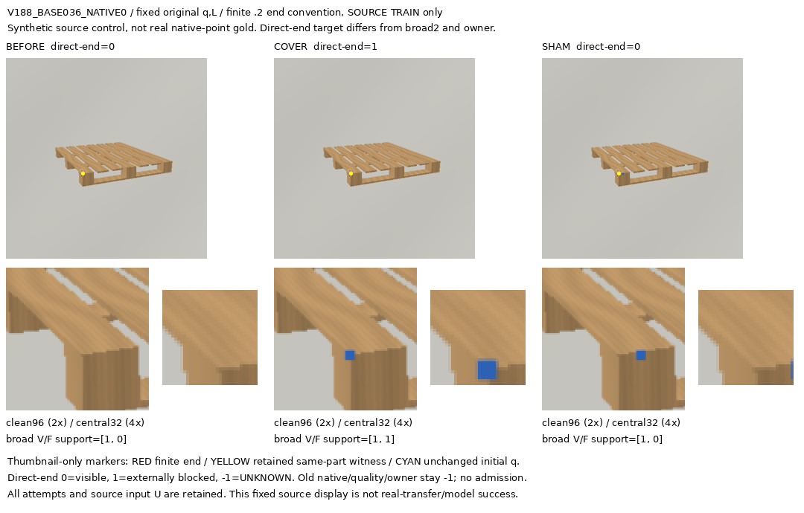

### PROCEDURAL_WOOD / SQUARE / BOARD_BLOCK_RUNNER — V188_BASE016_NATIVE3

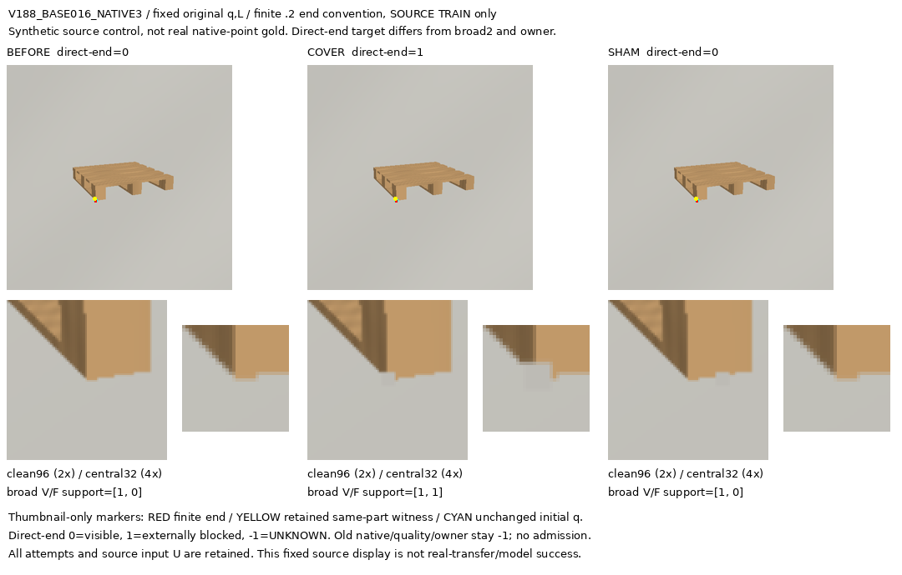

### PROCEDURAL_WOOD / SQUARE / RIB_LEG_RUNNER — V188_BASE050_NATIVE1

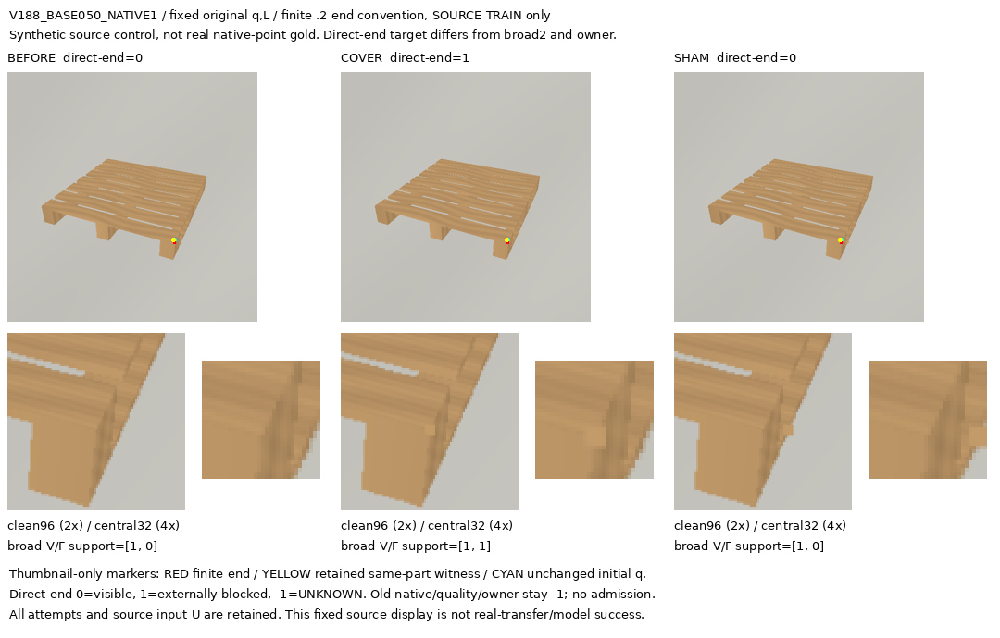

## 구성된 97쌍 전체

각 clean96은 표시 marker 없이 저장했습니다. contact의 fullscene thumbnail에만 끝점·잔존 부위·원 q 표시가 있습니다. `direct-end`는 0=보임, 1=외부 차폐, −1=UNKNOWN의 별도 합성 제어 target입니다. `broad V/F`는 넓은 부위의 비배타적 support 진단이며 native D/E로 해석하지 않습니다.

### V188_BASE000_NATIVE0

[전체 contact](V188_BASE000_NATIVE0/CONTACT.png)

| BEFORE clean96 | COVER clean96 | SHAM clean96 |
|---|---|---|
|  | 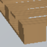 |  |

### V188_BASE000_NATIVE3

[전체 contact](V188_BASE000_NATIVE3/CONTACT.png)

| BEFORE clean96 | COVER clean96 | SHAM clean96 |
|---|---|---|
| 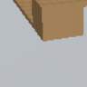 | 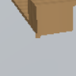 | 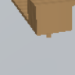 |

### V188_BASE001_NATIVE0

[전체 contact](V188_BASE001_NATIVE0/CONTACT.png)

| BEFORE clean96 | COVER clean96 | SHAM clean96 |
|---|---|---|
| 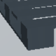 | 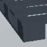 |  |

### V188_BASE001_NATIVE3

[전체 contact](V188_BASE001_NATIVE3/CONTACT.png)

| BEFORE clean96 | COVER clean96 | SHAM clean96 |
|---|---|---|
|  |  |  |

### V188_BASE006_NATIVE1

[전체 contact](V188_BASE006_NATIVE1/CONTACT.png)

| BEFORE clean96 | COVER clean96 | SHAM clean96 |
|---|---|---|
|  | 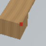 | 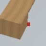 |

### V188_BASE006_NATIVE2

[전체 contact](V188_BASE006_NATIVE2/CONTACT.png)

| BEFORE clean96 | COVER clean96 | SHAM clean96 |
|---|---|---|
|  |  |  |

### V188_BASE007_NATIVE1

[전체 contact](V188_BASE007_NATIVE1/CONTACT.png)

| BEFORE clean96 | COVER clean96 | SHAM clean96 |
|---|---|---|
|  |  |  |

### V188_BASE007_NATIVE2

[전체 contact](V188_BASE007_NATIVE2/CONTACT.png)

| BEFORE clean96 | COVER clean96 | SHAM clean96 |
|---|---|---|
|  |  |  |

### V188_BASE012_NATIVE0

[전체 contact](V188_BASE012_NATIVE0/CONTACT.png)

| BEFORE clean96 | COVER clean96 | SHAM clean96 |
|---|---|---|
|  |  |  |

### V188_BASE013_NATIVE0

[전체 contact](V188_BASE013_NATIVE0/CONTACT.png)

| BEFORE clean96 | COVER clean96 | SHAM clean96 |
|---|---|---|
|  |  |  |

### V188_BASE016_NATIVE3

[전체 contact](V188_BASE016_NATIVE3/CONTACT.png)

| BEFORE clean96 | COVER clean96 | SHAM clean96 |
|---|---|---|
|  |  |  |

### V188_BASE017_NATIVE3

[전체 contact](V188_BASE017_NATIVE3/CONTACT.png)

| BEFORE clean96 | COVER clean96 | SHAM clean96 |
|---|---|---|
|  |  |  |

### V188_BASE020_NATIVE0

[전체 contact](V188_BASE020_NATIVE0/CONTACT.png)

| BEFORE clean96 | COVER clean96 | SHAM clean96 |
|---|---|---|
|  |  |  |

### V188_BASE020_NATIVE3

[전체 contact](V188_BASE020_NATIVE3/CONTACT.png)

| BEFORE clean96 | COVER clean96 | SHAM clean96 |
|---|---|---|
|  |  |  |

### V188_BASE020_NATIVE4

[전체 contact](V188_BASE020_NATIVE4/CONTACT.png)

| BEFORE clean96 | COVER clean96 | SHAM clean96 |
|---|---|---|
|  |  |  |

### V188_BASE021_NATIVE0

[전체 contact](V188_BASE021_NATIVE0/CONTACT.png)

| BEFORE clean96 | COVER clean96 | SHAM clean96 |
|---|---|---|
|  |  |  |

### V188_BASE021_NATIVE3

[전체 contact](V188_BASE021_NATIVE3/CONTACT.png)

| BEFORE clean96 | COVER clean96 | SHAM clean96 |
|---|---|---|
|  |  |  |

### V188_BASE021_NATIVE4

[전체 contact](V188_BASE021_NATIVE4/CONTACT.png)

| BEFORE clean96 | COVER clean96 | SHAM clean96 |
|---|---|---|
|  |  |  |

### V188_BASE026_NATIVE0

[전체 contact](V188_BASE026_NATIVE0/CONTACT.png)

| BEFORE clean96 | COVER clean96 | SHAM clean96 |
|---|---|---|
| 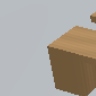 | 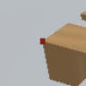 |  |

### V188_BASE026_NATIVE1

[전체 contact](V188_BASE026_NATIVE1/CONTACT.png)

| BEFORE clean96 | COVER clean96 | SHAM clean96 |
|---|---|---|
| 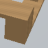 |  |  |

### V188_BASE027_NATIVE0

[전체 contact](V188_BASE027_NATIVE0/CONTACT.png)

| BEFORE clean96 | COVER clean96 | SHAM clean96 |
|---|---|---|
|  |  |  |

### V188_BASE027_NATIVE1

[전체 contact](V188_BASE027_NATIVE1/CONTACT.png)

| BEFORE clean96 | COVER clean96 | SHAM clean96 |
|---|---|---|
|  |  |  |

### V188_BASE028_NATIVE3

[전체 contact](V188_BASE028_NATIVE3/CONTACT.png)

| BEFORE clean96 | COVER clean96 | SHAM clean96 |
|---|---|---|
|  |  |  |

### V188_BASE029_NATIVE3

[전체 contact](V188_BASE029_NATIVE3/CONTACT.png)

| BEFORE clean96 | COVER clean96 | SHAM clean96 |
|---|---|---|
|  |  |  |

### V188_BASE036_NATIVE0

[전체 contact](V188_BASE036_NATIVE0/CONTACT.png)

| BEFORE clean96 | COVER clean96 | SHAM clean96 |
|---|---|---|
|  |  |  |

### V188_BASE036_NATIVE3

[전체 contact](V188_BASE036_NATIVE3/CONTACT.png)

| BEFORE clean96 | COVER clean96 | SHAM clean96 |
|---|---|---|
|  |  |  |

### V188_BASE037_NATIVE0

[전체 contact](V188_BASE037_NATIVE0/CONTACT.png)

| BEFORE clean96 | COVER clean96 | SHAM clean96 |
|---|---|---|
|  |  |  |

### V188_BASE037_NATIVE3

[전체 contact](V188_BASE037_NATIVE3/CONTACT.png)

| BEFORE clean96 | COVER clean96 | SHAM clean96 |
|---|---|---|
|  |  |  |

### V188_BASE042_NATIVE1

[전체 contact](V188_BASE042_NATIVE1/CONTACT.png)

| BEFORE clean96 | COVER clean96 | SHAM clean96 |
|---|---|---|
|  | 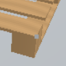 | 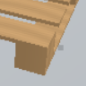 |

### V188_BASE043_NATIVE1

[전체 contact](V188_BASE043_NATIVE1/CONTACT.png)

| BEFORE clean96 | COVER clean96 | SHAM clean96 |
|---|---|---|
|  | 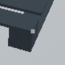 | 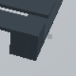 |

### V188_BASE050_NATIVE1

[전체 contact](V188_BASE050_NATIVE1/CONTACT.png)

| BEFORE clean96 | COVER clean96 | SHAM clean96 |
|---|---|---|
| 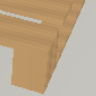 |  |  |

### V188_BASE050_NATIVE2

[전체 contact](V188_BASE050_NATIVE2/CONTACT.png)

| BEFORE clean96 | COVER clean96 | SHAM clean96 |
|---|---|---|
| 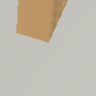 | 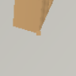 | 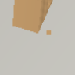 |

### V188_BASE051_NATIVE1

[전체 contact](V188_BASE051_NATIVE1/CONTACT.png)

| BEFORE clean96 | COVER clean96 | SHAM clean96 |
|---|---|---|
|  |  |  |

### V188_BASE051_NATIVE2

[전체 contact](V188_BASE051_NATIVE2/CONTACT.png)

| BEFORE clean96 | COVER clean96 | SHAM clean96 |
|---|---|---|
|  |  |  |

### V188_BASE056_NATIVE0

[전체 contact](V188_BASE056_NATIVE0/CONTACT.png)

| BEFORE clean96 | COVER clean96 | SHAM clean96 |
|---|---|---|
|  | 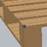 | 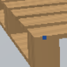 |

### V188_BASE056_NATIVE3

[전체 contact](V188_BASE056_NATIVE3/CONTACT.png)

| BEFORE clean96 | COVER clean96 | SHAM clean96 |
|---|---|---|
| 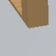 | 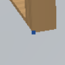 | 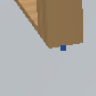 |

### V188_BASE057_NATIVE0

[전체 contact](V188_BASE057_NATIVE0/CONTACT.png)

| BEFORE clean96 | COVER clean96 | SHAM clean96 |
|---|---|---|
|  |  |  |

### V188_BASE057_NATIVE3

[전체 contact](V188_BASE057_NATIVE3/CONTACT.png)

| BEFORE clean96 | COVER clean96 | SHAM clean96 |
|---|---|---|
|  |  |  |

### V188_BASE062_NATIVE1

[전체 contact](V188_BASE062_NATIVE1/CONTACT.png)

| BEFORE clean96 | COVER clean96 | SHAM clean96 |
|---|---|---|
|  |  | 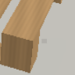 |

### V188_BASE062_NATIVE2

[전체 contact](V188_BASE062_NATIVE2/CONTACT.png)

| BEFORE clean96 | COVER clean96 | SHAM clean96 |
|---|---|---|
|  |  |  |

### V188_BASE063_NATIVE1

[전체 contact](V188_BASE063_NATIVE1/CONTACT.png)

| BEFORE clean96 | COVER clean96 | SHAM clean96 |
|---|---|---|
|  | 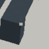 |  |

### V188_BASE063_NATIVE2

[전체 contact](V188_BASE063_NATIVE2/CONTACT.png)

| BEFORE clean96 | COVER clean96 | SHAM clean96 |
|---|---|---|
|  |  |  |

### V188_BASE068_NATIVE0

[전체 contact](V188_BASE068_NATIVE0/CONTACT.png)

| BEFORE clean96 | COVER clean96 | SHAM clean96 |
|---|---|---|
|  |  |  |

### V188_BASE068_NATIVE1

[전체 contact](V188_BASE068_NATIVE1/CONTACT.png)

| BEFORE clean96 | COVER clean96 | SHAM clean96 |
|---|---|---|
|  | 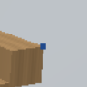 | 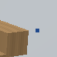 |

### V188_BASE068_NATIVE3

[전체 contact](V188_BASE068_NATIVE3/CONTACT.png)

| BEFORE clean96 | COVER clean96 | SHAM clean96 |
|---|---|---|
|  |  |  |

### V188_BASE069_NATIVE0

[전체 contact](V188_BASE069_NATIVE0/CONTACT.png)

| BEFORE clean96 | COVER clean96 | SHAM clean96 |
|---|---|---|
|  |  |  |

### V188_BASE069_NATIVE1

[전체 contact](V188_BASE069_NATIVE1/CONTACT.png)

| BEFORE clean96 | COVER clean96 | SHAM clean96 |
|---|---|---|
|  |  | 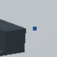 |

### V188_BASE069_NATIVE3

[전체 contact](V188_BASE069_NATIVE3/CONTACT.png)

| BEFORE clean96 | COVER clean96 | SHAM clean96 |
|---|---|---|
|  |  |  |

### V188_BASE074_NATIVE0

[전체 contact](V188_BASE074_NATIVE0/CONTACT.png)

| BEFORE clean96 | COVER clean96 | SHAM clean96 |
|---|---|---|
| 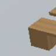 | 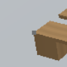 | 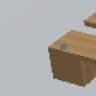 |

### V188_BASE074_NATIVE1

[전체 contact](V188_BASE074_NATIVE1/CONTACT.png)

| BEFORE clean96 | COVER clean96 | SHAM clean96 |
|---|---|---|
|  | 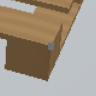 | 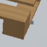 |

### V188_BASE074_NATIVE2

[전체 contact](V188_BASE074_NATIVE2/CONTACT.png)

| BEFORE clean96 | COVER clean96 | SHAM clean96 |
|---|---|---|
| 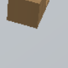 | 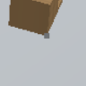 | 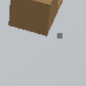 |

### V188_BASE074_NATIVE5

[전체 contact](V188_BASE074_NATIVE5/CONTACT.png)

| BEFORE clean96 | COVER clean96 | SHAM clean96 |
|---|---|---|
|  |  | 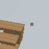 |

### V188_BASE075_NATIVE0

[전체 contact](V188_BASE075_NATIVE0/CONTACT.png)

| BEFORE clean96 | COVER clean96 | SHAM clean96 |
|---|---|---|
|  |  | 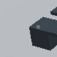 |

### V188_BASE075_NATIVE1

[전체 contact](V188_BASE075_NATIVE1/CONTACT.png)

| BEFORE clean96 | COVER clean96 | SHAM clean96 |
|---|---|---|
|  | 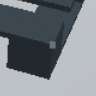 |  |

### V188_BASE075_NATIVE2

[전체 contact](V188_BASE075_NATIVE2/CONTACT.png)

| BEFORE clean96 | COVER clean96 | SHAM clean96 |
|---|---|---|
|  |  |  |

### V188_BASE075_NATIVE5

[전체 contact](V188_BASE075_NATIVE5/CONTACT.png)

| BEFORE clean96 | COVER clean96 | SHAM clean96 |
|---|---|---|
|  |  |  |

### V188_BASE082_NATIVE0

[전체 contact](V188_BASE082_NATIVE0/CONTACT.png)

| BEFORE clean96 | COVER clean96 | SHAM clean96 |
|---|---|---|
|  |  | 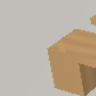 |

### V188_BASE082_NATIVE1

[전체 contact](V188_BASE082_NATIVE1/CONTACT.png)

| BEFORE clean96 | COVER clean96 | SHAM clean96 |
|---|---|---|
|  |  |  |

### V188_BASE082_NATIVE2

[전체 contact](V188_BASE082_NATIVE2/CONTACT.png)

| BEFORE clean96 | COVER clean96 | SHAM clean96 |
|---|---|---|
| 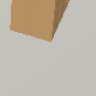 |  |  |

### V188_BASE083_NATIVE0

[전체 contact](V188_BASE083_NATIVE0/CONTACT.png)

| BEFORE clean96 | COVER clean96 | SHAM clean96 |
|---|---|---|
|  |  |  |

### V188_BASE083_NATIVE1

[전체 contact](V188_BASE083_NATIVE1/CONTACT.png)

| BEFORE clean96 | COVER clean96 | SHAM clean96 |
|---|---|---|
|  |  |  |

### V188_BASE083_NATIVE2

[전체 contact](V188_BASE083_NATIVE2/CONTACT.png)

| BEFORE clean96 | COVER clean96 | SHAM clean96 |
|---|---|---|
|  |  |  |

### V188_BASE084_NATIVE0

[전체 contact](V188_BASE084_NATIVE0/CONTACT.png)

| BEFORE clean96 | COVER clean96 | SHAM clean96 |
|---|---|---|
|  |  |  |

### V188_BASE084_NATIVE3

[전체 contact](V188_BASE084_NATIVE3/CONTACT.png)

| BEFORE clean96 | COVER clean96 | SHAM clean96 |
|---|---|---|
|  |  |  |

### V188_BASE085_NATIVE0

[전체 contact](V188_BASE085_NATIVE0/CONTACT.png)

| BEFORE clean96 | COVER clean96 | SHAM clean96 |
|---|---|---|
|  |  |  |

### V188_BASE085_NATIVE3

[전체 contact](V188_BASE085_NATIVE3/CONTACT.png)

| BEFORE clean96 | COVER clean96 | SHAM clean96 |
|---|---|---|
|  |  |  |

### V188_BASE088_NATIVE0

[전체 contact](V188_BASE088_NATIVE0/CONTACT.png)

| BEFORE clean96 | COVER clean96 | SHAM clean96 |
|---|---|---|
|  |  |  |

### V188_BASE088_NATIVE3

[전체 contact](V188_BASE088_NATIVE3/CONTACT.png)

| BEFORE clean96 | COVER clean96 | SHAM clean96 |
|---|---|---|
|  |  |  |

### V188_BASE089_NATIVE0

[전체 contact](V188_BASE089_NATIVE0/CONTACT.png)

| BEFORE clean96 | COVER clean96 | SHAM clean96 |
|---|---|---|
|  |  |  |

### V188_BASE089_NATIVE3

[전체 contact](V188_BASE089_NATIVE3/CONTACT.png)

| BEFORE clean96 | COVER clean96 | SHAM clean96 |
|---|---|---|
|  |  |  |

### V188_BASE094_NATIVE0

[전체 contact](V188_BASE094_NATIVE0/CONTACT.png)

| BEFORE clean96 | COVER clean96 | SHAM clean96 |
|---|---|---|
|  |  |  |

### V188_BASE094_NATIVE1

[전체 contact](V188_BASE094_NATIVE1/CONTACT.png)

| BEFORE clean96 | COVER clean96 | SHAM clean96 |
|---|---|---|
|  |  |  |

### V188_BASE094_NATIVE2

[전체 contact](V188_BASE094_NATIVE2/CONTACT.png)

| BEFORE clean96 | COVER clean96 | SHAM clean96 |
|---|---|---|
|  |  |  |

### V188_BASE095_NATIVE0

[전체 contact](V188_BASE095_NATIVE0/CONTACT.png)

| BEFORE clean96 | COVER clean96 | SHAM clean96 |
|---|---|---|
|  |  |  |

### V188_BASE095_NATIVE1

[전체 contact](V188_BASE095_NATIVE1/CONTACT.png)

| BEFORE clean96 | COVER clean96 | SHAM clean96 |
|---|---|---|
|  |  |  |

### V188_BASE095_NATIVE2

[전체 contact](V188_BASE095_NATIVE2/CONTACT.png)

| BEFORE clean96 | COVER clean96 | SHAM clean96 |
|---|---|---|
|  |  |  |

### V188_BASE098_NATIVE1

[전체 contact](V188_BASE098_NATIVE1/CONTACT.png)

| BEFORE clean96 | COVER clean96 | SHAM clean96 |
|---|---|---|
|  |  |  |

### V188_BASE099_NATIVE1

[전체 contact](V188_BASE099_NATIVE1/CONTACT.png)

| BEFORE clean96 | COVER clean96 | SHAM clean96 |
|---|---|---|
|  |  |  |

### V188_BASE104_NATIVE3

[전체 contact](V188_BASE104_NATIVE3/CONTACT.png)

| BEFORE clean96 | COVER clean96 | SHAM clean96 |
|---|---|---|
|  |  |  |

### V188_BASE105_NATIVE3

[전체 contact](V188_BASE105_NATIVE3/CONTACT.png)

| BEFORE clean96 | COVER clean96 | SHAM clean96 |
|---|---|---|
|  |  |  |

### V188_BASE110_NATIVE0

[전체 contact](V188_BASE110_NATIVE0/CONTACT.png)

| BEFORE clean96 | COVER clean96 | SHAM clean96 |
|---|---|---|
|  |  |  |

### V188_BASE110_NATIVE1

[전체 contact](V188_BASE110_NATIVE1/CONTACT.png)

| BEFORE clean96 | COVER clean96 | SHAM clean96 |
|---|---|---|
|  |  |  |

### V188_BASE111_NATIVE0

[전체 contact](V188_BASE111_NATIVE0/CONTACT.png)

| BEFORE clean96 | COVER clean96 | SHAM clean96 |
|---|---|---|
|  |  |  |

### V188_BASE111_NATIVE1

[전체 contact](V188_BASE111_NATIVE1/CONTACT.png)

| BEFORE clean96 | COVER clean96 | SHAM clean96 |
|---|---|---|
|  |  |  |

### V188_BASE112_NATIVE0

[전체 contact](V188_BASE112_NATIVE0/CONTACT.png)

| BEFORE clean96 | COVER clean96 | SHAM clean96 |
|---|---|---|
|  |  |  |

### V188_BASE112_NATIVE2

[전체 contact](V188_BASE112_NATIVE2/CONTACT.png)

| BEFORE clean96 | COVER clean96 | SHAM clean96 |
|---|---|---|
|  |  |  |

### V188_BASE112_NATIVE3

[전체 contact](V188_BASE112_NATIVE3/CONTACT.png)

| BEFORE clean96 | COVER clean96 | SHAM clean96 |
|---|---|---|
|  |  |  |

### V188_BASE118_NATIVE1

[전체 contact](V188_BASE118_NATIVE1/CONTACT.png)

| BEFORE clean96 | COVER clean96 | SHAM clean96 |
|---|---|---|
|  |  |  |

### V188_BASE118_NATIVE2

[전체 contact](V188_BASE118_NATIVE2/CONTACT.png)

| BEFORE clean96 | COVER clean96 | SHAM clean96 |
|---|---|---|
|  |  |  |

### V188_BASE119_NATIVE1

[전체 contact](V188_BASE119_NATIVE1/CONTACT.png)

| BEFORE clean96 | COVER clean96 | SHAM clean96 |
|---|---|---|
|  |  |  |

### V188_BASE119_NATIVE2

[전체 contact](V188_BASE119_NATIVE2/CONTACT.png)

| BEFORE clean96 | COVER clean96 | SHAM clean96 |
|---|---|---|
|  |  |  |

### V188_BASE124_NATIVE0

[전체 contact](V188_BASE124_NATIVE0/CONTACT.png)

| BEFORE clean96 | COVER clean96 | SHAM clean96 |
|---|---|---|
|  |  |  |

### V188_BASE124_NATIVE2

[전체 contact](V188_BASE124_NATIVE2/CONTACT.png)

| BEFORE clean96 | COVER clean96 | SHAM clean96 |
|---|---|---|
|  |  |  |

### V188_BASE124_NATIVE3

[전체 contact](V188_BASE124_NATIVE3/CONTACT.png)

| BEFORE clean96 | COVER clean96 | SHAM clean96 |
|---|---|---|
|  |  |  |

### V188_BASE125_NATIVE0

[전체 contact](V188_BASE125_NATIVE0/CONTACT.png)

| BEFORE clean96 | COVER clean96 | SHAM clean96 |
|---|---|---|
|  |  |  |

### V188_BASE125_NATIVE2

[전체 contact](V188_BASE125_NATIVE2/CONTACT.png)

| BEFORE clean96 | COVER clean96 | SHAM clean96 |
|---|---|---|
|  |  |  |

### V188_BASE125_NATIVE3

[전체 contact](V188_BASE125_NATIVE3/CONTACT.png)

| BEFORE clean96 | COVER clean96 | SHAM clean96 |
|---|---|---|
|  |  |  |

