# SOURCE expected finite-part matched controls

All19 nominal parents; all29 jitter parents separately. Finite-part weak, not native-point gold. Failed attempts retained. No training.

## NOMINAL19 F00_C000000_S0_N4,F00_C000000_S0_N5,F02_C000000_S0_N0,F02_C000000_S0_N4

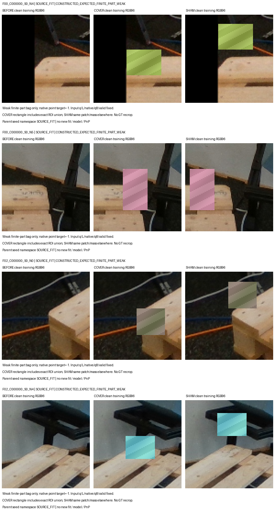

## NOMINAL19 F02_C000000_S0_N5,F02_C000001_S0_N5,F03_C000000_S0_N0,F03_C000000_S0_N3

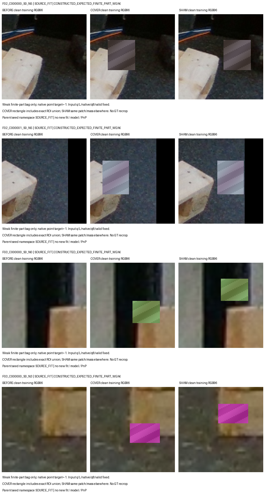

## NOMINAL19 F04_C000000_S0_N0,F04_C000000_S0_N3,F05_C000000_S0_N1,F05_C000000_S0_N4

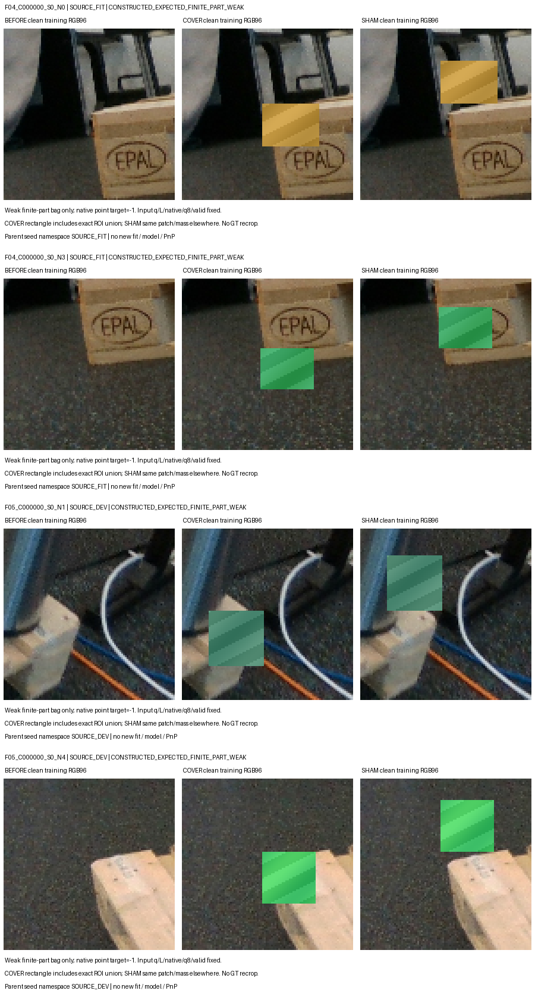

## NOMINAL19 F06_C000003_S0_N0,F06_C000003_S0_N1,F07_C000003_S0_N0,F07_C000003_S0_N1

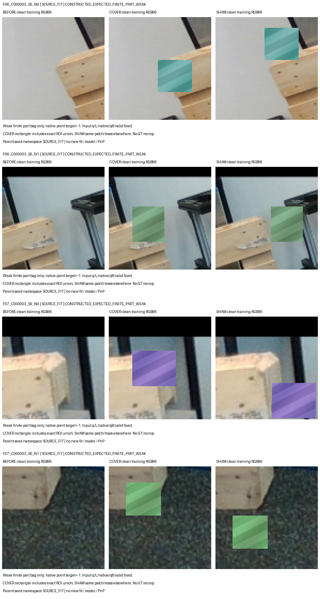

## NOMINAL19 F07_C000003_S0_N4,F08_C000003_S0_N1,F08_C000003_S0_N4

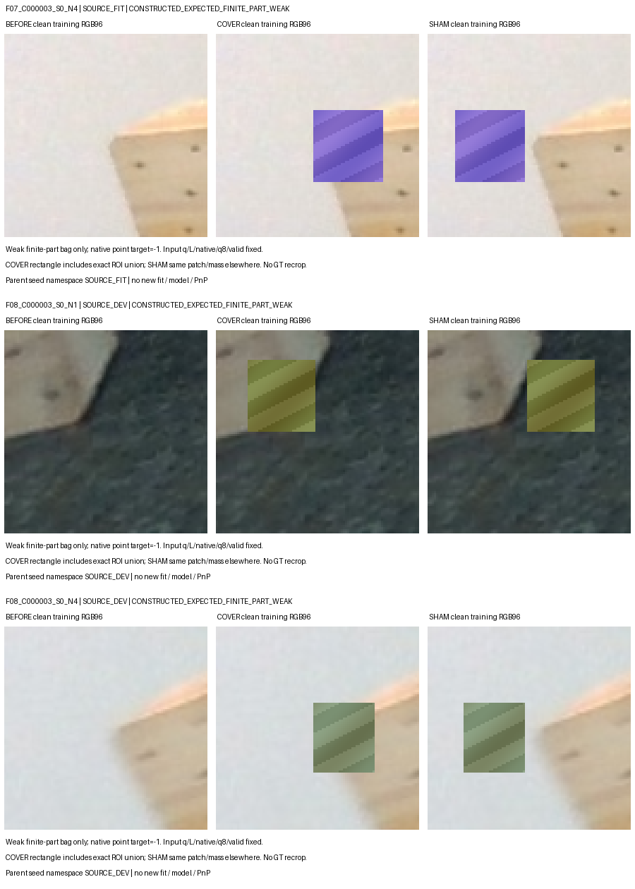

## JITTER29 F00_C000000_S1_N4,F00_C000000_S1_N5,F00_C000000_S2_N4,F00_C000000_S2_N5

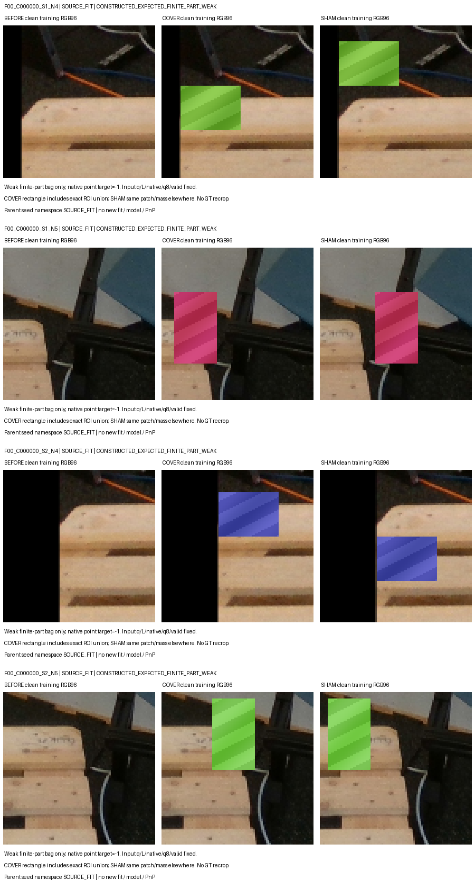

## JITTER29 F02_C000000_S1_N0,F02_C000000_S1_N4,F02_C000000_S2_N0,F02_C000000_S2_N4

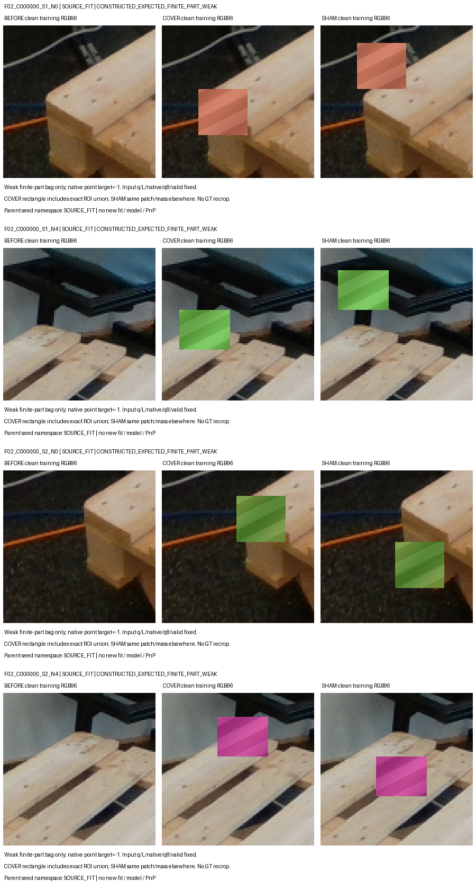

## JITTER29 F02_C000000_S2_N5,F02_C000001_S2_N5,F03_C000000_S1_N0,F03_C000000_S1_N3

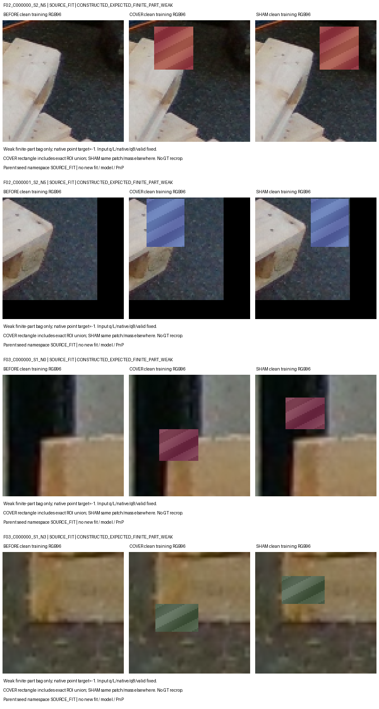

## JITTER29 F03_C000000_S2_N0,F03_C000000_S2_N3,F04_C000000_S1_N0,F04_C000000_S1_N3

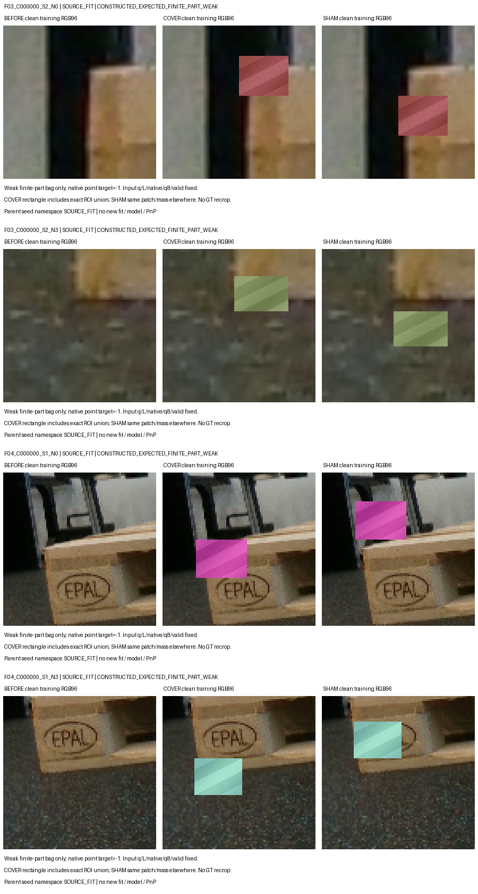

## JITTER29 F04_C000000_S2_N0,F04_C000000_S2_N3,F05_C000000_S1_N4,F05_C000000_S2_N1

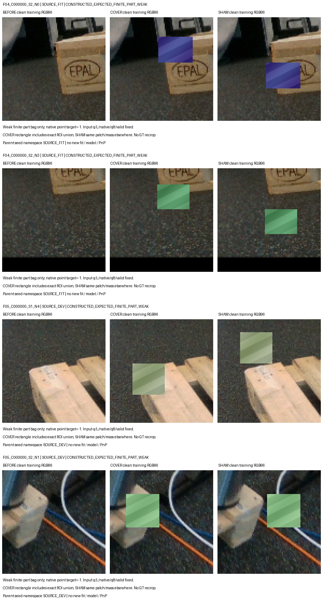

## JITTER29 F05_C000000_S2_N4,F06_C000003_S1_N0,F06_C000003_S2_N0,F06_C000003_S2_N1

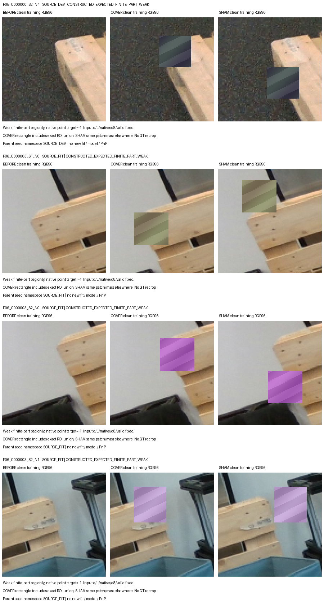

## JITTER29 F07_C000003_S1_N4,F07_C000003_S2_N0,F07_C000003_S2_N4,F08_C000003_S1_N4

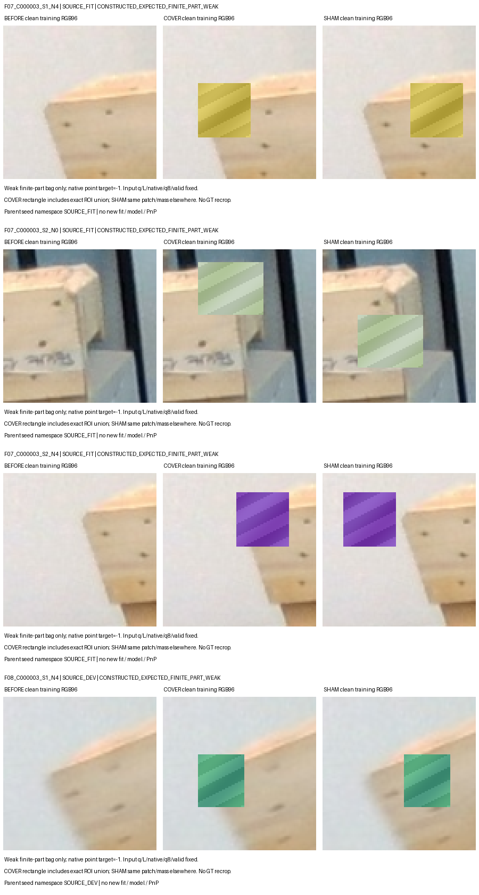

## JITTER29 F08_C000003_S2_N4

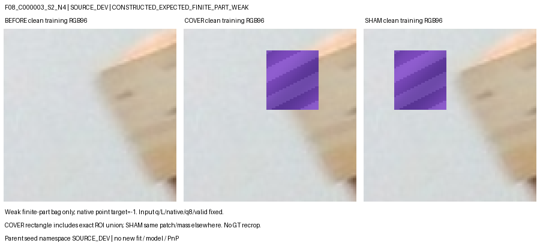
