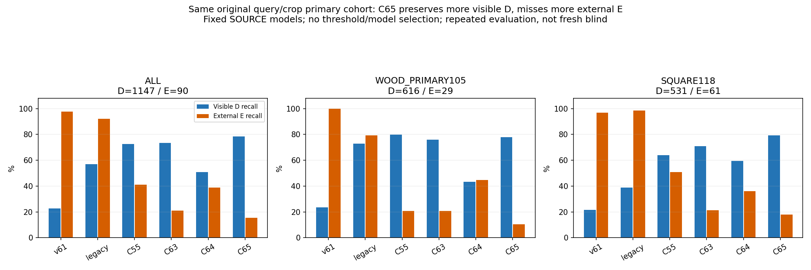
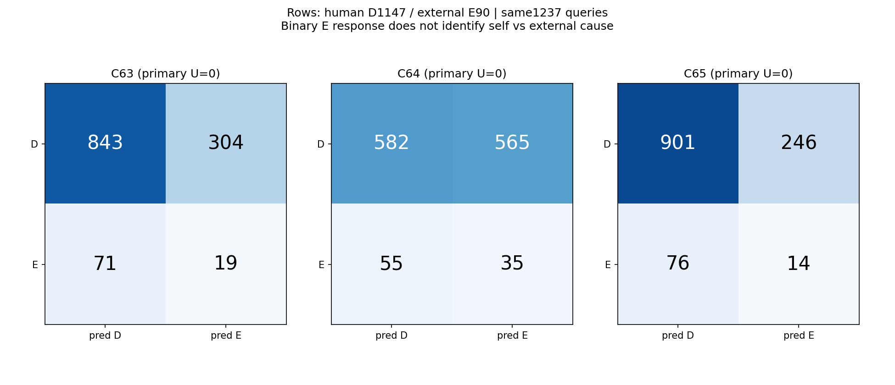
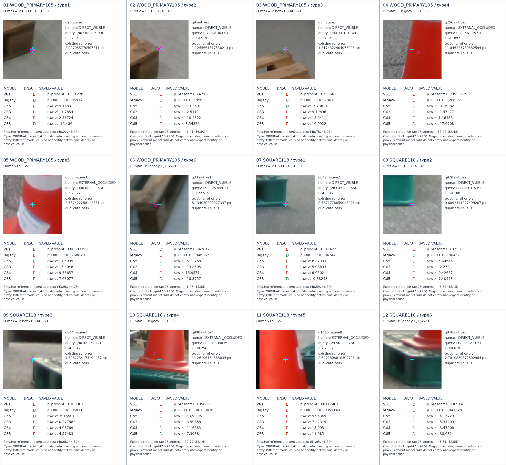

# V220: 원래 초기 추론 crop에서 두 고정 모델을 비교한 결과

**보이는 점 보존은 좋아졌고, 외부 가림 검출은 나빠졌습니다. 문제는 아직 해결되지 않았습니다.** 최근 C63 대비 C65는 D recall 73.50%→78.55%(+5.06%p), E recall 21.11%→15.56%(−5.56%p)입니다. 기존 우리 데이터 학습 모델(legacy)의 E recall 92.22%와 비교해 외부 가림을 잘 잡는 모델을 얻었다고 할 수 없습니다.

## 무엇을 비교했나

V219에서 공개 SOURCE와 합성으로 학습한 C64/C65를 그대로 고정했습니다. 두 모델은 같은 초기 가중치·공통 기존/합성 표본 추출·전체 118,359개 파라미터·각 4,000회로 학습했고, C65에 공개 실사의 기대 부재 약한 손실만 0.25배 추가했습니다. 약한 학습 45행(D39/E6)은 서로 상관된 변형을 포함하며, 원형 E는 5개뿐입니다. 이 SOURCE 내부 검증 12행에서는 D recall 5/9→8/9, E recall 2/3으로 같았습니다.

이번에는 현재 직접 촬영 223장(목재105·정사각형118)의 원래 초기 추론 q/L·native0…7·RAW96·입력 U를 사용했습니다. GT로 crop을 다시 맞추지 않았습니다. 전체 1,784 slot에서 원래 입력 누락 45개는 그대로 두고, 별도 공개 held45의 360 slot/입력 U108도 유지했습니다. 두 새 모델의 모든 예측을 저장한 뒤에 기존 정답·기존 모델 저장 출력과 대조했습니다. 새 학습·SAM/초기 추론 재실행·PnP·문턱 탐색·모델 선택은 없습니다.

기존 14개 모델 저장 결과에 새 두 모델을 추가해 current16/public15개 모델 경로를 보존했습니다. 기존 14개 주 평가 결과가 V213과 정확히 같은지 확인했습니다. 아래는 주요 6개입니다. v61은 원래 presence 응답을 옮긴 비교이고, legacy는 원래 저장 분류/보류를 유지했습니다. C55는 이전 SAM 포함 모델, C63은 직전 SOURCE 모델입니다. C63과 C65는 같은 한 요소만 바꾼 ablation이 아니며, **이번 약한 손실 추가의 직접 비교는 C64↔C65**입니다.

## 같은 평가 대상의 혼동행렬·precision/recall·보류율

기존 `paired_same_query_RGB` human D/E 1,237행(D1,147/E90)을 그대로 씁니다. D는 직접 보임, E는 외부 가림, U는 미결정입니다. 행렬의 행은 human D/E, 열은 예측 D/E/U입니다. recall은 보류까지 포함한 모든 해당 정답을 분모로 삼습니다.

| 모델 | 혼동행렬 D/E → D/E/U | D precision / recall | E precision / recall | 보류율 |
|---|---|---|---|---|
| v61 | [[260, 887, 0], [2, 88, 0]] | 99.24% / 22.67% | 9.03% / 97.78% | 0.00% |
| legacy | [[655, 319, 173], [3, 83, 4]] | 99.54% / 57.11% | 20.65% / 92.22% | 14.31% |
| C55 | [[831, 316, 0], [53, 37, 0]] | 94.00% / 72.45% | 10.48% / 41.11% | 0.00% |
| C63 | [[843, 304, 0], [71, 19, 0]] | 92.23% / 73.50% | 5.88% / 21.11% | 0.00% |
| C64 | [[582, 565, 0], [55, 35, 0]] | 91.37% / 50.74% | 5.83% / 38.89% | 0.00% |
| C65 | [[901, 246, 0], [76, 14, 0]] | 92.22% / 78.55% | 5.38% / 15.56% | 0.00% |

C65의 D 정답은 C63보다 58개 늘고 E 정답은 5개 줄었습니다. 전체 정답은 862→915개지만 D가 훨씬 많기 때문에 전체 정답 증가를 가림 해결로 해석할 수 없습니다. C65는 외부 가림 90개 중 76개를 보임으로 놓칩니다. 가림이라고 출력한 260개 중 실제 E는 14개여서 E precision도 5.38%입니다.

같은 초기 상태의 C64→C65 비교에서는 D 377개를 회복하고 58개를 새로 틀렸습니다(순증319). E는 2개를 회복하고 23개를 새로 틀렸습니다(순감21). 이 학습 쌍에서 약한 부재 감독을 추가하자 현재 평가의 판단이 보임 쪽으로 크게 이동했습니다. 그것이 모든 데이터/모델에서 나타나는 보편 원인이라는 뜻은 아닙니다.

주 평가에서 새 모델 U=0은 유한한 출력을 이진으로 강제한 결과입니다. 전체1,784의 원래 입력 U45는 그대로입니다. 불확실성 보류 모델을 새로 얻은 것은 아닙니다. legacy의 주 평가 보류는177/1,237(14.31%)입니다.

## 목재 / 정사각형

목재는 D616/E29, 정사각형은 D531/E61입니다. 223장 모두 등록돼 있고 주 평가 D/E가 남는 frame은 목재105/정사각형117장입니다. 다른 slot·SELF·매핑 미해결을 임의 E로 넣지 않았습니다.

| 구분 | 모델 | 혼동행렬 D/E → D/E/U | D precision / recall | E precision / recall | 보류율 |
|---|---|---|---|---|---|
| WOOD_PRIMARY105 | v61 | [[145, 471, 0], [0, 29, 0]] | 100.00% / 23.54% | 5.80% / 100.00% | 0.00% |
| WOOD_PRIMARY105 | legacy | [[448, 65, 103], [2, 23, 4]] | 99.56% / 72.73% | 26.14% / 79.31% | 16.59% |
| WOOD_PRIMARY105 | C55 | [[492, 124, 0], [23, 6, 0]] | 95.53% / 79.87% | 4.62% / 20.69% | 0.00% |
| WOOD_PRIMARY105 | C63 | [[467, 149, 0], [23, 6, 0]] | 95.31% / 75.81% | 3.87% / 20.69% | 0.00% |
| WOOD_PRIMARY105 | C64 | [[266, 350, 0], [16, 13, 0]] | 94.33% / 43.18% | 3.58% / 44.83% | 0.00% |
| WOOD_PRIMARY105 | C65 | [[480, 136, 0], [26, 3, 0]] | 94.86% / 77.92% | 2.16% / 10.34% | 0.00% |
| SQUARE118 | v61 | [[115, 416, 0], [2, 59, 0]] | 98.29% / 21.66% | 12.42% / 96.72% | 0.00% |
| SQUARE118 | legacy | [[207, 254, 70], [1, 60, 0]] | 99.52% / 38.98% | 19.11% / 98.36% | 11.82% |
| SQUARE118 | C55 | [[339, 192, 0], [30, 31, 0]] | 91.87% / 63.84% | 13.90% / 50.82% | 0.00% |
| SQUARE118 | C63 | [[376, 155, 0], [48, 13, 0]] | 88.68% / 70.81% | 7.74% / 21.31% | 0.00% |
| SQUARE118 | C64 | [[316, 215, 0], [39, 22, 0]] | 89.01% / 59.51% | 9.28% / 36.07% | 0.00% |
| SQUARE118 | C65 | [[421, 110, 0], [50, 11, 0]] | 89.38% / 79.28% | 9.09% / 18.03% | 0.00% |

## 자기 가림과 위치 오차는 어떻게 봤나

자기 가림은 사용자가 정한 상위 기하 필터 범위를 유지합니다. 아래 binary E는 ‘가려짐 쪽 응답’이며 외부/자기 가림 원인을 구분한 SELF 클래스나 SELF 검출 recall이 아닙니다. 전체 human SELF136개는 모두 목재이며, 원래 paired SELF subset은21개입니다. 정사각형 SELF 정답은0개입니다. legacy의 전체 SELF 미해결에는 과제 외 geometry S가 포함됩니다.

| 모델 | 전체 human SELF136: D / binary E / 미해결·과제외S | 기존 paired SELF21: D / binary E / 미해결 |
|---|---|---|
| v61 | 115 / 21 / 0 | 9 / 12 / 0 |
| legacy | 13 / 3 / 120 | 13 / 3 / 5 |
| C55 | 103 / 33 / 0 | 16 / 5 / 0 |
| C63 | 109 / 27 / 0 | 17 / 4 / 0 |
| C64 | 57 / 79 / 0 | 12 / 9 / 0 |
| C65 | 122 / 14 / 0 | 20 / 1 / 0 |

초기 좌표 오류만으로 실패를 설명할 수 있는지도 나눴습니다. 기존 reference와의 오차≤3px인 human D461개 중 C65는93개를 여전히 E로 분류합니다. 목재41/238, 정사각형52/223개입니다. 이 오차는 기존 좌표 대응 proxy이며 새로 물리 코너 gold를 인증한 값은 아닙니다. 주 평가를 이 조건으로 걸러 바꾸지는 않았습니다.

| 모델 | 기존 reference 오차≤3px인 human D461: D / E / U | D recall |
|---|---|---|
| v61 | 95 / 366 / 0 | 20.61% |
| legacy | 270 / 118 / 73 | 58.57% |
| C55 | 330 / 131 / 0 | 71.58% |
| C63 | 344 / 117 / 0 | 74.62% |
| C64 | 241 / 220 / 0 | 52.28% |
| C65 | 368 / 93 / 0 | 79.83% |

그중 수동 click 근접 D376개만 보면 C63의 오삭제90개→C65의69개입니다. 목재18→17개, 정사각형72→52개입니다. 따라서 작은 좌표 오차의 보임을 보존하는 진전은 있지만 정확한 위치 근처에서도 실패는 남습니다. 위치를 새로 찾거나 수정하는 head는 이번에 학습하지 않았습니다.

## 실제 crop으로 확인한 성공과 실패

각 그룹에서 여섯 조건을 미리 고정하고, 조건에 맞는 가장 작은 global index를 고른 뒤 저장 crop을 열었습니다. 회복/새 악화/지속 실패/외부 가림 누락/외부 가림 정답/legacy 오판 회복을 모두 포함한12개 고유 예시입니다. 사례 빈도나 대표성을 추정하는 표본은 아닙니다. 청록은 원 query, 자홍은 기존 reference이고, 어느 쪽으로도 crop을 옮기지 않았습니다. 전체 패널과 개별 원본96 crop을 아래 갤러리에서 확인할 수 있습니다.

- 목재 g2와 정사각형 g842는 보이는 모서리를 C63이 E로 분류했지만 C65가 D로 회복했습니다.
- 목재 g9는 오차1.13px인 보이는 모서리인데 C63 D→C65 E로 새로 틀렸습니다. 정사각형 g970도 오차0.61px인 보이는 하단 모서리에서 같은 악화가 있습니다. C65 raw logit은 각각+3.54/+7.40으로, 단순한 0 근처 반올림 오류가 아닙니다.
- 목재 g5는 오차1.82px인데 얇은 목재 경계와 회색 바닥에서 C63/C65 모두 E입니다. 정사각형 g844의 얇은 상단 경계도 같은 지속 실패입니다. 흐림·얇은 지지 영역·부위 외관에 따른 전이 실패가 가능한 설명입니다.
- 목재 g256 및 정사각형 g908은 붉은 cone이 query/reference 부근을 가린 human E인데 C65는 D입니다. 반면 g355/g1416의 cone 가림은 E로 맞힙니다. 눈에 띄는 외부 물체도 항상 잡지 못하므로 모든 실패를 좌표 오차나 다른 목재의 모호함으로 돌릴 수 없습니다. 물체 색 하나만으로 결과 차이를 설명할 근거도 없습니다.

이 관찰은 기존 human 가시성 정답에 대한 예측 실패를 확인합니다. 부위 정체성·국소 문맥·흐림의 정확한 인과 기전은 추가 대비 실험 없이 확정하지 않습니다.

## 무엇이 남았나

공개 실사의 약한 부재 감독으로 보임 보존이 실제 초기 추론 crop에도 일부 전이됐습니다. 그러나 외부 가림 분리는 전이되지 않았고 오히려 누락이 늘었습니다. 목표 차이와 실제 외관 전이 실패가 함께 남아 있습니다.

SOURCE의 약한 라벨은 기대하는 유한 부재의 보임/가림이며 정확한 물리 키포인트 한 점 gold와 다릅니다. 학습 q8 자체도 GT 유래이고, 현재 평가는 원래 초기 추론 q8입니다. 추가 GT pose/ref/ROI/mask 입력을 쓴 것은 아니지만 두 query 분포는 다릅니다. 약한 E는 FIT6행에 불과하고 native4/5·deck에 몰렸으며, native2/6/7 및 bottom-runner 외부 가림 지원은 없습니다. 이 제약은 SOURCE 단계에서 이미 확인됐고 이번 실사 점수로 새 학습 데이터를 선별한 것이 아닙니다.

다음 연구 대상은 공개 SOURCE에서 같은 query의 보임↔외부 물체 가림 대비와 부위/재질/시점 범위를 늘리고, 원래 초기 추론 q 조건에서 검증하는 것입니다. 기존 COVER/SHAM 자료도 부위 대응 문제가 있는 행을 구분한 제한적 약한 감독으로 다룰 수 있습니다. 완벽한 모든 물리 코너 라벨을 학습 시작의 일괄 조건으로 삼을 필요는 없습니다. 현재 평가223장은 평가 용도로 유지합니다.

## 재현·검증과 공개 held 결과

두 새 모델 모두 실제 SOURCE 최종 state와 동일하고 eval 모드·고정 FP32·같은192 batch의 반복2 출력이 일치했습니다. current1784/public360에서 원 q/L/native/U와 입력 fingerprint를 검증했습니다. 평가는 저장 출력만 읽었습니다. 새 모델/문턱/체크포인트 채택은 없습니다.

공개 held45/360은 known center-owner204/UNKNOWN156, 입력 U108입니다. 이전에 관찰한 단일 sequence의 AI 약한 center-owner/crop-presence 정답이며 native 외부/자기 가림 gold가 아닙니다. 결과는 별도 JSON에 보존했습니다. current와 public 모두 이전 개발에서 반복 노출된 평가이고 새 blind 검증이 아닙니다. legacy에는 과거 CAL 중복 이력도 있어, 그 수치를 누수 없는 새 일반화 성능으로 주장하지 않습니다.

- [주요6개 전체 표](PRIMARY6_SUMMARY.csv) · [목재/정사각형 표](GROUP_PRIMARY6_SUMMARY.csv)
- [기존16개 전체 평가 표](saved_real_head_evaluation_v1/current1784/METRICS.csv)
- [3px 이하 보임 표](LE3_VISIBLE6_SUMMARY.csv) · [자기 가림 응답](SELF_RESPONSE6_SUMMARY.csv) · [회복/손실](PRIMARY6_PAIRED_CHANGES.csv)
- [실제 crop 갤러리](actual_saved_crop_gallery_a/index.html) · [12개 선택행/저장 점수](actual_saved_crop_gallery_a/ALL12_SELECTED_STRATA.csv)
- [전체1784 native ledger](saved_real_head_evaluation_v1/current1784/ALL1784_CURRENT_NATIVE_LEDGER.jsonl)
- [공개 held의 약한 정답 결과](saved_real_head_evaluation_v1/publicheld360/PUBLIC_WEAK_OWNER_AND_SEPARATE_SUPPORT_ASSOCIATIONS.json)
- [예측 동결 기록](frozen_C64_C65_real_predictions_v1/PREDICTION_SEAL.json) · [저장 평가 완료](saved_real_head_evaluation_v1/COMPLETE.json)
- [SOURCE 학습·두 모델·라벨 정의](../query_visibility_expected_part_weak_paired_source_training_20261025_v219/PORTABLE_REPORT_KO.md)
