# 저장 crop 조건별 진단

기존 paired D/E 1237 중 사전 규칙 12칸 · 고유 예시 12개 · 빈 조건 0칸. 중복은 유지했다. Cyan은 원 q, magenta는 기존 reference proxy이며 GT/보정점이 아니다. 실제 native 부위·물리적 가림 원인을 이 crop만으로 재인증하지 않는다. v61/legacy는 저장 확률, C55/C63/C64/C65는 저장 raw logit으로 값의 의미가 다르다.

[12패널 PNG](PANELS_12.png) · [행 CSV](ALL12_SELECTED_STRATA.csv) · [사전 선택](SELECTED12_STRATA_BEFORE_RAW_INPUT_PIXELS.json) · [manifest](IMAGE_MANIFEST.json) · [완료](COMPLETE.json)

## WOOD_PRIMARY105 조건1: D ref<=3: C63 E -> C65 D / g2 (해당조건 15개, 중복 1칸)

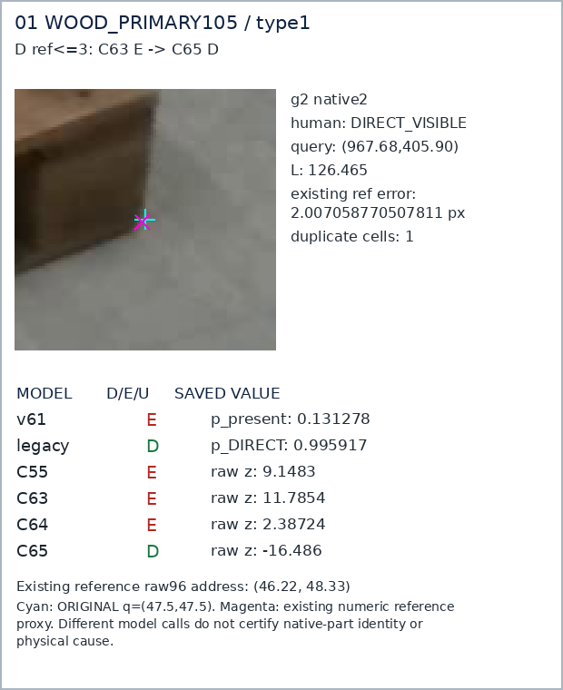

## WOOD_PRIMARY105 조건2: D ref<=3: C63 D -> C65 E / g9 (해당조건 11개, 중복 1칸)

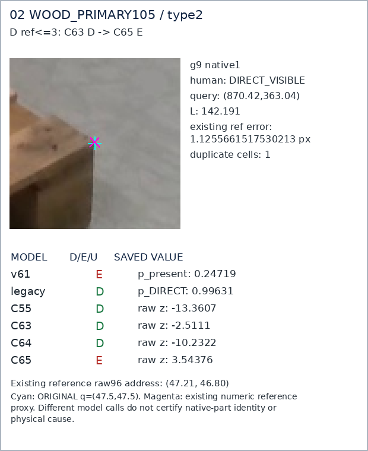

## WOOD_PRIMARY105 조건3: D ref<=3: both C63/C65 E / g5 (해당조건 30개, 중복 1칸)

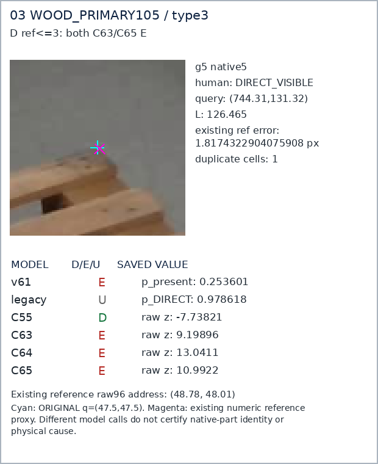

## WOOD_PRIMARY105 조건4: Human E: legacy E, C65 D / g256 (해당조건 20개, 중복 1칸)

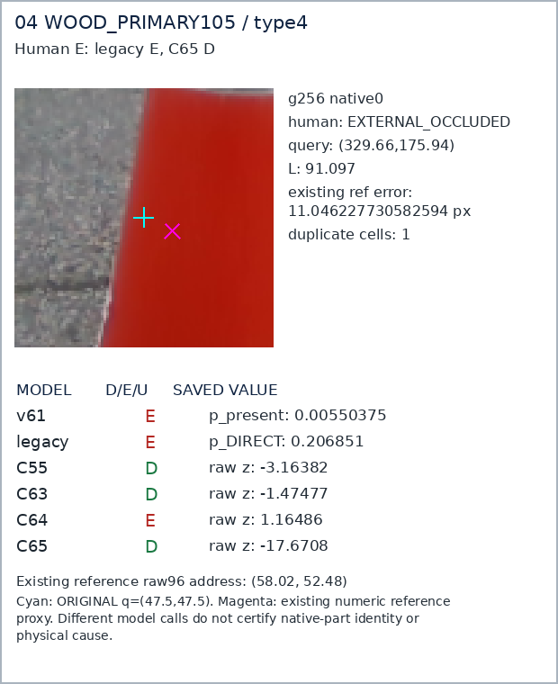

## WOOD_PRIMARY105 조건5: Human E: C65 E / g355 (해당조건 3개, 중복 1칸)

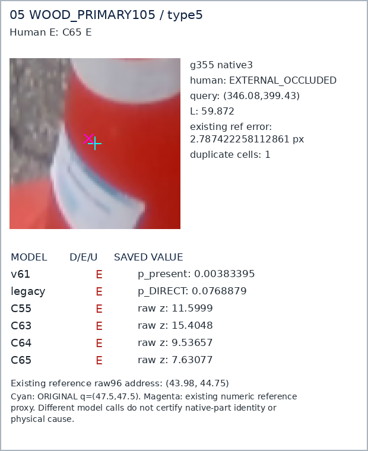

## WOOD_PRIMARY105 조건6: Human D: legacy E, C65 D / g33 (해당조건 53개, 중복 1칸)

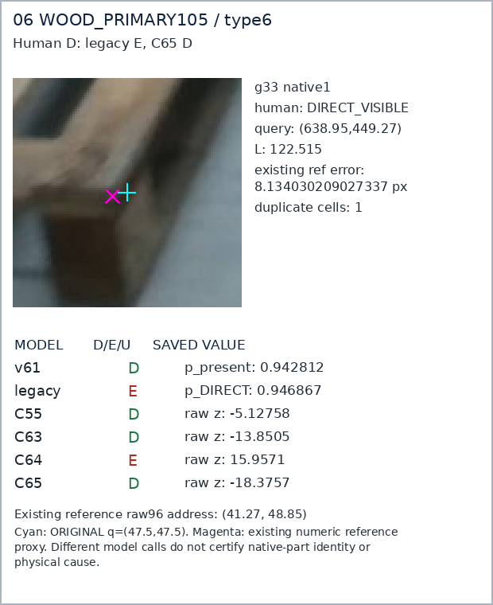

## SQUARE118 조건1: D ref<=3: C63 E -> C65 D / g842 (해당조건 33개, 중복 1칸)

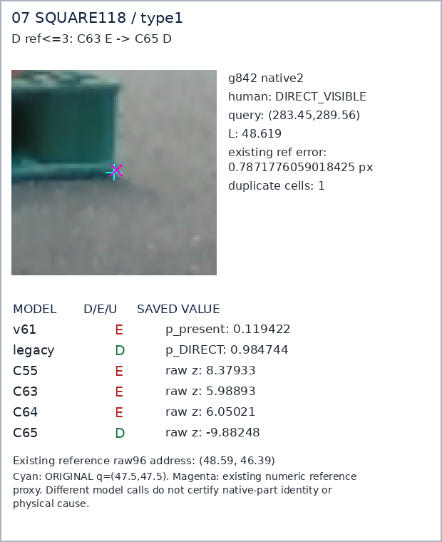

## SQUARE118 조건2: D ref<=3: C63 D -> C65 E / g970 (해당조건 13개, 중복 1칸)

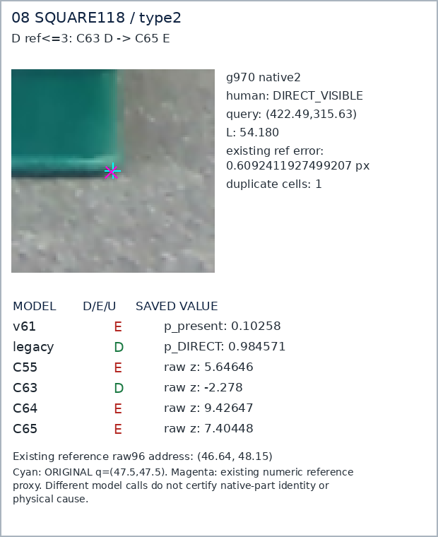

## SQUARE118 조건3: D ref<=3: both C63/C65 E / g844 (해당조건 39개, 중복 1칸)

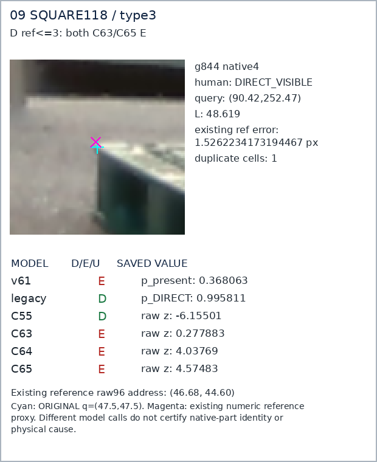

## SQUARE118 조건4: Human E: legacy E, C65 D / g908 (해당조건 49개, 중복 1칸)

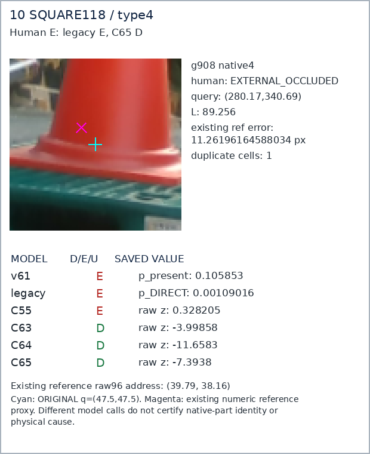

## SQUARE118 조건5: Human E: C65 E / g1416 (해당조건 11개, 중복 1칸)

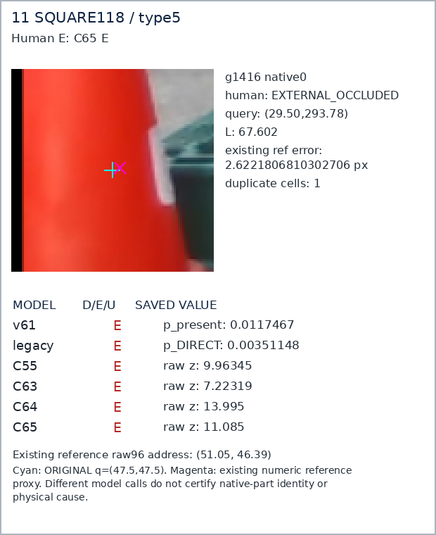

## SQUARE118 조건6: Human D: legacy E, C65 D / g840 (해당조건 221개, 중복 1칸)

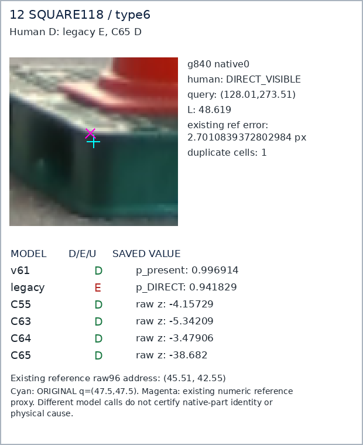
