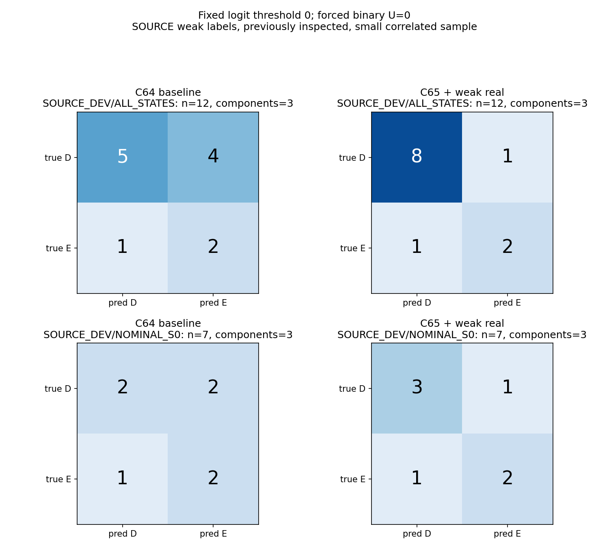
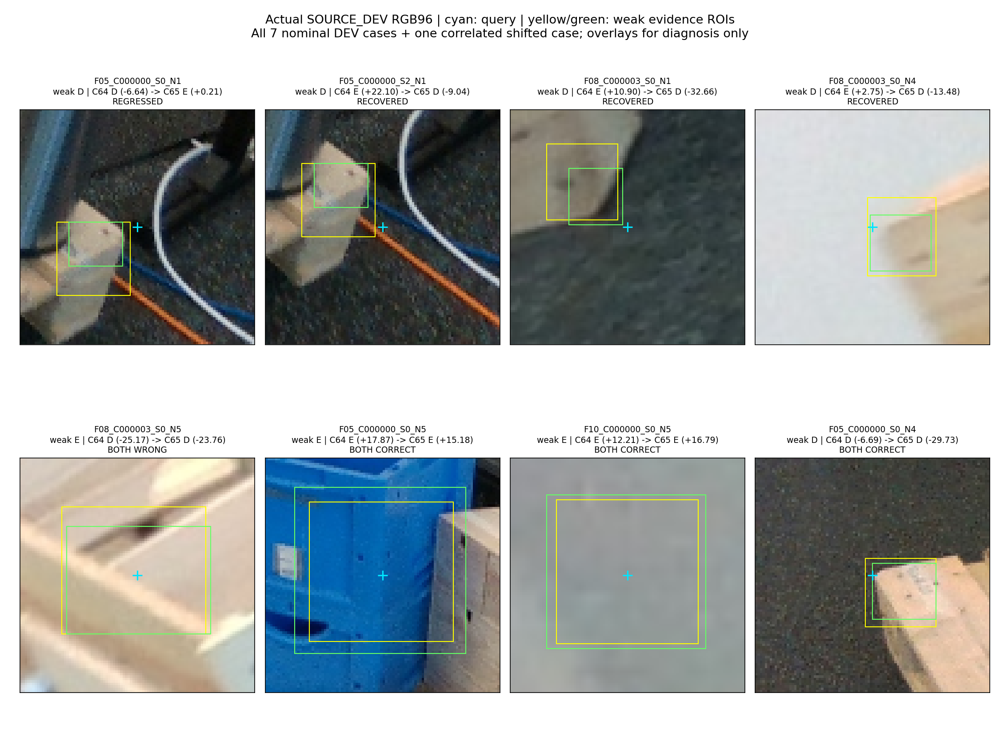

# V219: 공개 실사 약한 부재 감독을 추가한 실제 학습 결과

공개 실사의 작은 내부 검증에서 보이는 부재를 잘못 가림으로 분류하는 오류가 줄었습니다. 외부 가림을 놓치는 오류는 그대로입니다. 현재 평가 223장이나 v61·기존 모델 대비 개선은 이번 단계에서 측정하지 않았습니다. 모델 채택과 문제 해결을 선언하지 않습니다.

## 실제로 바꾼 것

C64는 기존 SOURCE 보조 손실과 합성의 지점 D/E 손실로 학습했습니다. C65에는 공개 실사에서 두 관찰자가 동의한 ‘기대하는 유한한 부재가 보이는가/다른 물체에 가려지는가’ 약한 손실을 0.25배 추가했습니다. 둘 다 새 초기화, 같은 118,359개 전체 파라미터, 같은 초기 가중치와 기존·합성 지점 추출 순서, 고정 4,000회 학습입니다. 32회씩의 실행 시간 시험은 폐기했고 본 학습을 초기 상태에서 시작했습니다. 학습 횟수는 실행 시간으로만 결정했고 출력이나 검증 성능으로 조정하지 않았습니다. 학습 완료까지 약 328초였습니다.

입력은 RGB96·유효 마스크·로컬 좌표와 native 순서 및 나머지 query의 상대 위치 32값입니다. SAM은 사용하지 않았습니다. 합성 및 원래 보조 데이터의 q/L은 저장된 초기 추론값을 유지했습니다. 추가된 공개 실사 약한 표본은 GT에서 만든 별도 학습용 q8과 고정 이동을 사용합니다. 이 GT 유래 학습용 query와 실제 초기 추론 query 사이의 전이 문제는 남아 있습니다. 추가 GT pose/reference/ROI/mask를 모델 입력 채널로 넣지는 않았습니다.

## 데이터와 라벨

- SOURCE 학습용 캐시: 합성 7,040행, 기존 공개 실사 보조 1,208행, 공개 변형 보조 3,816행. 서로 다른 보조 과제의 행이므로 합계가 독립된 D/E 라벨 수는 아닙니다.
- 합성 7,040행 중 지점 손실에 들어간 것은 6,096행(D 5,853/E 243)입니다. 나머지 944행은 해당 지점 손실에서 제외했고 E로 바꾸지 않았습니다.
- 공개 실사 추가 후보 360행 중 부재 약한 D/E가 확정된 57행만 사용 가능했습니다. FIT 45행(D 39/E 6), DEV 12행(D 9/E 3)입니다. 57행은 이동 변형이 상관된 27개 명목 지점, 11개 frame/component에서 나왔습니다.
- DEV 12행은 3개 component입니다. 이동을 제외한 DEV 원형은 7행(D 4/E 3)뿐입니다. 원래 DEV는 4개 component/32개 native slot이며, 그중 3개 component에서만 약한 D/E 지원 표본이 남았습니다.
- 새 DEV component에서 나온 기존 공개 보조 32행은 모든 학습·정규화 풀에서 제외했습니다. 이전 HOLD 합성 9,216행·공개 240행과 새 DEV의 수치는 추출하거나 모델에 입력하지 않았습니다. 혼합 압축 파일의 전체 해시·헤더 검사·제외 구간의 바이트 통과는 있었으므로 ‘제외 파일의 바이트도 전혀 읽지 않았다’고 표현하지 않습니다.
- 나머지 303행은 화면 밖 150, 다른 부재/기하 대응 미해결 72, UNKNOWN 81입니다. 이들은 정답이 미해결된 행이며 모델 보류(U)와 다릅니다.

D는 기대 부재가 보임, E는 그 부재가 외부 물체에 가려짐을 뜻하는 약한 라벨입니다. 두 AI 관찰자의 합의이며 사람이 확정한 정확한 물리 키포인트 gold가 아닙니다. 부재가 crop 안에 보인다는 것과 투영된 키포인트 한 점이 직접 보인다는 것은 다를 수 있습니다. 임의의 목재가 있다고 D로 인정하지 않았지만 정확한 native anatomy/instance 대응이 모두 해결된 것은 아닙니다. 자기 가림은 상위 기하 필터가 담당한다는 원래 범위를 유지했습니다. 이전 9개 COVER/SHAM 부재 변형은 이번 학습에 넣지 않았습니다.

## 고정 문턱에서의 저장 출력

문턱은 학습 전 고정한 raw logit 0입니다. 혼동행렬은 행이 실제 D/E, 열이 예측 D/E/U입니다. 모든 출력은 유한한 이진 예측이므로 U=0입니다. 이는 불확실성이나 입력 U 문제가 해결됐다는 뜻이 아닙니다.

| 표본 | 모델 | 혼동행렬 D/E → D/E/U | D precision / recall | E precision / recall | 보류율 |
|---|---|---|---|---|---|
| SOURCE_FIT/ALL_STATES (45) | C64 | [[24, 15, 0], [3, 3, 0]] | 88.89% / 61.54% | 16.67% / 50.00% | 0% |
| SOURCE_FIT/ALL_STATES (45) | C65 | [[39, 0, 0], [0, 6, 0]] | 100.00% / 100.00% | 100.00% / 100.00% | 0% |
| SOURCE_DEV/ALL_STATES (12) | C64 | [[5, 4, 0], [1, 2, 0]] | 83.33% / 55.56% | 33.33% / 66.67% | 0% |
| SOURCE_DEV/ALL_STATES (12) | C65 | [[8, 1, 0], [1, 2, 0]] | 88.89% / 88.89% | 66.67% / 66.67% | 0% |
| SOURCE_DEV/NOMINAL_S0 (7) | C64 | [[2, 2, 0], [1, 2, 0]] | 66.67% / 50.00% | 50.00% / 66.67% | 0% |
| SOURCE_DEV/NOMINAL_S0 (7) | C65 | [[3, 1, 0], [1, 2, 0]] | 75.00% / 75.00% | 66.67% / 66.67% | 0% |

DEV에서 D recall은 5/9(55.56%) → 8/9(88.89%)로, E precision은 2/6(33.33%) → 2/3(66.67%)로 좋아졌습니다. E recall은 2/3(66.67%)로 그대로입니다. 같은 12행에서 4행을 회복하고 1행을 새로 틀려 순증 3행입니다. 이동을 뺀 원형 7행에서는 2행 회복·1행 악화로 순증 1행입니다. 상관된 이동 변형을 독립 성공으로 세어 일반화하지 않습니다.

FIT 45행에서 C65는 전부 맞혔지만 이는 학습 자료 적합도입니다. 합성 학습 지점 6,096행도 두 모델 모두 전부 맞혔고, 독립 검증 성능이 아닙니다. DEV는 이전에 관찰한 SOURCE이며 새 blind 평가가 아닙니다. 이 작은 표본만으로 실제 운용 성능이나 우월성을 확정할 수 없습니다.

## 실제 crop에서 남은 문제

아래 그림은 DEV 원형 7개를 모두 포함하고, 새로 틀린 동일 부재의 이동 변형 1개를 추가했습니다. 청록 십자는 query, 노랑/초록 상자는 기존 두 관찰자의 부재 근거 영역입니다. 이 표시는 확인용으로만 그렸고 학습 RGB에는 없습니다.

- F08 N1/N4: 어두운 바닥 또는 밝은 배경 앞에 드러난 목재 경계를 C64는 가림으로 분류했고 C65는 보임으로 회복했습니다.
- F08 N5: 다른 목재가 앞을 가로질러도 두 모델 모두 보임으로 분류했습니다. ‘목재가 보임’과 ‘기대한 대상 부재가 보임’을 구별하지 못하는 후보 사례입니다. crop만으로 대상 부재의 정확한 물리 대응을 증명할 수는 없습니다.
- F05 N1: 기대 부재 근거가 query 왼쪽 아래에 있고 중앙에는 다른 구조가 있습니다. C65는 원형을 새로 가림으로 오판했고(logit +0.212), 같은 부재의 수직 이동 표본은 회복했습니다. crop 위치와 문맥에 따른 불안정성이 남았습니다. 이 두 행은 독립된 사건이 아닙니다.
- F05 N5의 파란 전경 물체는 두 모델 모두 가림으로 분류했습니다. F10의 흐린 회색 crop도 둘 다 E이지만, 이 crop 단독으로 대상 정체를 확인하기는 어렵습니다.

위 관찰은 외관·부재 식별 혼동이라는 가설을 지지하는 예시이지 원인을 확정한 ablation은 아닙니다. 물리 키포인트 한 점의 D/E와 유한 부재 약한 목표의 차이, GT 유래 학습 q와 초기 추론 q의 차이, 적은 외부 가림 표본 및 native 4/5에 몰린 E 지원은 여전히 제약입니다. native 2/6/7에 약한 D/E 지원은 없고 BOTTOM_RUNNER 표본은 소수 D뿐입니다.

## 검증과 다음 판단

독립 검사는 두 모델 8,000행 로그의 공통 추출·해시·마스크와 point/weak 난수 추출, 118,359개 파라미터·AdamW 4,000 step을 확인했습니다. 저장된 weak57 출력을 CPU batch32로 재생했고 최대 logit 차이는 C64 3.624e-5/C65 3.052e-5, 모든 D/E 부호가 같았습니다. old192의 클래스 조건부 추출 확률 자체는 기존 target NPZ를 다시 열지 않아 독립 재구성하지 않았고, 합성 RGB forward 전체를 재생하지는 않았습니다.

현재 평가 223장·기존 보호 평가·V112에 새로 접근하지 않았고 PnP도 실행하지 않았습니다. 기준 모델과 추가 감독 모델을 둘 다 보존하며 채택 모델은 없습니다. 현재 실사 비교의 최신 완료 기록은 V213으로 유지합니다. 다음에는 고정된 두 모델을 원래 query/동일 평가 코호트에서 v61·기존 가림 모델과 함께 비교해야 실제 전이를 판단할 수 있습니다. 그 결과로 이 단계의 데이터·문턱·체크포인트를 되돌려 고르지 않습니다.

학습 코드, 데이터 lineage, 저장 출력, 로그, 두 SOURCE 모델, 표·이미지 및 검증 기록을 이번 main 게시에 포함합니다. 원본/학습 입력 NPZ는 게시하지 않습니다.

- [57행 전체 실제 crop·예측 표](saved_source_result_readout_v1/PORTABLE_SOURCE_READOUT_KO.html)
- [전체 precision/recall·혼동행렬 CSV](saved_source_result_readout_v1/SOURCE_CONFUSIONS_PRECISION_RECALL.csv)
- [기계 판독 가능한 전체 지표](saved_source_result_readout_v1/SOURCE_METRICS_AND_PAIRED.json)
- [실제 학습 완료 기록](paired_source_fit_v1/COMPLETE.json)
- [독립 체크포인트·출력 재생 QA](independent_actual_pair_QA_a/actual_review_v1/REVIEW.json)
- [이전 공개 SOURCE crop·라벨 정의](../query_visibility_public_train_intended_part_query_targets_20261025_v218/PORTABLE_REPORT_KO.md)
