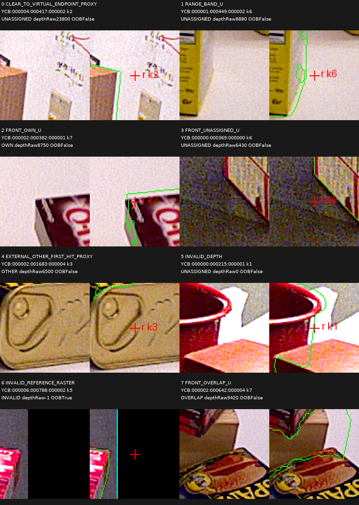

# V88 — query_visibility_external_ray_head_20261023_v88

기존 보고서에서 추출한 게시용 파생 개요입니다. 원본 파일을 수정하거나 실험·평가를 다시 실행하지 않았습니다. 원문 해시와 링크 대응은 publication manifest로 확인합니다.

**상태:** 명시된 완료 receipt 없음 — 완료 단정하지 않음

원본:

- [ROOT_READOUT_KO.html](ROOT_READOUT_KO.html) — SHA256 `5fb5b59eda0013a834ff4b62b4a37534ab5ad25ed52c70f25a09516e5ba54cd5`

## 방법·목표의 원문 필드

자동 추출 가능한 해당 최상위 필드가 없습니다. 원문 보고서와 phase receipt를 확인하십시오.

## 입력·학습·평가 분모의 원문 필드

자동 추출 가능한 해당 최상위 필드가 없습니다. 원문 보고서와 phase receipt를 확인하십시오.

## 결론·실패·한계의 원문 필드

자동 추출 가능한 해당 최상위 필드가 없습니다. 원문 보고서와 phase receipt를 확인하십시오.

## 코드·검증·전체 표·갤러리

아래 목록은 원 보고서가 참조한 파일의 경로를 다시 연결한 것입니다. 이 개요 작성 중 이미지 내용이나 raw 평가 데이터를 새로 검사하지 않았습니다.

- [query_visibility_external_ray_head_20261023_v88/runs/YCB_EXTERNAL_RAY_V1/SOURCE_RESULTS.json](runs/YCB_EXTERNAL_RAY_V1/SOURCE_RESULTS.json)
- [query_visibility_native_cue_evidence_20261023_v86/ROOT_NATIVE24_DEFINITION_DIAGNOSIS_KO.json](../query_visibility_native_cue_evidence_20261023_v86/ROOT_NATIVE24_DEFINITION_DIAGNOSIS_KO.json)
- [query_visibility_public_external_ray_20261023_v87/independent_output_audit/INDEPENDENT_ALL33600_OUTPUT_AUDIT_KO.json](../query_visibility_public_external_ray_20261023_v87/independent_output_audit/INDEPENDENT_ALL33600_OUTPUT_AUDIT_KO.json)
- [query_visibility_source_cue_corpus_20261023_v85/all49_completed_corpus/CORPUS_SUMMARY_KO.json](../query_visibility_source_cue_corpus_20261023_v85/all49_completed_corpus/CORPUS_SUMMARY_KO.json)
- [query_visibility_source_cue_corpus_20261023_v85/cumulative_20pair_review/CUMULATIVE20_RECONCILIATION_AND_COVERAGE_KO.json](../query_visibility_source_cue_corpus_20261023_v85/cumulative_20pair_review/CUMULATIVE20_RECONCILIATION_AND_COVERAGE_KO.json)
- [query_visibility_external_ray_head_20261023_v88/source_failure_visual_audit/SOURCE_FAILURE_ACTUAL_OBSERVATIONS_KO.json](source_failure_visual_audit/SOURCE_FAILURE_ACTUAL_OBSERVATIONS_KO.json)
- [query_visibility_public_cue_grid_20261023_v89/cue_coverage_gt_only/ALL_GRID_CUE_COVERAGE_SUMMARY_KO.json](../query_visibility_public_cue_grid_20261023_v89/cue_coverage_gt_only/ALL_GRID_CUE_COVERAGE_SUMMARY_KO.json)
- [query_visibility_external_ray_head_20261023_v88/NEXT_GRID_FEATURE_REUSE_FEASIBILITY.json](NEXT_GRID_FEATURE_REUSE_FEASIBILITY.json)
- [query_visibility_external_ray_head_20261023_v88/ROOT_PHASE_RESULTS_AND_NEXT_KO.json](ROOT_PHASE_RESULTS_AND_NEXT_KO.json)
- [query_visibility_external_ray_head_20261023_v88/FIT_PROTOCOL_BEFORE_SOURCE_ARRAYS.json](FIT_PROTOCOL_BEFORE_SOURCE_ARRAYS.json)
- [query_visibility_external_ray_head_20261023_v88/independent_postfit_audit/INDEPENDENT_POSTFIT_AUDIT.json](independent_postfit_audit/INDEPENDENT_POSTFIT_AUDIT.json)

## 원 보고서의 그림

원 보고서 참조 순서의 처음 최대4개를 표시합니다. 새 outcome 선택이나 전수 이미지 검증을 뜻하지 않습니다. 전체 갤러리는 위 원문 링크에서 확인합니다.

[query_visibility_native_cue_evidence_20261023_v86/independent_native_audit/G38__G__f16972_ALL8_RAW96_MARKED.png](../query_visibility_native_cue_evidence_20261023_v86/independent_native_audit/G38__G__f16972_ALL8_RAW96_MARKED.png)

[query_visibility_public_external_ray_20261023_v87/visual_audit/04_EXTERNAL_OTHER_FIRST_HIT_PROXY/FULL_RAW_AND_TARGET_OUTLINE.png](../query_visibility_public_external_ray_20261023_v87/visual_audit/04_EXTERNAL_OTHER_FIRST_HIT_PROXY/FULL_RAW_AND_TARGET_OUTLINE.png)

[query_visibility_public_external_ray_20261023_v87/visual_audit/00_CLEAR_TO_VIRTUAL_ENDPOINT_PROXY/FULL_RAW_AND_TARGET_OUTLINE.png](../query_visibility_public_external_ray_20261023_v87/visual_audit/00_CLEAR_TO_VIRTUAL_ENDPOINT_PROXY/FULL_RAW_AND_TARGET_OUTLINE.png)

[query_visibility_public_external_ray_20261023_v87/visual_audit/ALL8_FIXED_REASON_RAW_MARKED_NATIVE96_CONTACT.png](../query_visibility_public_external_ray_20261023_v87/visual_audit/ALL8_FIXED_REASON_RAW_MARKED_NATIVE96_CONTACT.png)

현재 사용자 목표 전체의 해결·새 모델 채택·실사 가림 원인 확정을 이 파생 개요가 추가로 주장하지 않습니다. UNKNOWN/U와 불리한 결과, 실패 실행 및 수정 provenance는 원문대로 보존해야 합니다.
