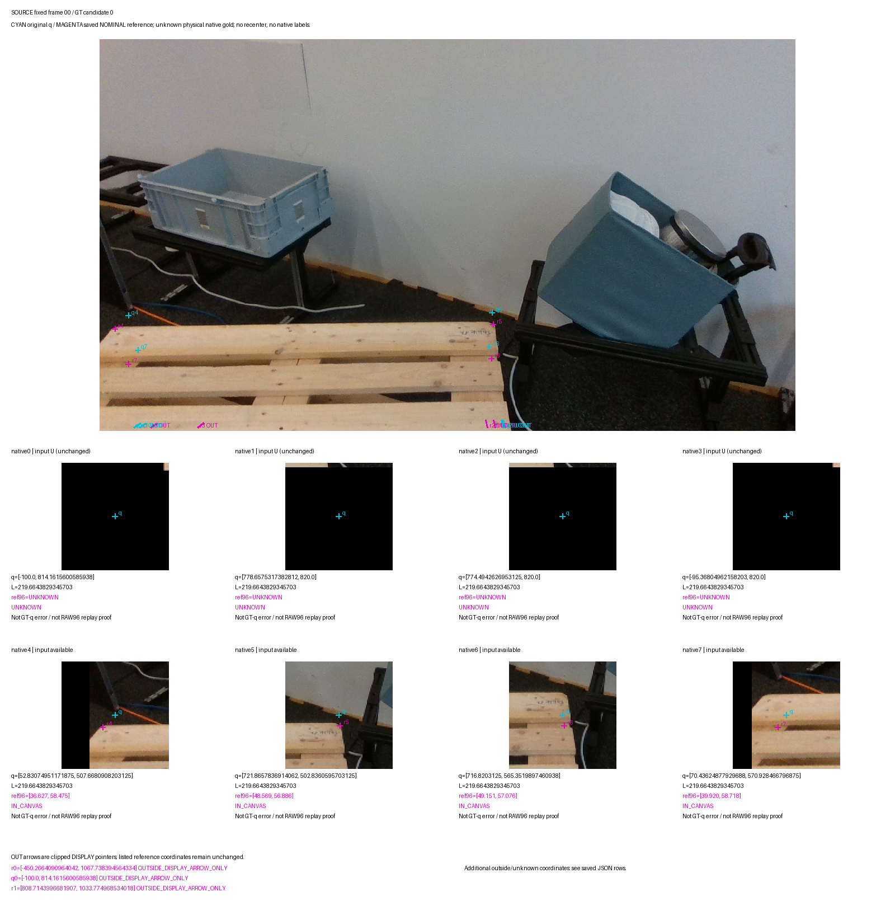
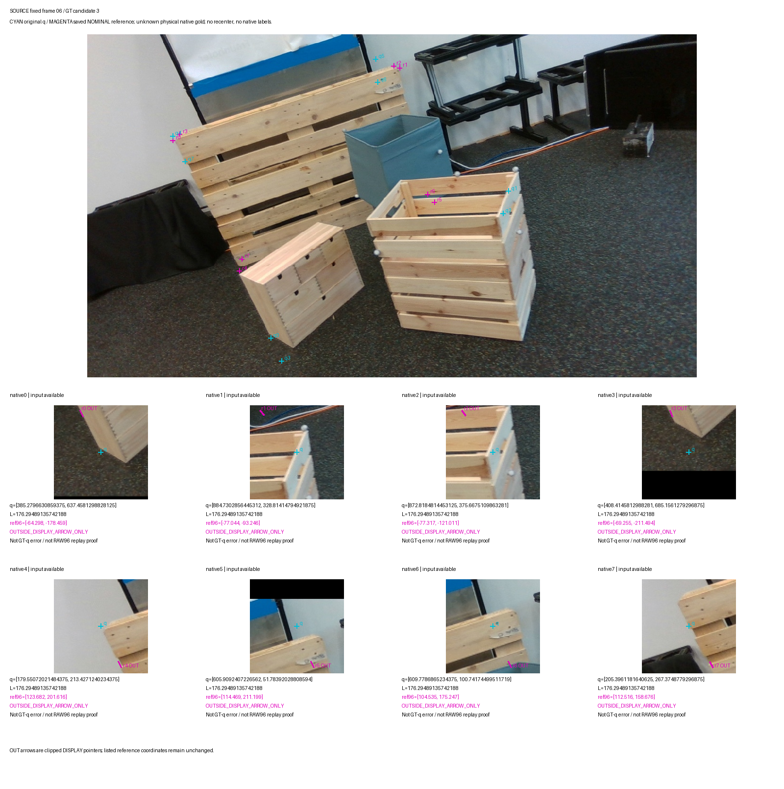
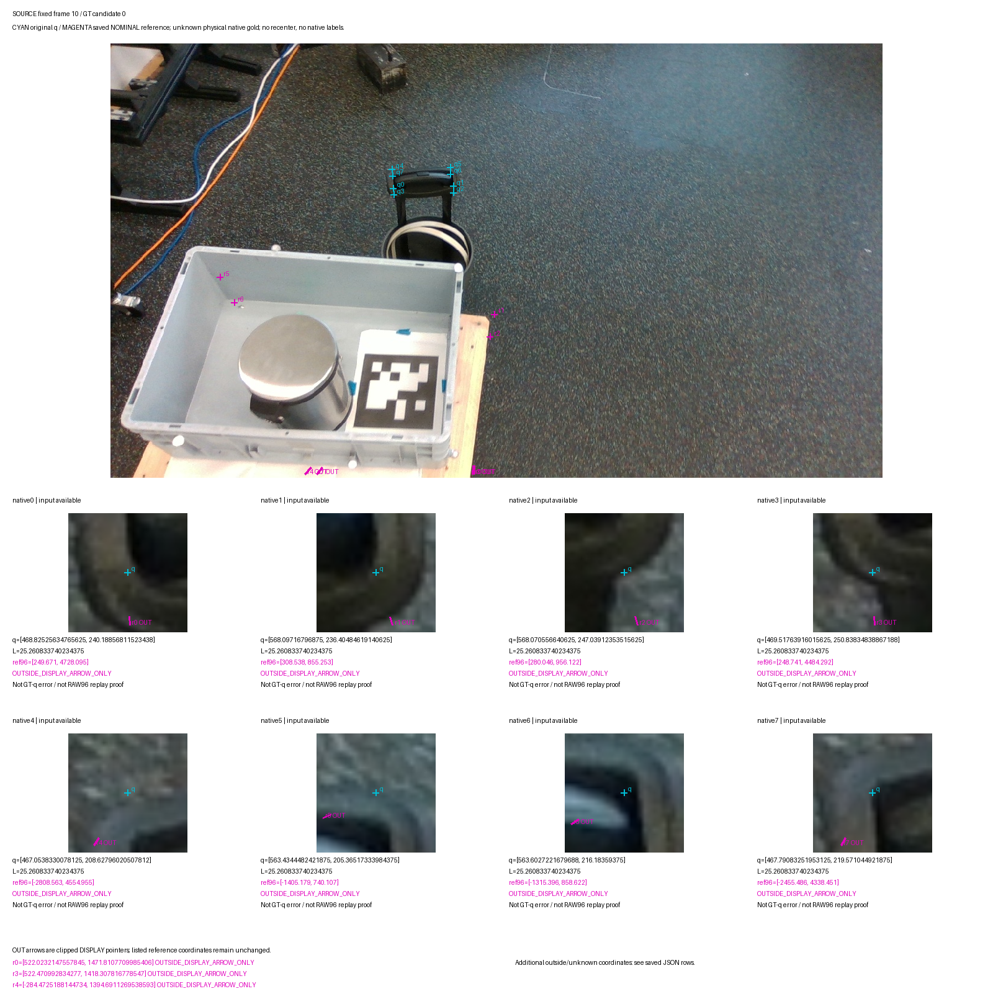

# V217: 공개 실사에서 원 query·대상 팔레트·native 부위·가시 마스크를 실제 대조

공개 SOURCE 12장의 저장 GT pose/info/camera, 전체·가시 마스크와 depth를 실제로 읽고, 15개 GT 후보 모두를 원 query와 대조했다. 새 학습·모델 추론·보호 평가·PnP는 0회다. **모델 성능 개선은 아직 입증되지 않았다. 이번 진전은 잘못된 학습 대상과 가시성 대리 라벨을 구분한 것이다.**

- [원 crop과 nominal 기준점: 고정 4장 갤러리](fixed_query_crop_nominal_reference_visual_v1/PORTABLE_GALLERY_KO.md)
- [전체 15후보 GT mask/depth 갤러리](fixed12_mask_depth_query_diagnostics_v2/PORTABLE_MASK_DEPTH_GALLERY.md)
- [같은 원 query를 유지한 120행 통합 CSV](ROOT_QUERY_INSTANCE_PART_SUPPORT_SYNTHESIS.csv)
- [계산값·출처·한계 JSON](ROOT_QUERY_INSTANCE_PART_SUPPORT_SYNTHESIS.json)
- [이전 V216 부위/query 검토](../query_visibility_public_train_part_query_support_contract_20261025_v216/PORTABLE_REPORT_KO.md)
- [최신 실사 모델 비교 V213](../query_visibility_dense_point_heads_frozen_real_benchmark_20261025_v213/PORTABLE_REPORT_KO.md)

## 이번에 실제로 한 일

| 항목 | 실제 완료 범위 | 해석 한계 |
|---|---:|---|
| 기존 공개 SOURCE frame | 12장 / 원 native query 96개 / 원 input U11 | 소규모 고정 진단 집합; 대표 표본 아님 |
| 기존 prospective 내부 분할 | FIT8장·64점 / DEV4장·32점 | 모두 outer TRAIN; 이미 영상/이전 학습에 노출됨. 새 blind split 아님 |
| scene GT/info/camera | 12개 JSON, 지정 frame 값 36개 파싱 | 다른 frame 값 519개는 불투명하게 건너뜀 |
| GT pallet 후보 | 15개 / 후보별 native 행 120개 | 중복 후보 행을 독립 query로 세지 않음 |
| 후보 확장 input U | 17개 (FIT15 / DEV2) | 고유 원 U11과 다름; 원 q/L/native/U는 유지 |
| 실제 mask/depth PNG | full15 + visible15 + depth12 = 42개 | 12개 기존 derived context도 표시; CAD/원 JPEG/RGB 배열은 읽지 않음 |
| 실제 그림 검토 | root 전체15 overlay; A 전체15 + standalone context7 | 모델 작성·기존 source 노출 관찰자; 독립 사람 gold 아님 |
| nominal 투영 | 모든15후보×native8, GT pose/camera 기반 | ±400/600/72mm cuboid 규약의 불확실한 기준; 물리 point gold 아님 |
| 새 native D/E/SELF gold / 학습 투입 | 0 / 0 | 보이는 판재 관찰을 native 정답으로 승격하지 않음 |

GT list index로 mask/info/pose를 연결했다. 첫 후보, 가장 가까운 후보, query에 가장 잘 맞는 permutation을 골라 정답을 만들지 않았다. 전체 12 frame의 자동 선택 instance는 UNKNOWN이다. 원 query를 GT로 옮기거나 crop을 다시 중심 맞추지 않았다.

## 실제 그림에서 드러난 세 가지 문제

**1. 다른 물체에 놓인 query가 있다.** frame3의 query는 팔레트 위 목재 상자, frame7/8은 배경 팔레트 앞의 목재 상자, frame9/10은 카트 손잡이에 놓였다. 목재·선명한 코너·손잡이가 보인다는 이유로 질문한 팔레트 native가 D가 되지 않는다. 다른 물체에 query가 놓였다는 이유만으로 원 native가 외부 E가 되는 것도 아니다. 대상 대응과 위치 지원을 먼저 구분해야 한다.

**2. 같은 팔레트의 판재가 보여도 native 역할이 다를 수 있다.** V216의 약한 같은 팔레트 부위 보임9개 중 frame6 native4/5/6은 세운 팔레트의 위 판재를 보는 관찰이다. 기존 nominal 역할로 투영한 기준점은 각 원 96 crop의 주소 범위 밖에 있다. 각각의 algebraic 주소는 약 (123.7,201.6), (114.5,211.2), (104.5,175.2)다. **이 3개를 native visibility D로 사용할 근거는 부족하다.** 기존 V216 관찰은 수정하지 않고 local part auxiliary 후보로 보존한다. 나머지6개도 native gold나 학습 admission으로 자동 승격하지 않는다. 서 있는 팔레트의 축/부위 convention, 초기 native 순서, nominal pose/치수 오차가 섞일 수 있으므로 이 차이를 정확한 좌표 오차로 단정하지 않는다.

**3. visible mask는 RGB의 의도한 부위 보임과 동치가 아니다.** frame9/10/11에서 가시 proxy의 일부가 흰 덮개나 금속 뚜껑 같은 비목재 외관 위에도 나타났다. 공식 BOP19 visibility 계산은 depth 비교·허용오차를 사용하고 측정 depth가 없는 픽셀도 visible로 취급할 수 있다. [공식 visibility 코드](https://github.com/thodan/bop_toolkit/blob/master/bop_toolkit_lib/visibility.py) 또한 전역 visible fraction의 silhouette 분모는 화면 밖 부분을 포함할 수 있어, 낮은 값이 특정 native 외부 가림을 뜻하지 않는다. [공식 GT info 계산](https://github.com/thodan/bop_toolkit/blob/master/scripts/calc_gt_info.py)

이 설명은 가능한 proxy 차이의 근거다. 실제 MR6D mask 생성 버전·mode·delta와 각 픽셀의 원인은 확인하지 못했다. 얇은 덮개, depth 결측/허용오차, pose·등록 차이 중 무엇이 원인인지 아직 UNKNOWN이다. 모든 GT가 잘못됐다는 결론도 아니다.

## 고정 사례: 원 입력을 바꾸지 않고 보여주기

청록은 초기 query, 자홍은 GT pose와 기존 cuboid/native convention에서 얻은 **nominal 기준점**이다. 아래 원 clean96은 원래 저장된 crop을 표시한 것으로 GT 중심으로 자르지 않았다. crop 안 자홍 주소는 대수적 좌표 진단이며 원 RAW96 sampler를 재실행한 결과가 아니다. 범위 밖 기준점은 바깥 좌표로 표시하며 보이는 점처럼 넣지 않았다. 원 input U는 그대로 U다.

### frame0 / GT후보0: 위 팔레트

원 query6/7은 위 팔레트의 목재 부위와 연결되고 nominal 기준점도 crop 안에 있다. 같은 부위의 관계를 확인할 수 있는 사례지만, 정확한 native 직접 보임 gold를 인증한 것은 아니다.

### frame0 / GT후보1: 아래 두 번째 팔레트

같은 RGB·같은 query라도 아래 팔레트를 대상으로 삼으면 기준점과 가림 관계가 달라진다. 위 팔레트의 보이는 목재를 아래 팔레트 native D로 복사할 수 없다.

### frame6 / GT후보3: 세운 팔레트의 부위 역할 차이

query4/5/6 근처 위 판재가 보인다는 관찰과, nominal native4/5/6 위치를 묻는 것은 다른 질문이다. 큰 차이는 native convention 불일치 가능성을 포함하며 물리 GT 오차나 모델의 순수한 전이 실패로 단정하지 않는다.

### frame10 / GT후보0: 팔레트 대신 카트 손잡이

query8개가 손잡이 주변으로 모여 있고 GT 팔레트는 아래에 있다. local feature를 잘 찾는 것과 의도한 팔레트 native 가림 판별을 구분해야 하는 사례다.

## 수치 진단을 읽을 때

모든 후보를 유지한 120행 중 nominal 기준점은 영상 안70 / 밖50이다. 원 available query에 대해 계산 가능한 후보 변위103개 중 3px 이하2개, 초과101개이며 중앙값309.047px다. **이 값은 불확실한 nominal 규약과 모든 후보를 포함한 진단이다.** 초기 모델의 실제 물리 좌표 오차 분포, 독립 query 103개, private223 성능 또는 가림 빈도로 해석하지 않는다.

mask의 raw q 표본은 floor(q+0.5)의 최근접 픽셀과 잘린3×3이다. RAW96 bilinear support 재생이나 ROI support 계산은 하지 않았다. 마스크0, depth0, 화면 밖, 빈 bbox sentinel을 외부 E로 바꾸지 않았다. candidate 확장 U를14로 적었던 중간 scope/검토 메시지는 실제 원본 계산과 달랐다. 원 U11에 frame0의4개와 frame2의2개 후보 중복을 더한 **17**이 맞으며 별도 정정 기록에 남겼다. 생산자 수치/원 입력은 바뀌지 않았다.

## 이전 대비 모델은 얼마나 좋아졌나

이번 phase에는 새 모델 결과가 없다. 최신 실사 비교는 V213의 동일 D/E1,237점(D1,147/E90)이다. 다음은 저장된 과거 집계의 재표시이며 이번에 모델을 재실행하거나 보호 평가 파일을 새로 읽지 않았다.

| 모델 | D 정답 / 재현율 | E 정답 / 재현율 | E 정밀도 | 예측 보류 U |
|---|---:|---:|---:|---:|
| v61 (과거 presence 응답 연결) | 260/1,147 · 22.67% | 88/90 · 97.78% | 9.03% | 0 |
| legacy (과거 real CAL 학습 참조) | 655/1,147 · 57.11% | 83/90 · 92.22% | 20.65% | 177/1,237 · 14.31% |
| C55 (V191 직접 가림 head) | 831/1,147 · 72.45% | 37/90 · 41.11% | 10.48% | 0 |
| C63 (최신 V213 dense point head) | 843/1,147 · 73.50% | 19/90 · 21.11% | 5.88% | 0 |

C63은 legacy보다 D를188개 더 보존하지만 E는64개 덜 찾는다. C55 대비 D12개 증가/E18개 감소다. **보임 보존과 외부 가림 검출이 함께 개선됐다는 결론은 아직 없다.** U0도 불확실성을 해결했다는 뜻이 아니라 유한 입력에 이진 출력을 강제한 정책의 결과다. legacy와 v61은 같은 감독 목표·학습 출처의 등조건 대조가 아니다. 반복 노출 current223은 개발 진단 자료이며 fresh blind 일반화 성능으로 부르지 않는다. 어떤 모델도 채택하지 않았다.

## 해결한 것과 남은 것

| 구분 | 현재 상태 |
|---|---|
| source GT가 없는가 | 기존 자료에 GT/info/camera/mask/depth가 실제로 있으며 고정12장 범위에서 대응을 검증했다. V154/V159의 이전 사용도 보존한다 |
| 원 query / candidate / mask의 연결 | 모든15후보·120행을 같은 frame/native에 연결했다. 자동 target instance 확정은 하지 않았다 |
| 보이는 local feature와 native D의 혼동 | 실제 다른 상자·손잡이, 세운 팔레트 부위 역할 차이를 분리했다 |
| visible mask를 그대로 D/E로 쓰기 | RGB 의미와 depth proxy 차이를 확인했고 자동 라벨화를 막았다 |
| 3px 이하 private 실패의 원인 | 과거 실패를 큰 위치 오차만으로 설명할 수 없다는 사실은 유지한다. 이번 SOURCE 진단만으로 그 사례 전부의 원인이나 순수 전이 실패를 확정하지 않았다 |
| 외부 가림 판별 성능 | 미해결. 최신 모델은 보이는 점을 더 보존하지만 가린 점을 많이 통과시킨다 |
| native 전체의 public source 직접 감독 | 아직 충분히 연결되지 않았다. SOURCE12는 라벨 생성 원리 진단이며 강한 D/E 학습 자료가 아니다 |
| 독립 일반화 | 아직 미입증. 기존 checkpoint/source 노출을 지운 것처럼 사후 split을 해석하지 않는다 |

목표 자체가 비현실적으로 높아서 실패했다고 볼 근거는 없다. 다만 virtual corner, 다른 물체, crop 밖 부위까지 local crop 하나에서 무조건 D/E로 답하게 하면 정보가 부족한 사례가 생긴다. 외부/자기 가림은 계속 구분하고 SELF는 upstream 기하 필터를 활용한다. native ID만 추가하면 잘못된 초기 기하까지 해결된다는 보장도 없다.

## 다음 실험에서 바꿀 것

1. 공개 SOURCE TRAIN에서 **대상 instance → native 의미/연결된 실제 부위 → 원 q/L → 입력 안 지원 → 감독 출처**를 한 행에 보존한다. 다른 물체·다른 부위·입력 불가를 external E로 섞지 않는다. 같은 팔레트의 local part 관찰은 명시적인 약한 보조 감독으로 사용할 수 있으며 완벽한 물리 mesh 인증을 모든 학습의 전제조건으로 두지 않는다.
2. 기존 V159의 part 제안과 이번 GT 대응을 이어, 배포 시 얻는 초기 기하/문맥으로 질문 부위를 지정할 수 있는지 먼저 확인한다. GT pose/끝점은 SOURCE 감독·진단 전용이고 배포 입력으로 넣지 않는다. 이번에 원 query는 수정하지 않았다. 별도의 GT 유래 jitter query 학습군이 필요하면 원 저장 query군과 분리해 선언하고 보호 평가 입력을 바꾸지 않는다.
3. 합성과 허용된 공개 실사에서 같은 부위를 고정한 BEFORE/COVER/인접 SHAM을 만든다. 특정 부위가 가려졌다는 양성 근거가 있는 경우만 D/E 관계를 주고, 마스크 차집합이나 일반 목재 존재로 정답을 만들지 않는다. 원 native 목표와 weak finite-part 목표는 별도 평가한다.
4. 새 분할의 FIT/DEV 및 모든 파생·보조학습 경로를 분리한 새 학습부터 검증한다. 이번 DEV4장도 이전 노출 때문에 새 blind를 의미하지 않으며 다른 public scene/asset 그룹의 검증이 필요하다. 기존 전체-source 학습 가중치를 이어 써서 독립 DEV를 주장하지 않는다.
5. 작은 동일 예산 비교에서 질문 부위 조건 하나의 효과를 먼저 본다. D recall, E recall/precision, input U와 예측 보류율을 함께 고정 source DEV에서 평가한다. 현재223이나 보호 holdout의 점수를 이용해 문턱·모델·구조를 선택하지 않는다. PnP는 계속 범위 밖이다.

이는 후속 설계이며 이 phase에서 학습·새 추론을 실행했다는 뜻이 아니다. 다음 범위는 기존 SOURCE part 제안과 GT/native convention의 실제 연결 및 그 근거가 있는 query 학습군 구성이다. 준비만 반복하지 않고 실제 supervised source 생성과 분리 검증으로 이어가되, weak 표적을 강한 native 정답으로 설명하지 않는다.

## 검산·출처·공개 범위

- [선택 GT JSON 독립 검산](independent_actual_selected_GT_review_c/REVIEW.json): 36개 선택 값/519개 불투명 건너뜀 및 원 SHA 대조.
- [mask/depth/query 독립 검산](independent_actual_pixel_review_b/actual_review_v1/REVIEW.json): 15후보/120행 수치·CSV·54개 PNG 바인딩·27개 갤러리 링크 대조.
- [nominal 투영 독립 검산](independent_actual_nominal_query_review_c/REVIEW.json): 별도 scalar 역행렬·face·pinhole 계산, 최대 차이 약1.82e-12.
- [root 실제15 overlay 관찰](ROOT_ACTUAL_ALL15_GT_OVERLAY_VISUAL_CORRESPONDENCE_QA.json), [A 실제15 overlay 관찰](actual_GT_overlay_correspondence_observations_a/ALL15_CANDIDATE_AND_FRAME12_OBSERVATIONS.json), [root 실제4 crop/reference 관찰](ROOT_ACTUAL_FIXED4_CROP_REFERENCE_VISUAL_QA.json).
- [후보 U 수 정정](ROOT_CANDIDATE_U_COUNT_CORRECTION_BEFORE_INTERPRETATION.json), [공식 가시성 정의 확인](ROOT_PRIMARY_SOURCE_VISIBILITY_DEFINITION_CHECK.json).

독립 QA에서 bbox sentinel, 후보 U 기대값, 서로 다른 imagebounds 태그에 관한 checker 가정 오류가 있었다. 원 실패 기록을 보존하고 가정만 고친 검산을 별도 버전으로 실행했다. 생산자 출력이나 과학 수치를 결과에 맞춰 수정하지 않았다. 최초 root protocol basename 착오도 payload 실행 전 실패 기록으로 남겼다. PASS는 수치·범위 일치이며 native 물리 gold 인증이나 모델 성능 PASS가 아니다.

공개 데이터: **MR6D, 배포자 anas-gouda**, [원 배포 페이지](https://huggingface.co/datasets/anas-gouda/mr6d), 접근 시 CC BY4.0 표기. 파생 그림은 원 저장 context/crop에 tint·marker·배치를 추가했다. [BOP 형식의 GT list/mask 대응](https://github.com/thodan/bop_toolkit/blob/master/docs/bop_datasets_format.md)을 참고했다. 원 mask/depth/CAD/모델·배열 파일은 이번 Git 공개에 복사하지 않고 경로·SHA 기록만 보존한다.

첨부 V193 검토서는 고정 과거 상태에 대한 조언 자료로 읽었다. 그 문서의 당시 엄격 합성 전용 권고는 이후 사용자가 허용한 공개 실사 학습 계약을 대체하지 않는다. 현재 직접 촬영223장과 공개 KU Leuven 자료는 원본을 공유하지 않는다는 사용자 확인도 유지한다. 보호 평가 자료는 학습·normalization·문턱·모델 선택에 사용하지 않는다.

전체 목표는 active/미해결이며 새 모델 채택·실사 개선·pose 개선을 선언하지 않는다.
