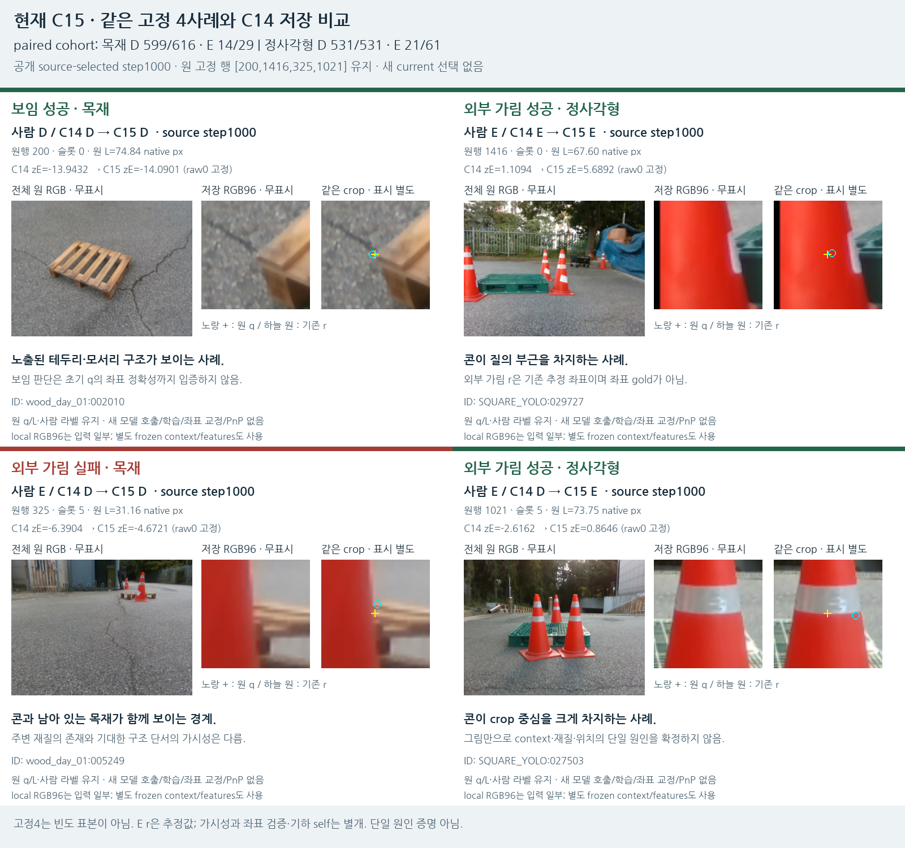
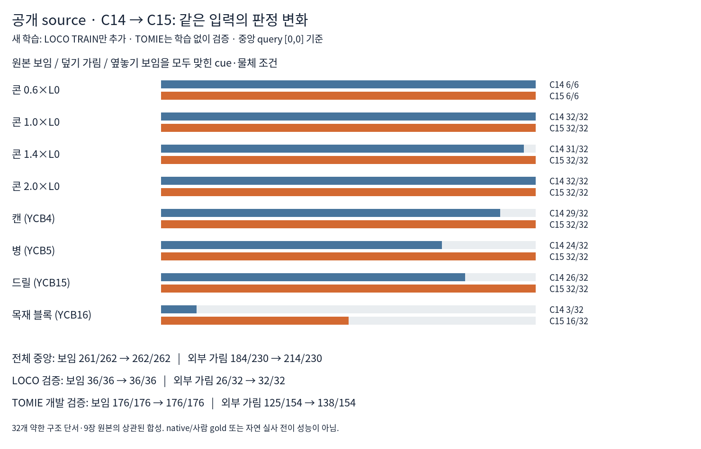
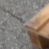
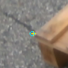

# V123 — query_visibility_flat_pallet_augmented_head_20261023_v123

기존 보고서에서 추출한 게시용 파생 개요입니다. 원본 파일을 수정하거나 실험·평가를 다시 실행하지 않았습니다. 원문 해시와 링크 대응은 publication manifest로 확인합니다.

**상태:** {"completed":true,"fully_solved":false,"goal_status":"active"}

원본:

- [ROOT_PHASE_RESULT.json](ROOT_PHASE_RESULT.json) — SHA256 `9def1d8297690a206498bab589d675164896b787fb188729961a52d27be5e5e9`
- [ROOT_READOUT_KO.html](ROOT_READOUT_KO.html) — SHA256 `7f454c3feb9f41e79ffbe60b0c07b42dab89b50b30fc8b403cde0349522705e5`
- [ROOT_RESULTS_KO.json](ROOT_RESULTS_KO.json) — SHA256 `2ab2e283fab9c368b31ffead006d24e4534d575da885ec16508d1cc4029d9d4d`

## 방법·목표의 원문 필드

`$.phase`

```text
V123_C15_SOURCE_ONLY_HEAD_TRAINED_AND_FROZEN_CURRENT_EVALUATION_COMPLETE
```

`$.saved_evaluation_schema_repair`

```text
{
  "failure": {
    "path": "query_visibility_flat_pallet_augmented_head_20261023_v123/ROOT_FAILED_SAVED_EVALUATION_SCHEMA_V1.json",
    "sha256": "775cac8a3d99bf4bcc4bae51cb46ac455d826d0e100fdef57ccd314c46cd4a3d"
  },
  "repair_entry": {
    "path": "query_visibility_flat_pallet_augmented_head_20261023_v123/ROOT_REPAIRED_C15_SAVED_CURRENT_EVALUATION_ENTRY.json",
    "sha256": "e08635c6ab703d3745badd0a18120330558de29569f8e548fbd75ff4ad370f3f"
  },
  "model_or_inference_reruns": 0,
  "note_KO": "C14 최소 CSV의 geometry 연결 오류만 저장값 전용 adapter로 고쳤다. 원 C15 추론·code·출력은 보존했다."
}
```


## 입력·학습·평가 분모의 원문 필드

`$.current_primary_comparison`

```text
{
  "excerpt": "[{\"cohort\": \"paired_same_query_RGB\", \"group\": \"WOOD_PRIMARY105\", \"model\": \"v61\", \"human_D_N\": \"616\", \"human_external_E_N\": \"29\", \"D_pred_D\": \"145\", \"D_pred_hidden\": \"471\", \"D_pred_U\": \"0\", \"E_pred_D\": \"0\", \"E_pred_hidden\": \"29\", \"E_pred_U\": \"0\", \"D_precision\": \"1.0\", \"D_recall\": \"0.2353896103896104\", \"external_E_response_precision\": \"0.058\", \"external_E_response_recall\": \"1.0\", \"unresolved_rate\": \"0.0\", \"hidden_response_not_learned_S\": \"True\"}, {\"cohort\": \"paired_same_query_RGB\", \"group\": \"WOOD_PRIMARY105\", \"model\": \"legacy\", \"human_D_N\": \"616\", \"human_external_E_N\": \"29\", \"D_pred_D\": \"448\", \"D_pred_hidden\": \"65\", \"D_pred_U\": \"103\", \"E_pred_D\": \"2\", \"E_pred_hidden\": \"23\", \"E_pred_U\": \"4\", \"D_precision\": \"0.9955555555555555\", \"D_recall\": \"0.7272727272727273\", \"external_E_response_precision\": \"0.26136363636363635\", \"external_E_response_recall\": \"0.7931034482758621\", \"unresolved_rate\": \"0.16589147286821707\", \"hidden_response_not_learned_S\": \"True\"}, {\"cohort\": \"paired_same_query_RGB\", \"group\": \"WOOD_PRIMARY105\", \"model\": \"V111_C11_RAW\", \"human_D_N\": \"616\", \"human_external_E_N\": \"29\", \"D_pred_D\": \"598\", \"D_pred_hidden\": \"18\", \"D_pred_U\": \"0\", \"E_pred_D\": \"11\", \"E_pred_hidden\": \"18\", \"E_pred_U\": \"0\", \"D_precision\": \"0.9819376026272578\", \"D_recall\": \"0.9707792207792207\", \"external_E_response_precision\": \"0.5\", \"external_E_response_recall\": \"0.6206896551724138\", \"unresolved_rate\": \"0.0\", \"hidden_response_not_learned_S\": \"True\"}, {\"cohort\": \"paired_same_query_RGB\", \"group\": \"WOOD_PRIMARY105\", \"model\": \"V119_C14_RAW\", \"human_D_N\": \"616\", \"human_external_E_N\": \"29\", \"D_pred_D\": \"599\"",
  "truncated": true
}
```


## 결론·실패·한계의 원문 필드

`$.outcome_KO`

```text
C15는 공개 source 추가 학습 후 실사 외부가림15/90→35/90, 보임1130/1147 유지. 큰 콘 중심 고정사례1021은 가림으로 수정됐지만 경계325는 여전히 보임 오판. 외부가림55/90 미검출로 목표 미해결.
```

`$.interpretation_KO`

```text
[
  "공개 source 학습 변경이 실제 외부가림20개 추가 검출로 일부 전이됐다. 단순히 합성만 더 잘 맞힌 결과는 아니다.",
  "같은 보임 정답 수가 유지되어 이번 향상이 전체 보임을 더 많이 버린 결과로 나타나지는 않았다. 개별 전환은 저장표에 남긴다.",
  "C15외부가림 합계35/90은 과거C11합계35/90과 같다. 목재/정사각형 분포는 다르며 이번 모델을 전체 실험 최상으로 선택하지 않았다.",
  "기존 실사 모델은 외부가림83/90이나 보임655/1147·보류177/1237의 다른 절충을 보인다. reliable external visibility 해결이라고 할 수 없다.",
  "공개 TOMIE 중앙 가림 누락16개는 목재 블록 조건에 남았다. 데이터 형태/촬영조건과 기대 단서의 구조를 일반화하는 문제가 여전히 있다."
]
```

`$.limits_KO`

```text
[
  "현재223은 평가에만 사용했지만 과거 개발에 노출된 자료이며 fresh blind test가 아니다.",
  "새4896행은32개의 약한 구조 단서·9장 원본에서 만든 상관된 파생 사례다. 새 학습용은6cue/3LOCO원본의846known행이다.",
  "LOCO는 기존source와같은fold원본중복, TOMIE4장은기존학습원본과겹침없으나하나의episode다.",
  "공개 합성 D/E는 조건부 AUX이며 정확한 native 키포인트·사람·pixel-ownership gold가 아니다.",
  "9개 공개 offset은각축±3px이고대각4.24px이며실제초기q를교정한결과가아니다.",
  "S/U는학습손실에서제외하며self는기존기하경로. visibility와좌표정답인증은별개다.",
  "학습1000회끝공개검증BCE가계속감소했지만기간연장·구조변경효과는아직검증하지않았다."
]
```


## 코드·검증·전체 표·갤러리

아래 목록은 원 보고서가 참조한 파일의 경로를 다시 연결한 것입니다. 이 개요 작성 중 이미지 내용이나 raw 평가 데이터를 새로 검사하지 않았습니다.

- [query_visibility_flat_pallet_augmented_head_20261023_v123/ROOT_READOUT_KO.html](ROOT_READOUT_KO.html)
- [query_visibility_flat_pallet_augmented_head_20261023_v123/ROOT_RESULTS_KO.json](ROOT_RESULTS_KO.json)
- [query_visibility_flat_pallet_augmented_head_20261023_v123/ROOT_REPORT_VISUAL_QA.json](ROOT_REPORT_VISUAL_QA.json)
- [query_visibility_flat_pallet_augmented_head_20261023_v123/runs/C15_PUBLIC_FLAT_PALLET_AUGMENTED_SPATIAL_QUERY/FIT_COMPLETE.json](runs/C15_PUBLIC_FLAT_PALLET_AUGMENTED_SPATIAL_QUERY/FIT_COMPLETE.json)
- [query_visibility_flat_pallet_augmented_head_20261023_v123/runs/C15_PUBLIC_FLAT_PALLET_AUGMENTED_SPATIAL_QUERY/MODEL_FREEZE.json](runs/C15_PUBLIC_FLAT_PALLET_AUGMENTED_SPATIAL_QUERY/MODEL_FREEZE.json)
- [query_visibility_flat_pallet_augmented_head_20261023_v123/private_evaluation/C15_FROZEN_CURRENT223/INFERENCE_SEAL.json](private_evaluation/C15_FROZEN_CURRENT223/INFERENCE_SEAL.json)
- [query_visibility_flat_pallet_augmented_head_20261023_v123/private_evaluation/C15_FROZEN_CURRENT223/evaluation/EVALUATION_SEAL.json](private_evaluation/C15_FROZEN_CURRENT223/evaluation/EVALUATION_SEAL.json)
- [query_visibility_flat_pallet_augmented_head_20261023_v123/source_audit/SAVED_FIT_REVIEW.json](source_audit/SAVED_FIT_REVIEW.json)
- [query_visibility_flat_pallet_augmented_head_20261023_v123/source_audit/SAVED_CURRENT_REVIEW.json](source_audit/SAVED_CURRENT_REVIEW.json)
- [query_visibility_flat_pallet_augmented_head_20261023_v123/private_evaluation/C15_FROZEN_CURRENT223/evaluation/D_VS_EXTERNAL_E_2X3.csv](private_evaluation/C15_FROZEN_CURRENT223/evaluation/D_VS_EXTERNAL_E_2X3.csv)
- [query_visibility_flat_pallet_augmented_head_20261023_v123/runs/C15_PUBLIC_FLAT_PALLET_AUGMENTED_SPATIAL_QUERY/NEW_FLAT_SOURCE_RESULTS.json](runs/C15_PUBLIC_FLAT_PALLET_AUGMENTED_SPATIAL_QUERY/NEW_FLAT_SOURCE_RESULTS.json)
- [query_visibility_flat_pallet_augmented_head_20261023_v123/private_evaluation/C15_FROZEN_CURRENT223/evaluation/HUMAN_SELF_BINARY_RESPONSE.csv](private_evaluation/C15_FROZEN_CURRENT223/evaluation/HUMAN_SELF_BINARY_RESPONSE.csv)
- [query_visibility_flat_pallet_augmented_head_20261023_v123/private_evaluation/C15_FROZEN_CURRENT223/evaluation/MANUAL_NEAR_D.csv](private_evaluation/C15_FROZEN_CURRENT223/evaluation/MANUAL_NEAR_D.csv)
- [query_visibility_flat_pallet_cue_source_20261023_v122/ROOT_READOUT_KO.html](../query_visibility_flat_pallet_cue_source_20261023_v122/ROOT_READOUT_KO.html)
- [query_visibility_flat_pallet_augmented_head_20261023_v123/ROOT_FAILED_SAVED_EVALUATION_SCHEMA_V1.json](ROOT_FAILED_SAVED_EVALUATION_SCHEMA_V1.json)
- [query_visibility_flat_pallet_augmented_head_20261023_v123/ROOT_REPAIRED_C15_SAVED_CURRENT_EVALUATION_ENTRY.json](ROOT_REPAIRED_C15_SAVED_CURRENT_EVALUATION_ENTRY.json)
- [query_visibility_flat_pallet_augmented_head_20261023_v123/ROOT_C15_DESIGN_BEFORE_SOURCE_FIT.json](ROOT_C15_DESIGN_BEFORE_SOURCE_FIT.json)

## 원 보고서의 그림

원 보고서 참조 순서의 처음 최대4개를 표시합니다. 새 outcome 선택이나 전수 이미지 검증을 뜻하지 않습니다. 전체 갤러리는 위 원문 링크에서 확인합니다.

[query_visibility_flat_pallet_augmented_head_20261023_v123/visual_followup/C15_FIXED4_SUCCESS_FAILURE.png](visual_followup/C15_FIXED4_SUCCESS_FAILURE.png)



[query_visibility_flat_pallet_augmented_head_20261023_v123/source_visual_followup/SOURCE_C14_TO_C15.png](source_visual_followup/SOURCE_C14_TO_C15.png)



[query_visibility_success_failure_visual_review_20261023_v117/exact_saved_crops/case_00_RAW_RGB96.png](../query_visibility_success_failure_visual_review_20261023_v117/exact_saved_crops/case_00_RAW_RGB96.png)



[query_visibility_success_failure_visual_review_20261023_v117/exact_saved_crops/case_00_MARKED_RGB96.png](../query_visibility_success_failure_visual_review_20261023_v117/exact_saved_crops/case_00_MARKED_RGB96.png)




현재 사용자 목표 전체의 해결·새 모델 채택·실사 가림 원인 확정을 이 파생 개요가 추가로 주장하지 않습니다. UNKNOWN/U와 불리한 결과, 실패 실행 및 수정 provenance는 원문대로 보존해야 합니다.
