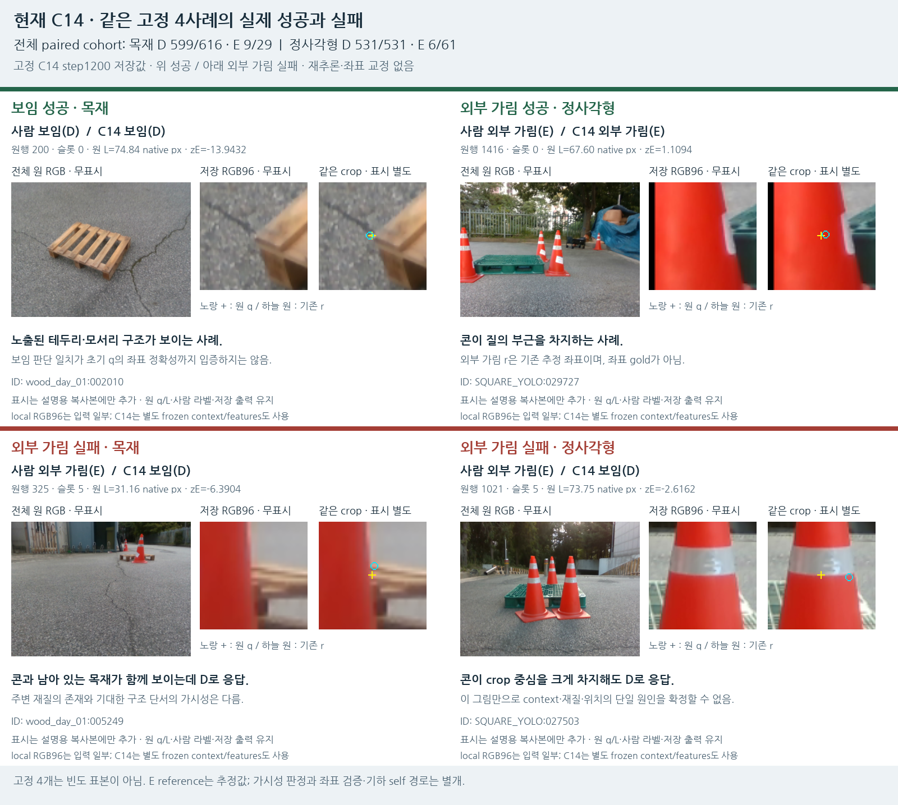

# V122 — query_visibility_flat_pallet_cue_source_20261023_v122

기존 보고서에서 추출한 게시용 파생 개요입니다. 원본 파일을 수정하거나 실험·평가를 다시 실행하지 않았습니다. 원문 해시와 링크 대응은 publication manifest로 확인합니다.

**상태:** {"completed":true,"fully_solved":false,"goal_status":"active"}

원본:

- [ROOT_PHASE_RESULT.json](ROOT_PHASE_RESULT.json) — SHA256 `89a520527ae4271863f3b3f33d9368d92ecd9ec8991afb046075703ee671eff5`
- [ROOT_READOUT_KO.html](ROOT_READOUT_KO.html) — SHA256 `6c97e22776bd793200521bf75e72cec29406d400f4cf41ef854b4f95c84a213b`
- [ROOT_RESULTS_KO.json](ROOT_RESULTS_KO.json) — SHA256 `65be8fe023025643286c10389ccb4504fd4ecb5b1e8952b8db84b56fd1f4b600`

## 방법·목표의 원문 필드

`$.phase`

```text
V122_PUBLIC_FLAT_PALLET_FROZEN_C14_BASELINE_AND_VISUAL_DIAGNOSIS
```


## 입력·학습·평가 분모의 원문 필드

자동 추출 가능한 해당 최상위 필드가 없습니다. 원문 보고서와 phase receipt를 확인하십시오.

## 결론·실패·한계의 원문 필드

`$.outcome_KO`

```text
공개32cue의 제어 합성에서 C14 중앙 BEFORE32/32·SHAM229/230·COVER184/230. 콘101/102와 목재 블록3/32의 큰 차이. 현재 실사 외부가림15/90은 미해결.
```

`$.interpretation_KO`

```text
현재 입력/학습 조건에서 전이와 가리는 물체 외형 일반화가 부족하다는 증거다. 단순 D/E 목표 자체가 과도하다는 증거는 아니다. 모든 작은 crop에서 100% 판정을 보장하지 않으며 좌표의 정확성을 검증한 결과도 아니다.
```

`$.limits_KO`

```text
[
  "32cue/9RGB에서 만든4896개는 독립 실사4896장이 아니다.",
  "AI 약한 구조 단서+알려진 합성 alpha에 기반한 조건부 보조 라벨이며 native 키포인트/사람 gold는 아니다.",
  "TOMIE4장은 같은 촬영 episode이며 전부 development validation. LOCO 원래 fold 유지.",
  "9offset은 각축±3px이며 대각선은4.24px. 새로운 public query 모사이며 실제 초기 q를 교정하지 않는다.",
  "Teacher U468과 모델 보류는 별개다. 모델은4896개 모두 판정했으며 known D/E에서 보류0.",
  "current223은 과거 개발에 노출되어 fresh blind holdout으로 부르지 않는다. 학습·정규화·문턱·checkpoint 선택에는 사용하지 않았다.",
  "Self occlusion은 초기 기하 경로에서 분리한다. 학습 head는 D/E이며 PnP/xy 회귀를 하지 않는다."
]
```


## 코드·검증·전체 표·갤러리

아래 목록은 원 보고서가 참조한 파일의 경로를 다시 연결한 것입니다. 이 개요 작성 중 이미지 내용이나 raw 평가 데이터를 새로 검사하지 않았습니다.

- [query_visibility_flat_pallet_cue_source_20261023_v122/ROOT_READOUT_KO.html](ROOT_READOUT_KO.html)
- [query_visibility_flat_pallet_cue_source_20261023_v122/ROOT_RESULTS_KO.json](ROOT_RESULTS_KO.json)
- [query_visibility_flat_pallet_cue_source_20261023_v122/ROOT_REPORT_VISUAL_QA.json](ROOT_REPORT_VISUAL_QA.json)
- [query_visibility_flat_pallet_cue_source_20261023_v122/frozen_C14_source_baseline/PREDICTION_SEAL.json](frozen_C14_source_baseline/PREDICTION_SEAL.json)
- [query_visibility_flat_pallet_cue_source_20261023_v122/frozen_C14_source_baseline/saved_weak_evaluation/EVALUATION_SEAL.json](frozen_C14_source_baseline/saved_weak_evaluation/EVALUATION_SEAL.json)
- [query_visibility_flat_pallet_cue_source_20261023_v122/current_visual_followup/C14_FIXED4_MAPPING_AND_METRICS.json](current_visual_followup/C14_FIXED4_MAPPING_AND_METRICS.json)
- [query_visibility_flat_pallet_cue_source_20261023_v122/frozen_C14_source_baseline/saved_weak_evaluation/SOURCE_RESULTS.json](frozen_C14_source_baseline/saved_weak_evaluation/SOURCE_RESULTS.json)
- [query_visibility_flat_pallet_cue_source_20261023_v122/frozen_C14_source_baseline/saved_weak_evaluation/PAIRED_QUERY_RANK2304_DIAGNOSTICS.csv](frozen_C14_source_baseline/saved_weak_evaluation/PAIRED_QUERY_RANK2304_DIAGNOSTICS.csv)
- [query_visibility_flat_pallet_cue_source_20261023_v122/source_prediction_visual_review/READOUT_KO.html](source_prediction_visual_review/READOUT_KO.html)
- [query_visibility_flat_pallet_cue_source_20261023_v122/fixed_corpus_visual_review/GALLERY_KO.html](fixed_corpus_visual_review/GALLERY_KO.html)
- [query_visibility_consistent_query_context_20261023_v119/ROOT_READOUT_KO.html](../query_visibility_consistent_query_context_20261023_v119/ROOT_READOUT_KO.html)
- [query_visibility_natural_cue_query_baseline_20261023_v121/ROOT_READOUT_KO.html](../query_visibility_natural_cue_query_baseline_20261023_v121/ROOT_READOUT_KO.html)
- [query_visibility_flat_pallet_cue_source_20261023_v122/actual_corpus/CORPUS_SEAL.json](actual_corpus/CORPUS_SEAL.json)
- [query_visibility_consistent_query_context_20261023_v119/ROOT_RESULTS_KO.json](../query_visibility_consistent_query_context_20261023_v119/ROOT_RESULTS_KO.json)
- [query_visibility_flat_pallet_cue_source_20261023_v122/ROOT_ACTUAL_VISUAL_REVIEW_AND_AUX_SCOPE.json](ROOT_ACTUAL_VISUAL_REVIEW_AND_AUX_SCOPE.json)

## 원 보고서의 그림

원 보고서 참조 순서의 처음 최대4개를 표시합니다. 새 outcome 선택이나 전수 이미지 검증을 뜻하지 않습니다. 전체 갤러리는 위 원문 링크에서 확인합니다.

[query_visibility_flat_pallet_cue_source_20261023_v122/current_visual_followup/C14_FIXED4_SUCCESS_FAILURE.png](current_visual_followup/C14_FIXED4_SUCCESS_FAILURE.png)



[query_visibility_flat_pallet_cue_source_20261023_v122/source_prediction_visual_review/SAME_CUE_CONE_VS_WOODBLOCK.png](source_prediction_visual_review/SAME_CUE_CONE_VS_WOODBLOCK.png)


[query_visibility_flat_pallet_cue_source_20261023_v122/source_prediction_visual_review/SOURCE_SUCCESS_FAILURE_TRIPLETS.png](source_prediction_visual_review/SOURCE_SUCCESS_FAILURE_TRIPLETS.png)


[query_visibility_flat_pallet_cue_source_20261023_v122/source_prediction_visual_review/SOURCE_METRICS.png](source_prediction_visual_review/SOURCE_METRICS.png)


현재 사용자 목표 전체의 해결·새 모델 채택·실사 가림 원인 확정을 이 파생 개요가 추가로 주장하지 않습니다. UNKNOWN/U와 불리한 결과, 실패 실행 및 수정 provenance는 원문대로 보존해야 합니다.
