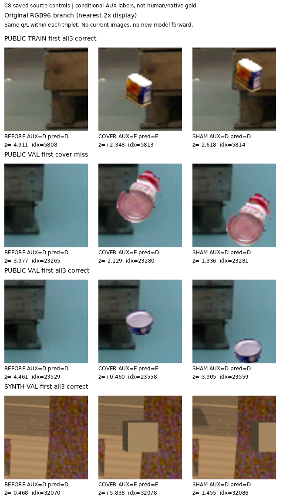
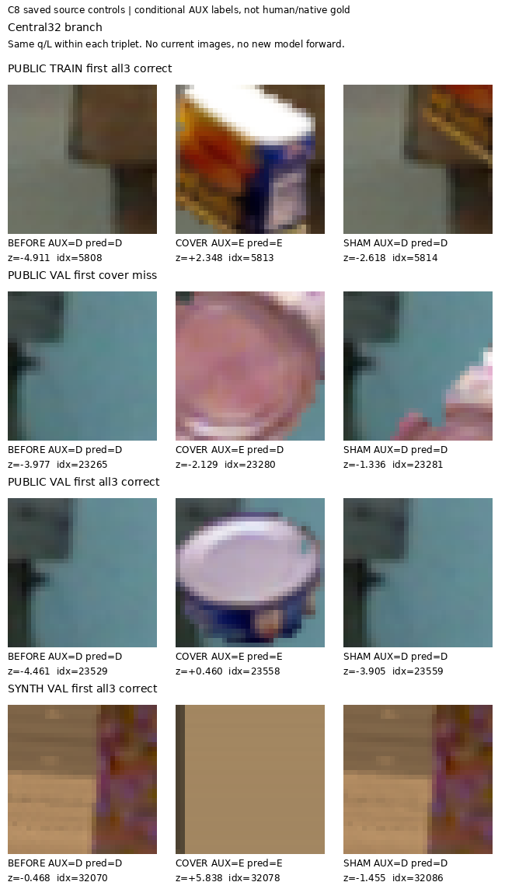

# V105 — query_visibility_frozen_rgb_head_20261023_v105

기존 보고서에서 추출한 게시용 파생 개요입니다. 원본 파일을 수정하거나 실험·평가를 다시 실행하지 않았습니다. 원문 해시와 링크 대응은 publication manifest로 확인합니다.

**상태:** {"completed":true}

원본:

- [ROOT_READOUT_KO.html](ROOT_READOUT_KO.html) — SHA256 `7a76e361cb27e7f1b86789e7024e86f8b0dde9d5a45b8ca3b7f4ba6ca16d9767`
- [ROOT_RESULTS_KO.json](ROOT_RESULTS_KO.json) — SHA256 `1a5e673fdb18f2929fbf8c4e2ac9865a3bdb6f3ac0fa913a92da7314d48faa6f`

## 방법·목표의 원문 필드

자동 추출 가능한 해당 최상위 필드가 없습니다. 원문 보고서와 phase receipt를 확인하십시오.

## 입력·학습·평가 분모의 원문 필드

`$.optimizer_updates`

```text
2000
```

`$.C8_VAL_eight_cohorts`

```text
{
  "old_LOCO_BEFORE_D": {
    "N": 3,
    "correct": 3
  },
  "old_PALLOX_BEFORE_D": {
    "N": 30,
    "correct": 30
  },
  "old_SHAM_D": {
    "N": 119,
    "correct": 108
  },
  "old_BEFORE_E": {
    "N": 2,
    "correct": 1
  },
  "old_COVER_E": {
    "N": 119,
    "correct": 56
  },
  "new_BEFORE_D": {
    "N": 82,
    "correct": 81
  },
  "new_SHAM_D": {
    "N": 77,
    "correct": 75
  },
  "new_COVER_E": {
    "N": 32,
    "correct": 32
  }
}
```

`$.denominator_and_semantic_boundary`

```text
{
  "all_occurrences": 33984,
  "D": 1215,
  "E": 303,
  "S_excluded": 396,
  "GT_U": 32070,
  "factual_input_U_allrows": 4686,
  "known_VAL_U_rate_old": 0.0,
  "known_VAL_U_rate_new": 0.0,
  "labels": "Conditional physical-cue AUX; native identity UNKNOWN; not human gold or current metrics. Geometric S outside learned D/E, not recoded to E or teacher U.",
  "old_controls": "Public RGB with GT-guided real-donor opaque-cover/sham edits;119 VAL ranks cluster18 base queries9images. Not119 natural occlusion events. Natural BEFORE_E VAL only2.",
  "new_controls": "Simplified synthetic expected-cue RGB composites. Camera/aspect/material tests are source controls, not real deployment evidence.",
  "development": "Repeated source VAL development; not a blind test.",
  "new_V104_pilot_rows_used_in_C8": 0
}
```

`$.current_training_threshold_checkpoint_selection`

```text
0
```


## 결론·실패·한계의 원문 필드

`$.main_outcome_KO`

```text
합성 외부 cover 제어는 크게 개선됐으나 공개 RGB 기반 controlled cover 일반화는 부족하다. 12개 사전 gate 중9개만 통과해 불채택하며 새 current223 추론은 없다.
```

`$.interpretation_limits_KO`

```text
[
  "중앙 crop에 donor가 크게 보여도 공개 VAL 첫 cover 실패에서 D였다. 한 그림으로 실패 원인이나 특정 encoder의 한계를 단정하지 않는다.",
  "C8은 합성 D 보존과 triple 성능을 개선했지만 공개 controlled triple은 C7보다 낮다. 단일 수치로 전체 우월을 주장하지 않는다.",
  "실제 초기 query의 target/cue 대응은 별도 문제다. V104에서 multi-pallet box, floor·사람·트럭 위 q가 관찰됐고 자동 E/위치 오답 gold를 만들지 않았다."
]
```


## 코드·검증·전체 표·갤러리

아래 목록은 원 보고서가 참조한 파일의 경로를 다시 연결한 것입니다. 이 개요 작성 중 이미지 내용이나 raw 평가 데이터를 새로 검사하지 않았습니다.

- [query_visibility_public_flat_pallet_queries_20261023_v104/visual_query_review/ACTUAL_VISUAL_READOUT_KO.html](../query_visibility_public_flat_pallet_queries_20261023_v104/visual_query_review/ACTUAL_VISUAL_READOUT_KO.html)
- [query_visibility_frozen_rgb_head_20261023_v105/ROOT_RESULTS_KO.json](ROOT_RESULTS_KO.json)
- [query_visibility_frozen_rgb_head_20261023_v105/ROOT_SOURCE_ADMISSION.json](ROOT_SOURCE_ADMISSION.json)
- [query_visibility_frozen_rgb_head_20261023_v105/saved_source_review/REVIEW.json](saved_source_review/REVIEW.json)
- [query_visibility_frozen_rgb_head_20261023_v105/runs/C8_FROZEN_IMAGENET_RGB_TWO_SCALE/SOURCE_RESULTS.json](runs/C8_FROZEN_IMAGENET_RGB_TWO_SCALE/SOURCE_RESULTS.json)
- [query_visibility_frozen_rgb_head_20261023_v105/ROOT_C8_DESIGN_BEFORE_FEATURE_FORWARD.json](ROOT_C8_DESIGN_BEFORE_FEATURE_FORWARD.json)
- [query_visibility_frozen_rgb_head_20261023_v105/runs/C8_FROZEN_IMAGENET_RGB_TWO_SCALE/FIT_COMPLETE.json](runs/C8_FROZEN_IMAGENET_RGB_TWO_SCALE/FIT_COMPLETE.json)
- [query_visibility_frozen_rgb_head_20261023_v105/runs/C8_FROZEN_IMAGENET_RGB_TWO_SCALE/SOURCE_GATE_RESULTS.json](runs/C8_FROZEN_IMAGENET_RGB_TWO_SCALE/SOURCE_GATE_RESULTS.json)
- [query_visibility_frozen_rgb_head_20261023_v105/saved_failure_views/CASES.json](saved_failure_views/CASES.json)

## 원 보고서의 그림

원 보고서 참조 순서의 처음 최대4개를 표시합니다. 새 outcome 선택이나 전수 이미지 검증을 뜻하지 않습니다. 전체 갤러리는 위 원문 링크에서 확인합니다.

[query_visibility_frozen_rgb_head_20261023_v105/saved_failure_views/SOURCE_CONTROLS_RGB96.png](saved_failure_views/SOURCE_CONTROLS_RGB96.png)



[query_visibility_frozen_rgb_head_20261023_v105/saved_failure_views/SOURCE_CONTROLS_CENTRAL32.png](saved_failure_views/SOURCE_CONTROLS_CENTRAL32.png)




현재 사용자 목표 전체의 해결·새 모델 채택·실사 가림 원인 확정을 이 파생 개요가 추가로 주장하지 않습니다. UNKNOWN/U와 불리한 결과, 실패 실행 및 수정 provenance는 원문대로 보존해야 합니다.
