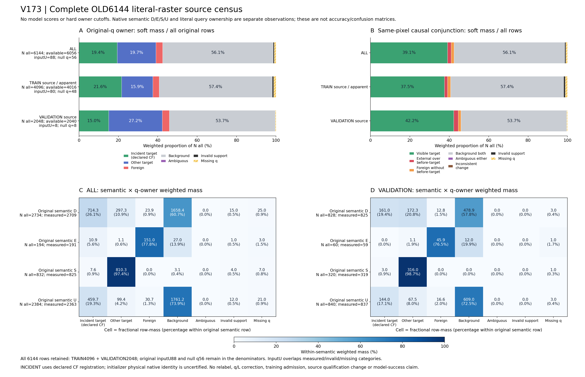

# V173 — query_visibility_full_source_query_causal_census_20261024_v173

기존 보고서에서 추출한 게시용 파생 개요입니다. 원본 파일을 수정하거나 실험·평가를 다시 실행하지 않았습니다. 원문 해시와 링크 대응은 publication manifest로 확인합니다.

**상태:** {"completed":true,"selected_model":null,"fully_solved":false}

원본:

- [ROOT_PHASE_RESULT.json](ROOT_PHASE_RESULT.json) — SHA256 `75f2f665550947db8e09bd4fd211cc0c3fc06bdfffade368a390b9b0c4560d41`
- [ROOT_READOUT_KO.html](ROOT_READOUT_KO.html) — SHA256 `140b807c0928e2a0de3436d5066b0385102c06de9a52cb85ecf990550b12b06d`
- [ROOT_RESULTS_KO.json](ROOT_RESULTS_KO.json) — SHA256 `caf3299189e71e7cba760aa2ccc76a11718f97dcdefe25976b5e7698c56c41a0`

## 방법·목표의 원문 필드

`$.phase`

```text
V173
```

`$.goal_complete`

```text
false
```


## 입력·학습·평가 분모의 원문 필드

`$.cohorts`

```text
{
  "excerpt": "{\"ALL\": {\"N_all\": 6144, \"N_input_available\": 6056, \"N_inputU\": 88, \"N_null_q\": 56, \"N_null_L\": 56, \"N_null_selected\": 56, \"semantic_counts\": {\"D\": 2734, \"E\": 194, \"S\": 832, \"U\": 2384}, \"measures\": {\"scene_owner_point\": {\"N_all\": 6144, \"N_measured\": 6088, \"N_missing\": 56, \"weighted_mass\": [1192.5581564274617, 1208.1438031247817, 205.61686384445056, 3449.681176603306, 0.0, 32.0], \"fraction_of_all\": [0.1941012624393655, 0.19663798878984076, 0.033466286433016044, 0.561471545671111, 0.0, 0.005208333333333333], \"missing_fraction\": 0.009114583333333334}, \"BEFORE_owner_point\": {\"N_all\": 6144, \"N_measured\": 6088, \"N_missing\": 56, \"weighted_mass\": [1264.9810681254603, 1249.3801189246587, 0.0, 3541.638812949881, 0.0, 32.0], \"fraction_of_all\": [0.20588884572354496, 0.203349628731227, 0.0, 0.5764386088785614, 0.0, 0.005208333333333333], \"missing_fraction\": 0.009114583333333334}, \"joint_point\": {\"N_all\": 6144, \"N_measured\": 6088, \"N_missing\": 56, \"weighted_mass\": [2400.7019595522434, 113.65922749787569, 91.95763634657487, 3449.681176603306, 0.0, 0.0, 32.0], \"fraction_of_all\": [0.3907392512292063, 0.018499223225565704, 0.014967063207450337, 0.561471545671111, 0.0, 0.0, 0.005208333333333333], \"missing_fraction\": 0.009114583333333334}, \"scene_owner_central4\": {\"N_all\": 6144, \"N_measured\": 6088, \"N_missing\": 56, \"weighted_mass\": [1196.901193533667, 1212.3056980827396, 204.96197693226185, 3441.83113145133, 0.0, 32.0], \"fraction_of_all\": [0.1948081369683703, 0.1973153805473209, 0.03335969676631866, 0.5601938690513232, 0.0, 0.005208333333333333], \"missing_fraction\": 0.009114583333333334}, \"join",
  "truncated": true
}
```

`$.training_admission`

```text
false
```

`$.HTML_browser_rendered`

```text
false
```


## 결론·실패·한계의 원문 필드

`$.conclusion_KO`

```text
원 V129 합성 source6144 전체에서 원 semantic 역할과 literal q 소속·같은위치 외부가림을 별도 수치로 확인했다. 이는 라벨 오류·전체 실패 원인·모델 성공 판정이 아니며 기존 source qualification과 전체 목표 미해결 상태를 바꾸지 않는다.
```

`$.interpretation_KO`

```text
[
  "수치는 hard owner label 수가 아니라 float64 bilinear onehot weighted mass다. 원6144 전체분모와 측정가능분모를 모두 표시하고 U88/null56을 보존했다.",
  "SCENE foreign mass 중 BEFORE target이 있던 같은 소스픽셀만 EXTERNAL_OVER_BEFORE_TARGET이다. BEFORE BG 위 foreign은 FOREIGN_WITHOUT_BEFORE_TARGET으로 분리했다. marginal 확률의 곱을 쓰지 않았다.",
  "TRAIN은 기존 학습 source의 apparent 진단, VALIDATION은 원source 고정분할 진단이다. 이 단계에서 새 모델학습·성능평가·문턱탐색은 없다.",
  "INCIDENT는 선언 CF-to-canonical 등록 부위에 상대적인 표현이며 초기query의 물리 native identity를 인증하지 않는다. correspondence_boundary는 CF/V4 순서 불일치로 pixelboundary와 다르다.",
  "전수범위는 원 합성 V129 corpus이다. 실제 데이터 일반화·human physical native visibility gold·라벨오류 또는 모든 실패 원인을 증명하지 않는다.",
  "독립검산은 원768 bufferSHA·6144metadata와6088 유한 q의 nearest/4-source-pixel point owner/joint를 직접 재계산했다. 9soft배열의 NPZ↔JSONL 일치와189집계도 확인했다. central4/32는 저장값 일치·집계 검산이며 독립 재샘플링하지 않았다. 원 fullframe joint/reason pixelcount도 독립 재계산 범위 밖이다."
]
```


## 코드·검증·전체 표·갤러리

아래 목록은 원 보고서가 참조한 파일의 경로를 다시 연결한 것입니다. 이 개요 작성 중 이미지 내용이나 raw 평가 데이터를 새로 검사하지 않았습니다.

- [query_visibility_full_source_query_causal_census_20261024_v173/literal_raster_census_v1/COMPLETE.json](literal_raster_census_v1/COMPLETE.json)
- [query_visibility_full_source_query_causal_census_20261024_v173/ROOT_RESULTS_KO.json](ROOT_RESULTS_KO.json)
- [query_visibility_full_source_query_causal_census_20261024_v173/ROOT_READOUT_KO.html](ROOT_READOUT_KO.html)
- [query_visibility_full_source_query_causal_census_20261024_v173/scientific_readout_v1/SOFT_MASS_READOUT_COUNTS.json](scientific_readout_v1/SOFT_MASS_READOUT_COUNTS.json)
- [query_visibility_full_source_query_causal_census_20261024_v173/actual_saved_census_review_a/REVIEW.json](actual_saved_census_review_a/REVIEW.json)
- [query_visibility_full_source_query_causal_census_20261024_v173/ROOT_ACTUAL_SCIENTIFIC_V2_FIGURE_VISUAL_QA.json](ROOT_ACTUAL_SCIENTIFIC_V2_FIGURE_VISUAL_QA.json)
- [query_visibility_full_source_query_causal_census_20261024_v173/scientific_readout_v2/ACTUAL_VISUAL_QA.json](scientific_readout_v2/ACTUAL_VISUAL_QA.json)
- [query_visibility_full_source_query_causal_census_20261024_v173/ROOT_ACTUAL_FULL_SOURCE_CENSUS_EXECUTION_TERMINAL.json](ROOT_ACTUAL_FULL_SOURCE_CENSUS_EXECUTION_TERMINAL.json)
- [query_visibility_full_source_query_causal_census_20261024_v173/report_preparation/finalize_saved_report_bindings.py](report_preparation/finalize_saved_report_bindings.py)
- [query_visibility_full_source_query_causal_census_20261024_v173/literal_raster_census_v1/ALL6144_LITERAL_RASTER_SOURCE_DIAGNOSTICS.jsonl](literal_raster_census_v1/ALL6144_LITERAL_RASTER_SOURCE_DIAGNOSTICS.jsonl.parts.json)
- [query_visibility_full_source_query_causal_census_20261024_v173/literal_raster_census_v1/ALL768_SCENE_INCONSISTENCY_DIAGNOSTICS.jsonl](literal_raster_census_v1/ALL768_SCENE_INCONSISTENCY_DIAGNOSTICS.jsonl)
- [query_visibility_full_source_query_causal_census_20261024_v173/literal_raster_census_v1/EXACT_SPLIT_GROUP_NATIVE_VARIANT_AGGREGATES.json](literal_raster_census_v1/EXACT_SPLIT_GROUP_NATIVE_VARIANT_AGGREGATES.json)
- [query_visibility_full_source_query_causal_census_20261024_v173/report_preparation/write_saved_census_readout.py](report_preparation/write_saved_census_readout.py)

## 원 보고서의 그림

원 보고서 참조 순서의 처음 최대4개를 표시합니다. 새 outcome 선택이나 전수 이미지 검증을 뜻하지 않습니다. 전체 갤러리는 위 원문 링크에서 확인합니다.

[query_visibility_full_source_query_causal_census_20261024_v173/scientific_readout_v2/FULL6144_SOFT_OWNER_CAUSAL_SEMANTIC_CENSUS.png](scientific_readout_v2/FULL6144_SOFT_OWNER_CAUSAL_SEMANTIC_CENSUS.png)



[query_visibility_full_source_query_causal_census_20261024_v173/scientific_readout_v1/FULL6144_SOFT_OWNER_CAUSAL_SEMANTIC_CENSUS.png](scientific_readout_v1/FULL6144_SOFT_OWNER_CAUSAL_SEMANTIC_CENSUS.png)


현재 사용자 목표 전체의 해결·새 모델 채택·실사 가림 원인 확정을 이 파생 개요가 추가로 주장하지 않습니다. UNKNOWN/U와 불리한 결과, 실패 실행 및 수정 provenance는 원문대로 보존해야 합니다.

큰 원문 링크는 무손실 gzip의 `.parts.json` descriptor로 연결합니다. 원문 SHA와 복원 방법은 게시 안내를 따릅니다.
