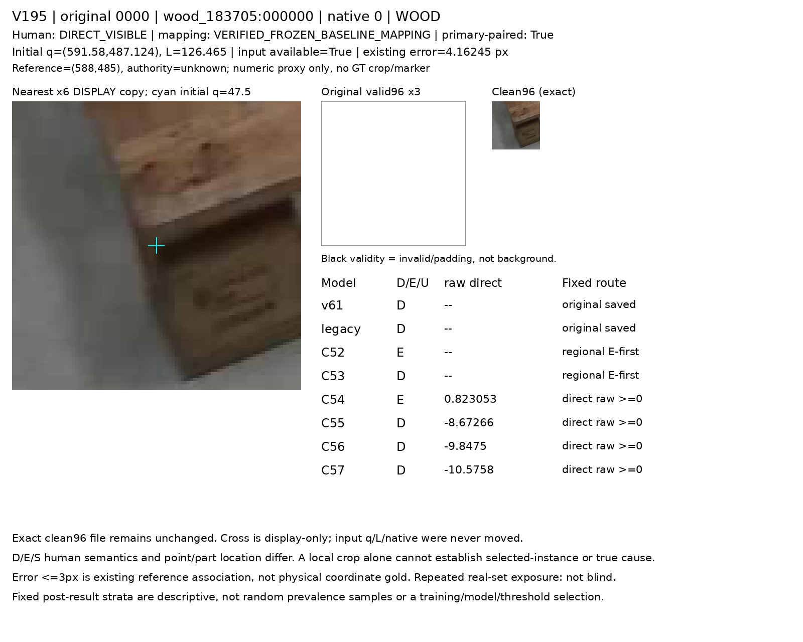
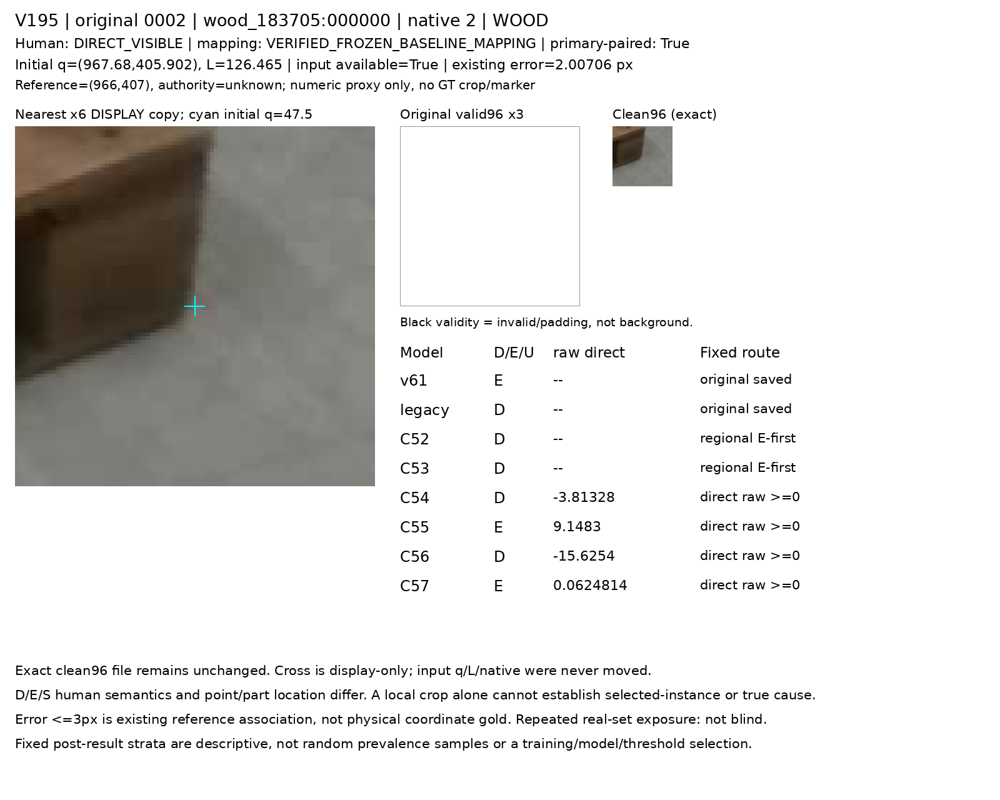
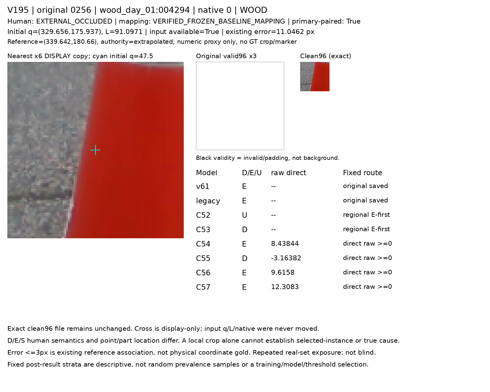
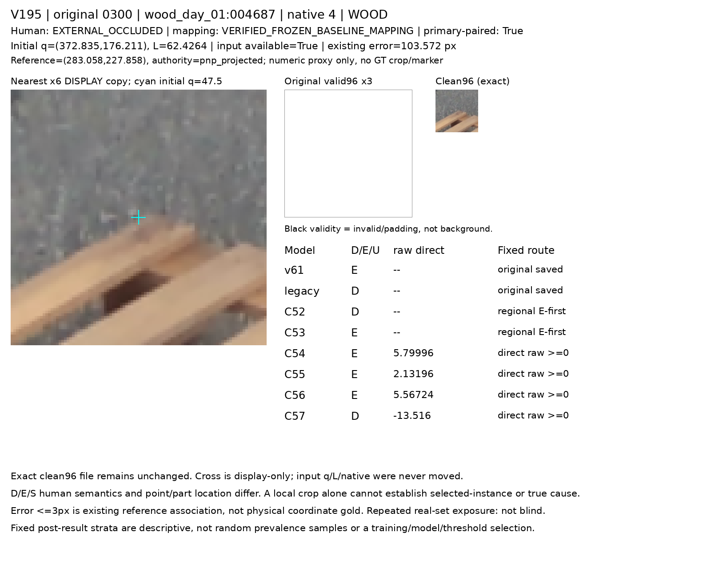
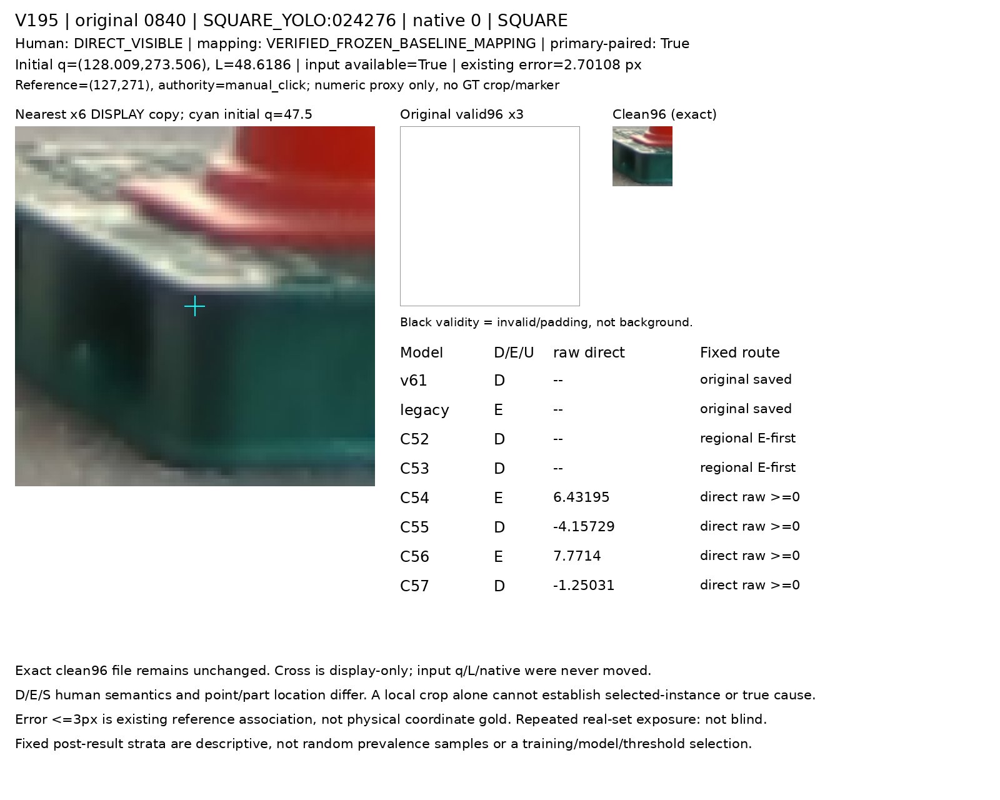
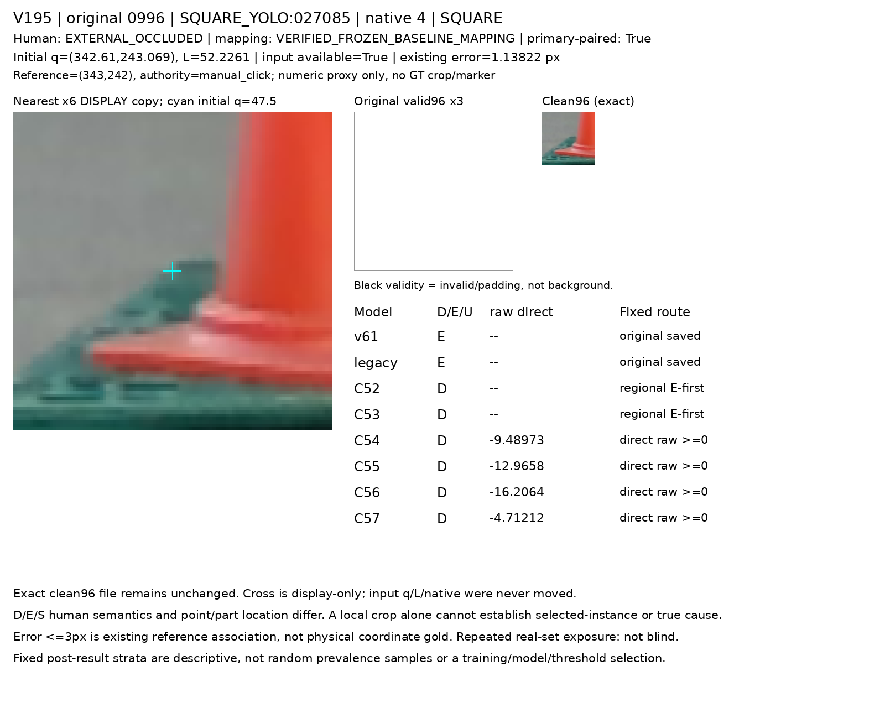

# V195: 원본 그룹 분리 direct-end 모델의 동일 실사 평가

동일 primary1237(D1147/E90)에서 C56의 D/E 재현율은 62.0%/37.8%, C57은 63.6%/57.8%다. 아래에 U와 두 재질·기존6모델을 함께 보존했다. 어느 arm도 채택하거나 best로 고르지 않았으며 전체 목표는 미해결이다.

원 current223×8=1784, public45×8=360, 등록 WOOD105/SQUARE118과 native0..7의 원 q/L·crop·가용성을 유지했다. primary는 기존 동일-query 인간 D1147/E90 총1237행이다. 원입력U45/1784와 primary 모델 U/N을 구분한다.

## 동일8모델 primary CM/P/R/U

CM 행은 인간 D/E, 열은 모델 D/E/U다. 정밀도는 해당 결정 예측, 재현율은 U를 포함한 해당 인간 전체 분모다. 기존 E 응답은 물리 원인 인증이 아니다.

|모델|N|D행 [D,E,U]|E행 [D,E,U]|D 정밀도|D 재현율|E 정밀도|E 재현율|U|U율|
|---|---|---|---|---|---|---|---|---|---|
|v61|1237|[260, 887, 0]|[2, 88, 0]|99.2%|22.7%|9.0%|97.8%|0|0.0%|
|legacy|1237|[655, 319, 173]|[3, 83, 4]|99.5%|57.1%|20.6%|92.2%|177|14.3%|
|C52|1237|[821, 302, 24]|[52, 33, 5]|94.0%|71.6%|9.9%|36.7%|29|2.3%|
|C53|1237|[868, 273, 6]|[70, 20, 0]|92.5%|75.7%|6.8%|22.2%|6|0.5%|
|C54|1237|[698, 449, 0]|[55, 35, 0]|92.7%|60.9%|7.2%|38.9%|0|0.0%|
|C55|1237|[831, 316, 0]|[53, 37, 0]|94.0%|72.4%|10.5%|41.1%|0|0.0%|
|C56|1237|[711, 436, 0]|[56, 34, 0]|92.7%|62.0%|7.2%|37.8%|0|0.0%|
|C57|1237|[729, 418, 0]|[38, 52, 0]|95.0%|63.6%|11.1%|57.8%|0|0.0%|

## 새 두 모델의 WOOD/SQUARE 결과

|모델|재질|N|D행 [D,E,U]|E행 [D,E,U]|D 정밀도|D 재현율|E 정밀도|E 재현율|U|U율|
|---|---|---|---|---|---|---|---|---|---|---|
|C56|WOOD|645|[395, 221, 0]|[15, 14, 0]|96.3%|64.1%|6.0%|48.3%|0|0.0%|
|C57|WOOD|645|[401, 215, 0]|[16, 13, 0]|96.2%|65.1%|5.7%|44.8%|0|0.0%|
|C56|SQUARE|592|[316, 215, 0]|[41, 20, 0]|88.5%|59.5%|8.5%|32.8%|0|0.0%|
|C57|SQUARE|592|[328, 203, 0]|[22, 39, 0]|93.7%|61.8%|16.1%|63.9%|0|0.0%|

[모든8모델·재질 표](fixed_direct_end_real_visual_v1/PRIMARY_ALL8_CM_PRECISION_RECALL_U.csv) · [native8 전체분모](fixed_direct_end_real_visual_v1/ALL_ORIGINAL_NATIVE_MATERIAL_DENOMINATORS.csv)

## self와 참조 연관은 별도다

### SELF paired D_vs_ES21

|모델|별도 human S N|D 응답|binary hidden 응답|미결정|
|---|---|---|---|---|
|v61|21|9|12|0|
|legacy|21|13|3|5|
|C52|21|18|2|1|
|C53|21|15|6|0|
|C54|21|19|2|0|
|C55|21|16|5|0|
|C56|21|16|5|0|
|C57|21|13|8|0|

### SELF all/same-slot136

|모델|별도 human S N|D 응답|binary hidden 응답|미결정|
|---|---|---|---|---|
|v61|136|115|21|0|
|legacy|136|13|118|5|
|C52|136|95|38|3|
|C53|136|106|27|3|
|C54|136|98|38|0|
|C55|136|103|33|0|
|C56|136|85|51|0|
|C57|136|101|35|0|

차이115는 기존 paired eligibility 밖이며, 제외 사유를 새 원인으로 추정하지 않는다. 두 표는 learned-self classifier가 아니다.

|모델|기존reference≤3 humanD N|D|E|U|
|---|---|---|---|---|
|C56|461|290|171|0|
|C57|461|291|170|0|

기존 reference≤3px humanD461과 manual-click near376(WOOD153/SQUARE223)은 다른 집단이다. 참조 연관을 물리 좌표 gold나 인과 증거로 바꾸지 않았다.

## Public360 weak center-owner만

known204/UNKNOWN156, inputU108/center4invalid112와 v61 자체 가용성을 유지한다. public owner/crop 약관찰을 native 외부가림 정답으로 승격하지 않으며 legacy는 기존 경로 부재로 그대로 둔다.

|모델|T 정밀도|T 재현율|non-T 재현율|ownerF 정밀도|ownerF 재현율|
|---|---|---|---|---|---|
|C52|39.5%|70.8%|85.6%|82.1%|24.0%|
|C53|53.3%|66.7%|92.2%|75.4%|47.9%|
|C54|30.6%|79.2%|76.1%|77.4%|25.0%|
|C55|46.5%|83.3%|87.2%|77.8%|51.0%|
|C56|33.9%|83.3%|78.3%|74.3%|27.1%|
|C57|35.6%|66.7%|83.9%|75.0%|43.8%|
|v61|30.4%|29.2%|91.1%|미정|미정|

## 이전과 동일한 고정 그림

동일68 ID 중 아래 사전 고정0/2/256/300/840/996가 있으면 표시한다. 새 출력에 따라 보충·교체하지 않는다. clean96는 원 픽셀이고 cyan q는 표시 사본에만 있다.

### original 0

동일 고정 원 입력과 모든8모델 출력을 함께 비교한다. 무효 padding을 자연 배경으로 해석하지 않는다.

### original 2

사전에 고정된 원 crop이다. D/E 응답과 기존 참조 연관을 분리하며 local crop만으로 실제 원인을 단정하지 않는다.

### original 256

이전과 같은 고정 ID다. 새 출력에 따라 사례를 바꾸거나 중심을 보정하지 않았다.

### original 300

기존 참조와 원 query의 관계는 설명용 연관이다. E 응답만으로 queried-end의 물리 외부가림을 인증하지 않는다.

### original 840

고정 SQUARE 사례다. 중심 owner/주변 팔레트 존재와 native 끝부위 가시성을 동일시하지 않는다.

### original 996

기존 고정 사례의 새 두 응답을 그대로 표시한다. 작은 참조 오차도 물리 pixel gold나 인과 분리 증거가 아니다.

[동일68 portable 갤러리](fixed_direct_end_real_visual_v1/PORTABLE_GALLERY_KO.md) · [고정 ID 및 기존 membership](fixed_direct_end_real_visual_v1/FIXED_CELL_SELECTION.csv)

## Source 학습과 실제 평가의 구분

[V194 원본 그룹 분리 source 보고서](../query_visibility_source_group_split_direct_end_training_20261024_v194/PORTABLE_REPORT_KO.md)를 별도로 보존한다. source TRAIN apparent와 grouped HOLDOUT은 이 실사 평가의 재점수/독립 증거가 아니다. 공개 실사 source가 포함되며 synthetic-only라고 부르지 않는다.

## 한계와 보존 기록

- C56/C57은 V194의 새 fromscratch 고정8000/115222 모델이며 source-only 학습에는 공개 실사와 YCB 기반 control도 포함된다. synthetic-only 학습이라고 부르지 않는다.
- C54/C55 대비 직접 control5→27 확대와 모든 loss 풀의 원본 component TRAIN 분리 등 여러 학습 조건이 함께 달라졌다. 이 평가로 특정 감독·SAM·분할·자료 증가의 단일 인과 효과를 분리하지 않는다.
- V194 direct FULL372(D248/E124),TRAIN327(D218/E109),HOLDOUT45(D30/E15)를 구분한다. HOLDOUT45는 전부 합성이며 real-end holdout0이다.124triplet(합성97+실사weak27)은124독립 frame이 아니다. 이미 알려진 source 설계 안의 grouped holdout이며 자연실사/unseen blind/nativephysical gold가 아니다.
- 기존 인간 D/E/S 의미 권위를 유지한다. 점소속·넓은crop 팔레트 존재·broad support2·직접 weak끝점 감독을 native 물리 gold로 혼합하지 않는다. quality/owner/오차로 primary를 걸러내지 않았다.
- current223/publicheld45는 반복 개발 노출되어 fresh 독립 검증이 아니다. legacy의 과거 realCAL 이력을 보존하고 public legacy 부재를 새 forward로 채우지 않았다.
- primary U는1237행의 모델 응답 분모다. 전체1784 factual inputU45와 public360 inputU108/centerinvalid112/known204 UNKNOWN156은 서로 다른 분모다. U0이 uncertainty나 입력 가용성 문제 해결을 뜻하지 않는다.
- SELF는 D_vs_ES paired21과 all/same-slot136을 별도로 보고하며 D/E primary1237에 넣지 않는다. 차이115의 원인을 query오류·inputU·물리 원인으로 추측하지 않는다. reference≤3 humanD461은 manual-click near376과 다르다.
- 그림은 V191에서 봉인된 동일68 ID다. 새 출력 기반 firstcase나 대체 사례가 없고 대표성/유병률을 주장하지 않는다. 실제 image-tool 확인 범위는 root QA에 기록된 수만 인용하며 HTML browser 렌더를 주장하지 않는다.

[독립 A 수치 감사](independent_saved_result_review_preparation_a/actual_review_v1/REVIEW.json) · [root 실제 그림 QA](ROOT_ACTUAL_FIXED6_CARD_VISUAL_QA.json) · [self guard 행정 수정](SELF_COHORT_GUARD_REPAIR_RECEIPT.json) · [원 실패 보존](provenance/BEFORE_SELF_COHORT_D_VS_ES_GUARD_REPAIR/FAILED_SAVED_EVALUATOR_ORIGINAL.json)

[예측 코드](prediction_preparation_b/infer_both_frozen_grouped_direct_end_heads.py) · [평가 코드](evaluation_preparation_b/evaluate_saved_grouped_direct_end_real.py) · [고정 그림 코드](fixed_visual_preparation_b/render_fixed_grouped_direct_end_real.py) · [보고서 코드](report_preparation_b/build_top_level_readout.py)

[수치·근거 JSON](ROOT_RESULTS_KO.json) · [phase 범위](ROOT_PHASE_RESULT.json) · [오프라인 HTML](ROOT_READOUT_KO.html)
