# V196: 전체 source HOLDOUT 목표-입력 대응

Source HOLDOUT360행 전체(45known/315UNKNOWN),15triplet×3variant×native8이다. 오답/점수/native로 선택·교체하지 않았다. 원q/L/clean96/valid를 유지한다. finite-end sampled mask와 bbox는 기존 구성적/weak 목표의 위치 설명이며 물리 native gold나 새 localization이 아니다. sourceHOLDOUT은 TRAIN으로 편입하지 않는다. source 설계가 이미 알려졌으며 자연 실사 일반화/모델 채택/해결 주장을 하지 않는다.

[전체360 target/prediction CSV](ALL360_HOLDOUT_TARGET_MAPPING.csv) · [전체360 JSON](ALL360_HOLDOUT_TARGET_MAPPING.json) · [15개 목표 연관/기존proof](ALL15_TARGET_ASSOCIATIONS.json)

원본clean96와valid는 각각 별도 파일이다. 아래contact 윗줄은clean96확대 표시, 아랫줄은마젠타 end-related sample/노란기존enclosure/cyan원q의 표시 사본이다. 색표시는 모델입력에들어가지 않는다.

## V189_BASE042_NATIVE1

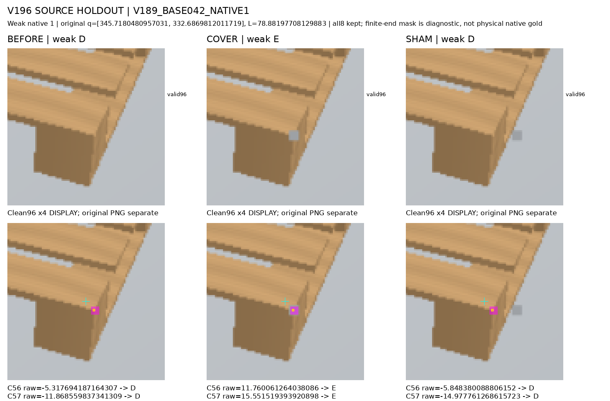

[기존 목표 위치와 proof](TRIPLET_00/TARGET_ASSOCIATION.json)

|variant|native|target|C56|C57|clean96|valid96|
|---|---|---|---|---|---|---|
|BEFORE|0|-1|D|D|[clean](TRIPLET_00/BEFORE_N0_CLEAN96.png)|[valid](TRIPLET_00/BEFORE_N0_VALID96.png)|
|BEFORE|1|0|D|D|[clean](TRIPLET_00/BEFORE_N1_CLEAN96.png)|[valid](TRIPLET_00/BEFORE_N1_VALID96.png)|
|BEFORE|2|-1|D|D|[clean](TRIPLET_00/BEFORE_N2_CLEAN96.png)|[valid](TRIPLET_00/BEFORE_N2_VALID96.png)|
|BEFORE|3|-1|D|D|[clean](TRIPLET_00/BEFORE_N3_CLEAN96.png)|[valid](TRIPLET_00/BEFORE_N3_VALID96.png)|
|BEFORE|4|-1|D|D|[clean](TRIPLET_00/BEFORE_N4_CLEAN96.png)|[valid](TRIPLET_00/BEFORE_N4_VALID96.png)|
|BEFORE|5|-1|D|D|[clean](TRIPLET_00/BEFORE_N5_CLEAN96.png)|[valid](TRIPLET_00/BEFORE_N5_VALID96.png)|
|BEFORE|6|-1|D|D|[clean](TRIPLET_00/BEFORE_N6_CLEAN96.png)|[valid](TRIPLET_00/BEFORE_N6_VALID96.png)|
|BEFORE|7|-1|D|D|[clean](TRIPLET_00/BEFORE_N7_CLEAN96.png)|[valid](TRIPLET_00/BEFORE_N7_VALID96.png)|
|COVER|0|-1|D|D|[clean](TRIPLET_00/COVER_N0_CLEAN96.png)|[valid](TRIPLET_00/COVER_N0_VALID96.png)|
|COVER|1|1|E|E|[clean](TRIPLET_00/COVER_N1_CLEAN96.png)|[valid](TRIPLET_00/COVER_N1_VALID96.png)|
|COVER|2|-1|D|D|[clean](TRIPLET_00/COVER_N2_CLEAN96.png)|[valid](TRIPLET_00/COVER_N2_VALID96.png)|
|COVER|3|-1|D|D|[clean](TRIPLET_00/COVER_N3_CLEAN96.png)|[valid](TRIPLET_00/COVER_N3_VALID96.png)|
|COVER|4|-1|D|D|[clean](TRIPLET_00/COVER_N4_CLEAN96.png)|[valid](TRIPLET_00/COVER_N4_VALID96.png)|
|COVER|5|-1|D|D|[clean](TRIPLET_00/COVER_N5_CLEAN96.png)|[valid](TRIPLET_00/COVER_N5_VALID96.png)|
|COVER|6|-1|D|D|[clean](TRIPLET_00/COVER_N6_CLEAN96.png)|[valid](TRIPLET_00/COVER_N6_VALID96.png)|
|COVER|7|-1|D|D|[clean](TRIPLET_00/COVER_N7_CLEAN96.png)|[valid](TRIPLET_00/COVER_N7_VALID96.png)|
|SHAM|0|-1|D|D|[clean](TRIPLET_00/SHAM_N0_CLEAN96.png)|[valid](TRIPLET_00/SHAM_N0_VALID96.png)|
|SHAM|1|0|D|D|[clean](TRIPLET_00/SHAM_N1_CLEAN96.png)|[valid](TRIPLET_00/SHAM_N1_VALID96.png)|
|SHAM|2|-1|D|D|[clean](TRIPLET_00/SHAM_N2_CLEAN96.png)|[valid](TRIPLET_00/SHAM_N2_VALID96.png)|
|SHAM|3|-1|D|D|[clean](TRIPLET_00/SHAM_N3_CLEAN96.png)|[valid](TRIPLET_00/SHAM_N3_VALID96.png)|
|SHAM|4|-1|D|D|[clean](TRIPLET_00/SHAM_N4_CLEAN96.png)|[valid](TRIPLET_00/SHAM_N4_VALID96.png)|
|SHAM|5|-1|D|D|[clean](TRIPLET_00/SHAM_N5_CLEAN96.png)|[valid](TRIPLET_00/SHAM_N5_VALID96.png)|
|SHAM|6|-1|D|D|[clean](TRIPLET_00/SHAM_N6_CLEAN96.png)|[valid](TRIPLET_00/SHAM_N6_VALID96.png)|
|SHAM|7|-1|D|D|[clean](TRIPLET_00/SHAM_N7_CLEAN96.png)|[valid](TRIPLET_00/SHAM_N7_VALID96.png)|

## V189_BASE050_NATIVE1

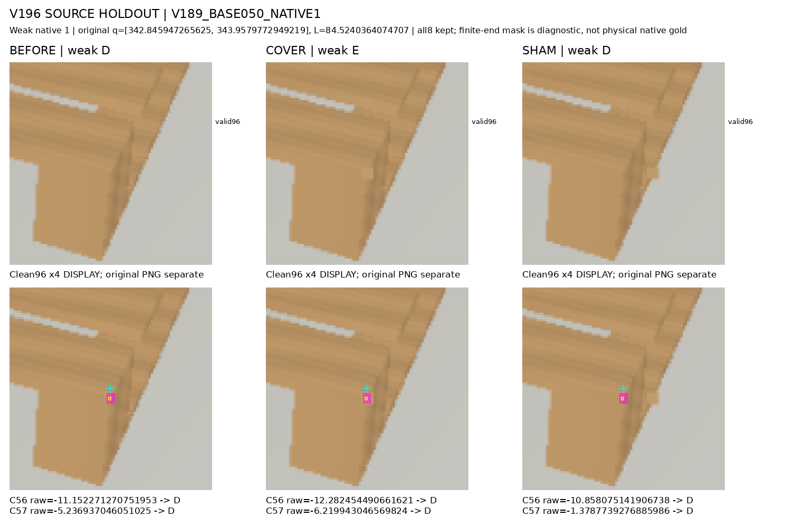

[기존 목표 위치와 proof](TRIPLET_01/TARGET_ASSOCIATION.json)

|variant|native|target|C56|C57|clean96|valid96|
|---|---|---|---|---|---|---|
|BEFORE|0|-1|D|D|[clean](TRIPLET_01/BEFORE_N0_CLEAN96.png)|[valid](TRIPLET_01/BEFORE_N0_VALID96.png)|
|BEFORE|1|0|D|D|[clean](TRIPLET_01/BEFORE_N1_CLEAN96.png)|[valid](TRIPLET_01/BEFORE_N1_VALID96.png)|
|BEFORE|2|-1|D|D|[clean](TRIPLET_01/BEFORE_N2_CLEAN96.png)|[valid](TRIPLET_01/BEFORE_N2_VALID96.png)|
|BEFORE|3|-1|D|D|[clean](TRIPLET_01/BEFORE_N3_CLEAN96.png)|[valid](TRIPLET_01/BEFORE_N3_VALID96.png)|
|BEFORE|4|-1|D|D|[clean](TRIPLET_01/BEFORE_N4_CLEAN96.png)|[valid](TRIPLET_01/BEFORE_N4_VALID96.png)|
|BEFORE|5|-1|D|D|[clean](TRIPLET_01/BEFORE_N5_CLEAN96.png)|[valid](TRIPLET_01/BEFORE_N5_VALID96.png)|
|BEFORE|6|-1|D|D|[clean](TRIPLET_01/BEFORE_N6_CLEAN96.png)|[valid](TRIPLET_01/BEFORE_N6_VALID96.png)|
|BEFORE|7|-1|D|D|[clean](TRIPLET_01/BEFORE_N7_CLEAN96.png)|[valid](TRIPLET_01/BEFORE_N7_VALID96.png)|
|COVER|0|-1|D|D|[clean](TRIPLET_01/COVER_N0_CLEAN96.png)|[valid](TRIPLET_01/COVER_N0_VALID96.png)|
|COVER|1|1|D|D|[clean](TRIPLET_01/COVER_N1_CLEAN96.png)|[valid](TRIPLET_01/COVER_N1_VALID96.png)|
|COVER|2|-1|D|D|[clean](TRIPLET_01/COVER_N2_CLEAN96.png)|[valid](TRIPLET_01/COVER_N2_VALID96.png)|
|COVER|3|-1|D|D|[clean](TRIPLET_01/COVER_N3_CLEAN96.png)|[valid](TRIPLET_01/COVER_N3_VALID96.png)|
|COVER|4|-1|D|D|[clean](TRIPLET_01/COVER_N4_CLEAN96.png)|[valid](TRIPLET_01/COVER_N4_VALID96.png)|
|COVER|5|-1|D|D|[clean](TRIPLET_01/COVER_N5_CLEAN96.png)|[valid](TRIPLET_01/COVER_N5_VALID96.png)|
|COVER|6|-1|D|D|[clean](TRIPLET_01/COVER_N6_CLEAN96.png)|[valid](TRIPLET_01/COVER_N6_VALID96.png)|
|COVER|7|-1|D|D|[clean](TRIPLET_01/COVER_N7_CLEAN96.png)|[valid](TRIPLET_01/COVER_N7_VALID96.png)|
|SHAM|0|-1|D|D|[clean](TRIPLET_01/SHAM_N0_CLEAN96.png)|[valid](TRIPLET_01/SHAM_N0_VALID96.png)|
|SHAM|1|0|D|D|[clean](TRIPLET_01/SHAM_N1_CLEAN96.png)|[valid](TRIPLET_01/SHAM_N1_VALID96.png)|
|SHAM|2|-1|D|D|[clean](TRIPLET_01/SHAM_N2_CLEAN96.png)|[valid](TRIPLET_01/SHAM_N2_VALID96.png)|
|SHAM|3|-1|D|D|[clean](TRIPLET_01/SHAM_N3_CLEAN96.png)|[valid](TRIPLET_01/SHAM_N3_VALID96.png)|
|SHAM|4|-1|D|D|[clean](TRIPLET_01/SHAM_N4_CLEAN96.png)|[valid](TRIPLET_01/SHAM_N4_VALID96.png)|
|SHAM|5|-1|D|D|[clean](TRIPLET_01/SHAM_N5_CLEAN96.png)|[valid](TRIPLET_01/SHAM_N5_VALID96.png)|
|SHAM|6|-1|D|D|[clean](TRIPLET_01/SHAM_N6_CLEAN96.png)|[valid](TRIPLET_01/SHAM_N6_VALID96.png)|
|SHAM|7|-1|D|D|[clean](TRIPLET_01/SHAM_N7_CLEAN96.png)|[valid](TRIPLET_01/SHAM_N7_VALID96.png)|

## V189_BASE050_NATIVE2

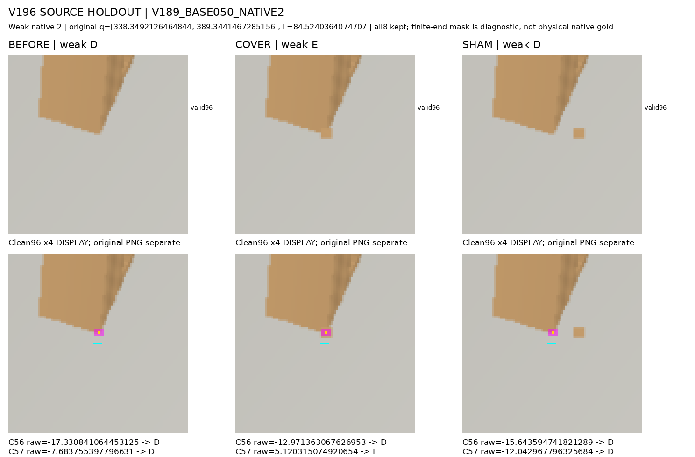

[기존 목표 위치와 proof](TRIPLET_02/TARGET_ASSOCIATION.json)

|variant|native|target|C56|C57|clean96|valid96|
|---|---|---|---|---|---|---|
|BEFORE|0|-1|D|D|[clean](TRIPLET_02/BEFORE_N0_CLEAN96.png)|[valid](TRIPLET_02/BEFORE_N0_VALID96.png)|
|BEFORE|1|-1|D|D|[clean](TRIPLET_02/BEFORE_N1_CLEAN96.png)|[valid](TRIPLET_02/BEFORE_N1_VALID96.png)|
|BEFORE|2|0|D|D|[clean](TRIPLET_02/BEFORE_N2_CLEAN96.png)|[valid](TRIPLET_02/BEFORE_N2_VALID96.png)|
|BEFORE|3|-1|D|D|[clean](TRIPLET_02/BEFORE_N3_CLEAN96.png)|[valid](TRIPLET_02/BEFORE_N3_VALID96.png)|
|BEFORE|4|-1|D|D|[clean](TRIPLET_02/BEFORE_N4_CLEAN96.png)|[valid](TRIPLET_02/BEFORE_N4_VALID96.png)|
|BEFORE|5|-1|D|D|[clean](TRIPLET_02/BEFORE_N5_CLEAN96.png)|[valid](TRIPLET_02/BEFORE_N5_VALID96.png)|
|BEFORE|6|-1|D|D|[clean](TRIPLET_02/BEFORE_N6_CLEAN96.png)|[valid](TRIPLET_02/BEFORE_N6_VALID96.png)|
|BEFORE|7|-1|D|D|[clean](TRIPLET_02/BEFORE_N7_CLEAN96.png)|[valid](TRIPLET_02/BEFORE_N7_VALID96.png)|
|COVER|0|-1|D|D|[clean](TRIPLET_02/COVER_N0_CLEAN96.png)|[valid](TRIPLET_02/COVER_N0_VALID96.png)|
|COVER|1|-1|D|D|[clean](TRIPLET_02/COVER_N1_CLEAN96.png)|[valid](TRIPLET_02/COVER_N1_VALID96.png)|
|COVER|2|1|D|E|[clean](TRIPLET_02/COVER_N2_CLEAN96.png)|[valid](TRIPLET_02/COVER_N2_VALID96.png)|
|COVER|3|-1|D|D|[clean](TRIPLET_02/COVER_N3_CLEAN96.png)|[valid](TRIPLET_02/COVER_N3_VALID96.png)|
|COVER|4|-1|D|D|[clean](TRIPLET_02/COVER_N4_CLEAN96.png)|[valid](TRIPLET_02/COVER_N4_VALID96.png)|
|COVER|5|-1|D|D|[clean](TRIPLET_02/COVER_N5_CLEAN96.png)|[valid](TRIPLET_02/COVER_N5_VALID96.png)|
|COVER|6|-1|D|D|[clean](TRIPLET_02/COVER_N6_CLEAN96.png)|[valid](TRIPLET_02/COVER_N6_VALID96.png)|
|COVER|7|-1|D|D|[clean](TRIPLET_02/COVER_N7_CLEAN96.png)|[valid](TRIPLET_02/COVER_N7_VALID96.png)|
|SHAM|0|-1|D|D|[clean](TRIPLET_02/SHAM_N0_CLEAN96.png)|[valid](TRIPLET_02/SHAM_N0_VALID96.png)|
|SHAM|1|-1|D|D|[clean](TRIPLET_02/SHAM_N1_CLEAN96.png)|[valid](TRIPLET_02/SHAM_N1_VALID96.png)|
|SHAM|2|0|D|D|[clean](TRIPLET_02/SHAM_N2_CLEAN96.png)|[valid](TRIPLET_02/SHAM_N2_VALID96.png)|
|SHAM|3|-1|D|D|[clean](TRIPLET_02/SHAM_N3_CLEAN96.png)|[valid](TRIPLET_02/SHAM_N3_VALID96.png)|
|SHAM|4|-1|D|D|[clean](TRIPLET_02/SHAM_N4_CLEAN96.png)|[valid](TRIPLET_02/SHAM_N4_VALID96.png)|
|SHAM|5|-1|D|D|[clean](TRIPLET_02/SHAM_N5_CLEAN96.png)|[valid](TRIPLET_02/SHAM_N5_VALID96.png)|
|SHAM|6|-1|D|D|[clean](TRIPLET_02/SHAM_N6_CLEAN96.png)|[valid](TRIPLET_02/SHAM_N6_VALID96.png)|
|SHAM|7|-1|D|D|[clean](TRIPLET_02/SHAM_N7_CLEAN96.png)|[valid](TRIPLET_02/SHAM_N7_VALID96.png)|

## V189_BASE074_NATIVE0

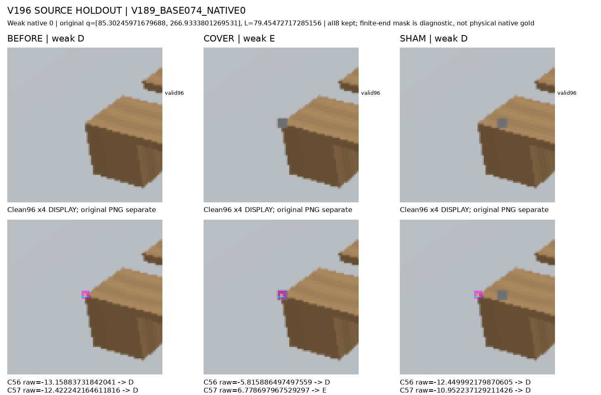

[기존 목표 위치와 proof](TRIPLET_03/TARGET_ASSOCIATION.json)

|variant|native|target|C56|C57|clean96|valid96|
|---|---|---|---|---|---|---|
|BEFORE|0|0|D|D|[clean](TRIPLET_03/BEFORE_N0_CLEAN96.png)|[valid](TRIPLET_03/BEFORE_N0_VALID96.png)|
|BEFORE|1|-1|D|D|[clean](TRIPLET_03/BEFORE_N1_CLEAN96.png)|[valid](TRIPLET_03/BEFORE_N1_VALID96.png)|
|BEFORE|2|-1|D|D|[clean](TRIPLET_03/BEFORE_N2_CLEAN96.png)|[valid](TRIPLET_03/BEFORE_N2_VALID96.png)|
|BEFORE|3|-1|D|D|[clean](TRIPLET_03/BEFORE_N3_CLEAN96.png)|[valid](TRIPLET_03/BEFORE_N3_VALID96.png)|
|BEFORE|4|-1|D|D|[clean](TRIPLET_03/BEFORE_N4_CLEAN96.png)|[valid](TRIPLET_03/BEFORE_N4_VALID96.png)|
|BEFORE|5|-1|D|D|[clean](TRIPLET_03/BEFORE_N5_CLEAN96.png)|[valid](TRIPLET_03/BEFORE_N5_VALID96.png)|
|BEFORE|6|-1|D|D|[clean](TRIPLET_03/BEFORE_N6_CLEAN96.png)|[valid](TRIPLET_03/BEFORE_N6_VALID96.png)|
|BEFORE|7|-1|D|D|[clean](TRIPLET_03/BEFORE_N7_CLEAN96.png)|[valid](TRIPLET_03/BEFORE_N7_VALID96.png)|
|COVER|0|1|D|E|[clean](TRIPLET_03/COVER_N0_CLEAN96.png)|[valid](TRIPLET_03/COVER_N0_VALID96.png)|
|COVER|1|-1|D|D|[clean](TRIPLET_03/COVER_N1_CLEAN96.png)|[valid](TRIPLET_03/COVER_N1_VALID96.png)|
|COVER|2|-1|D|D|[clean](TRIPLET_03/COVER_N2_CLEAN96.png)|[valid](TRIPLET_03/COVER_N2_VALID96.png)|
|COVER|3|-1|D|D|[clean](TRIPLET_03/COVER_N3_CLEAN96.png)|[valid](TRIPLET_03/COVER_N3_VALID96.png)|
|COVER|4|-1|D|D|[clean](TRIPLET_03/COVER_N4_CLEAN96.png)|[valid](TRIPLET_03/COVER_N4_VALID96.png)|
|COVER|5|-1|D|D|[clean](TRIPLET_03/COVER_N5_CLEAN96.png)|[valid](TRIPLET_03/COVER_N5_VALID96.png)|
|COVER|6|-1|D|D|[clean](TRIPLET_03/COVER_N6_CLEAN96.png)|[valid](TRIPLET_03/COVER_N6_VALID96.png)|
|COVER|7|-1|D|D|[clean](TRIPLET_03/COVER_N7_CLEAN96.png)|[valid](TRIPLET_03/COVER_N7_VALID96.png)|
|SHAM|0|0|D|D|[clean](TRIPLET_03/SHAM_N0_CLEAN96.png)|[valid](TRIPLET_03/SHAM_N0_VALID96.png)|
|SHAM|1|-1|D|D|[clean](TRIPLET_03/SHAM_N1_CLEAN96.png)|[valid](TRIPLET_03/SHAM_N1_VALID96.png)|
|SHAM|2|-1|D|D|[clean](TRIPLET_03/SHAM_N2_CLEAN96.png)|[valid](TRIPLET_03/SHAM_N2_VALID96.png)|
|SHAM|3|-1|D|D|[clean](TRIPLET_03/SHAM_N3_CLEAN96.png)|[valid](TRIPLET_03/SHAM_N3_VALID96.png)|
|SHAM|4|-1|D|D|[clean](TRIPLET_03/SHAM_N4_CLEAN96.png)|[valid](TRIPLET_03/SHAM_N4_VALID96.png)|
|SHAM|5|-1|D|D|[clean](TRIPLET_03/SHAM_N5_CLEAN96.png)|[valid](TRIPLET_03/SHAM_N5_VALID96.png)|
|SHAM|6|-1|D|D|[clean](TRIPLET_03/SHAM_N6_CLEAN96.png)|[valid](TRIPLET_03/SHAM_N6_VALID96.png)|
|SHAM|7|-1|D|D|[clean](TRIPLET_03/SHAM_N7_CLEAN96.png)|[valid](TRIPLET_03/SHAM_N7_VALID96.png)|

## V189_BASE074_NATIVE1

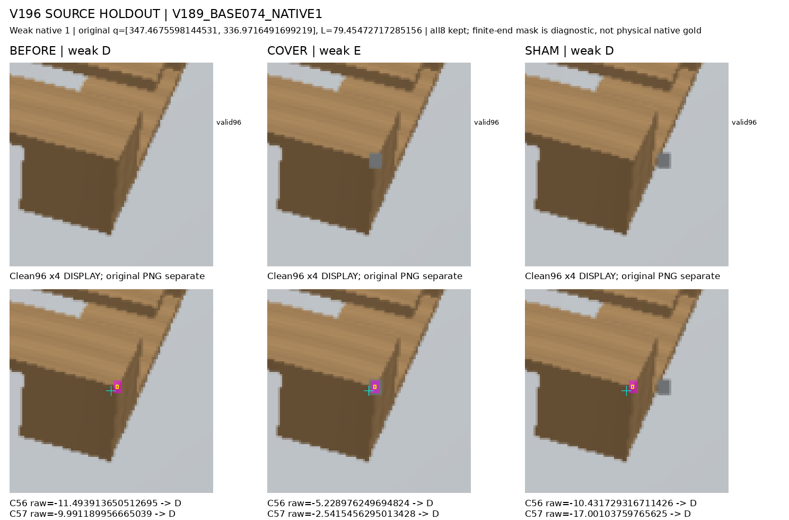

[기존 목표 위치와 proof](TRIPLET_04/TARGET_ASSOCIATION.json)

|variant|native|target|C56|C57|clean96|valid96|
|---|---|---|---|---|---|---|
|BEFORE|0|-1|D|D|[clean](TRIPLET_04/BEFORE_N0_CLEAN96.png)|[valid](TRIPLET_04/BEFORE_N0_VALID96.png)|
|BEFORE|1|0|D|D|[clean](TRIPLET_04/BEFORE_N1_CLEAN96.png)|[valid](TRIPLET_04/BEFORE_N1_VALID96.png)|
|BEFORE|2|-1|D|D|[clean](TRIPLET_04/BEFORE_N2_CLEAN96.png)|[valid](TRIPLET_04/BEFORE_N2_VALID96.png)|
|BEFORE|3|-1|D|D|[clean](TRIPLET_04/BEFORE_N3_CLEAN96.png)|[valid](TRIPLET_04/BEFORE_N3_VALID96.png)|
|BEFORE|4|-1|D|D|[clean](TRIPLET_04/BEFORE_N4_CLEAN96.png)|[valid](TRIPLET_04/BEFORE_N4_VALID96.png)|
|BEFORE|5|-1|D|D|[clean](TRIPLET_04/BEFORE_N5_CLEAN96.png)|[valid](TRIPLET_04/BEFORE_N5_VALID96.png)|
|BEFORE|6|-1|D|D|[clean](TRIPLET_04/BEFORE_N6_CLEAN96.png)|[valid](TRIPLET_04/BEFORE_N6_VALID96.png)|
|BEFORE|7|-1|D|D|[clean](TRIPLET_04/BEFORE_N7_CLEAN96.png)|[valid](TRIPLET_04/BEFORE_N7_VALID96.png)|
|COVER|0|-1|D|D|[clean](TRIPLET_04/COVER_N0_CLEAN96.png)|[valid](TRIPLET_04/COVER_N0_VALID96.png)|
|COVER|1|1|D|D|[clean](TRIPLET_04/COVER_N1_CLEAN96.png)|[valid](TRIPLET_04/COVER_N1_VALID96.png)|
|COVER|2|-1|D|D|[clean](TRIPLET_04/COVER_N2_CLEAN96.png)|[valid](TRIPLET_04/COVER_N2_VALID96.png)|
|COVER|3|-1|D|D|[clean](TRIPLET_04/COVER_N3_CLEAN96.png)|[valid](TRIPLET_04/COVER_N3_VALID96.png)|
|COVER|4|-1|D|D|[clean](TRIPLET_04/COVER_N4_CLEAN96.png)|[valid](TRIPLET_04/COVER_N4_VALID96.png)|
|COVER|5|-1|D|D|[clean](TRIPLET_04/COVER_N5_CLEAN96.png)|[valid](TRIPLET_04/COVER_N5_VALID96.png)|
|COVER|6|-1|D|D|[clean](TRIPLET_04/COVER_N6_CLEAN96.png)|[valid](TRIPLET_04/COVER_N6_VALID96.png)|
|COVER|7|-1|D|D|[clean](TRIPLET_04/COVER_N7_CLEAN96.png)|[valid](TRIPLET_04/COVER_N7_VALID96.png)|
|SHAM|0|-1|D|D|[clean](TRIPLET_04/SHAM_N0_CLEAN96.png)|[valid](TRIPLET_04/SHAM_N0_VALID96.png)|
|SHAM|1|0|D|D|[clean](TRIPLET_04/SHAM_N1_CLEAN96.png)|[valid](TRIPLET_04/SHAM_N1_VALID96.png)|
|SHAM|2|-1|D|D|[clean](TRIPLET_04/SHAM_N2_CLEAN96.png)|[valid](TRIPLET_04/SHAM_N2_VALID96.png)|
|SHAM|3|-1|D|D|[clean](TRIPLET_04/SHAM_N3_CLEAN96.png)|[valid](TRIPLET_04/SHAM_N3_VALID96.png)|
|SHAM|4|-1|D|D|[clean](TRIPLET_04/SHAM_N4_CLEAN96.png)|[valid](TRIPLET_04/SHAM_N4_VALID96.png)|
|SHAM|5|-1|D|D|[clean](TRIPLET_04/SHAM_N5_CLEAN96.png)|[valid](TRIPLET_04/SHAM_N5_VALID96.png)|
|SHAM|6|-1|D|D|[clean](TRIPLET_04/SHAM_N6_CLEAN96.png)|[valid](TRIPLET_04/SHAM_N6_VALID96.png)|
|SHAM|7|-1|D|D|[clean](TRIPLET_04/SHAM_N7_CLEAN96.png)|[valid](TRIPLET_04/SHAM_N7_VALID96.png)|

## V189_BASE074_NATIVE2

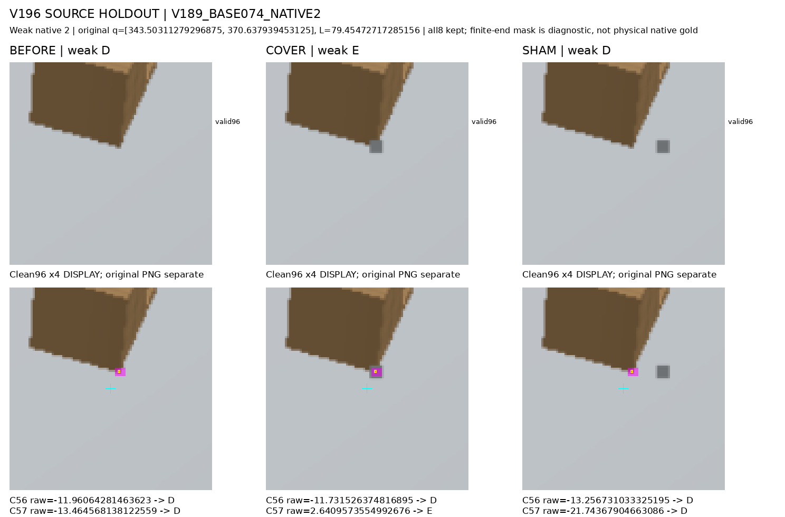

[기존 목표 위치와 proof](TRIPLET_05/TARGET_ASSOCIATION.json)

|variant|native|target|C56|C57|clean96|valid96|
|---|---|---|---|---|---|---|
|BEFORE|0|-1|D|D|[clean](TRIPLET_05/BEFORE_N0_CLEAN96.png)|[valid](TRIPLET_05/BEFORE_N0_VALID96.png)|
|BEFORE|1|-1|D|D|[clean](TRIPLET_05/BEFORE_N1_CLEAN96.png)|[valid](TRIPLET_05/BEFORE_N1_VALID96.png)|
|BEFORE|2|0|D|D|[clean](TRIPLET_05/BEFORE_N2_CLEAN96.png)|[valid](TRIPLET_05/BEFORE_N2_VALID96.png)|
|BEFORE|3|-1|D|D|[clean](TRIPLET_05/BEFORE_N3_CLEAN96.png)|[valid](TRIPLET_05/BEFORE_N3_VALID96.png)|
|BEFORE|4|-1|D|D|[clean](TRIPLET_05/BEFORE_N4_CLEAN96.png)|[valid](TRIPLET_05/BEFORE_N4_VALID96.png)|
|BEFORE|5|-1|D|D|[clean](TRIPLET_05/BEFORE_N5_CLEAN96.png)|[valid](TRIPLET_05/BEFORE_N5_VALID96.png)|
|BEFORE|6|-1|D|D|[clean](TRIPLET_05/BEFORE_N6_CLEAN96.png)|[valid](TRIPLET_05/BEFORE_N6_VALID96.png)|
|BEFORE|7|-1|D|D|[clean](TRIPLET_05/BEFORE_N7_CLEAN96.png)|[valid](TRIPLET_05/BEFORE_N7_VALID96.png)|
|COVER|0|-1|D|D|[clean](TRIPLET_05/COVER_N0_CLEAN96.png)|[valid](TRIPLET_05/COVER_N0_VALID96.png)|
|COVER|1|-1|D|D|[clean](TRIPLET_05/COVER_N1_CLEAN96.png)|[valid](TRIPLET_05/COVER_N1_VALID96.png)|
|COVER|2|1|D|E|[clean](TRIPLET_05/COVER_N2_CLEAN96.png)|[valid](TRIPLET_05/COVER_N2_VALID96.png)|
|COVER|3|-1|D|D|[clean](TRIPLET_05/COVER_N3_CLEAN96.png)|[valid](TRIPLET_05/COVER_N3_VALID96.png)|
|COVER|4|-1|D|D|[clean](TRIPLET_05/COVER_N4_CLEAN96.png)|[valid](TRIPLET_05/COVER_N4_VALID96.png)|
|COVER|5|-1|D|D|[clean](TRIPLET_05/COVER_N5_CLEAN96.png)|[valid](TRIPLET_05/COVER_N5_VALID96.png)|
|COVER|6|-1|D|D|[clean](TRIPLET_05/COVER_N6_CLEAN96.png)|[valid](TRIPLET_05/COVER_N6_VALID96.png)|
|COVER|7|-1|D|D|[clean](TRIPLET_05/COVER_N7_CLEAN96.png)|[valid](TRIPLET_05/COVER_N7_VALID96.png)|
|SHAM|0|-1|D|D|[clean](TRIPLET_05/SHAM_N0_CLEAN96.png)|[valid](TRIPLET_05/SHAM_N0_VALID96.png)|
|SHAM|1|-1|D|D|[clean](TRIPLET_05/SHAM_N1_CLEAN96.png)|[valid](TRIPLET_05/SHAM_N1_VALID96.png)|
|SHAM|2|0|D|D|[clean](TRIPLET_05/SHAM_N2_CLEAN96.png)|[valid](TRIPLET_05/SHAM_N2_VALID96.png)|
|SHAM|3|-1|D|D|[clean](TRIPLET_05/SHAM_N3_CLEAN96.png)|[valid](TRIPLET_05/SHAM_N3_VALID96.png)|
|SHAM|4|-1|D|D|[clean](TRIPLET_05/SHAM_N4_CLEAN96.png)|[valid](TRIPLET_05/SHAM_N4_VALID96.png)|
|SHAM|5|-1|D|D|[clean](TRIPLET_05/SHAM_N5_CLEAN96.png)|[valid](TRIPLET_05/SHAM_N5_VALID96.png)|
|SHAM|6|-1|D|D|[clean](TRIPLET_05/SHAM_N6_CLEAN96.png)|[valid](TRIPLET_05/SHAM_N6_VALID96.png)|
|SHAM|7|-1|D|D|[clean](TRIPLET_05/SHAM_N7_CLEAN96.png)|[valid](TRIPLET_05/SHAM_N7_VALID96.png)|

## V189_BASE074_NATIVE5

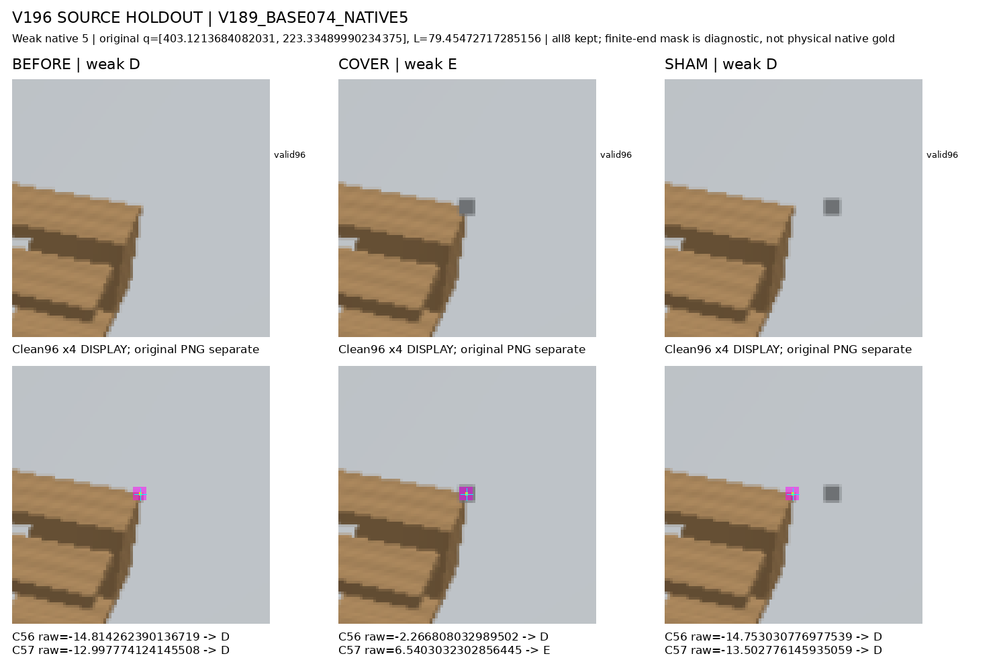

[기존 목표 위치와 proof](TRIPLET_06/TARGET_ASSOCIATION.json)

|variant|native|target|C56|C57|clean96|valid96|
|---|---|---|---|---|---|---|
|BEFORE|0|-1|D|D|[clean](TRIPLET_06/BEFORE_N0_CLEAN96.png)|[valid](TRIPLET_06/BEFORE_N0_VALID96.png)|
|BEFORE|1|-1|D|D|[clean](TRIPLET_06/BEFORE_N1_CLEAN96.png)|[valid](TRIPLET_06/BEFORE_N1_VALID96.png)|
|BEFORE|2|-1|D|D|[clean](TRIPLET_06/BEFORE_N2_CLEAN96.png)|[valid](TRIPLET_06/BEFORE_N2_VALID96.png)|
|BEFORE|3|-1|D|D|[clean](TRIPLET_06/BEFORE_N3_CLEAN96.png)|[valid](TRIPLET_06/BEFORE_N3_VALID96.png)|
|BEFORE|4|-1|D|D|[clean](TRIPLET_06/BEFORE_N4_CLEAN96.png)|[valid](TRIPLET_06/BEFORE_N4_VALID96.png)|
|BEFORE|5|0|D|D|[clean](TRIPLET_06/BEFORE_N5_CLEAN96.png)|[valid](TRIPLET_06/BEFORE_N5_VALID96.png)|
|BEFORE|6|-1|D|D|[clean](TRIPLET_06/BEFORE_N6_CLEAN96.png)|[valid](TRIPLET_06/BEFORE_N6_VALID96.png)|
|BEFORE|7|-1|D|D|[clean](TRIPLET_06/BEFORE_N7_CLEAN96.png)|[valid](TRIPLET_06/BEFORE_N7_VALID96.png)|
|COVER|0|-1|D|D|[clean](TRIPLET_06/COVER_N0_CLEAN96.png)|[valid](TRIPLET_06/COVER_N0_VALID96.png)|
|COVER|1|-1|D|D|[clean](TRIPLET_06/COVER_N1_CLEAN96.png)|[valid](TRIPLET_06/COVER_N1_VALID96.png)|
|COVER|2|-1|D|D|[clean](TRIPLET_06/COVER_N2_CLEAN96.png)|[valid](TRIPLET_06/COVER_N2_VALID96.png)|
|COVER|3|-1|D|D|[clean](TRIPLET_06/COVER_N3_CLEAN96.png)|[valid](TRIPLET_06/COVER_N3_VALID96.png)|
|COVER|4|-1|D|D|[clean](TRIPLET_06/COVER_N4_CLEAN96.png)|[valid](TRIPLET_06/COVER_N4_VALID96.png)|
|COVER|5|1|D|E|[clean](TRIPLET_06/COVER_N5_CLEAN96.png)|[valid](TRIPLET_06/COVER_N5_VALID96.png)|
|COVER|6|-1|D|D|[clean](TRIPLET_06/COVER_N6_CLEAN96.png)|[valid](TRIPLET_06/COVER_N6_VALID96.png)|
|COVER|7|-1|D|D|[clean](TRIPLET_06/COVER_N7_CLEAN96.png)|[valid](TRIPLET_06/COVER_N7_VALID96.png)|
|SHAM|0|-1|D|D|[clean](TRIPLET_06/SHAM_N0_CLEAN96.png)|[valid](TRIPLET_06/SHAM_N0_VALID96.png)|
|SHAM|1|-1|D|D|[clean](TRIPLET_06/SHAM_N1_CLEAN96.png)|[valid](TRIPLET_06/SHAM_N1_VALID96.png)|
|SHAM|2|-1|D|D|[clean](TRIPLET_06/SHAM_N2_CLEAN96.png)|[valid](TRIPLET_06/SHAM_N2_VALID96.png)|
|SHAM|3|-1|D|D|[clean](TRIPLET_06/SHAM_N3_CLEAN96.png)|[valid](TRIPLET_06/SHAM_N3_VALID96.png)|
|SHAM|4|-1|D|D|[clean](TRIPLET_06/SHAM_N4_CLEAN96.png)|[valid](TRIPLET_06/SHAM_N4_VALID96.png)|
|SHAM|5|0|D|D|[clean](TRIPLET_06/SHAM_N5_CLEAN96.png)|[valid](TRIPLET_06/SHAM_N5_VALID96.png)|
|SHAM|6|-1|D|D|[clean](TRIPLET_06/SHAM_N6_CLEAN96.png)|[valid](TRIPLET_06/SHAM_N6_VALID96.png)|
|SHAM|7|-1|D|D|[clean](TRIPLET_06/SHAM_N7_CLEAN96.png)|[valid](TRIPLET_06/SHAM_N7_VALID96.png)|

## V189_BASE075_NATIVE0

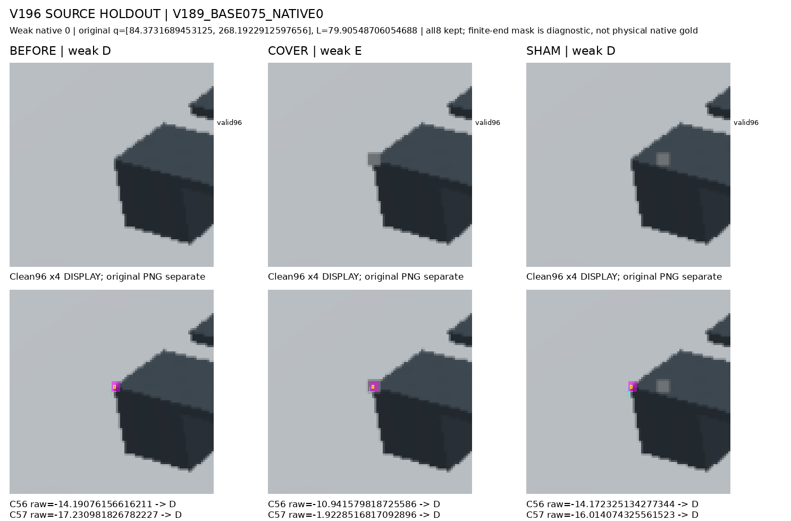

[기존 목표 위치와 proof](TRIPLET_07/TARGET_ASSOCIATION.json)

|variant|native|target|C56|C57|clean96|valid96|
|---|---|---|---|---|---|---|
|BEFORE|0|0|D|D|[clean](TRIPLET_07/BEFORE_N0_CLEAN96.png)|[valid](TRIPLET_07/BEFORE_N0_VALID96.png)|
|BEFORE|1|-1|D|D|[clean](TRIPLET_07/BEFORE_N1_CLEAN96.png)|[valid](TRIPLET_07/BEFORE_N1_VALID96.png)|
|BEFORE|2|-1|D|D|[clean](TRIPLET_07/BEFORE_N2_CLEAN96.png)|[valid](TRIPLET_07/BEFORE_N2_VALID96.png)|
|BEFORE|3|-1|D|D|[clean](TRIPLET_07/BEFORE_N3_CLEAN96.png)|[valid](TRIPLET_07/BEFORE_N3_VALID96.png)|
|BEFORE|4|-1|D|D|[clean](TRIPLET_07/BEFORE_N4_CLEAN96.png)|[valid](TRIPLET_07/BEFORE_N4_VALID96.png)|
|BEFORE|5|-1|D|D|[clean](TRIPLET_07/BEFORE_N5_CLEAN96.png)|[valid](TRIPLET_07/BEFORE_N5_VALID96.png)|
|BEFORE|6|-1|D|D|[clean](TRIPLET_07/BEFORE_N6_CLEAN96.png)|[valid](TRIPLET_07/BEFORE_N6_VALID96.png)|
|BEFORE|7|-1|D|D|[clean](TRIPLET_07/BEFORE_N7_CLEAN96.png)|[valid](TRIPLET_07/BEFORE_N7_VALID96.png)|
|COVER|0|1|D|D|[clean](TRIPLET_07/COVER_N0_CLEAN96.png)|[valid](TRIPLET_07/COVER_N0_VALID96.png)|
|COVER|1|-1|D|D|[clean](TRIPLET_07/COVER_N1_CLEAN96.png)|[valid](TRIPLET_07/COVER_N1_VALID96.png)|
|COVER|2|-1|D|D|[clean](TRIPLET_07/COVER_N2_CLEAN96.png)|[valid](TRIPLET_07/COVER_N2_VALID96.png)|
|COVER|3|-1|D|D|[clean](TRIPLET_07/COVER_N3_CLEAN96.png)|[valid](TRIPLET_07/COVER_N3_VALID96.png)|
|COVER|4|-1|D|D|[clean](TRIPLET_07/COVER_N4_CLEAN96.png)|[valid](TRIPLET_07/COVER_N4_VALID96.png)|
|COVER|5|-1|D|D|[clean](TRIPLET_07/COVER_N5_CLEAN96.png)|[valid](TRIPLET_07/COVER_N5_VALID96.png)|
|COVER|6|-1|D|D|[clean](TRIPLET_07/COVER_N6_CLEAN96.png)|[valid](TRIPLET_07/COVER_N6_VALID96.png)|
|COVER|7|-1|D|D|[clean](TRIPLET_07/COVER_N7_CLEAN96.png)|[valid](TRIPLET_07/COVER_N7_VALID96.png)|
|SHAM|0|0|D|D|[clean](TRIPLET_07/SHAM_N0_CLEAN96.png)|[valid](TRIPLET_07/SHAM_N0_VALID96.png)|
|SHAM|1|-1|D|D|[clean](TRIPLET_07/SHAM_N1_CLEAN96.png)|[valid](TRIPLET_07/SHAM_N1_VALID96.png)|
|SHAM|2|-1|D|D|[clean](TRIPLET_07/SHAM_N2_CLEAN96.png)|[valid](TRIPLET_07/SHAM_N2_VALID96.png)|
|SHAM|3|-1|D|D|[clean](TRIPLET_07/SHAM_N3_CLEAN96.png)|[valid](TRIPLET_07/SHAM_N3_VALID96.png)|
|SHAM|4|-1|D|D|[clean](TRIPLET_07/SHAM_N4_CLEAN96.png)|[valid](TRIPLET_07/SHAM_N4_VALID96.png)|
|SHAM|5|-1|D|D|[clean](TRIPLET_07/SHAM_N5_CLEAN96.png)|[valid](TRIPLET_07/SHAM_N5_VALID96.png)|
|SHAM|6|-1|D|D|[clean](TRIPLET_07/SHAM_N6_CLEAN96.png)|[valid](TRIPLET_07/SHAM_N6_VALID96.png)|
|SHAM|7|-1|D|D|[clean](TRIPLET_07/SHAM_N7_CLEAN96.png)|[valid](TRIPLET_07/SHAM_N7_VALID96.png)|

## V189_BASE075_NATIVE1

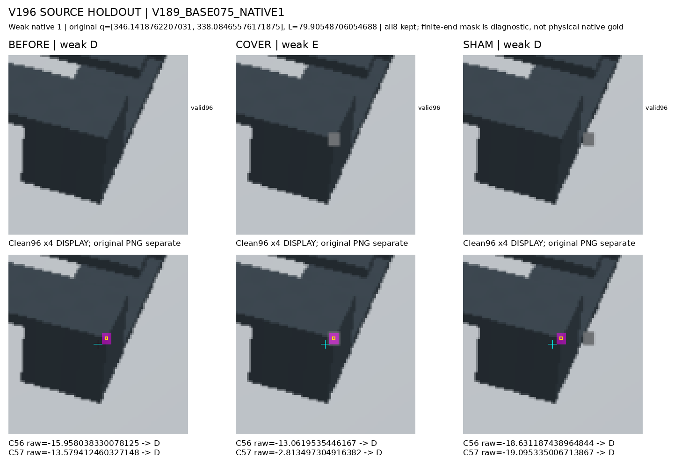

[기존 목표 위치와 proof](TRIPLET_08/TARGET_ASSOCIATION.json)

|variant|native|target|C56|C57|clean96|valid96|
|---|---|---|---|---|---|---|
|BEFORE|0|-1|D|D|[clean](TRIPLET_08/BEFORE_N0_CLEAN96.png)|[valid](TRIPLET_08/BEFORE_N0_VALID96.png)|
|BEFORE|1|0|D|D|[clean](TRIPLET_08/BEFORE_N1_CLEAN96.png)|[valid](TRIPLET_08/BEFORE_N1_VALID96.png)|
|BEFORE|2|-1|D|D|[clean](TRIPLET_08/BEFORE_N2_CLEAN96.png)|[valid](TRIPLET_08/BEFORE_N2_VALID96.png)|
|BEFORE|3|-1|D|D|[clean](TRIPLET_08/BEFORE_N3_CLEAN96.png)|[valid](TRIPLET_08/BEFORE_N3_VALID96.png)|
|BEFORE|4|-1|D|D|[clean](TRIPLET_08/BEFORE_N4_CLEAN96.png)|[valid](TRIPLET_08/BEFORE_N4_VALID96.png)|
|BEFORE|5|-1|D|D|[clean](TRIPLET_08/BEFORE_N5_CLEAN96.png)|[valid](TRIPLET_08/BEFORE_N5_VALID96.png)|
|BEFORE|6|-1|D|D|[clean](TRIPLET_08/BEFORE_N6_CLEAN96.png)|[valid](TRIPLET_08/BEFORE_N6_VALID96.png)|
|BEFORE|7|-1|D|D|[clean](TRIPLET_08/BEFORE_N7_CLEAN96.png)|[valid](TRIPLET_08/BEFORE_N7_VALID96.png)|
|COVER|0|-1|D|D|[clean](TRIPLET_08/COVER_N0_CLEAN96.png)|[valid](TRIPLET_08/COVER_N0_VALID96.png)|
|COVER|1|1|D|D|[clean](TRIPLET_08/COVER_N1_CLEAN96.png)|[valid](TRIPLET_08/COVER_N1_VALID96.png)|
|COVER|2|-1|D|D|[clean](TRIPLET_08/COVER_N2_CLEAN96.png)|[valid](TRIPLET_08/COVER_N2_VALID96.png)|
|COVER|3|-1|D|D|[clean](TRIPLET_08/COVER_N3_CLEAN96.png)|[valid](TRIPLET_08/COVER_N3_VALID96.png)|
|COVER|4|-1|D|D|[clean](TRIPLET_08/COVER_N4_CLEAN96.png)|[valid](TRIPLET_08/COVER_N4_VALID96.png)|
|COVER|5|-1|D|D|[clean](TRIPLET_08/COVER_N5_CLEAN96.png)|[valid](TRIPLET_08/COVER_N5_VALID96.png)|
|COVER|6|-1|D|D|[clean](TRIPLET_08/COVER_N6_CLEAN96.png)|[valid](TRIPLET_08/COVER_N6_VALID96.png)|
|COVER|7|-1|D|D|[clean](TRIPLET_08/COVER_N7_CLEAN96.png)|[valid](TRIPLET_08/COVER_N7_VALID96.png)|
|SHAM|0|-1|D|D|[clean](TRIPLET_08/SHAM_N0_CLEAN96.png)|[valid](TRIPLET_08/SHAM_N0_VALID96.png)|
|SHAM|1|0|D|D|[clean](TRIPLET_08/SHAM_N1_CLEAN96.png)|[valid](TRIPLET_08/SHAM_N1_VALID96.png)|
|SHAM|2|-1|D|D|[clean](TRIPLET_08/SHAM_N2_CLEAN96.png)|[valid](TRIPLET_08/SHAM_N2_VALID96.png)|
|SHAM|3|-1|D|D|[clean](TRIPLET_08/SHAM_N3_CLEAN96.png)|[valid](TRIPLET_08/SHAM_N3_VALID96.png)|
|SHAM|4|-1|D|D|[clean](TRIPLET_08/SHAM_N4_CLEAN96.png)|[valid](TRIPLET_08/SHAM_N4_VALID96.png)|
|SHAM|5|-1|D|D|[clean](TRIPLET_08/SHAM_N5_CLEAN96.png)|[valid](TRIPLET_08/SHAM_N5_VALID96.png)|
|SHAM|6|-1|D|D|[clean](TRIPLET_08/SHAM_N6_CLEAN96.png)|[valid](TRIPLET_08/SHAM_N6_VALID96.png)|
|SHAM|7|-1|D|D|[clean](TRIPLET_08/SHAM_N7_CLEAN96.png)|[valid](TRIPLET_08/SHAM_N7_VALID96.png)|

## V189_BASE075_NATIVE2

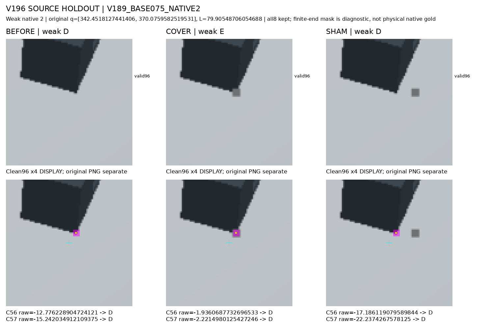

[기존 목표 위치와 proof](TRIPLET_09/TARGET_ASSOCIATION.json)

|variant|native|target|C56|C57|clean96|valid96|
|---|---|---|---|---|---|---|
|BEFORE|0|-1|D|D|[clean](TRIPLET_09/BEFORE_N0_CLEAN96.png)|[valid](TRIPLET_09/BEFORE_N0_VALID96.png)|
|BEFORE|1|-1|D|D|[clean](TRIPLET_09/BEFORE_N1_CLEAN96.png)|[valid](TRIPLET_09/BEFORE_N1_VALID96.png)|
|BEFORE|2|0|D|D|[clean](TRIPLET_09/BEFORE_N2_CLEAN96.png)|[valid](TRIPLET_09/BEFORE_N2_VALID96.png)|
|BEFORE|3|-1|D|D|[clean](TRIPLET_09/BEFORE_N3_CLEAN96.png)|[valid](TRIPLET_09/BEFORE_N3_VALID96.png)|
|BEFORE|4|-1|D|D|[clean](TRIPLET_09/BEFORE_N4_CLEAN96.png)|[valid](TRIPLET_09/BEFORE_N4_VALID96.png)|
|BEFORE|5|-1|D|D|[clean](TRIPLET_09/BEFORE_N5_CLEAN96.png)|[valid](TRIPLET_09/BEFORE_N5_VALID96.png)|
|BEFORE|6|-1|D|D|[clean](TRIPLET_09/BEFORE_N6_CLEAN96.png)|[valid](TRIPLET_09/BEFORE_N6_VALID96.png)|
|BEFORE|7|-1|D|D|[clean](TRIPLET_09/BEFORE_N7_CLEAN96.png)|[valid](TRIPLET_09/BEFORE_N7_VALID96.png)|
|COVER|0|-1|D|D|[clean](TRIPLET_09/COVER_N0_CLEAN96.png)|[valid](TRIPLET_09/COVER_N0_VALID96.png)|
|COVER|1|-1|D|D|[clean](TRIPLET_09/COVER_N1_CLEAN96.png)|[valid](TRIPLET_09/COVER_N1_VALID96.png)|
|COVER|2|1|D|D|[clean](TRIPLET_09/COVER_N2_CLEAN96.png)|[valid](TRIPLET_09/COVER_N2_VALID96.png)|
|COVER|3|-1|D|D|[clean](TRIPLET_09/COVER_N3_CLEAN96.png)|[valid](TRIPLET_09/COVER_N3_VALID96.png)|
|COVER|4|-1|D|D|[clean](TRIPLET_09/COVER_N4_CLEAN96.png)|[valid](TRIPLET_09/COVER_N4_VALID96.png)|
|COVER|5|-1|D|D|[clean](TRIPLET_09/COVER_N5_CLEAN96.png)|[valid](TRIPLET_09/COVER_N5_VALID96.png)|
|COVER|6|-1|D|D|[clean](TRIPLET_09/COVER_N6_CLEAN96.png)|[valid](TRIPLET_09/COVER_N6_VALID96.png)|
|COVER|7|-1|D|D|[clean](TRIPLET_09/COVER_N7_CLEAN96.png)|[valid](TRIPLET_09/COVER_N7_VALID96.png)|
|SHAM|0|-1|D|D|[clean](TRIPLET_09/SHAM_N0_CLEAN96.png)|[valid](TRIPLET_09/SHAM_N0_VALID96.png)|
|SHAM|1|-1|D|D|[clean](TRIPLET_09/SHAM_N1_CLEAN96.png)|[valid](TRIPLET_09/SHAM_N1_VALID96.png)|
|SHAM|2|0|D|D|[clean](TRIPLET_09/SHAM_N2_CLEAN96.png)|[valid](TRIPLET_09/SHAM_N2_VALID96.png)|
|SHAM|3|-1|D|D|[clean](TRIPLET_09/SHAM_N3_CLEAN96.png)|[valid](TRIPLET_09/SHAM_N3_VALID96.png)|
|SHAM|4|-1|D|D|[clean](TRIPLET_09/SHAM_N4_CLEAN96.png)|[valid](TRIPLET_09/SHAM_N4_VALID96.png)|
|SHAM|5|-1|D|D|[clean](TRIPLET_09/SHAM_N5_CLEAN96.png)|[valid](TRIPLET_09/SHAM_N5_VALID96.png)|
|SHAM|6|-1|D|D|[clean](TRIPLET_09/SHAM_N6_CLEAN96.png)|[valid](TRIPLET_09/SHAM_N6_VALID96.png)|
|SHAM|7|-1|D|D|[clean](TRIPLET_09/SHAM_N7_CLEAN96.png)|[valid](TRIPLET_09/SHAM_N7_VALID96.png)|

## V189_BASE075_NATIVE5

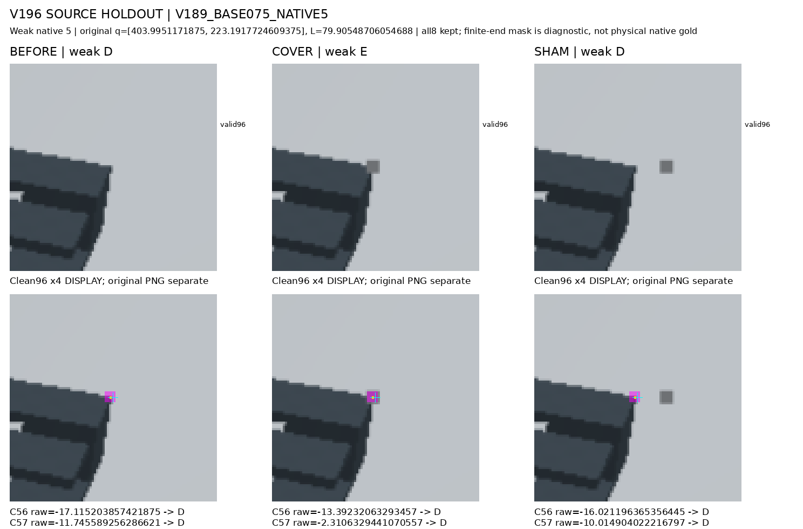

[기존 목표 위치와 proof](TRIPLET_10/TARGET_ASSOCIATION.json)

|variant|native|target|C56|C57|clean96|valid96|
|---|---|---|---|---|---|---|
|BEFORE|0|-1|D|D|[clean](TRIPLET_10/BEFORE_N0_CLEAN96.png)|[valid](TRIPLET_10/BEFORE_N0_VALID96.png)|
|BEFORE|1|-1|D|D|[clean](TRIPLET_10/BEFORE_N1_CLEAN96.png)|[valid](TRIPLET_10/BEFORE_N1_VALID96.png)|
|BEFORE|2|-1|D|D|[clean](TRIPLET_10/BEFORE_N2_CLEAN96.png)|[valid](TRIPLET_10/BEFORE_N2_VALID96.png)|
|BEFORE|3|-1|D|D|[clean](TRIPLET_10/BEFORE_N3_CLEAN96.png)|[valid](TRIPLET_10/BEFORE_N3_VALID96.png)|
|BEFORE|4|-1|D|D|[clean](TRIPLET_10/BEFORE_N4_CLEAN96.png)|[valid](TRIPLET_10/BEFORE_N4_VALID96.png)|
|BEFORE|5|0|D|D|[clean](TRIPLET_10/BEFORE_N5_CLEAN96.png)|[valid](TRIPLET_10/BEFORE_N5_VALID96.png)|
|BEFORE|6|-1|D|D|[clean](TRIPLET_10/BEFORE_N6_CLEAN96.png)|[valid](TRIPLET_10/BEFORE_N6_VALID96.png)|
|BEFORE|7|-1|D|D|[clean](TRIPLET_10/BEFORE_N7_CLEAN96.png)|[valid](TRIPLET_10/BEFORE_N7_VALID96.png)|
|COVER|0|-1|D|D|[clean](TRIPLET_10/COVER_N0_CLEAN96.png)|[valid](TRIPLET_10/COVER_N0_VALID96.png)|
|COVER|1|-1|D|D|[clean](TRIPLET_10/COVER_N1_CLEAN96.png)|[valid](TRIPLET_10/COVER_N1_VALID96.png)|
|COVER|2|-1|D|D|[clean](TRIPLET_10/COVER_N2_CLEAN96.png)|[valid](TRIPLET_10/COVER_N2_VALID96.png)|
|COVER|3|-1|D|D|[clean](TRIPLET_10/COVER_N3_CLEAN96.png)|[valid](TRIPLET_10/COVER_N3_VALID96.png)|
|COVER|4|-1|D|D|[clean](TRIPLET_10/COVER_N4_CLEAN96.png)|[valid](TRIPLET_10/COVER_N4_VALID96.png)|
|COVER|5|1|D|D|[clean](TRIPLET_10/COVER_N5_CLEAN96.png)|[valid](TRIPLET_10/COVER_N5_VALID96.png)|
|COVER|6|-1|D|D|[clean](TRIPLET_10/COVER_N6_CLEAN96.png)|[valid](TRIPLET_10/COVER_N6_VALID96.png)|
|COVER|7|-1|D|D|[clean](TRIPLET_10/COVER_N7_CLEAN96.png)|[valid](TRIPLET_10/COVER_N7_VALID96.png)|
|SHAM|0|-1|D|D|[clean](TRIPLET_10/SHAM_N0_CLEAN96.png)|[valid](TRIPLET_10/SHAM_N0_VALID96.png)|
|SHAM|1|-1|D|D|[clean](TRIPLET_10/SHAM_N1_CLEAN96.png)|[valid](TRIPLET_10/SHAM_N1_VALID96.png)|
|SHAM|2|-1|D|D|[clean](TRIPLET_10/SHAM_N2_CLEAN96.png)|[valid](TRIPLET_10/SHAM_N2_VALID96.png)|
|SHAM|3|-1|D|D|[clean](TRIPLET_10/SHAM_N3_CLEAN96.png)|[valid](TRIPLET_10/SHAM_N3_VALID96.png)|
|SHAM|4|-1|D|D|[clean](TRIPLET_10/SHAM_N4_CLEAN96.png)|[valid](TRIPLET_10/SHAM_N4_VALID96.png)|
|SHAM|5|0|D|D|[clean](TRIPLET_10/SHAM_N5_CLEAN96.png)|[valid](TRIPLET_10/SHAM_N5_VALID96.png)|
|SHAM|6|-1|D|D|[clean](TRIPLET_10/SHAM_N6_CLEAN96.png)|[valid](TRIPLET_10/SHAM_N6_VALID96.png)|
|SHAM|7|-1|D|D|[clean](TRIPLET_10/SHAM_N7_CLEAN96.png)|[valid](TRIPLET_10/SHAM_N7_VALID96.png)|

## V189_BASE083_NATIVE0

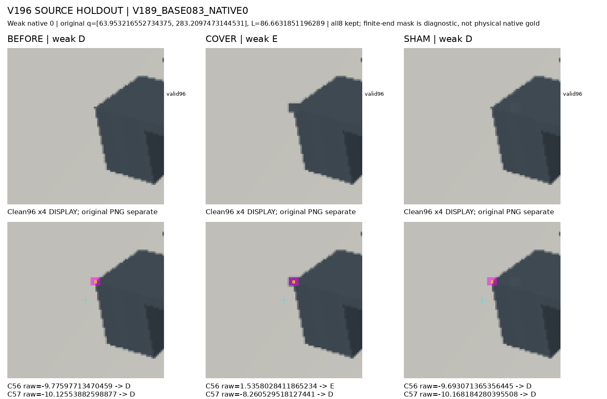

[기존 목표 위치와 proof](TRIPLET_11/TARGET_ASSOCIATION.json)

|variant|native|target|C56|C57|clean96|valid96|
|---|---|---|---|---|---|---|
|BEFORE|0|0|D|D|[clean](TRIPLET_11/BEFORE_N0_CLEAN96.png)|[valid](TRIPLET_11/BEFORE_N0_VALID96.png)|
|BEFORE|1|-1|D|D|[clean](TRIPLET_11/BEFORE_N1_CLEAN96.png)|[valid](TRIPLET_11/BEFORE_N1_VALID96.png)|
|BEFORE|2|-1|E|E|[clean](TRIPLET_11/BEFORE_N2_CLEAN96.png)|[valid](TRIPLET_11/BEFORE_N2_VALID96.png)|
|BEFORE|3|-1|D|D|[clean](TRIPLET_11/BEFORE_N3_CLEAN96.png)|[valid](TRIPLET_11/BEFORE_N3_VALID96.png)|
|BEFORE|4|-1|D|D|[clean](TRIPLET_11/BEFORE_N4_CLEAN96.png)|[valid](TRIPLET_11/BEFORE_N4_VALID96.png)|
|BEFORE|5|-1|D|D|[clean](TRIPLET_11/BEFORE_N5_CLEAN96.png)|[valid](TRIPLET_11/BEFORE_N5_VALID96.png)|
|BEFORE|6|-1|D|D|[clean](TRIPLET_11/BEFORE_N6_CLEAN96.png)|[valid](TRIPLET_11/BEFORE_N6_VALID96.png)|
|BEFORE|7|-1|D|D|[clean](TRIPLET_11/BEFORE_N7_CLEAN96.png)|[valid](TRIPLET_11/BEFORE_N7_VALID96.png)|
|COVER|0|1|E|D|[clean](TRIPLET_11/COVER_N0_CLEAN96.png)|[valid](TRIPLET_11/COVER_N0_VALID96.png)|
|COVER|1|-1|D|D|[clean](TRIPLET_11/COVER_N1_CLEAN96.png)|[valid](TRIPLET_11/COVER_N1_VALID96.png)|
|COVER|2|-1|E|E|[clean](TRIPLET_11/COVER_N2_CLEAN96.png)|[valid](TRIPLET_11/COVER_N2_VALID96.png)|
|COVER|3|-1|D|D|[clean](TRIPLET_11/COVER_N3_CLEAN96.png)|[valid](TRIPLET_11/COVER_N3_VALID96.png)|
|COVER|4|-1|D|D|[clean](TRIPLET_11/COVER_N4_CLEAN96.png)|[valid](TRIPLET_11/COVER_N4_VALID96.png)|
|COVER|5|-1|D|D|[clean](TRIPLET_11/COVER_N5_CLEAN96.png)|[valid](TRIPLET_11/COVER_N5_VALID96.png)|
|COVER|6|-1|D|D|[clean](TRIPLET_11/COVER_N6_CLEAN96.png)|[valid](TRIPLET_11/COVER_N6_VALID96.png)|
|COVER|7|-1|D|D|[clean](TRIPLET_11/COVER_N7_CLEAN96.png)|[valid](TRIPLET_11/COVER_N7_VALID96.png)|
|SHAM|0|0|D|D|[clean](TRIPLET_11/SHAM_N0_CLEAN96.png)|[valid](TRIPLET_11/SHAM_N0_VALID96.png)|
|SHAM|1|-1|D|D|[clean](TRIPLET_11/SHAM_N1_CLEAN96.png)|[valid](TRIPLET_11/SHAM_N1_VALID96.png)|
|SHAM|2|-1|E|E|[clean](TRIPLET_11/SHAM_N2_CLEAN96.png)|[valid](TRIPLET_11/SHAM_N2_VALID96.png)|
|SHAM|3|-1|D|D|[clean](TRIPLET_11/SHAM_N3_CLEAN96.png)|[valid](TRIPLET_11/SHAM_N3_VALID96.png)|
|SHAM|4|-1|D|D|[clean](TRIPLET_11/SHAM_N4_CLEAN96.png)|[valid](TRIPLET_11/SHAM_N4_VALID96.png)|
|SHAM|5|-1|D|D|[clean](TRIPLET_11/SHAM_N5_CLEAN96.png)|[valid](TRIPLET_11/SHAM_N5_VALID96.png)|
|SHAM|6|-1|D|D|[clean](TRIPLET_11/SHAM_N6_CLEAN96.png)|[valid](TRIPLET_11/SHAM_N6_VALID96.png)|
|SHAM|7|-1|D|D|[clean](TRIPLET_11/SHAM_N7_CLEAN96.png)|[valid](TRIPLET_11/SHAM_N7_VALID96.png)|

## V189_BASE083_NATIVE1

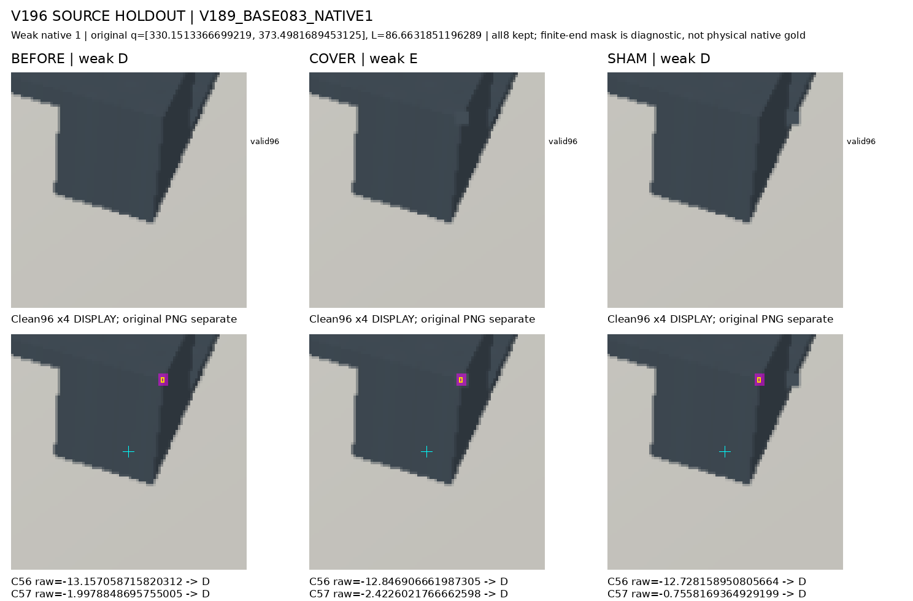

[기존 목표 위치와 proof](TRIPLET_12/TARGET_ASSOCIATION.json)

|variant|native|target|C56|C57|clean96|valid96|
|---|---|---|---|---|---|---|
|BEFORE|0|-1|D|D|[clean](TRIPLET_12/BEFORE_N0_CLEAN96.png)|[valid](TRIPLET_12/BEFORE_N0_VALID96.png)|
|BEFORE|1|0|D|D|[clean](TRIPLET_12/BEFORE_N1_CLEAN96.png)|[valid](TRIPLET_12/BEFORE_N1_VALID96.png)|
|BEFORE|2|-1|E|E|[clean](TRIPLET_12/BEFORE_N2_CLEAN96.png)|[valid](TRIPLET_12/BEFORE_N2_VALID96.png)|
|BEFORE|3|-1|D|D|[clean](TRIPLET_12/BEFORE_N3_CLEAN96.png)|[valid](TRIPLET_12/BEFORE_N3_VALID96.png)|
|BEFORE|4|-1|D|D|[clean](TRIPLET_12/BEFORE_N4_CLEAN96.png)|[valid](TRIPLET_12/BEFORE_N4_VALID96.png)|
|BEFORE|5|-1|D|D|[clean](TRIPLET_12/BEFORE_N5_CLEAN96.png)|[valid](TRIPLET_12/BEFORE_N5_VALID96.png)|
|BEFORE|6|-1|D|D|[clean](TRIPLET_12/BEFORE_N6_CLEAN96.png)|[valid](TRIPLET_12/BEFORE_N6_VALID96.png)|
|BEFORE|7|-1|D|D|[clean](TRIPLET_12/BEFORE_N7_CLEAN96.png)|[valid](TRIPLET_12/BEFORE_N7_VALID96.png)|
|COVER|0|-1|D|D|[clean](TRIPLET_12/COVER_N0_CLEAN96.png)|[valid](TRIPLET_12/COVER_N0_VALID96.png)|
|COVER|1|1|D|D|[clean](TRIPLET_12/COVER_N1_CLEAN96.png)|[valid](TRIPLET_12/COVER_N1_VALID96.png)|
|COVER|2|-1|E|E|[clean](TRIPLET_12/COVER_N2_CLEAN96.png)|[valid](TRIPLET_12/COVER_N2_VALID96.png)|
|COVER|3|-1|D|D|[clean](TRIPLET_12/COVER_N3_CLEAN96.png)|[valid](TRIPLET_12/COVER_N3_VALID96.png)|
|COVER|4|-1|D|D|[clean](TRIPLET_12/COVER_N4_CLEAN96.png)|[valid](TRIPLET_12/COVER_N4_VALID96.png)|
|COVER|5|-1|D|D|[clean](TRIPLET_12/COVER_N5_CLEAN96.png)|[valid](TRIPLET_12/COVER_N5_VALID96.png)|
|COVER|6|-1|D|D|[clean](TRIPLET_12/COVER_N6_CLEAN96.png)|[valid](TRIPLET_12/COVER_N6_VALID96.png)|
|COVER|7|-1|D|D|[clean](TRIPLET_12/COVER_N7_CLEAN96.png)|[valid](TRIPLET_12/COVER_N7_VALID96.png)|
|SHAM|0|-1|D|D|[clean](TRIPLET_12/SHAM_N0_CLEAN96.png)|[valid](TRIPLET_12/SHAM_N0_VALID96.png)|
|SHAM|1|0|D|D|[clean](TRIPLET_12/SHAM_N1_CLEAN96.png)|[valid](TRIPLET_12/SHAM_N1_VALID96.png)|
|SHAM|2|-1|E|E|[clean](TRIPLET_12/SHAM_N2_CLEAN96.png)|[valid](TRIPLET_12/SHAM_N2_VALID96.png)|
|SHAM|3|-1|D|D|[clean](TRIPLET_12/SHAM_N3_CLEAN96.png)|[valid](TRIPLET_12/SHAM_N3_VALID96.png)|
|SHAM|4|-1|D|D|[clean](TRIPLET_12/SHAM_N4_CLEAN96.png)|[valid](TRIPLET_12/SHAM_N4_VALID96.png)|
|SHAM|5|-1|D|D|[clean](TRIPLET_12/SHAM_N5_CLEAN96.png)|[valid](TRIPLET_12/SHAM_N5_VALID96.png)|
|SHAM|6|-1|D|D|[clean](TRIPLET_12/SHAM_N6_CLEAN96.png)|[valid](TRIPLET_12/SHAM_N6_VALID96.png)|
|SHAM|7|-1|D|D|[clean](TRIPLET_12/SHAM_N7_CLEAN96.png)|[valid](TRIPLET_12/SHAM_N7_VALID96.png)|

## V189_BASE083_NATIVE2

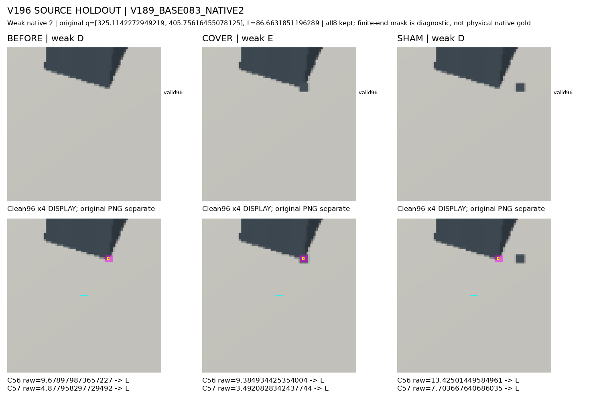

[기존 목표 위치와 proof](TRIPLET_13/TARGET_ASSOCIATION.json)

|variant|native|target|C56|C57|clean96|valid96|
|---|---|---|---|---|---|---|
|BEFORE|0|-1|D|D|[clean](TRIPLET_13/BEFORE_N0_CLEAN96.png)|[valid](TRIPLET_13/BEFORE_N0_VALID96.png)|
|BEFORE|1|-1|D|D|[clean](TRIPLET_13/BEFORE_N1_CLEAN96.png)|[valid](TRIPLET_13/BEFORE_N1_VALID96.png)|
|BEFORE|2|0|E|E|[clean](TRIPLET_13/BEFORE_N2_CLEAN96.png)|[valid](TRIPLET_13/BEFORE_N2_VALID96.png)|
|BEFORE|3|-1|D|D|[clean](TRIPLET_13/BEFORE_N3_CLEAN96.png)|[valid](TRIPLET_13/BEFORE_N3_VALID96.png)|
|BEFORE|4|-1|D|D|[clean](TRIPLET_13/BEFORE_N4_CLEAN96.png)|[valid](TRIPLET_13/BEFORE_N4_VALID96.png)|
|BEFORE|5|-1|D|D|[clean](TRIPLET_13/BEFORE_N5_CLEAN96.png)|[valid](TRIPLET_13/BEFORE_N5_VALID96.png)|
|BEFORE|6|-1|D|D|[clean](TRIPLET_13/BEFORE_N6_CLEAN96.png)|[valid](TRIPLET_13/BEFORE_N6_VALID96.png)|
|BEFORE|7|-1|D|D|[clean](TRIPLET_13/BEFORE_N7_CLEAN96.png)|[valid](TRIPLET_13/BEFORE_N7_VALID96.png)|
|COVER|0|-1|D|D|[clean](TRIPLET_13/COVER_N0_CLEAN96.png)|[valid](TRIPLET_13/COVER_N0_VALID96.png)|
|COVER|1|-1|D|E|[clean](TRIPLET_13/COVER_N1_CLEAN96.png)|[valid](TRIPLET_13/COVER_N1_VALID96.png)|
|COVER|2|1|E|E|[clean](TRIPLET_13/COVER_N2_CLEAN96.png)|[valid](TRIPLET_13/COVER_N2_VALID96.png)|
|COVER|3|-1|D|D|[clean](TRIPLET_13/COVER_N3_CLEAN96.png)|[valid](TRIPLET_13/COVER_N3_VALID96.png)|
|COVER|4|-1|D|D|[clean](TRIPLET_13/COVER_N4_CLEAN96.png)|[valid](TRIPLET_13/COVER_N4_VALID96.png)|
|COVER|5|-1|D|D|[clean](TRIPLET_13/COVER_N5_CLEAN96.png)|[valid](TRIPLET_13/COVER_N5_VALID96.png)|
|COVER|6|-1|D|D|[clean](TRIPLET_13/COVER_N6_CLEAN96.png)|[valid](TRIPLET_13/COVER_N6_VALID96.png)|
|COVER|7|-1|D|D|[clean](TRIPLET_13/COVER_N7_CLEAN96.png)|[valid](TRIPLET_13/COVER_N7_VALID96.png)|
|SHAM|0|-1|D|D|[clean](TRIPLET_13/SHAM_N0_CLEAN96.png)|[valid](TRIPLET_13/SHAM_N0_VALID96.png)|
|SHAM|1|-1|D|D|[clean](TRIPLET_13/SHAM_N1_CLEAN96.png)|[valid](TRIPLET_13/SHAM_N1_VALID96.png)|
|SHAM|2|0|E|E|[clean](TRIPLET_13/SHAM_N2_CLEAN96.png)|[valid](TRIPLET_13/SHAM_N2_VALID96.png)|
|SHAM|3|-1|D|D|[clean](TRIPLET_13/SHAM_N3_CLEAN96.png)|[valid](TRIPLET_13/SHAM_N3_VALID96.png)|
|SHAM|4|-1|D|D|[clean](TRIPLET_13/SHAM_N4_CLEAN96.png)|[valid](TRIPLET_13/SHAM_N4_VALID96.png)|
|SHAM|5|-1|D|D|[clean](TRIPLET_13/SHAM_N5_CLEAN96.png)|[valid](TRIPLET_13/SHAM_N5_VALID96.png)|
|SHAM|6|-1|D|D|[clean](TRIPLET_13/SHAM_N6_CLEAN96.png)|[valid](TRIPLET_13/SHAM_N6_VALID96.png)|
|SHAM|7|-1|D|D|[clean](TRIPLET_13/SHAM_N7_CLEAN96.png)|[valid](TRIPLET_13/SHAM_N7_VALID96.png)|

## V189_BASE104_NATIVE3

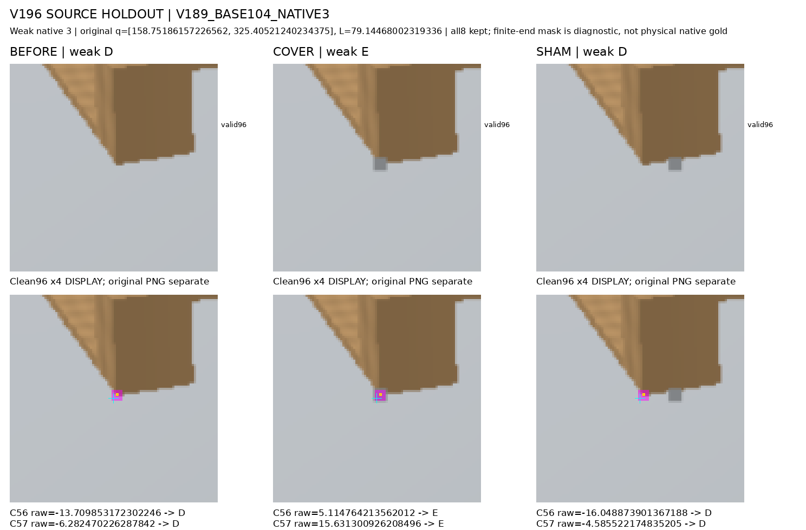

[기존 목표 위치와 proof](TRIPLET_14/TARGET_ASSOCIATION.json)

|variant|native|target|C56|C57|clean96|valid96|
|---|---|---|---|---|---|---|
|BEFORE|0|-1|D|D|[clean](TRIPLET_14/BEFORE_N0_CLEAN96.png)|[valid](TRIPLET_14/BEFORE_N0_VALID96.png)|
|BEFORE|1|-1|D|D|[clean](TRIPLET_14/BEFORE_N1_CLEAN96.png)|[valid](TRIPLET_14/BEFORE_N1_VALID96.png)|
|BEFORE|2|-1|D|D|[clean](TRIPLET_14/BEFORE_N2_CLEAN96.png)|[valid](TRIPLET_14/BEFORE_N2_VALID96.png)|
|BEFORE|3|0|D|D|[clean](TRIPLET_14/BEFORE_N3_CLEAN96.png)|[valid](TRIPLET_14/BEFORE_N3_VALID96.png)|
|BEFORE|4|-1|D|D|[clean](TRIPLET_14/BEFORE_N4_CLEAN96.png)|[valid](TRIPLET_14/BEFORE_N4_VALID96.png)|
|BEFORE|5|-1|D|D|[clean](TRIPLET_14/BEFORE_N5_CLEAN96.png)|[valid](TRIPLET_14/BEFORE_N5_VALID96.png)|
|BEFORE|6|-1|D|D|[clean](TRIPLET_14/BEFORE_N6_CLEAN96.png)|[valid](TRIPLET_14/BEFORE_N6_VALID96.png)|
|BEFORE|7|-1|D|D|[clean](TRIPLET_14/BEFORE_N7_CLEAN96.png)|[valid](TRIPLET_14/BEFORE_N7_VALID96.png)|
|COVER|0|-1|D|D|[clean](TRIPLET_14/COVER_N0_CLEAN96.png)|[valid](TRIPLET_14/COVER_N0_VALID96.png)|
|COVER|1|-1|D|D|[clean](TRIPLET_14/COVER_N1_CLEAN96.png)|[valid](TRIPLET_14/COVER_N1_VALID96.png)|
|COVER|2|-1|D|D|[clean](TRIPLET_14/COVER_N2_CLEAN96.png)|[valid](TRIPLET_14/COVER_N2_VALID96.png)|
|COVER|3|1|E|E|[clean](TRIPLET_14/COVER_N3_CLEAN96.png)|[valid](TRIPLET_14/COVER_N3_VALID96.png)|
|COVER|4|-1|D|D|[clean](TRIPLET_14/COVER_N4_CLEAN96.png)|[valid](TRIPLET_14/COVER_N4_VALID96.png)|
|COVER|5|-1|D|D|[clean](TRIPLET_14/COVER_N5_CLEAN96.png)|[valid](TRIPLET_14/COVER_N5_VALID96.png)|
|COVER|6|-1|D|D|[clean](TRIPLET_14/COVER_N6_CLEAN96.png)|[valid](TRIPLET_14/COVER_N6_VALID96.png)|
|COVER|7|-1|D|D|[clean](TRIPLET_14/COVER_N7_CLEAN96.png)|[valid](TRIPLET_14/COVER_N7_VALID96.png)|
|SHAM|0|-1|D|D|[clean](TRIPLET_14/SHAM_N0_CLEAN96.png)|[valid](TRIPLET_14/SHAM_N0_VALID96.png)|
|SHAM|1|-1|D|D|[clean](TRIPLET_14/SHAM_N1_CLEAN96.png)|[valid](TRIPLET_14/SHAM_N1_VALID96.png)|
|SHAM|2|-1|D|D|[clean](TRIPLET_14/SHAM_N2_CLEAN96.png)|[valid](TRIPLET_14/SHAM_N2_VALID96.png)|
|SHAM|3|0|D|D|[clean](TRIPLET_14/SHAM_N3_CLEAN96.png)|[valid](TRIPLET_14/SHAM_N3_VALID96.png)|
|SHAM|4|-1|D|D|[clean](TRIPLET_14/SHAM_N4_CLEAN96.png)|[valid](TRIPLET_14/SHAM_N4_VALID96.png)|
|SHAM|5|-1|D|D|[clean](TRIPLET_14/SHAM_N5_CLEAN96.png)|[valid](TRIPLET_14/SHAM_N5_VALID96.png)|
|SHAM|6|-1|D|D|[clean](TRIPLET_14/SHAM_N6_CLEAN96.png)|[valid](TRIPLET_14/SHAM_N6_VALID96.png)|
|SHAM|7|-1|D|D|[clean](TRIPLET_14/SHAM_N7_CLEAN96.png)|[valid](TRIPLET_14/SHAM_N7_VALID96.png)|
