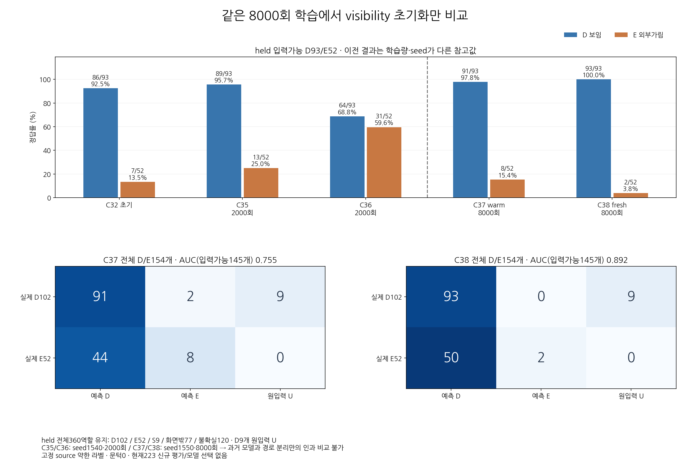
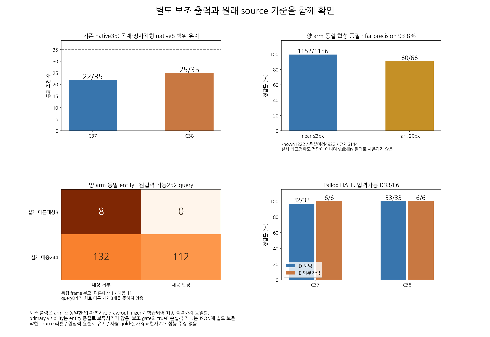
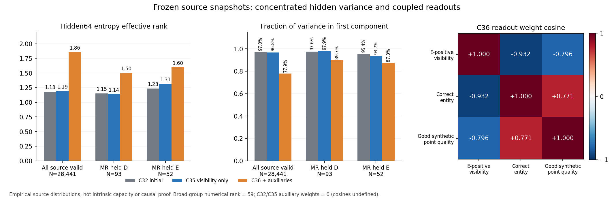

# V155 — query_visibility_independent_auxiliary_source_control_20261024_v155

기존 보고서에서 추출한 게시용 파생 개요입니다. 원본 파일을 수정하거나 실험·평가를 다시 실행하지 않았습니다. 원문 해시와 링크 대응은 publication manifest로 확인합니다.

**상태:** {"completed":true,"selected_model":null,"adopted":false,"fully_solved":false,"goal_status":"active_unsolved"}

원본:

- [ROOT_PHASE_RESULT.json](ROOT_PHASE_RESULT.json) — SHA256 `c9cbd389c761da978bf55f1e69ec1b26ba1faabc37ca1a9ecfb937f5c274a699`
- [ROOT_READOUT_KO.html](ROOT_READOUT_KO.html) — SHA256 `2b9913ae646cc47847a51f228b44278dccb20d47f8d99d38c1108a9722883a26`
- [ROOT_RESULTS_KO.json](ROOT_RESULTS_KO.json) — SHA256 `eaae46f46627cb9e91a685c5a263d852303103130e5a2d889a51cd70c3112c7c`

## 방법·목표의 원문 필드

`$.schema`

```text
V155_FROZEN_HIDDEN_REPLAY_AND_MATCHED_INDEPENDENT_AUX_WARM_FRESH_SOURCE_RESULTS
```


## 입력·학습·평가 분모의 원문 필드

`$.execution_QA_PASS_is_not_scientific_qualification`

```text
true
```

`$.actual_source_optimizer_updates`

```text
16000
```

`$.updates_each`

```text
8000
```

`$.all_source_rows_preserved`

```text
28976
```


## 결론·실패·한계의 원문 필드

`$.interpretation_KO`

```text
[
  "보조 gradient가 가림 경로에 들어가지 않는 구현·업데이트 제어는 검증됐지만 source 장면 일반화는 해결되지 않았다.",
  "양모델 TRAIN의 입력가능D341/E49는 전부 맞히지만 held는 C37D91/E8, C38D93/E2이다. Source 약한 라벨의 학습/검증 격차이며 현재223 결과가 아니다.",
  "C38 held AUC .892는 C37 .755보다 높지만 fixedraw0 Erecall은2/52이다. native35와MR 목표는 어떤 단일global threshold로도 함께 통과할 수 없다는 저장출력 진단이 나왔다. 모델/문턱 선택은 없다.",
  "독립entity는 TRAINpos638/neg365를 모두 맞히고 heldpos112/244만 보존한다. held다른대상8query는1frame이며 trueE52중23도 거부한다. 보조entitygate는두모델모두 맞는E를1개만 남긴다.",
  "합성quality는far60/66,near1152/1156,farprecision60/64=.9375이다. 품질미정4922행을 유지하고 실사좌표품질 성과로 해석하거나 visibility 평가행을 제거하지 않는다."
]
```

`$.limits_KO`

```text
[
  "공개 역할 라벨은assistant 약한 제안, 제공pose는cm오차 가능성이 있는 reference이다.",
  "scene를 나눴지만 같은 실물·반복촬영이 있을 수 있다. Euro목재 source가 정사각형 실사 검증을 대신하지 않는다.",
  "held360행은D102/E52/S9/OOF77/U120, 알려진154에는원입력불가D9가있다. 입력가능145와 전체154 지표를 구분한다.",
  "source35는기존AUX29를새로재검증한것이아니다. 모두source미달·채택없음·최종목표미해결이다.",
  "현재223은과거반복평가로개발에노출된자료이며blindtest가아니다. 이번단계의privatebody읽기/추론/학습/선택0."
]
```


## 코드·검증·전체 표·갤러리

아래 목록은 원 보고서가 참조한 파일의 경로를 다시 연결한 것입니다. 이 개요 작성 중 이미지 내용이나 raw 평가 데이터를 새로 검사하지 않았습니다.

- [query_visibility_independent_auxiliary_source_control_20261024_v155/ROOT_RESULTS_KO.json](ROOT_RESULTS_KO.json)
- [query_visibility_independent_auxiliary_source_control_20261024_v155/ROOT_READOUT_KO.html](ROOT_READOUT_KO.html)
- [query_visibility_independent_auxiliary_source_control_20261024_v155/ROOT_REPORT_VISUAL_QA.json](ROOT_REPORT_VISUAL_QA.json)
- [query_visibility_independent_auxiliary_source_control_20261024_v155/ROOT_ACTUAL_INDEPENDENT_SOURCE_FIT_EXECUTION_RECEIPT.json](ROOT_ACTUAL_INDEPENDENT_SOURCE_FIT_EXECUTION_RECEIPT.json)
- [query_visibility_independent_auxiliary_source_control_20261024_v155/independent_saved_fit_review/REVIEW.json](independent_saved_fit_review/REVIEW.json)
- [query_visibility_independent_auxiliary_source_control_20261024_v155/future_current_preparation/FUTURE_PROTOCOL_DRAFT_NO_CURRENT_AUTHORIZATION.json](future_current_preparation/FUTURE_PROTOCOL_DRAFT_NO_CURRENT_AUTHORIZATION.json)
- [query_visibility_independent_auxiliary_source_control_20261024_v155/ROOT_NEXT_ACTION_COMMITMENT_BEFORE_ANY_NEW_PRIVATE_READS.json](ROOT_NEXT_ACTION_COMMITMENT_BEFORE_ANY_NEW_PRIVATE_READS.json)
- [query_visibility_independent_auxiliary_source_control_20261024_v155/independent_saved_fit_review/GLOBAL_THRESHOLD_FEASIBILITY_DIAGNOSTIC.json](independent_saved_fit_review/GLOBAL_THRESHOLD_FEASIBILITY_DIAGNOSTIC.json)
- [query_visibility_public_native_frozen_current_benchmark_20261024_v149/ROOT_READOUT_KO.html](../query_visibility_public_native_frozen_current_benchmark_20261024_v149/ROOT_READOUT_KO.html)
- [query_visibility_independent_auxiliary_source_control_20261024_v155/ROOT_POLICY_BEFORE_FROZEN_PROBE_AND_INDEPENDENT_AUXILIARY_CONTROL.json](ROOT_POLICY_BEFORE_FROZEN_PROBE_AND_INDEPENDENT_AUXILIARY_CONTROL.json)
- [query_visibility_independent_auxiliary_source_control_20261024_v155/MATCHED_WARM_FRESH_DESIGN_BEFORE_NEW_SOURCE_FIT.json](MATCHED_WARM_FRESH_DESIGN_BEFORE_NEW_SOURCE_FIT.json)
- [query_visibility_independent_auxiliary_source_control_20261024_v155/ROOT_APPROVED_FROZEN_SOURCE_PROBE_ENTRY.json](ROOT_APPROVED_FROZEN_SOURCE_PROBE_ENTRY.json)
- [query_visibility_independent_auxiliary_source_control_20261024_v155/ROOT_ACTUAL_FROZEN_PROBE_EXECUTION_RECEIPT.json](ROOT_ACTUAL_FROZEN_PROBE_EXECUTION_RECEIPT.json)
- [query_visibility_independent_auxiliary_source_control_20261024_v155/frozen_hidden_probe_v1/PROBE_COMPLETE.json](frozen_hidden_probe_v1/PROBE_COMPLETE.json)
- [query_visibility_independent_auxiliary_source_control_20261024_v155/frozen_hidden_probe_agent/SAVED_PROBE_REVIEW.json](frozen_hidden_probe_agent/SAVED_PROBE_REVIEW.json)
- [query_visibility_independent_auxiliary_source_control_20261024_v155/frozen_hidden_probe_agent/FIGURE_RECEIPT.json](frozen_hidden_probe_agent/FIGURE_RECEIPT.json)
- [query_visibility_independent_auxiliary_source_control_20261024_v155/independent_head_preparation/PREPARATION_READY.json](independent_head_preparation/PREPARATION_READY.json)
- [query_visibility_independent_auxiliary_source_control_20261024_v155/independent_head_preparation/GENERATED_INDEPENDENCE_CHECKS.json](independent_head_preparation/GENERATED_INDEPENDENCE_CHECKS.json)
- [query_visibility_independent_auxiliary_source_control_20261024_v155/independent_head_preparation/ACTIVE_VISIBILITY_CLIP_APPENDIX.json](independent_head_preparation/ACTIVE_VISIBILITY_CLIP_APPENDIX.json)
- [query_visibility_independent_auxiliary_source_control_20261024_v155/prospective_design_review_agent/REVIEW.json](prospective_design_review_agent/REVIEW.json)
- [query_visibility_independent_auxiliary_source_control_20261024_v155/source_fit_preparation/INDEPENDENT_TRAINER_CODE_REVIEW.json](source_fit_preparation/INDEPENDENT_TRAINER_CODE_REVIEW.json)
- [query_visibility_independent_auxiliary_source_control_20261024_v155/source_fit_preparation/INDEPENDENT_PREPARED_PROTOCOL_REVIEW.json](source_fit_preparation/INDEPENDENT_PREPARED_PROTOCOL_REVIEW.json)
- [query_visibility_independent_auxiliary_source_control_20261024_v155/source_fit_preparation/PROTOCOL_BEFORE_SOURCE_FEATURE_OR_CHECKPOINT_BODIES.json](source_fit_preparation/PROTOCOL_BEFORE_SOURCE_FEATURE_OR_CHECKPOINT_BODIES.json)
- [query_visibility_independent_auxiliary_source_control_20261024_v155/ROOT_APPROVED_INDEPENDENT_SOURCE_FIT_ENTRY.json](ROOT_APPROVED_INDEPENDENT_SOURCE_FIT_ENTRY.json)

## 원 보고서의 그림

원 보고서 참조 순서의 처음 최대4개를 표시합니다. 새 outcome 선택이나 전수 이미지 검증을 뜻하지 않습니다. 전체 갤러리는 위 원문 링크에서 확인합니다.

[query_visibility_independent_auxiliary_source_control_20261024_v155/source_result_summary_agent/WARM_FRESH_SOURCE_COMPARISON_KO.png](source_result_summary_agent/WARM_FRESH_SOURCE_COMPARISON_KO.png)



[query_visibility_independent_auxiliary_source_control_20261024_v155/source_result_summary_agent/AUXILIARY_SOURCE_SCOPE_KO.png](source_result_summary_agent/AUXILIARY_SOURCE_SCOPE_KO.png)



[query_visibility_independent_auxiliary_source_control_20261024_v155/frozen_hidden_probe_agent/HIDDEN_RANK_AND_READOUT.png](frozen_hidden_probe_agent/HIDDEN_RANK_AND_READOUT.png)




현재 사용자 목표 전체의 해결·새 모델 채택·실사 가림 원인 확정을 이 파생 개요가 추가로 주장하지 않습니다. UNKNOWN/U와 불리한 결과, 실패 실행 및 수정 provenance는 원문대로 보존해야 합니다.
