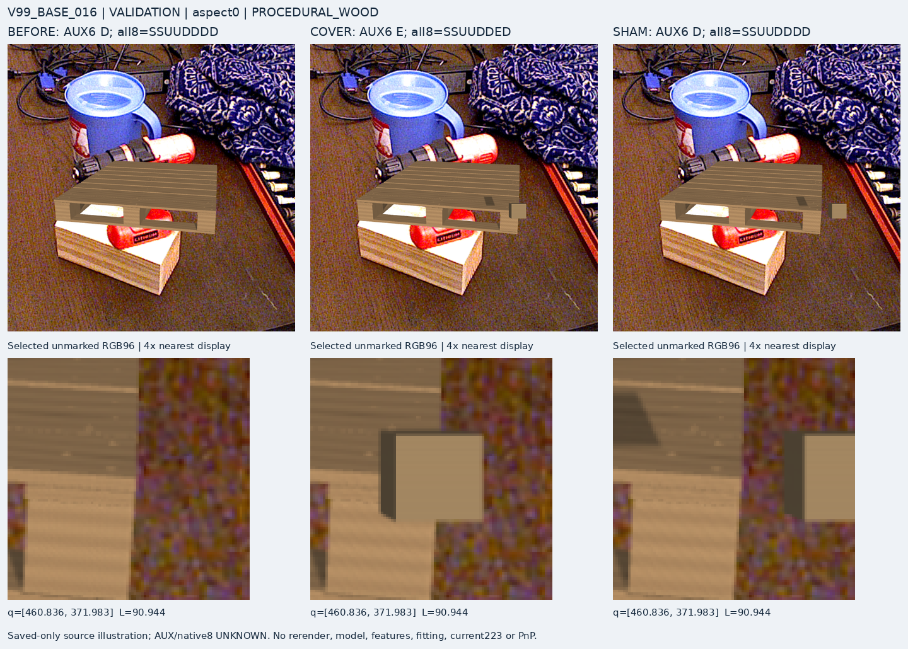
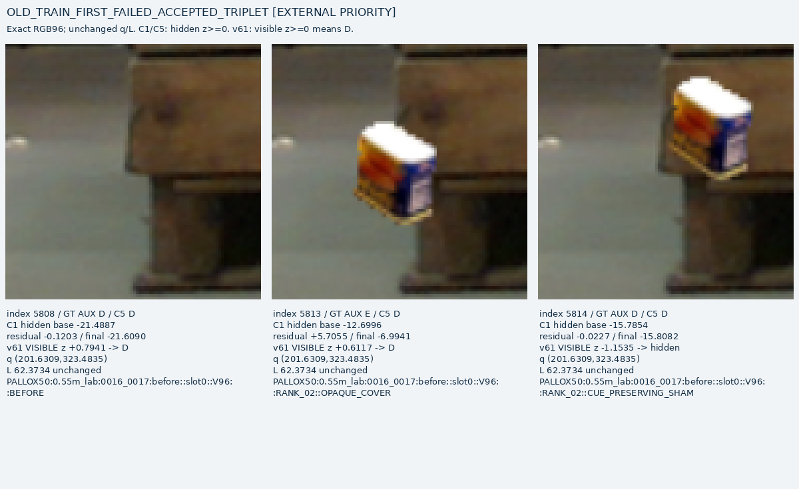
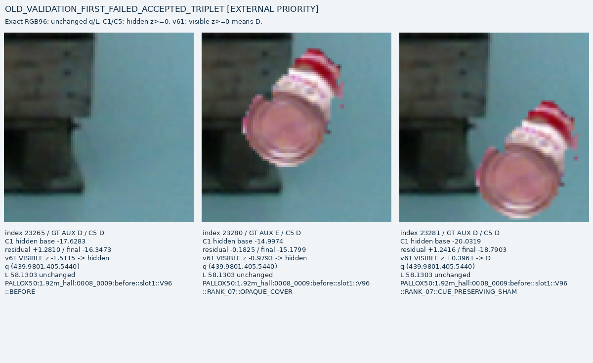

# V101 — query_visibility_local_residual_head_20261023_v101

기존 보고서에서 추출한 게시용 파생 개요입니다. 원본 파일을 수정하거나 실험·평가를 다시 실행하지 않았습니다. 원문 해시와 링크 대응은 publication manifest로 확인합니다.

**상태:** {"completed":true,"fully_solved":false}

원본:

- [ROOT_READOUT_KO.html](ROOT_READOUT_KO.html) — SHA256 `68b1d0e3d7e65cb497822bd080aed04cd38ff8feb403949dbfd1a97afbab6cde`
- [ROOT_RESULTS_KO.json](ROOT_RESULTS_KO.json) — SHA256 `b7fe9653b84e88cb850686962ef2ef7beaf5b548b93830f7a4247484ae144ecc`

## 방법·목표의 원문 필드

`$.decoder`

```text
{
  "v61": "Original visible_logit>=0 D, including signed0; <0hidden; unavailableU",
  "C1_C5": "Hiddenlogit<0 D, >=0hidden; unavailableU; base/delta are diagnostic only"
}
```


## 입력·학습·평가 분모의 원문 필드

`$.optimizer_updates`

```text
2000
```

`$.same33984_rows_q_L_folds_units_available`

```text
true
```

`$.all_original_mixed_S_rows_and_counts`

```text
{
  "total_occurrences": 33984,
  "old_occurrences": 31680,
  "new_occurrences": 2304,
  "typed_counts": {
    "D": 1215,
    "E": 303,
    "S": 396,
    "U": 32070
  },
  "teacher_U": 32070,
  "factual_prediction_U": 4686,
  "known_prediction_U": 0,
  "by_domain_split": {
    "V96_REAL": {
      "TRAIN": {
        "rows": 14784,
        "typed_states": {
          "D": 103,
          "E": 77,
          "S": 0,
          "U": 14604
        },
        "by_variant": {
          "BEFORE": {
            "D": 28,
            "E": 2,
            "S": 0,
            "U": 418
          },
          "CUE_PRESERVING_SHAM": {
            "D": 75,
            "E": 0,
            "S": 0,
            "U": 7093
          },
          "OPAQUE_COVER": {
            "D": 0,
            "E": 75,
            "S": 0,
            "U": 7093
          }
        }
      },
      "VALIDATION": {
        "rows": 16896,
        "typed_states": {
          "D": 152,
          "E": 121,
          "S": 0,
          "U": 16623
        },
        "by_variant": {
          "BEFORE": {
            "D": 33,
            "E": 2,
            "S": 0,
            "U": 477
          },
          "CUE_PRESERVING_SHAM": {
            "D": 119,
            "E": 0,
            "S": 0,
            "U": 8073
          },
          "OPAQUE_COVER": {
            "D": 0,
            "E": 119,
            "S": 0,
            "U": 8073
          }
        }
      }
    },
    "V99_SYNTH": {
      "TRAIN": {
        "rows": 1536,
        "typed_states": {
          "D": 751,
          "E": 71,
          "S": 204,
          "U": 510
        },
        "by_variant": {
          "BEFORE": {
            "D": 274,
            "E": 0,
            "S": 68,
            "U": 170
          },
          "COVER": {
            "D": 210,
            "E": 64,
            "S": 68,
            "U": 170
          },
          "SHAM": {
            "D": 267,
            "E": 7,
            "S": 68,
            "U": 170
          }
        }
      },
      "VALIDATION": {
        "rows": 768,
        "typed_states": {
          "D": 209,
          "E": 34,
          "S": 192,
          "U": 333
        },
        "by_variant": {
          "BEFORE": {
            "D": 82,
            "E": 0,
            "S": 64,
            "U": 110
          },
          "COVER": {
            "D": 50,
            "E": 32,
            "S": 64,
            "U": 110
          },
          "SHAM": {
            "D": 77,
            "E": 2,
            "S": 64,
            "U": 113
          }
        }
      }
    },
    "VAL_cohorts": {
      "old_LOCO_BEFORE_D": 3,
      "old_PALLOX_BEFORE_D": 30,
      "old_SHAM_D": 119,
      "old_BEFORE_E": 2,
      "old_COVER_E": 119,
      "new_BEFORE_D": 82,
      "new_SHAM_D": 77,
      "new_COVER_E": 32,
      "new_ALL_S": 192
    },
    "old_accepted_pairs": {
      "TRAIN": 75,
      "VALIDATION": 119
    },
    "new_selected_pairs": {
      "TRAIN": 64,
      "VALIDATION": 32
    }
  }
}
```

`$.original_9cohort_selector`

```text
{
  "old_LOCO_BEFORE_D": {
    "count": 3,
    "mean_BCE": 0.6182067752436122,
    "unavailable": 0
  },
  "old_PALLOX_BEFORE_D": {
    "count": 30,
    "mean_BCE": 0.007345924120010202,
    "unavailable": 0
  },
  "old_SHAM_D": {
    "count": 119,
    "mean_BCE": 0.38308639517282006,
    "unavailable": 0
  },
  "old_BEFORE_E": {
    "count": 2,
    "mean_BCE": 1.1158761745733159e-06,
    "unavailable": 0
  },
  "old_COVER_E": {
    "count": 119,
    "mean_BCE": 8.522714956345215,
    "unavailable": 0
  },
  "new_BEFORE_D": {
    "count": 82,
    "mean_BCE": 1.1996700632158215,
    "unavailable": 0
  },
  "new_SHAM_D": {
    "count": 77,
    "mean_BCE": 1.0110278498336172,
    "unavailable": 0
  },
  "new_COVER_E": {
    "count": 32,
    "mean_BCE": 0.05953277785555056,
    "unavailable": 0
  },
  "new_ALL_S": {
    "count": 192,
    "mean_BCE": 7.800481736539171,
    "unavailable": 0
  }
}
```


## 결론·실패·한계의 원문 필드

`$.main_conclusion_KO`

```text
단순 합성 외부 COVER는 구분했지만 실사 기반 외부 가림은 해결하지 못했습니다.
```

`$.failure_diagnosis`

```text
{
  "excerpt": "{\"completed\": true, \"PASS_saved_diagnosis\": true, \"code\": [{\"path\": \"query_visibility_local_residual_head_20261023_v101/saved_source_failure_diagnosis/build_saved_diagnosis.py\", \"sha256\": \"c9e2c8c36e57c87f516dd01c966cad86e077b71793bdc76c74387dac3d9ffaab\"}, {\"path\": \"query_visibility_local_residual_head_20261023_v101/saved_source_failure_diagnosis/add_v61_comparison_and_observations.py\", \"sha256\": \"815f8ba6d0010bd0c65018465337bff9406974ec73cd8a2659948acaf3e0f9c5\"}], \"selection_policy\": {\"path\": \"query_visibility_local_residual_head_20261023_v101/saved_source_failure_diagnosis/SCOPE_AND_SELECTION_BEFORE_RGB96_READ.json\", \"sha256\": \"84b1cc0854588e7e5a450609572c3877cf74cb5263252806917a24eedda08abd\"}, \"numerical\": {\"path\": \"query_visibility_local_residual_head_20261023_v101/saved_source_failure_diagnosis/NUMERICAL_AND_CROP_RESULTS.json\", \"sha256\": \"f06f49e936864650739f9c1baab74d1273c61ec8b14e2d9e54dba78a8d127e69\"}, \"v61_comparison\": {\"path\": \"query_visibility_local_residual_head_20261023_v101/saved_source_failure_diagnosis/V61_COMPARISON_AND_FIGURES.json\", \"sha256\": \"5601212cf8419f9cb2a1a4d7ab08c4ef2e23dbe9dc907d3cf43cb21e2c5997e3\"}, \"actual_visual_receipt\": {\"path\": \"/home/minjae/Documents/Codex/2026-10-20/task-2/p",
  "truncated": true
}
```

`$.postfit_user_requested_savedaggregate_historyreview_only`

```text
true
```

`$.limits_KO`

```text
[
  "V96는공개실사RGB에외부물체를합성한통제쌍이며자연가림일반성공을뜻하지않습니다.",
  "V99는동일팔레트메시에단순큐빅물체와공개배경을합친RGBA소스입니다.새팔레트인스턴스/실사전이증거가아닙니다.",
  "AUX조건부주석/유한기하witness는인간native8정답이아닙니다.",
  "반복소스개발/VAL사용으로blindgeneralization검증이아닙니다.",
  "새합성모양/표면축은서로교차하며현재WOOD/SQUARE코호트와동등하지않습니다.",
  "감사PASS는저장/연산/절차일치이며모델성능PASS가아닙니다."
]
```


## 코드·검증·전체 표·갤러리

아래 목록은 원 보고서가 참조한 파일의 경로를 다시 연결한 것입니다. 이 개요 작성 중 이미지 내용이나 raw 평가 데이터를 새로 검사하지 않았습니다.

- [query_visibility_local_residual_head_20261023_v101/ROOT_RESULTS_KO.json](ROOT_RESULTS_KO.json)
- [query_visibility_local_residual_head_20261023_v101/independent_saved_review/REVIEW.json](independent_saved_review/REVIEW.json)
- [query_visibility_local_residual_head_20261023_v101/saved_source_failure_diagnosis/RESULT.json](saved_source_failure_diagnosis/RESULT.json)
- [query_visibility_local_residual_head_20261023_v101/ROOT_USER_STEERING_EXTERNAL_ONLY.json](ROOT_USER_STEERING_EXTERNAL_ONLY.json)
- [query_visibility_local_residual_head_20261023_v101/ROOT_USER_REQUESTED_HISTORICAL_COMPARISON.json](ROOT_USER_REQUESTED_HISTORICAL_COMPARISON.json)
- [query_visibility_local_residual_head_20261023_v101/runs/C5_FROZEN_C1_CENTRAL_RGB_SOURCE_V1/MODEL_FREEZE.json](runs/C5_FROZEN_C1_CENTRAL_RGB_SOURCE_V1/MODEL_FREEZE.json)
- [query_visibility_local_residual_head_20261023_v101/saved_source_failure_diagnosis/build_saved_diagnosis.py](saved_source_failure_diagnosis/build_saved_diagnosis.py)
- [query_visibility_local_residual_head_20261023_v101/saved_source_failure_diagnosis/add_v61_comparison_and_observations.py](saved_source_failure_diagnosis/add_v61_comparison_and_observations.py)
- [query_visibility_local_residual_head_20261023_v101/saved_source_failure_diagnosis/SCOPE_AND_SELECTION_BEFORE_RGB96_READ.json](saved_source_failure_diagnosis/SCOPE_AND_SELECTION_BEFORE_RGB96_READ.json)
- [query_visibility_local_residual_head_20261023_v101/saved_source_failure_diagnosis/NUMERICAL_AND_CROP_RESULTS.json](saved_source_failure_diagnosis/NUMERICAL_AND_CROP_RESULTS.json)
- [query_visibility_local_residual_head_20261023_v101/saved_source_failure_diagnosis/V61_COMPARISON_AND_FIGURES.json](saved_source_failure_diagnosis/V61_COMPARISON_AND_FIGURES.json)
- [query_visibility_local_residual_head_20261023_v101/saved_source_failure_diagnosis/ACTUAL_IMAGE_OBSERVATIONS.json](saved_source_failure_diagnosis/ACTUAL_IMAGE_OBSERVATIONS.json)
- [query_visibility_local_residual_head_20261023_v101/runs/C5_FROZEN_C1_CENTRAL_RGB_SOURCE_V1/FIT_COMPLETE.json](runs/C5_FROZEN_C1_CENTRAL_RGB_SOURCE_V1/FIT_COMPLETE.json)
- [query_visibility_local_residual_head_20261023_v101/runs/C5_FROZEN_C1_CENTRAL_RGB_SOURCE_V1/SOURCE_RESULTS.json](runs/C5_FROZEN_C1_CENTRAL_RGB_SOURCE_V1/SOURCE_RESULTS.json)
- [query_visibility_local_residual_head_20261023_v101/runs/C5_FROZEN_C1_CENTRAL_RGB_SOURCE_V1/SOURCE_GATE_RESULTS.json](runs/C5_FROZEN_C1_CENTRAL_RGB_SOURCE_V1/SOURCE_GATE_RESULTS.json)
- [query_visibility_local_residual_head_20261023_v101/runs/C5_FROZEN_C1_CENTRAL_RGB_SOURCE_V1/HISTORY.jsonl](runs/C5_FROZEN_C1_CENTRAL_RGB_SOURCE_V1/HISTORY.jsonl)
- [query_visibility_local_residual_head_20261023_v101/runs/C5_FROZEN_C1_CENTRAL_RGB_SOURCE_V1/TRAIN_UPDATES.jsonl](runs/C5_FROZEN_C1_CENTRAL_RGB_SOURCE_V1/TRAIN_UPDATES.jsonl.parts.json)
- [query_visibility_local_residual_head_20261023_v101/independent_saved_review/SEAL.json](independent_saved_review/SEAL.json)
- [query_visibility_local_residual_head_20261023_v101/model/PREPARATION_SEAL.json](model/PREPARATION_SEAL.json)
- [query_visibility_local_residual_head_20261023_v101/source_fit_preparation/FIT_PROTOCOL_BEFORE_SOURCE_HEAD_FORWARD.json](source_fit_preparation/FIT_PROTOCOL_BEFORE_SOURCE_HEAD_FORWARD.json)
- [query_visibility_local_residual_head_20261023_v101/v61_source_baseline/FINAL_BASELINE_RECEIPT.json](v61_source_baseline/FINAL_BASELINE_RECEIPT.json)
- [query_visibility_local_residual_head_20261023_v101/v61_source_baseline/outputs/BASELINE_SEAL.json](v61_source_baseline/outputs/BASELINE_SEAL.json)
- [query_visibility_local_residual_head_20261023_v101/v61_source_baseline/SAVED_BASELINE_REPLAY.json](v61_source_baseline/SAVED_BASELINE_REPLAY.json)
- [query_visibility_local_residual_head_20261023_v101/saved_source_failure_diagnosis/SEAL.json](saved_source_failure_diagnosis/SEAL.json)

## 원 보고서의 그림

원 보고서 참조 순서의 처음 최대4개를 표시합니다. 새 outcome 선택이나 전수 이미지 검증을 뜻하지 않습니다. 전체 갤러리는 위 원문 링크에서 확인합니다.

[query_visibility_local_residual_head_20261023_v101/saved_v99_contacts/V99_FIXED_BASE_016_SAVED_CONTACT.png](saved_v99_contacts/V99_FIXED_BASE_016_SAVED_CONTACT.png)



[query_visibility_local_residual_head_20261023_v101/saved_source_failure_diagnosis/case_00_v61_comparison.png](saved_source_failure_diagnosis/case_00_v61_comparison.png)



[query_visibility_local_residual_head_20261023_v101/saved_source_failure_diagnosis/case_01_v61_comparison.png](saved_source_failure_diagnosis/case_01_v61_comparison.png)




현재 사용자 목표 전체의 해결·새 모델 채택·실사 가림 원인 확정을 이 파생 개요가 추가로 주장하지 않습니다. UNKNOWN/U와 불리한 결과, 실패 실행 및 수정 provenance는 원문대로 보존해야 합니다.

큰 원문 링크는 무손실 gzip의 `.parts.json` descriptor로 연결합니다. 원문 SHA와 복원 방법은 게시 안내를 따릅니다.
