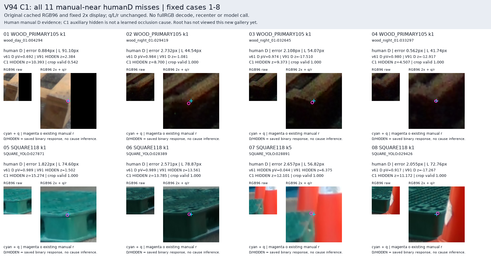
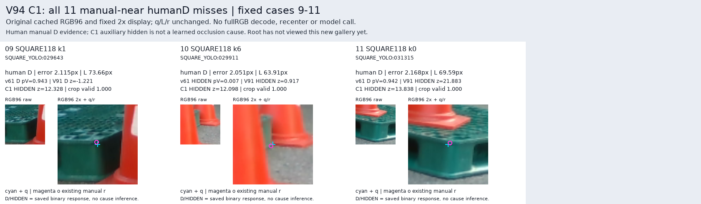
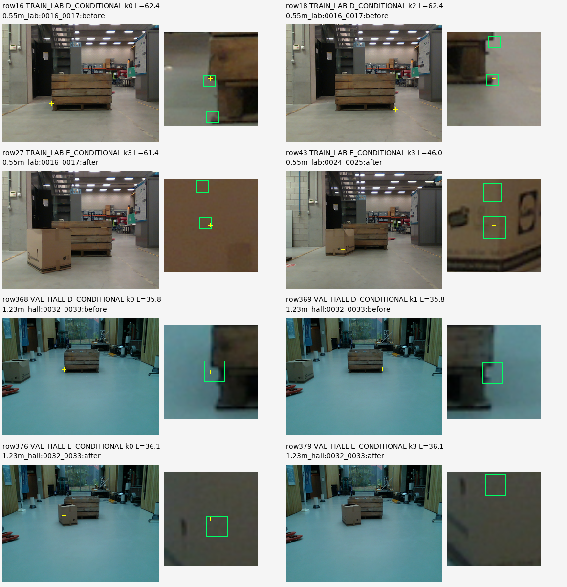
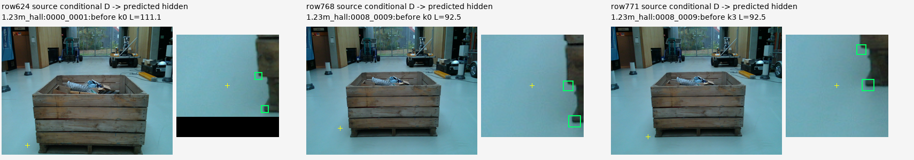

# V94 — query_visibility_matched_query_scalar_20261023_v94

기존 보고서에서 추출한 게시용 파생 개요입니다. 원본 파일을 수정하거나 실험·평가를 다시 실행하지 않았습니다. 원문 해시와 링크 대응은 publication manifest로 확인합니다.

**상태:** {"goal_status":"active"}

원본:

- [ROOT_READOUT_KO.html](ROOT_READOUT_KO.html) — SHA256 `8cc7a0e1a4897b6b0a0c8e4b0e2e4e316521ba204026a5501def8d76e22c4e4f`
- [ROOT_RESULTS_KO.json](ROOT_RESULTS_KO.json) — SHA256 `460f236b80a262ba96d92898130ed7916cba445c4a140b34b68444561d3a6576`

## 방법·목표의 원문 필드

`$.schema`

```text
V94_C1_COMPACT_KOREAN_PHASE_RESULTS_V1
```

`$.goal_complete`

```text
false
```


## 입력·학습·평가 분모의 원문 필드

`$.primary`

```text
V94_C1_RAW
```

`$.report_creation_new_model_inference_training_RGB_decode`

```text
0
```


## 결론·실패·한계의 원문 필드

`$.conclusion_KO`

```text
공개 Pallox 조건부 source gate는 통과했으나 현재 외부 가림 recall은 목재12/29·정사각형32/61로 부족합니다. manual≤3px D 유지율 개선은 관찰됐지만 전체 목표 해결이나 단일 원인의 증명이 아닙니다.
```

`$.limitations_KO`

```text
[
  "현재223은 반복 개발 중 노출된 평가 집합이며 새로운 blind test가 아닙니다. C1 fit/문턱/체크포인트 선택에는 사용하지 않았습니다.",
  "V91과 architecture·source q/L 분포·학습 readout/operator·supervision이 함께 달라져 개선 원인을 하나로 분리할 수 없습니다.",
  "공개 source는 동일 물리 bin의 LAB/HALL 분리와 약한 조건부 cue 라벨입니다. FULL 포함은 native expected-cue association 증명이 아닙니다.",
  "C1은 sourceGT region/mosaic readout을 현재 q중심 scalar로 바꾸었으나 target identity, semantic correspondence, 자연 외부 가림 전이 모두 해결됐다고 할 수 없습니다.",
  "U는 입력/연산자 가용성 보류이며 의미적 불확실성이나 confidence calibration을 학습한 결과가 아닙니다.",
  "합성/YCB/controlledV3는 이번 C1 head fit에 섞지 않았습니다. 기존 frozen backbone과 저장 입력은 유지했습니다."
]
```


## 코드·검증·전체 표·갤러리

아래 목록은 원 보고서가 참조한 파일의 경로를 다시 연결한 것입니다. 이 개요 작성 중 이미지 내용이나 raw 평가 데이터를 새로 검사하지 않았습니다.

- [query_visibility_matched_query_scalar_20261023_v94/current_evaluation/C1_NATURAL_KNOWNSET_ONE_SHOT/METRICS.csv](current_evaluation/C1_NATURAL_KNOWNSET_ONE_SHOT/METRICS.csv)
- [query_visibility_matched_query_scalar_20261023_v94/current_evaluation/C1_NATURAL_KNOWNSET_ONE_SHOT/MANUAL_NEAR_D.csv](current_evaluation/C1_NATURAL_KNOWNSET_ONE_SHOT/MANUAL_NEAR_D.csv)
- [query_visibility_matched_query_scalar_20261023_v94/runs/C1_NATURAL_KNOWNSET_SOURCE_V1/SOURCE_RESULTS.json](runs/C1_NATURAL_KNOWNSET_SOURCE_V1/SOURCE_RESULTS.json)
- [query_visibility_matched_query_scalar_20261023_v94/ROOT_RESULTS_KO.json](ROOT_RESULTS_KO.json)
- [query_visibility_matched_query_scalar_20261023_v94/current_nearD_failure_crop_diagnosis/ALL11_CASES_AND_PROVENANCE.json](current_nearD_failure_crop_diagnosis/ALL11_CASES_AND_PROVENANCE.json)
- [query_visibility_matched_query_scalar_20261023_v94/current_nearD_failure_crop_diagnosis/ACTUAL_ALL11_VISUAL_OBSERVATIONS_KO_V2.json](current_nearD_failure_crop_diagnosis/ACTUAL_ALL11_VISUAL_OBSERVATIONS_KO_V2.json)
- [query_visibility_matched_query_scalar_20261023_v94/current_nearD_failure_crop_diagnosis/ROOT_ACTUAL_ALL11_VIEW.json](current_nearD_failure_crop_diagnosis/ROOT_ACTUAL_ALL11_VIEW.json)
- [query_visibility_matched_query_scalar_20261023_v94/independent_actual_C1_current_evaluation_audit/REVIEW.json](independent_actual_C1_current_evaluation_audit/REVIEW.json)
- [query_visibility_matched_query_scalar_20261023_v94/runs/C1_NATURAL_KNOWNSET_SOURCE_V1/SOURCE_GATE_RESULTS.json](runs/C1_NATURAL_KNOWNSET_SOURCE_V1/SOURCE_GATE_RESULTS.json)
- [query_visibility_matched_query_scalar_20261023_v94/current_evaluation/C1_NATURAL_KNOWNSET_ONE_SHOT/CURRENT_PRIMARY_RESULTS.json](current_evaluation/C1_NATURAL_KNOWNSET_ONE_SHOT/CURRENT_PRIMARY_RESULTS.json)
- [query_visibility_matched_query_scalar_20261023_v94/current_evaluation/C1_NATURAL_KNOWNSET_ONE_SHOT/HUMAN_SELF_BINARY_RESPONSE.csv](current_evaluation/C1_NATURAL_KNOWNSET_ONE_SHOT/HUMAN_SELF_BINARY_RESPONSE.csv)

## 원 보고서의 그림

원 보고서 참조 순서의 처음 최대4개를 표시합니다. 새 outcome 선택이나 전수 이미지 검증을 뜻하지 않습니다. 전체 갤러리는 위 원문 링크에서 확인합니다.

[query_visibility_matched_query_scalar_20261023_v94/current_nearD_failure_crop_diagnosis/CONTACT_01_ALL8_V2.png](current_nearD_failure_crop_diagnosis/CONTACT_01_ALL8_V2.png)



[query_visibility_matched_query_scalar_20261023_v94/current_nearD_failure_crop_diagnosis/CONTACT_02_REMAINING3_V2.png](current_nearD_failure_crop_diagnosis/CONTACT_02_REMAINING3_V2.png)



[query_visibility_matched_query_scalar_20261023_v94/root_conditional_source_crop_review/FIRST8_SAVED_SOURCE_QUERY_CROPS_GT_ONLY.png](root_conditional_source_crop_review/FIRST8_SAVED_SOURCE_QUERY_CROPS_GT_ONLY.png)



[query_visibility_matched_query_scalar_20261023_v94/root_conditional_source_crop_review/ALL3_SOURCE_VAL_VISIBLE_MISSES_GT_ONLY.png](root_conditional_source_crop_review/ALL3_SOURCE_VAL_VISIBLE_MISSES_GT_ONLY.png)




현재 사용자 목표 전체의 해결·새 모델 채택·실사 가림 원인 확정을 이 파생 개요가 추가로 주장하지 않습니다. UNKNOWN/U와 불리한 결과, 실패 실행 및 수정 provenance는 원문대로 보존해야 합니다.
