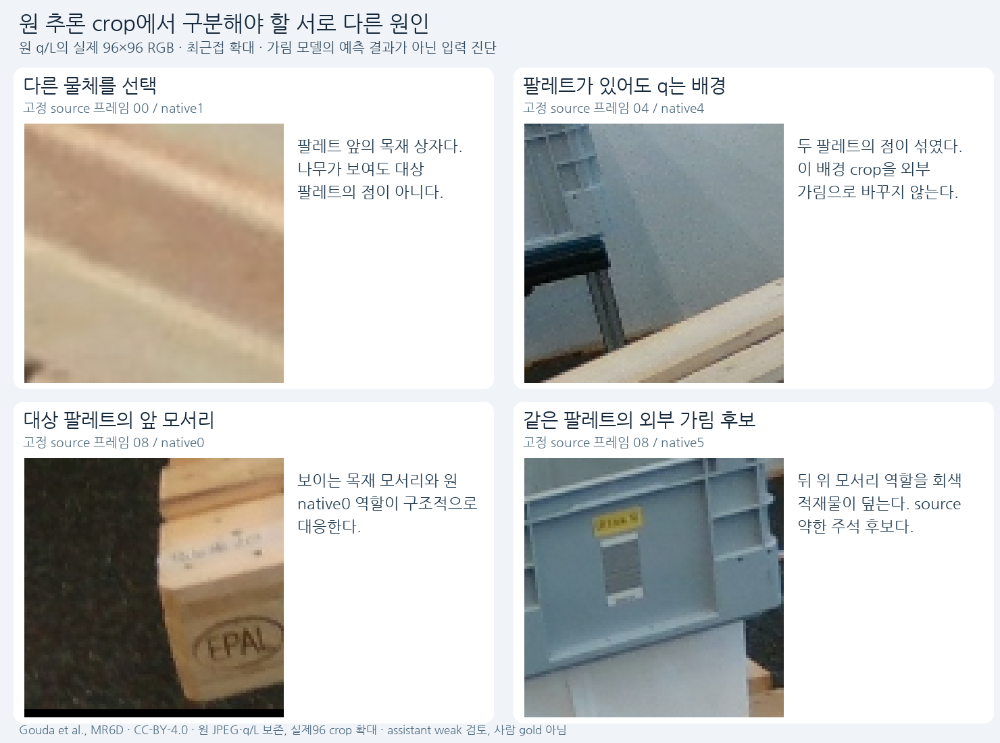
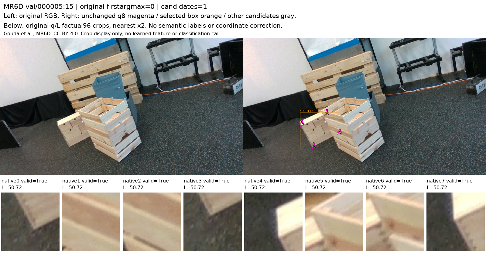
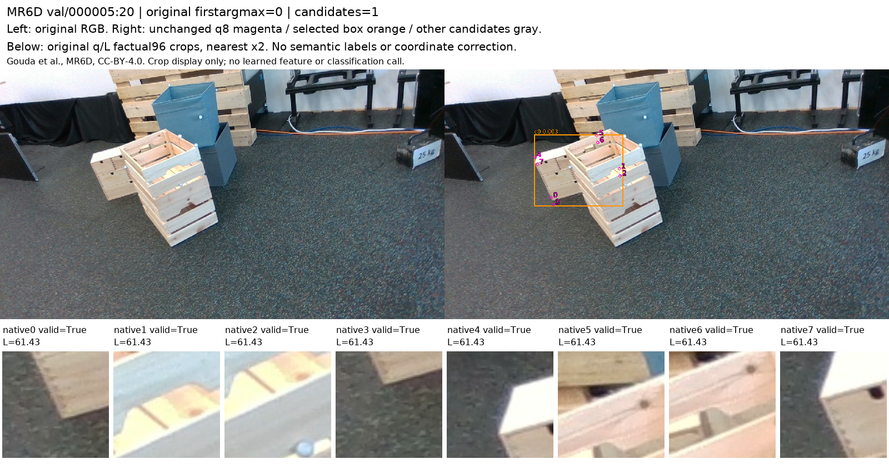
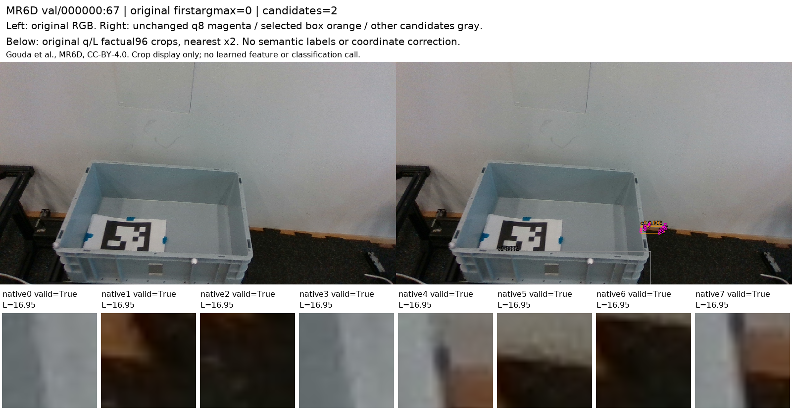

# V152 — query_visibility_mr6d_actual_query_bridge_20261024_v152

기존 보고서에서 추출한 게시용 파생 개요입니다. 원본 파일을 수정하거나 실험·평가를 다시 실행하지 않았습니다. 원문 해시와 링크 대응은 publication manifest로 확인합니다.

**상태:** {"completed":true,"selected_model":null,"goal_status":"active"}

원본:

- [ROOT_PHASE_RESULT.json](ROOT_PHASE_RESULT.json) — SHA256 `1db14d4fbbf2623250240e3ebbde16ad520fbd2f1fdd28ec2cb611ae716a4d5a`
- [ROOT_READOUT_KO.html](ROOT_READOUT_KO.html) — SHA256 `b1835e49202785c1892fb28312619b57d9b9b9dcd543efdd75372be3e707bcbd`
- [ROOT_RESULTS_KO.json](ROOT_RESULTS_KO.json) — SHA256 `827003a09afc84c43aa186bf2cbf170985e80852c151f3359a000053bfe1ac8a`

## 방법·목표의 원문 필드

`$.phase`

```text
V152_ACTUAL_SOURCE_QUERY_AND_NATIVE_ROLE_BRIDGE_COMPLETE
```

`$.full_goal_solved`

```text
false
```


## 입력·학습·평가 분모의 원문 필드

`$.source_training_ready`

```text
false
```

`$.actual_training_updates`

```text
0
```

`$.original_query_rows`

```text
80
```

`$.factual_GT_role_rows`

```text
104
```


## 결론·실패·한계의 원문 필드

`$.conclusion_KO`

```text
새 공개 실사에서 원 R0를 실제 실행했다. 6장은 다른 물체/대상 부재 오검출, 2장은 여러 팔레트의 점이 섞여 개체 대응 불명확, 2장은 팔레트 개체가 지지되지만 native별 위치 품질과 역할 가림을 별도 검토해야 한다. 원80 query와104 GT 참조를 모두 보존했으며, 오검출을 외부 가림 E로 학습하면 안 된다는 직접 근거를 얻었다.
```

`$.limits_KO`

```text
[
  "이 고정10장은 source 준비를 위한 작은 표본이며 초기 모델 정확도나 실제 배포 빈도를 추정하는 표본이 아니다.",
  "104개 source 역할 제안과 원80개 query 라벨은 다르다. 다른 GT 팔레트의 점을 원 q 대신 넣지 않았다.",
  "source D/E/S는 assistant weak 제안이다. 제공 pose/CAD는 센티미터 불확실성이 있어 정확한3px gold가 아니다.",
  "새 공개 자료는 목재 Euro 직사각형이며 정사각형 target의 실사 감독 공백은 남아 있다.",
  "시각 독립 검토는 root의 초안 관측을 전달받은 뒤 실행했으므로 blind adjudication은 아니다."
]
```


## 코드·검증·전체 표·갤러리

아래 목록은 원 보고서가 참조한 파일의 경로를 다시 연결한 것입니다. 이 개요 작성 중 이미지 내용이나 raw 평가 데이터를 새로 검사하지 않았습니다.

- [query_visibility_mr6d_actual_query_bridge_20261024_v152/ROOT_ACTUAL_EXECUTION_RECEIPT.json](ROOT_ACTUAL_EXECUTION_RECEIPT.json)
- [query_visibility_mr6d_actual_query_bridge_20261024_v152/actual_mr6d_initializer_v1/PREDICTION_SEAL.json](actual_mr6d_initializer_v1/PREDICTION_SEAL.json)
- [query_visibility_mr6d_actual_query_bridge_20261024_v152/native_reference_audit/provided_reference_v1/REFERENCE_PROJECTION_COMPLETE.json](native_reference_audit/provided_reference_v1/REFERENCE_PROJECTION_COMPLETE.json)
- [query_visibility_mr6d_actual_query_bridge_20261024_v152/ROOT_PARTIAL_SUPERVISION_ADJUDICATION.json](ROOT_PARTIAL_SUPERVISION_ADJUDICATION.json)
- [query_visibility_mr6d_actual_query_bridge_20261024_v152/independent_partial_supervision_review/REVIEW.json](independent_partial_supervision_review/REVIEW.json)
- [query_visibility_mr6d_actual_query_bridge_20261024_v152/independent_saved_initializer_review/REVIEW.json](independent_saved_initializer_review/REVIEW.json)
- [query_visibility_mr6d_actual_query_bridge_20261024_v152/independent_reference_review/REVIEW.json](independent_reference_review/REVIEW.json)
- [query_visibility_mr6d_actual_query_bridge_20261024_v152/ROOT_RESULTS_KO.json](ROOT_RESULTS_KO.json)
- [query_visibility_mr6d_actual_query_bridge_20261024_v152/ROOT_READOUT_KO.html](ROOT_READOUT_KO.html)
- [query_visibility_mr6d_actual_query_bridge_20261024_v152/ROOT_READOUT_QA.json](ROOT_READOUT_QA.json)
- [query_visibility_mr6d_actual_query_bridge_20261024_v152/ROOT_OPERATIONAL_LABEL_CONTRACT_NEXT_EXPERIMENT.json](ROOT_OPERATIONAL_LABEL_CONTRACT_NEXT_EXPERIMENT.json)
- [query_visibility_mr6d_actual_query_bridge_20261024_v152/native_reference_audit/INDEX.html](native_reference_audit/INDEX.html)
- [query_visibility_mr6d_actual_query_bridge_20261024_v152/root_saved_query_role_diagnosis/ALL80_QUERY_IDENTITY_ROLE_AND_LOCAL_EVIDENCE.jsonl](root_saved_query_role_diagnosis/ALL80_QUERY_IDENTITY_ROLE_AND_LOCAL_EVIDENCE.jsonl)
- [query_visibility_mr6d_actual_query_bridge_20261024_v152/native_reference_audit/selected_query_role_review/REVIEW_COMPLETE.json](native_reference_audit/selected_query_role_review/REVIEW_COMPLETE.json)
- [query_visibility_mr6d_actual_query_bridge_20261024_v152/ROOT_PARTIAL_WEAK_SUPERVISION_ALL80.jsonl](ROOT_PARTIAL_WEAK_SUPERVISION_ALL80.jsonl)
- [query_visibility_mr6d_actual_query_bridge_20261024_v152/independent_bridge_review/REVIEW.json](independent_bridge_review/REVIEW.json)
- [query_visibility_mr6d_actual_query_bridge_20261024_v152/independent_saved_initializer_review/SELECTED_ENTITY_VISUAL_REVIEW_COMPLETE.json](independent_saved_initializer_review/SELECTED_ENTITY_VISUAL_REVIEW_COMPLETE.json)
- [query_visibility_mr6d_actual_query_bridge_20261024_v152/native_reference_audit/SOURCE104_PROPOSAL_SUMMARY_KO.json](native_reference_audit/SOURCE104_PROPOSAL_SUMMARY_KO.json)
- [query_visibility_mr6d_actual_query_bridge_20261024_v152/root_saved_query_role_diagnosis/RESULTS.json](root_saved_query_role_diagnosis/RESULTS.json)
- [query_visibility_mr6d_actual_query_bridge_20261024_v152/original_query_evidence/EVIDENCE_RENDER_COMPLETE.json](original_query_evidence/EVIDENCE_RENDER_COMPLETE.json)

## 원 보고서의 그림

원 보고서 참조 순서의 처음 최대4개를 표시합니다. 새 outcome 선택이나 전수 이미지 검증을 뜻하지 않습니다. 전체 갤러리는 위 원문 링크에서 확인합니다.

[query_visibility_mr6d_actual_query_bridge_20261024_v152/QUERY_FAILURE_CAUSES_KO.png](QUERY_FAILURE_CAUSES_KO.png)



[query_visibility_mr6d_actual_query_bridge_20261024_v152/original_query_evidence/FRAME_00_ORIGINAL_Q_AND_CROPS.png](original_query_evidence/FRAME_00_ORIGINAL_Q_AND_CROPS.png)



[query_visibility_mr6d_actual_query_bridge_20261024_v152/original_query_evidence/FRAME_01_ORIGINAL_Q_AND_CROPS.png](original_query_evidence/FRAME_01_ORIGINAL_Q_AND_CROPS.png)



[query_visibility_mr6d_actual_query_bridge_20261024_v152/original_query_evidence/FRAME_02_ORIGINAL_Q_AND_CROPS.png](original_query_evidence/FRAME_02_ORIGINAL_Q_AND_CROPS.png)




현재 사용자 목표 전체의 해결·새 모델 채택·실사 가림 원인 확정을 이 파생 개요가 추가로 주장하지 않습니다. UNKNOWN/U와 불리한 결과, 실패 실행 및 수정 provenance는 원문대로 보존해야 합니다.
